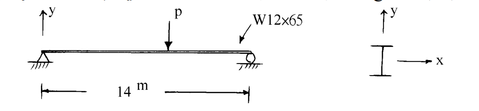

# SS-2002-2 題目正本

> 本檔只記錄**考卷上寫了什麼、圖上畫了什麼**，不含任何解法。解析見同資料夾 `SS-2002-2.md`。
> 判讀清單經使用者確認前，狀態為「待確認」；確認後本檔原則上不再修改（改動須回考卷原圖並記 log）。

| 項目 | 內容 |
|------|------|
| 考卷 | `raw/exams/SS-2002_鋼結構設計.pdf` 第 1 頁（全一張之正面），第二題 |
| 考年 | 民國 91 年（2002） |
| 配分 | 25 分 |
| 附圖 | 1 張（簡支梁與斷面座標），`SS-2002-2-fig-1.png` |
| 判讀狀態 | **待確認**（轉錄 2026-11-02，PyMuPDF 110 dpi 全頁＋附圖 300 dpi 局部目視，盲讀後才比對既有解析） |

## 1. 考卷原文（逐字）

> 二、如圖所示之 A36 簡支梁，斷面為 W12×65，長 14m，承受一移動集中載重 P，假設梁兩端及每 1/4 跨距處之弱軸方向均有一側向支撐，考慮自重。依容許應力設計法(ASD)，試計算此容許載重 P。（A36 鋼材之 E＝2100 t/cm², $F_y$＝2.5 t/cm², $F_u$＝4.1 t/cm²；W12×65 為結實斷面，斷面性質如下：A＝119.4 cm², d＝30.3 cm, $t_w$＝1 cm, $b_f$＝30cm, $t_f$＝1.5 cm, $I_x$＝20820 cm⁴, $I_y$＝6797 cm⁴, $S_x$＝1373 cm³, $S_y$＝455 cm³, $r_x$＝13.2 cm, $r_y$＝7.6 cm, $L_c$＝3.87 m, $L_u$＝8.44 m；鋼梁自重為 97 kg/m。）（25 分）

## 2. 考卷給的公式、附表與參數

- 題文：跨長 14 m；A36，$E = 2100$、$F_y = 2.5$、$F_u = 4.1$ t/cm²；W12×65 斷面性質（照錄於 §1）；$L_c = 3.87$ m、$L_u = 8.44$ m；自重 97 kg/m；結實斷面。
- 本題**沒有印 ASD 容許撓曲應力公式**（同頁第三題的公式是柱用）。
- 卷首注意事項：㈠可以使用電子計算器，需詳列解答過程；㈡不必抄題。

## 3. 附圖

*圖面文字照錄：y；p；W12×65；14 m；y；x。*

## 4. 判讀清單

「把握」標**不確定**者請優先確認；解讀類項目（題目用字的意思）另標「解讀」。

| # | 項目 | 判讀 | 圖上／題文依據 | 把握 |
|---|------|------|---------------|------|
| 1 | 支承 | 左端鉸支、右端滾支，簡支 | 附圖（300 dpi） | 確定 |
| 2 | 彎曲軸 | 工字形直立，繞強軸 $x$ 彎曲 | 斷面座標圖 | 確定 |
| 3 | 側撐 | 兩端與每 1/4 跨（3.5、7、10.5 m）處，無支長度 $L_b = 3.5$ m | 題文 | 確定 |
| 4 | 移動載重 | $P$ 位置可變，取最不利位置；圖上 $p$ 畫在跨中附近只是示意 | 題文「移動」 | 確定（解讀） |
| 5 | 自重 | 97 kg/m 全跨均佈，與 $P$ 同時作用 | 題文 | 確定 |
| 6 | 所求 | 依 ASD 求容許 $P$（是否也檢核剪力，題未明示） | 題文 | 不確定（解讀） |

---

*轉錄：2026-11-02（SS-U1-2 題目正本推廣・批 1）*
