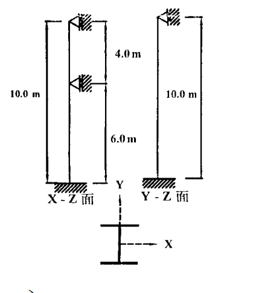
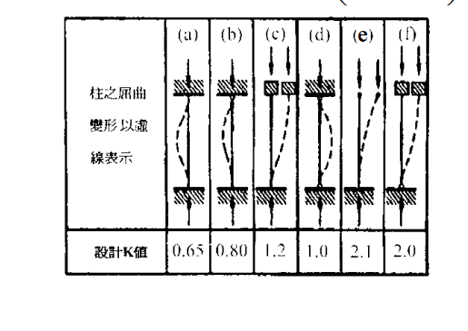

# SS-2002-3 題目正本

> 本檔只記錄**考卷上寫了什麼、圖上畫了什麼**，不含任何解法。解析見同資料夾 `SS-2002-3.md`。
> 判讀清單經使用者確認前，狀態為「待確認」；確認後本檔原則上不再修改（改動須回考卷原圖並記 log）。

| 項目 | 內容 |
|------|------|
| 考卷 | `raw/exams/SS-2002_鋼結構設計.pdf` 第 1（正面） 頁，第三題 |
| 考年 | 民國 91 年（2002） |
| 配分 | 25 分（㈠ 10、㈡ 15） |
| 附圖 | 2 張：柱立面 X-Z／Y-Z 面＋斷面 `SS-2002-3-fig-2.png`；設計 K 值表 `SS-2002-3-fig-1.png` |
| 判讀狀態 | **已確認**（2026-11-02 使用者確認，含「不確定」項之解讀；轉錄同日，PyMuPDF 110 dpi 全頁＋關鍵處 400–500 dpi 局部目視，盲讀後才比對既有解析） |

## 1. 考卷原文（逐字）

> 三、有一受軸向載重之鋼柱長度為 10 m，柱子底部固接於基礎，頂端則為鉸接，中間垂直於弱軸有鉸接側向支撐（如附圖所示），採用 A36 鋼材斷面為 W14×53 型鋼，且為結實斷面。試回答以下問題：
> ㈠根據容許應力設計法，求該柱之容許載重（$P_a$）。（10 分）
> ㈡根據極限設計法，求該柱之設計載重（$P_u$）。（15 分）
>
> W14×53 斷面參數：$A = 100.64\ \text{cm}^2$，$r_x = 14.96$ cm，$r_y = 4.88$ cm
> A36 鋼材：$F_y = 2.50\ \text{t/cm}^2$，$F_u = 4.10\ \text{t/cm}^2$，$E = 2.1\times10^3\ \text{t/cm}^2$
> 參考公式與圖表：

## 2. 考卷給的公式、附表與參數

題內「參考公式與圖表」照錄：

$$F_a = \frac{\left(1 - \dfrac{(KL/r)^2}{2C_c^2}\right)F_y}{\dfrac{5}{3} + \dfrac{3(KL/r)}{8C_c} - \dfrac{(KL/r)^3}{8C_c^3}}\qquad F_a = \frac{12}{23}\frac{\pi^2E}{(KL/r)^2}\qquad C_c = \sqrt{\frac{2\pi^2E}{F_y}}$$

$$F_{cr} = \left[\exp(-0.419\lambda_c^2)\right]F_y\qquad F_{cr} = \left(\frac{0.877}{\lambda_c^2}\right)F_y\qquad \lambda_c = \frac{KL}{r\pi}\sqrt{\frac{F_y}{E}}\qquad \phi = 0.85$$

- 公式未標適用範圍（$KL/r$ 與 $C_c$、$\lambda_c$ 與 1.5 的分界考卷沒寫）。
- 設計 K 值表（柱之屈曲變形以虛線表示）：(a) 0.65、(b) 0.80、(c) 1.2、(d) 1.0、(e) 2.1、(f) 2.0（各欄端部符號見 §3 附圖 2）。
- 考卷**沒給** $F_u$ 以外的用途說明；$F_u$ 本題用不到。

## 3. 附圖

*圖面文字照錄：10.0 m；4.0 m；6.0 m；X - Z 面；10.0 m；Y - Z 面；Y；X。*

*圖面文字照錄：柱之屈曲變形以虛線表示；設計K值 0.65、0.80、1.2、1.0、2.1、2.0。*

## 4. 判讀清單

「把握」標**不確定**者請優先確認；解讀類項目（題目用字的意思）另標「解讀」。

| # | 項目 | 判讀 | 圖上／題文依據 | 把握 |
|---|------|------|---------------|------|
| 1 | 柱長 | 10 m（兩個面皆是） | 題文；兩面尺寸線皆 10.0 m | 確定 |
| 2 | 底部 | 固接 | 題文「底部固接」；兩面底部皆為地面斜線 | 確定 |
| 3 | 頂端 | 鉸接（有側向束制，不可平移） | 題文「頂端則為鉸接」；頂端三角形＋側邊斜線支承 | 確定 |
| 4 | 中間側撐位置 | **距頂 4.0 m、距底 6.0 m**（只在 X-Z 面） | X-Z 面尺寸線：上段 4.0 m、下段 6.0 m（500 dpi） | 確定 |
| 5 | 側撐所在平面與軸 | X-Z 面＝柱在 X 方向側彎＝繞**弱軸 Y** 挫屈；Y-Z 面（繞強軸 X）無中間側撐 | 斷面圖：腹板沿 Y 軸、翼板水平；題文「垂直於弱軸有鉸接側向支撐」（解讀） | 確定 |
| 6 | K 值取用 | 考卷附「設計 K 值」表，作答應取表中設計值（固-鉸 0.80、鉸-鉸 1.0），而非理論值 | 附圖 2（解讀） | 不確定 → 使用者確認 |
| 7 | ㈡「設計載重 $P_u$」 | 設計強度 $\phi_cP_n$（$\phi = 0.85$），不是因數化外力 | 題文＋公式區給 $\phi$（解讀） | 不確定 → 使用者確認 |
| 8 | 公式適用範圍 | 考卷未標 $C_c$、$\lambda_c = 1.5$ 分界，依規範補 | 公式區（解讀） | 確定 |

---

*轉錄：2026-11-02（SS-U1-1 題目正本推廣・批 1）｜確認：2026-11-02 使用者確認*

*修正日期：2026-11-03（頭表與 §3 的證據圖檔名對調更正：柱立面＋斷面為 `fig-2.png`、設計 K 值表為 `fig-1.png`；已回證據圖逐張目視確認。考卷原文、§2 與判讀清單內容不變。使用者同意）*
