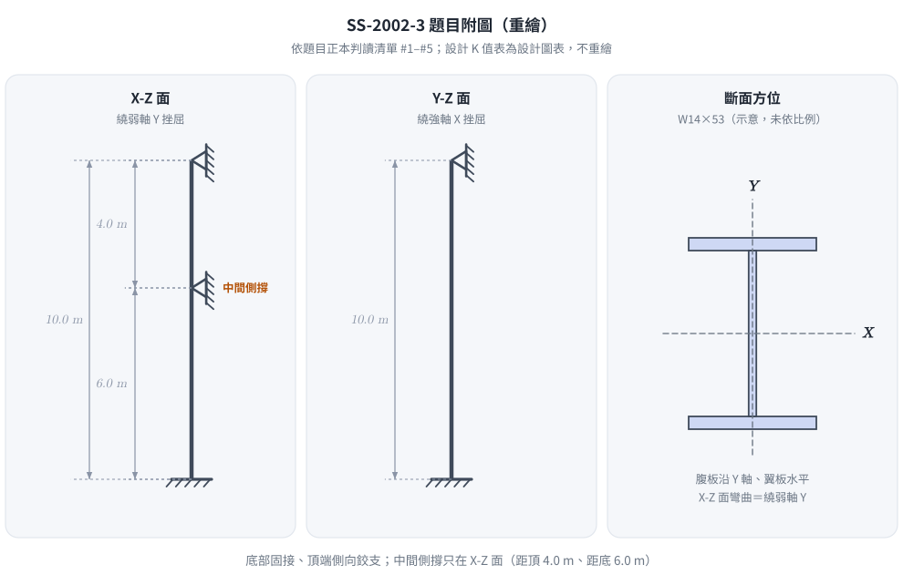
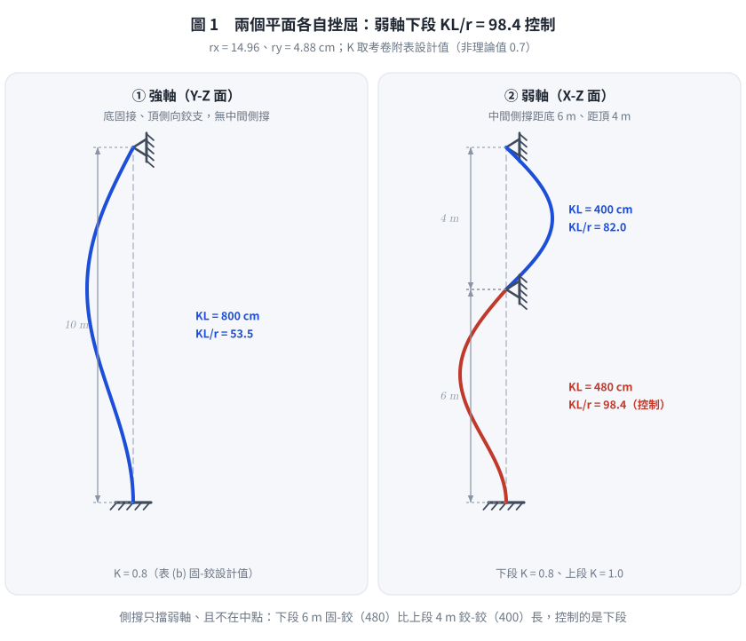
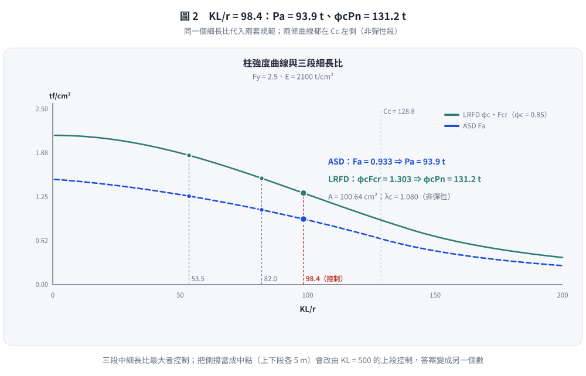

# 考題編號：SS-2002-3

**主分類：** `SS-U1-1` 拉力及壓力桿件
**副分類：**（無）
**設計法：** 混合（ASD + LRFD）
**標籤：** `壓力桿件` `有效長度` `K值` `端部條件` `中間側向支撐` `弱軸挫屈` `強軸挫屈` `ASD` `LRFD` `Cc` `Fa` `λc` `Fcr` `φcPn` `非彈性挫屈` `側撐位置判讀`

---

## 1. 題目（考卷原文見題目正本）

> 考卷原文、公式／附表、附圖與判讀清單（已確認）見 [`SS-2002-3-problem.md`](SS-2002-3-problem.md)。本節只列**解題時最容易讀錯的地方**與本解使用的記號；題意以題目正本為準。

*圖 1　題目附圖重繪（依題目正本判讀清單 #1–#5；設計 K 值表為設計圖表，不重繪）。兩個面並排，中間側撐只出現在 X-Z 面且位置標為距頂 4.0 m、距底 6.0 m，攔下把側撐放到強軸方向或上下段長度顛倒的誤讀。*

### 常見誤讀

| 項目 | 正確判讀 | 常見誤讀 |
|------|---------|---------|
| 中間側撐位置 | 距頂 4.0 m、距底 6.0 m，只在 X-Z 面 | 當成中點 5 m（舊版解析即如此，上段 KL 500 cm 控制） |
| 側撐對應的軸 | X-Z 面＝柱沿 X 側彎＝繞**弱軸** Y；Y-Z 面（強軸）全長 10 m 無側撐 | 把 X-Z 面當成強軸平面 |
| K 值 | 取考卷附表**設計值**：固-鉸 0.80、鉸-鉸 1.0 | 用理論值 0.7 |
| ㈡「設計載重 $P_u$」 | 設計強度 $\phi_cP_n$（$\phi = 0.85$） | 以為要另做載重組合 |

**本解記號：** W14×53：$A = 100.64$ cm²、$r_x = 14.96$、$r_y = 4.88$ cm；$F_y = 2.5$、$E = 2100$ t/cm²；$KL$：強軸 800、弱軸下段 480、弱軸上段 400 cm。

---

## 2. 考題核心精神與出題者意圖 (Core Concepts & Examiner's Intent)

**核心觀念：** 壓力柱要分別檢查強軸與弱軸的有效細長比，取大者控制。中間側撐只對它所約束的那個方向有效；被側撐分開的兩段長度不同、端部條件也不同，要逐段算。

**出題者意圖：**
1. 能從兩個平面的立面圖讀出各方向的支承與側撐位置。
2. 從設計 K 表正確查值（固-鉸 0.80、鉸-鉸 1.0）。
3. 同一柱分別以 ASD 與 LRFD 計算。

---

## 3. 解題戰略地圖與陷阱分析 (Strategic Roadmap & Trap Analysis)

**解題順序：**
$$\text{讀圖：哪個面有側撐、在哪裡} \to \text{逐段 }K \to KL/r\text{（強軸、弱軸上段、弱軸下段）} \to \text{取最大} \to \text{ASD: }F_a,\,P_a \to \text{LRFD: }\lambda_c,\,F_{cr},\,\phi_c P_n$$

**關鍵陷阱：**

1. **側撐不在中點**：X-Z 面立面圖標的是「上 4.0 m、下 6.0 m」。下段較長且是固-鉸（$K = 0.80$），$KL = 480$ cm；上段 4 m 鉸-鉸，$KL = 400$ cm。**下段控制**。若誤當成中點（各 5 m），會得到上段 $KL = 500$ cm 控制，偏保守約 4%。
2. **分清兩個面對應哪一軸**：X-Z 面內的變形是沿 $X$ 方向側移，彎曲軸是 $Y$（弱軸）。題文「中間垂直於弱軸有鉸接側向支撐」與此一致。
3. **K 用設計值**：題目附的是設計 K 表，固-鉸取 0.80，不是理論值 0.70。

---

## 3.5 變數層次分析（Variable Hierarchy Analysis）

> 複習提示：解題後，在每個卡住的知識點「卡關?」欄標記 `⚠`；第二次複習時只看有 `⚠` 的項目。

**最終目標：** 判斷強弱軸端部條件 → 查取 $K$ → 比較 $KL/r$（弱軸下段控制）→ ASD：$\boxed{P_a}$；LRFD：$\boxed{\phi_c P_n}$

### 主要公式（$\boxed{\phantom{x}}$ = 未知，待推導）

$$\frac{K_xL}{r_x} = \frac{0.8 \times 1000}{14.96} = 53.5, \quad \frac{K_yL_{下}}{r_y} = \frac{0.8 \times 600}{4.88} = \boxed{98.4}\text{（控制）}, \quad \frac{K_yL_{上}}{r_y} = \frac{1.0 \times 400}{4.88} = 82.0$$

**ASD：**
$$C_c = \sqrt{\frac{2\pi^2 E}{F_y}} = 128.8, \quad KL/r < C_c \Rightarrow \boxed{F_a} \Rightarrow \boxed{P_a} = F_a A$$

**LRFD：**
$$\lambda_c = \frac{KL}{r\pi}\sqrt{\frac{F_y}{E}} = \boxed{1.080} < 1.5 \Rightarrow F_{cr} = e^{-0.419\lambda_c^2}F_y \Rightarrow \boxed{\phi_c P_n} = 0.85 F_{cr} A$$

### L1：題目直接給定

| 符號 | 數值 | 說明 |
|------|------|------|
| $L$ | 10 m | 柱全長 |
| $A$ | 100.64 cm² | W14×53 |
| $r_x$、$r_y$ | 14.96、4.88 cm | |
| $F_y$、$E$ | 2.50、2100 t/cm² | A36 |
| 底端／頂端 | 固接／鉸接 | 兩個面皆同 |
| 弱軸側撐 | X-Z 面，距底 6.0 m、距頂 4.0 m | 依原圖標註 |

### L2：需知識點推導

**Step 1：K 值**

| 符號 | 公式 / 來源 | 卡關? |
|------|------------|:-----:|
| $K_x$ | Y-Z 面全長 10 m，固-鉸 → 0.80，$KL = 800$ cm | |
| $K_{y,下}$ | X-Z 面下段 6 m，固-鉸（側撐點）→ 0.80，$KL = 480$ cm | ⚠ |
| $K_{y,上}$ | X-Z 面上段 4 m，鉸-鉸 → 1.0，$KL = 400$ cm | |

**Step 2：細長比**

| 符號 | 公式 / 來源 | 卡關? |
|------|------------|:-----:|
| $(KL/r)_x$ | $800/14.96 = 53.5$ | |
| $(KL/r)_{y,下}$ | $480/4.88 = 98.4$（控制） | |
| $(KL/r)_{y,上}$ | $400/4.88 = 82.0$ | |

**Step 3(a)：ASD**

| 符號 | 公式 / 來源 | 卡關? |
|------|------------|:-----:|
| $C_c$ | $128.8$ | |
| $F.S.$ | $5/3 + 3(98.4)/(8 \times 128.8) - 98.4^3/(8 \times 128.8^3) = 1.897$ | |
| $F_a$ | $[1 - 98.4^2/(2 \times 128.8^2)] \times 2.5 / 1.897 = 0.933$ t/cm² | |
| $P_a$ | $0.933 \times 100.64 = 93.9$ t | |

**Step 3(b)：LRFD**

| 符號 | 公式 / 來源 | 卡關? |
|------|------------|:-----:|
| $\lambda_c$ | $(98.4/\pi)\sqrt{2.5/2100} = 1.080$ | |
| $F_{cr}$ | $e^{-0.419 \times 1.080^2} \times 2.5 = 1.533$ t/cm² | |
| $\phi_c P_n$ | $0.85 \times 1.533 \times 100.64 = 131.2$ t | |

### L3：深層知識（不懂就卡住）

| 知識點 | 說明 | 卡關? |
|--------|------|:-----:|
| 立面圖與彎曲軸 | 在 X-Z 面內側移＝繞 $Y$ 軸彎曲；先把「面」換成「軸」再配 $r$ | |
| 側撐分段 | 側撐點視為鉸（可轉不可移），兩段各自判斷端部條件與長度 | |
| ASD $C_c$ | Euler 應力 $= F_y/2$ 時的細長比 | |
| 設計 K 值 | 含固接端的理論值往上調（0.5→0.65、0.7→0.80、2.0→2.1） | |

---

## 4. 步驟化詳細計算過程 (Step-by-Step Detailed Calculation)

### 步驟 1：判斷各方向端部條件並查取 K 值

**強軸（繞 $X$ 軸彎曲，Y-Z 面）：** 全長 10 m，底固接、頂鉸接，無中間側撐 → 表 (b)：

$$K_x = 0.80,\qquad K_xL = 0.80 \times 1000 = 800\ \text{cm}$$

**弱軸（繞 $Y$ 軸彎曲，X-Z 面）：** 側撐位於距底 6.0 m、距頂 4.0 m，分兩段。

| 段 | 長度 | 下端 | 上端 | 表 | $K$ | $KL$ |
|----|:---:|------|------|:---:|:---:|:---:|
| 下段 | 600 cm | 固接（基礎） | 鉸（側撐） | (b) | 0.80 | **480 cm** |
| 上段 | 400 cm | 鉸（側撐） | 鉸（柱頂） | (d) | 1.0 | 400 cm |

弱軸取較大者：$K_yL = 480$ cm（下段控制）。

---

### 步驟 2：細長比

$$\frac{K_xL}{r_x} = \frac{800}{14.96} = 53.5,\qquad \frac{K_yL_{下}}{r_y} = \frac{480}{4.88} = 98.4,\qquad \frac{K_yL_{上}}{r_y} = \frac{400}{4.88} = 82.0$$

$$\boxed{\frac{KL}{r} = 98.4\quad\text{（弱軸下段控制）}}$$

*圖 1　兩個平面各自挫屈：側撐只擋弱軸，且不在中點，下段 6 m 固-鉸的 $KL/r = 98.4$ 控制。這張圖攔的是把側撐也算給強軸、把側撐當成中點，或下段 K 取理論值 0.7。*

---

### 步驟 3（一）ASD — 容許載重 $P_a$

$$C_c = \sqrt{\frac{2\pi^2 \times 2100}{2.5}} = 128.8 > 98.4 \Rightarrow \text{非彈性挫屈}$$

| 項目 | 計算 | 數值 |
|------|------|------|
| $(KL/r)^2/(2C_c^2)$ | $9{,}675/33{,}162$ | $0.2918$ |
| **分子** | $(1 - 0.2918) \times 2.5$ | **$1.771$ t/cm²** |
| $3(KL/r)/(8C_c)$ | $3 \times 98.4/(8 \times 128.8)$ | $0.2864$ |
| $(KL/r)^3/(8C_c^3)$ | $951{,}600/(8 \times 2{,}135{,}000)$ | $0.0557$ |
| **分母 F.S.** | $1.6667 + 0.2864 - 0.0557$ | **$1.897$** |

$$F_a = \frac{1.771}{1.897} = 0.933\ \text{t/cm}^2$$

$$\boxed{P_a = 0.933 \times 100.64 = 93.9\ \text{t}}$$

---

### 步驟 3（二）LRFD — 設計載重 $\phi_cP_n$

$$\lambda_c = \frac{98.4}{\pi}\sqrt{\frac{2.5}{2100}} = 31.31 \times 0.03450 = 1.080 < 1.5\ \Rightarrow\ \text{非彈性}$$

$$F_{cr} = \exp(-0.419 \times 1.080^2) \times 2.5 = \exp(-0.4890) \times 2.5 = 0.6133 \times 2.5 = 1.533\ \text{t/cm}^2$$

$$P_n = 1.533 \times 100.64 = 154.3\ \text{t}$$

$$\boxed{P_u \le \phi_c P_n = 0.85 \times 154.3 = 131.2\ \text{t}}$$

*圖 2　同一個控制細長比 $98.4$ 代入兩套規範：$P_a = 93.9$ t、$\phi_cP_n = 131.2$ t，都在 $C_c$ 左側的非彈性段。這張圖攔的是取錯控制段，或誤用彈性挫屈公式。*

---

### 計算結果總覽

| 方向 | 端部條件 | K | KL (cm) | r (cm) | KL/r |
|------|------|:---:|:---:|:---:|:---:|
| 強軸（Y-Z 面） | 固-鉸，10 m | 0.80 | 800 | 14.96 | 53.5 |
| 弱軸下段（X-Z 面） | 固-鉸，6 m | 0.80 | 480 | 4.88 | **98.4（控制）** |
| 弱軸上段（X-Z 面） | 鉸-鉸，4 m | 1.0 | 400 | 4.88 | 82.0 |

| 設計法 | 結果 |
|--------|------|
| ASD | $P_a = \mathbf{93.9\ t}$ |
| LRFD | $\phi_cP_n = \mathbf{131.2\ t}$ |

**雙路徑驗算：** 以 $\lambda_c$ 與 $C_c$ 的關係 $\lambda_c = \sqrt2\,(KL/r)/C_c = \sqrt2 \times 98.4/128.8 = 1.080$ ✔；三段逐一代入 ASD 公式，$P_a$ 分別為 126.8（強軸）、93.9（弱軸下段）、107.1（弱軸上段）t，最小者 93.9 t 與上相同 ✔。

---

## 5. 關鍵爭議點與進階探討 (Critical Issues & Advanced Discussion)

### 讀錯側撐位置會怎樣

| 判讀 | 控制段 | KL/r | $P_a$ | $\phi_cP_n$ |
|------|------|:---:|:---:|:---:|
| 原圖：距底 6 m（本解） | 下段 固-鉸 | 98.4 | **93.9 t** | **131.2 t** |
| 誤作中點（舊版解析） | 上段 鉸-鉸 5 m | 102.5 | 90.4 t | 125.8 t |

誤判偏保守 4%，但控制段整個換了位置；若換成「距底 4 m」反而會變成上段 6 m 鉸-鉸控制（KL/r = 123），差距就大了。立面圖上的尺寸線一定要讀。

### 為何用 0.80 不用 0.70

考卷附的是**設計** K 值表。基礎與側撐的實際轉動約束都不完全，含固接端的理論值要往上調。

### ASD 與 LRFD 結果比較

$$\frac{\phi_cP_n}{P_a} = \frac{131.2}{93.9} = 1.40$$

ASD 的 $P_a$ 對應工作載重，LRFD 的 $\phi_cP_n$ 對應因數化載重；活載重比例中等時，因數化載重約為工作載重的 1.4 倍，兩者相當。

### 分段的近似性

把側撐點當成鉸、兩段各自查 K，忽略了上下兩段彼此的轉動約束（上段較短，會對下段頂端提供一些轉動約束）。這是考場與設計常用的保守簡化。

---

## 6. 依最新規範（AISC 360-16／-22）對照

| 項目 | 考卷（ASD 1989／LRFD 1993 系） | AISC 360-16／-22 |
|:---|:---|:---|
| 柱強度式 | $F_{cr} = 0.658^{\lambda_c^2}F_y$ 的指數形式 $e^{-0.419\lambda_c^2}F_y$；$\lambda_c > 1.5$ 用 $0.877F_y/\lambda_c^2$ | 以 $F_y/F_e \le 2.25$ 分界（等同 $\lambda_c \le 1.5$），$F_{cr} = 0.658^{F_y/F_e}F_y$ |
| $\phi_c$ | 0.85 | **0.90** |
| 本題 $\phi_cP_n$ | 131.2 t | $0.90 \times 154.3 = 138.9$ t |
| ASD | $F_a$ 拋物線、F.S. 1.67～1.92 | $P_n/\Omega_c$，$\Omega_c = 1.67$：$154.3/1.67 = 92.4$ t |

**觀察：** 新版 ASD 以 LRFD 同一條曲線除以固定 $\Omega_c = 1.67$，本題得 92.4 t，與舊 ASD 的 93.9 t 很接近；LRFD 則因 $\phi_c$ 由 0.85 提高到 0.90 而增加約 6%。台灣現行 99 年版鋼構規範 LRFD 仍採 $\phi_c = 0.85$。

---

*修正日期：2026-11-01（依考卷原圖：X-Z 面側撐位於距底 6.0 m、距頂 4.0 m，原解誤作中點 5 m，且誤把 X-Z 面標為強軸平面；更正為弱軸下段固-鉸控制，$KL/r$ 102.5 → **98.4**，$P_a$ 90.4 → **93.9 t**、$\phi_cP_n$ 125.8 → **131.2 t**；新增雙路徑驗算與 §6 對照）*
*圖解補繪：2026-11-03（向量圖 2 張，腳本 `gen_SS-2002-3.py`，改輸入可原地重跑；SVG 供 wiki／PDF，2× PNG 供 pptx／影片）*
*驗證狀態：unverified*

*修正日期：2026-11-02（§1 全文重述改為指向題目正本 `SS-2002-3-problem.md`（已確認）＋常見誤讀＋本解記號，避免題意兩份不同步；解題內容與答案不變）*

*修正日期：2026-11-03（§1 補入題目附圖重繪 `figs/SS-2002-3-fig-1-problem.svg`（依已確認的題目正本判讀清單，腳本 `gen_SS-2002-3.py`，可重跑）；解題內容與答案不變）*
