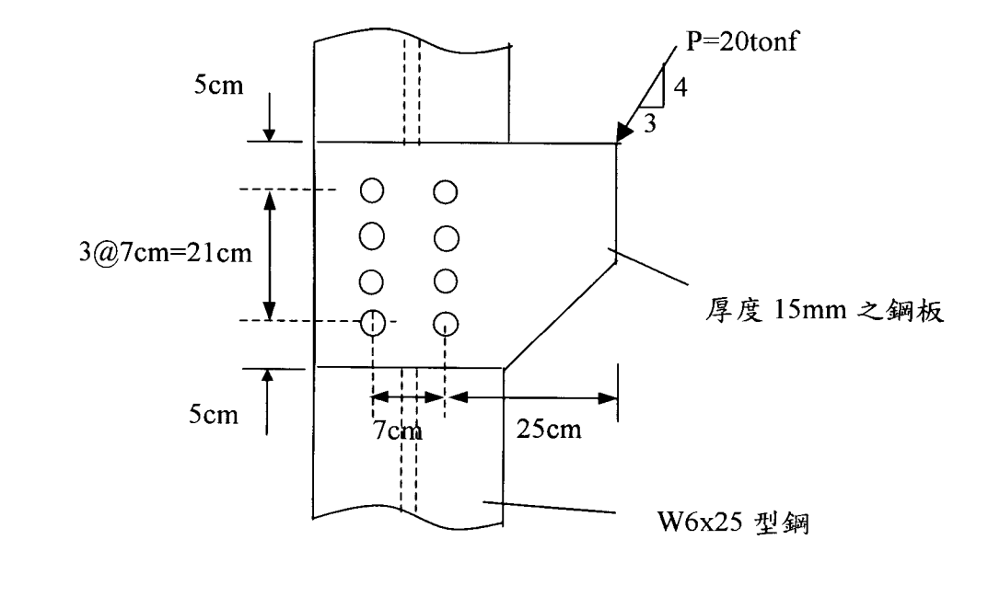

# SS-2002-4 題目正本

> 本檔只記錄**考卷上寫了什麼、圖上畫了什麼**，不含任何解法。解析見同資料夾 `SS-2002-4.md`。
> 判讀清單經使用者確認前，狀態為「待確認」；確認後本檔原則上不再修改（改動須回考卷原圖並記 log）。

| 項目 | 內容 |
|------|------|
| 考卷 | `raw/exams/SS-2002_鋼結構設計.pdf` 第 2 頁（全一張之背面），第四題 |
| 考年 | 民國 91 年（2002） |
| 配分 | 25 分 |
| 附圖 | 1 張（托架板螺栓接合），`SS-2002-4-fig-1.png`；題內附表照錄於 §2 |
| 判讀狀態 | **待確認**（轉錄 2026-11-02，PyMuPDF 110 dpi 全頁＋附圖 400 dpi 局部目視，盲讀後才比對既有解析） |

## 1. 考卷原文（逐字）

> 四、圖示接合受偏心工作荷重 P＝20 tonfs 之作用，螺栓對稱配置於型鋼腹板兩側，其心距 7 cm。假設螺栓採用標稱直徑為 22 mm 之 A325X 承壓型螺栓（標準孔），螺栓孔附近之變形非為設計之考量因素。試根據容許應力設計法(ASD)，以彈性分析法檢核此接合的強度是否足夠？（25 分）

## 2. 考卷給的公式、附表與參數

- 參考資料：鋼板與型鋼 $F_y$＝2.5 ton/cm²，$F_u$＝4.1 ton/cm²；W6×25：d＝16.21 cm，$b_f$＝15.44 cm，$t_w$＝0.813 cm，$t_f$＝1.156 cm；螺栓：斷面積 $A_b$＝3.88 cm²。
- 容許應力表（t/cm²，照錄）：

| 螺栓類別 | 容許張應力 $F_t$ | 摩阻型 標準孔 | 摩阻型 擴大孔及短槽孔 | 摩阻型 長槽孔 載重垂直 | 摩阻型 長槽孔 載重平行 | 承壓式接合 |
|---|---|---|---|---|---|---|
| A325 螺栓、螺紋不在剪力平面 | 3.05 | 1.19 | 1.05 | 0.84 | 0.70 | 2.10 |
| A325 螺栓、螺紋在剪力平面 | 3.05 | 1.19 | 1.05 | 0.84 | 0.70 | 1.45 |
| A490 螺栓、螺紋不在剪力平面 | 3.75 | 1.47 | 1.26 | 1.05 | 0.91 | 2.80 |
| A490 螺栓、螺紋在剪力平面 | 3.75 | 1.47 | 1.26 | 1.05 | 0.91 | 1.95 |

- 容許承壓應力（照錄）：當 L 大於 1.5d 而螺栓孔中心距離大於 3d 時，且作用力線上有二個（含）以上之螺栓時，$F_p$＝1.2$F_u$ (1a)；在長槽孔且其方向與載重垂直：$F_p$＝1.0$F_u$ (1b)；對於最靠邊緣且在作用線上邊距小於 1.5d 之螺栓，或接合不包括在公式(1a)和(1b)範圍內者，$F_p$＝$LF_u/2d$≦1.2$F_u$ (1c)。其中 d＝標稱螺栓直徑，cm；L＝作用力線上，標準孔或擴大孔或槽孔端半圓中心至接合物邊緣之距離，cm。
- 卷首注意事項：㈠可以使用電子計算器，需詳列解答過程；㈡不必抄題。

## 3. 附圖

*圖面文字照錄：P=20tonf；4；3；5cm；3@7cm=21cm；5cm；7cm；25cm；厚度 15mm 之鋼板；W6x25 型鋼。*

## 4. 判讀清單

「把握」標**不確定**者請優先確認；解讀類項目（題目用字的意思）另標「解讀」。

| # | 項目 | 判讀 | 圖上／題文依據 | 把握 |
|---|------|------|---------------|------|
| 1 | 接合面 | 鋼板接於 W6×25 **翼板**（翼板面向讀者，虛線為腹板），單剪 | 附圖 400 dpi＋題文「對稱配置於型鋼腹板兩側」 | 確定 |
| 2 | 螺栓配置 | 2 行 × 4 列 = 8 顆；行距 7 cm、列距 7 cm | 附圖 | 確定 |
| 3 | 25 cm | 右側螺栓行至鋼板右緣（P 作用點的水平位置） | 尺寸線端點 | 確定 |
| 4 | 5 cm | 鋼板上、下緣至最外列螺栓 | 尺寸線 | 確定 |
| 5 | P 作用點與方向 | 鋼板右上角；向左下，垂直 4：水平 3 | 箭頭與斜率三角形 | 確定 |
| 6 | A325X | 螺紋不在剪力平面 → 承壓式 $F_v = 2.10$ | 「X」標記慣例＋附表 | 確定（解讀） |
| 7 | 承壓厚度 | 鋼板 15 mm 與翼板 11.56 mm 取薄者 | 題文 | 確定（解讀） |
| 8 | 承壓公式 | 依螺栓位置與邊距選 (1a) 或 (1c)；最靠邊緣螺栓的 L 隨合力方向而定 | 附表條文 | 不確定（解讀） |

---

*轉錄：2026-11-02（SS-U1-4 題目正本推廣・批 1）*
