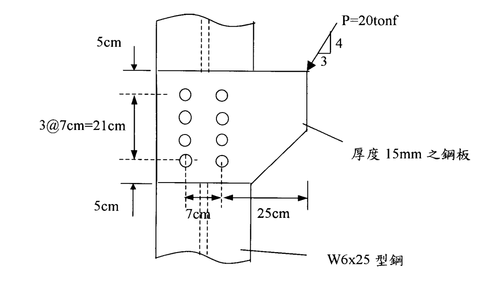
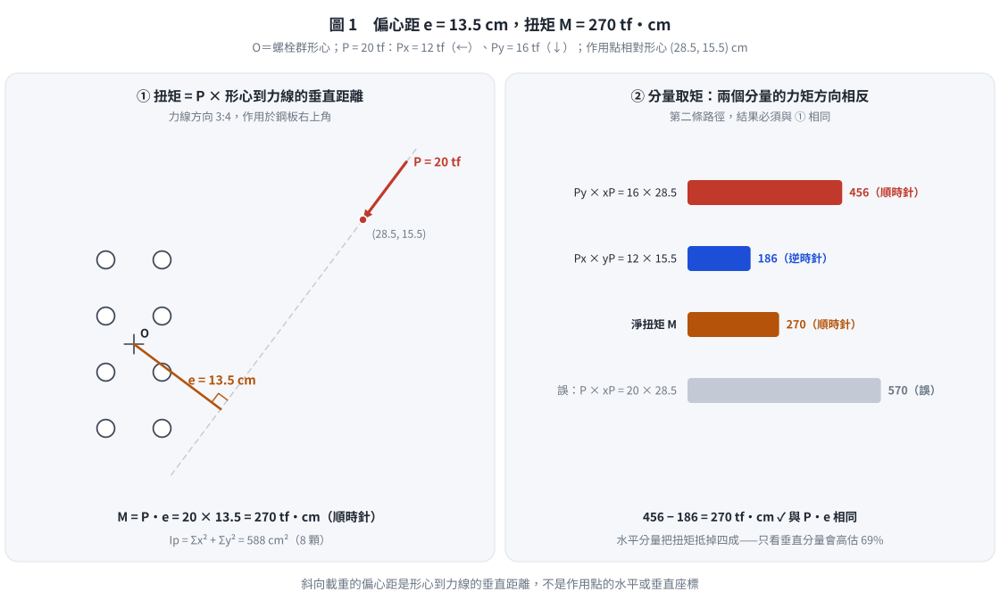
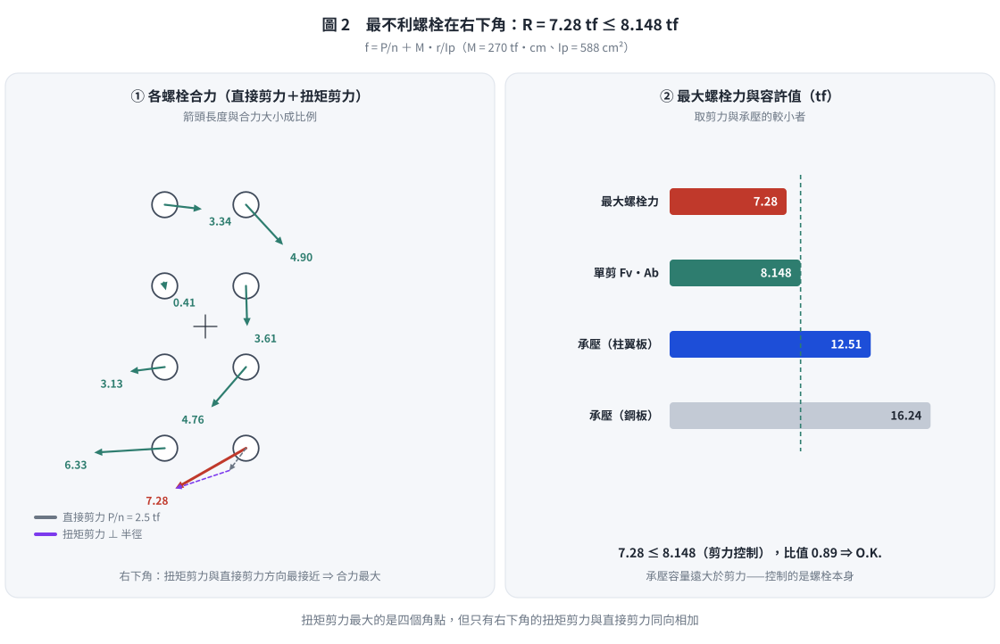

# 考題編號：SS-2002-4

**主分類：** `SS-U1-4` 接合之分析與設計
**副分類：**（無）
**設計法：** ASD
**標籤：** `接合設計` `偏心螺栓群` `彈性分析法` `承壓型螺栓` `A325X` `容許剪應力` `容許承壓應力` `向量疊加` `扭矩極慣性矩` `斜向載重`

---

## 1. 原始題目重述 (Problem Restatement)

> 四、圖示接合受偏心工作荷重 P＝20 tonfs 之作用，螺栓對稱配置於型鋼腹板兩側，其心距 7 cm。假設螺栓採用標稱直徑為 22 mm 之 A325X 承壓型螺栓（標準孔），螺栓孔附近之變形非為設計之考量因素。試根據容許應力設計法(ASD)，以彈性分析法檢核此接合的強度是否足夠？（25 分）
>
> 參考資料：鋼板與型鋼 $F_y = 2.5\ \text{ton/cm}^2$，$F_u = 4.1\ \text{ton/cm}^2$；W6×25：$d = 16.21$ cm，$b_f = 15.44$ cm，$t_w = 0.813$ cm，$t_f = 1.156$ cm；螺栓斷面積 $A_b = 3.88\ \text{cm}^2$。附容許應力表（A325 螺紋不在剪力平面、承壓式接合 $F_v = 2.10\ \text{t/cm}^2$）與容許承壓應力 (1a) $F_p = 1.2F_u$、(1b) $F_p = 1.0F_u$、(1c) $F_p = LF_u/2d \le 1.2F_u$。

*圖說（依考卷原圖 300 dpi 目視判讀）：W6×25 翼板面向讀者，兩條虛線為腹板；厚 15 mm 托架鋼板以 2 行 × 4 列＝8 顆螺栓接於**翼板**，兩行螺栓分居腹板兩側、行距 7 cm（各距腹板中心 3.5 cm），列距 3@7 cm＝21 cm，鋼板上、下緣距最外列螺栓各 5 cm。P＝20 tonf 作用於鋼板**右上角**，方向**向左下、斜率垂直 4：水平 3**；「25 cm」量自右行螺栓線至鋼板右緣（載重作用點）。*

| 項目 | 數值 |
|------|------|
| 載重分量 | $P_x = \tfrac35 \times 20 = 12$ tf（←），$P_y = \tfrac45 \times 20 = 16$ tf（↓） |
| 作用點（相對螺栓群形心）| $x = 25 + 3.5 = 28.5$ cm，$y = 10.5 + 5 = 15.5$ cm |
| 剪力面 | 鋼板－柱翼板，單剪 |
| 承壓厚度 | $\min(t_p = 1.5,\ t_f = 1.156) = 1.156$ cm |

**求：** 以 ASD 彈性分析法檢核接合強度（螺栓剪力、承壓）。

---

## 2. 考題核心精神與出題者意圖 (Core Concepts & Examiner's Intent)

**核心觀念：** 偏心螺栓群的彈性向量法——直接剪力 $P/n$ 與扭矩剪力 $M r/I_p$ 的向量疊加。本題的載重是**斜向力**，扭矩必須用兩個分量分別對形心取矩（或以力線到形心的垂直距離乘 $P$），兩個分量的力矩**方向相反、部分抵銷**。

**出題者意圖：**
1. 能否從圖上讀出載重方向（3-4-5 三角形）與作用點位置，並把 25 cm 換算成到**形心**的距離；
2. 斜向力的直接剪力有水平、垂直兩個分量，最危險螺栓要逐顆向量疊加判斷；
3. 承壓應力依邊距與間距選用 (1a)，並取較薄的柱翼板控制。

---

## 3. 解題戰略地圖與陷阱分析 (Strategic Roadmap & Trap Analysis)

**解題順序：**
$$\text{讀圖（方向、作用點）} \to I_p = \Sigma r^2 \to M = x P_y - y P_x \to \text{各螺栓向量合力} \to R_v、R_p \to \text{檢核}$$

**關鍵陷阱：**

1. **載重方向**：圖上 P 旁有「4、3」斜率三角形，是斜向力。當成垂直力會把扭矩高估（$20 \times 25 = 500$ vs 實際 270 tf·cm），結論由 OK 變成 N.G.
2. **偏心距量到形心**：25 cm 是右行螺栓到作用點，到形心還要加 3.5 cm；作用點在鋼板上緣，比形心高 15.5 cm，水平分量也產生力矩。
3. **兩分量力矩反向**：$P_y$ 在形心右側 → 順時針；$P_x$（向左）在形心上方 → 逆時針。
4. **螺栓穿過翼板**：兩行螺栓在腹板兩側，穿過的是柱**翼板**（$t_f = 1.156$ cm），不是腹板。
5. **最危險螺栓**：斜向直接剪力 $(−1.5, −2.0)$ 與順時針扭矩剪力在**右下角**同向疊加。

---

## 3.5 變數層次分析（Variable Hierarchy Analysis）

> 依考卷原卷重建（2026-11-01 勘誤）。

### 主要公式（$\boxed{\phantom{x}}$ = 未知，待推導）

$$\boxed{I_p} = \Sigma x^2 + \Sigma y^2,\qquad \boxed{M} = x_P P_y - y_P P_x$$

$$\boxed{f_x} = \frac{P_x}{n} - \frac{M\,y}{I_p},\quad \boxed{f_y} = \frac{P_y}{n} + \frac{M\,x}{I_p},\quad \boxed{R} = \sqrt{f_x^2 + f_y^2} \le \min(R_v,\ R_p)$$

### L1：題目直接給定

| 變數 | 值 | 來源 |
|------|----|------|
| $P$ | 20 tf，斜率 4:3 向左下 | 附圖 |
| 螺栓配置 | 2 行 × 4 列，行距 7、列距 7 cm | 附圖、題文 |
| 25 cm、5 cm | 右行螺栓至作用點；外列螺栓至板緣 | 附圖 |
| $d$、$A_b$ | 2.2 cm、3.88 cm² | 題文 |
| $F_v$ | 2.10 t/cm²（A325X 承壓式） | 附表 |
| $F_u$、$t_f$、$t_p$ | 4.1 t/cm²、1.156 cm、1.5 cm | 參考資料、附圖 |

### L2：需知識點推導

| 變數 | 推導 | 值 |
|------|------|----|
| $P_x$、$P_y$ | $20 \times 3/5$、$20 \times 4/5$ | 12、16 tf |
| 作用點 $(x_P, y_P)$ | $(25 + 3.5,\ 10.5 + 5)$ | (28.5, 15.5) cm |
| $I_p$ | $8(3.5^2) + 4(3.5^2 + 10.5^2)$ | 588 cm² |
| $M$ | $28.5(−16) − 15.5(−12)$ | −270 tf·cm（順時針） |
| $R_v$ | $F_v A_b$ | 8.148 tf |
| $F_p$ | 間距 7 > 3d、邊距 5 > 1.5d → (1a) | 4.92 t/cm² |

### L3：深層知識（不懂就卡住）

| 知識點 | 說明 |
|--------|------|
| 斜向力的扭矩 | 分量各自對形心取矩再相加（含正負號），或 $P \times$ 力線至形心垂直距離 |
| 螺栓穿過哪一塊板 | 兩行螺栓對稱於腹板 → 穿過翼板，承壓取 $\min(t_f, t_p)$ |
| 承壓應力選式 | 邊距、間距皆符合 → $1.2F_u$ |

---

## 4. 步驟化詳細計算過程 (Step-by-Step Detailed Calculation)

### 步驟 1：螺栓群幾何

形心取兩行中線與四列中點，各螺栓 $x = \pm 3.5$、$y = \pm 3.5, \pm 10.5$ cm：

$$\Sigma x^2 = 8 \times 3.5^2 = 98.0,\qquad \Sigma y^2 = 4 \times (3.5^2 + 10.5^2) = 490.0$$

$$\boxed{I_p = 98.0 + 490.0 = 588.0\ \text{cm}^2}$$

### 步驟 2：載重分量與作用點

$$P_x = 20 \times \tfrac35 = 12\ \text{tf}\ (\leftarrow),\qquad P_y = 20 \times \tfrac45 = 16\ \text{tf}\ (\downarrow)$$

作用點（鋼板右上角）相對形心：$x_P = 25 + 3.5 = 28.5$ cm，$y_P = 10.5 + 5 = 15.5$ cm。

### 步驟 3：扭矩（兩條路徑）

**路徑一（分量取矩）：**

$$M = x_P P_y - y_P P_x = 28.5(-16) - 15.5(-12) = -456 + 186 = \boxed{-270\ \text{tf}\cdot\text{cm}}\ \text{（順時針）}$$

**路徑二（力線垂直距離）：** 力線過 $(28.5, 15.5)$、方向 $(-0.6, -0.8)$，形心至力線距離

$$e = |28.5(-0.8) - 15.5(-0.6)| = |-22.8 + 9.3| = 13.5\ \text{cm} \Rightarrow M = 20 \times 13.5 = 270\ \text{tf}\cdot\text{cm}\ \checkmark$$

*圖 1　扭矩取形心到力線的垂直距離 $e = 13.5$ cm，$M = 270$ tf·cm；分量取矩是第二條路徑，兩者必須相同。這張圖攔的是拿作用點座標當力臂（$P \times 28.5 = 570$），或只算垂直分量的力矩。*

### 步驟 4：各螺栓合力

直接剪力：$(P_x/8,\ P_y/8) = (-1.5,\ -2.0)$ tf

扭矩剪力：$f_{Tx} = -M y/I_p$，$f_{Ty} = M x/I_p$（$M = -270$）

| 螺栓 $(x, y)$ | $f_x$ (tf) | $f_y$ (tf) | $R$ (tf) |
|:---:|---:|---:|---:|
| (+3.5, +10.5) | 3.321 | −3.607 | 4.90 |
| (+3.5, +3.5) | 0.107 | −3.607 | 3.61 |
| (+3.5, −3.5) | −3.107 | −3.607 | 4.76 |
| **(+3.5, −10.5)** | **−6.321** | **−3.607** | **7.28** |
| (−3.5, +10.5) | 3.321 | −0.393 | 3.34 |
| (−3.5, +3.5) | 0.107 | −0.393 | 0.41 |
| (−3.5, −3.5) | −3.107 | −0.393 | 3.13 |
| (−3.5, −10.5) | −6.321 | −0.393 | 6.33 |

**驗算（極座標）：** 右下角 $r = \sqrt{3.5^2 + 10.5^2} = 11.07$ cm，扭矩剪力 $270 \times 11.07/588 = 5.08$ tf，方向垂直於半徑 → $(-4.821, -1.607)$；與直接剪力相加 $(-6.321, -3.607)$，$R = 7.28$ tf ✓

$$\boxed{R_{max} = 7.28\ \text{tf}\ \text{（右下角螺栓）}}$$

### 步驟 5：容許螺栓力

**剪力（單剪，A325X 承壓式）：**

$$R_v = F_v A_b = 2.10 \times 3.88 = 8.148\ \text{tf}$$

**承壓：** 列距 7 cm $> 3d = 6.6$ cm、邊距 5 cm $> 1.5d = 3.3$ cm，柱翼板側邊距 $15.44/2 - 3.5 = 4.22$ cm $> 3.3$ cm → 採 (1a) $F_p = 1.2F_u = 4.92\ \text{t/cm}^2$

| 元件 | 厚度 | $R_p = F_p\,d\,t$ |
|------|------|------|
| 柱翼板 | 1.156 cm | 12.51 tf |
| 鋼板 | 1.5 cm | 16.24 tf |

$$R_{allow} = \min(8.148,\ 12.51) = \boxed{8.148\ \text{tf（剪力控制）}}$$

### 步驟 6：檢核

$$R_{max} = 7.28\ \text{tf} \le R_{allow} = 8.148\ \text{tf}\quad(\text{比值 } 0.89)$$

$$\boxed{\text{接合強度足夠（O.K.）}}$$

*圖 2　各螺栓合力向量與容許值。四個角點的扭矩剪力一樣大，只有右下角與直接剪力同向相加；這張圖攔的是選錯臨界螺栓，以及誤以承壓為控制（實為單剪 8.148 tf）。*

---

## 5. 關鍵爭議點與進階探討 (Critical Issues & Advanced Discussion)

### Q：若把 P 當成垂直力會怎樣？

$M = 20 \times 28.5 = 570$ tf·cm（量到形心），最大螺栓力 11.76 tf > 8.15 tf，判定 N.G.；若再把 25 cm 當成到形心的距離，得 10.47 tf，仍 N.G.。本題的斜向力讓兩個分量的力矩部分抵銷（$-456 + 186$），這是「O.K.」的關鍵，讀圖錯會直接翻轉結論。

### Q：作用點高度的敏感度

若作用點取在最上列螺栓高度（$y_P = 10.5$），$M = -456 + 126 = -330$ tf·cm，最大螺栓力 8.39 tf，略大於 8.15 tf（超 3%）。可見結論對作用點位置敏感，讀圖要確實。圖上「5cm」以外側箭頭標在鋼板上緣與最上列螺栓之間，作用點在鋼板角點，故取 $y_P = 15.5$ cm。

### Q：彈性法與即時中心法

彈性法假設接合板繞形心剛體旋轉、螺栓力與距離成正比，忽略螺栓非線性變形，結果偏保守。即時中心法（AISC 表格係數 $C$）考慮螺栓的荷重－變形曲線，容量通常高 20%–40%。本題指定彈性法。

### Q：鋼板本身

題目只問接合強度，鋼板之淨斷面、塊狀剪力與托架彎矩未要求，未列入。

---

## 6. 依最新規範（AISC 360-16／-22）對照

| 項目 | 考卷（ASD 1989 系） | AISC 360-16／-22（ASD，Ω = 2.00） |
|:---|:---|:---|
| 螺栓剪力 | $F_v = 2.10$ t/cm²（A325X 承壓式） | $F_{nv} = 469$ MPa（Group A，螺紋排除），$R_n/\Omega = 4.78 \times 3.88/2 = 9.28$ tf |
| 承壓 | $1.2F_u\,d\,t$ | $2.4dtF_u/\Omega = 12.51$ tf；撕裂 $1.2l_ctF_u/\Omega$（$l_c = 5 - 1.2 = 3.8$ cm）$= 10.81$ tf |
| 偏心分析 | 彈性法 | 彈性法或即時中心法皆可 |

**本題以 360-16 估算：** 容許值 $\min(9.28,\ 10.81) = 9.28$ tf ≥ 7.28 tf，O.K.（比值 0.78）。新版剪力強度較高，結論不變。

---

*修正日期：2026-11-01（依考卷原圖：P 旁斜率三角形為垂直 4：水平 3，原解誤作垂直力；25 cm 量自右行螺栓，原解誤作偏心距（到形心為 28.5 cm），並漏計作用點在鋼板上緣之水平分量力矩。更正 $M$ 由 500 為 270 tf·cm（兩分量反向抵銷），最大螺栓力 10.47 → **7.28 tf** ≤ 8.148 tf，結論由 N.G. 改為 **O.K.**；另更正螺栓穿過柱翼板（$t_f = 1.156$ cm），承壓 $R_p$ 8.795 → 12.51 tf。新增力線垂直距離與極座標雙路徑驗算、§6 對照）*
*圖解補繪：2026-11-03（向量圖 2 張，腳本 `gen_SS-2002-4.py`，改輸入可原地重跑；SVG 供 wiki／PDF，2× PNG 供 pptx／影片）*
*驗證狀態：unverified*
