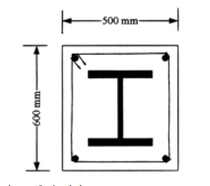

# SS-2003-2 題目正本

> 本檔只記錄**考卷上寫了什麼、圖上畫了什麼**，不含任何解法。解析見同資料夾 `SS-2003-2.md`。
> 判讀清單經使用者確認前，狀態為「待確認」；確認後本檔原則上不再修改（改動須回考卷原圖並記 log）。

| 項目 | 內容 |
|------|------|
| 考卷 | `raw/exams/SS-2003_鋼結構設計.pdf` 第 1（正面） 頁，第二題 |
| 考年 | 民國 92 年（2003） |
| 配分 | 25 分 |
| 附圖 | 1 張（合成柱斷面），`SS-2003-2-fig-1.png` |
| 判讀狀態 | **已確認**（2026-11-02 使用者確認，含「不確定」項之解讀；轉錄同日，PyMuPDF 110 dpi 全頁＋關鍵處 400–500 dpi 局部目視，盲讀後才比對既有解析） |

## 1. 考卷原文（逐字）

> 二、下圖所示為一合成受壓構材之斷面，使用 A572 Gr. 50 之 H312×303×13×21 型鋼斷面，SD 420 之 D32 鋼筋（斷面積為 8.14 cm²）以及抗壓強度 $f'_c = 280\ \text{kg/cm}^2$ 之混凝土。該受壓構材在與腹板平行以及垂直之平面上，其長度皆為 15 m、有效長度係數皆為 0.8。以極限設計法求該受壓構材的設計強度。已知鋼骨降伏強度為 3.5 t/cm²，鋼筋降伏強度為 4.2 t/cm²，鋼材彈性係數為 2100 t/cm²，混凝土彈性係數為 250 t/cm²。
> H312×303×13×21：$A = 165\ \text{cm}^2$；$r_x = 13.4$ cm；$r_y = 7.7$ cm。（25 分）

## 2. 考卷給的公式、附表與參數

題內「設計強度」說明照錄：

> 設計強度：承受軸力之合成柱，其設計強度為 $\phi_cP_n$，其中 $\phi_c = 0.85$，$P_n$ 為標稱軸向強度，$P_n$ 可由公式⑴至⑷經過下述之修正、計算而得。
> 1. $A_s$：型鋼或鋼管（圓形、矩形）之全斷面積，cm²（代替 $A_g$）。
>    $r_m$：型鋼或鋼管（圓形、矩形）之迴轉半徑，對型鋼而言，此值不應小於合成斷面沿著挫屈平面之全厚度之百分之三十，cm（代替 $r$）。
> 2. 降伏強度及斷面模數依下列二式修正為 $F_{my}$ 及 $E_m$。
>    $F_{my} = F_y + C_1F_{yr}(A_r/A_s) + C_2f'_c(A_c/A_s)$　　$E_m = E + C_3E_c(A_c/A_s)$
>    其中 $A_c$＝混凝土面積，$A_r$＝縱向鋼筋之面積，$A_s$＝鋼骨之斷面積，$E$＝鋼骨之彈性模數，$E_c$＝混凝土之彈性模數，$F_y$＝型鋼或鋼管（圓形或矩型）之標稱降伏強度，$F_{yr}$＝縱向鋼筋之標稱降伏強度，$f'_c$＝混凝土之抗壓強度，$C_1$、$C_2$、$C_3$ 為係數。對於中空部分澆注混凝土之鋼管（圓形、矩形）：$C_1 = 1.0$、$C_2 = 0.85$、$C_3 = 0.4$，對於混凝土包覆之型鋼：$C_1 = 0.7$、$C_2 = 0.6$、$C_3 = 0.2$
>
> 設計受壓強度：若受壓斷面肢材之寬厚比滿足半結實斷面者，其設計強度為 $\phi_cP_n$。
> 其中 $\phi_c = 0.85$　$P_n = A_gF_{cr}$ ⋯⋯⑴
> 當 $\lambda_c \le 1.5$　$F_{cr} = [\exp(-0.419\lambda_c^2)]F_y$ ⋯⋯⑵
> 當 $\lambda_c > 1.5$　$F_{cr} = \left[\dfrac{0.877}{\lambda_c^2}\right]F_y$ ⋯⋯⑶
> 其中 $\lambda_c = \dfrac{kL}{\pi r}\sqrt{\dfrac{F_y}{E}}$ ⋯⋯⑷
> $A_g$＝構材之全斷面積，cm²　$F_y$＝標稱降伏應力，t/cm²　$E$＝彈性模數，t/cm²　$k$＝有效長度係數
> $L$＝構材之無側撐長度，cm　$r$＝對挫屈平面之最小迴轉半徑，cm。

- 考卷**沒給**鋼筋根數（由圖數）、混凝土面積（須自算）、鋼筋是否扣除於 $A_c$。
- $f'_c$ 單位為 kg/cm²，其餘為 t/cm²（單位混用為考卷原樣）。

## 3. 附圖

*圖面文字照錄：500 mm；600 mm。*

## 4. 判讀清單

「把握」標**不確定**者請優先確認；解讀類項目（題目用字的意思）另標「解讀」。

| # | 項目 | 判讀 | 圖上／題文依據 | 把握 |
|---|------|------|---------------|------|
| 1 | 混凝土斷面 | 寬 500 mm（水平）× 高 600 mm（垂直） | 上方尺寸線 500 mm、左側尺寸線 600 mm（500 dpi） | 確定 |
| 2 | 型鋼方向 | 翼板水平、腹板垂直，置中 | 斷面圖 | 確定 |
| 3 | 強軸／弱軸對應的全厚度 | 繞強軸（水平軸 x）挫屈 → 沿 600 mm 方向；繞弱軸（垂直軸 y）挫屈 → 沿 500 mm 方向 | 斷面圖＋$r_m$ 規定「沿著挫屈平面之全厚度」（解讀） | 不確定 → 使用者確認 |
| 4 | 鋼筋 | 4 根 D32，四角各 1 根，每根 8.14 cm² | 圖上四角黑點；題文 | 確定 |
| 5 | 長度與 K | 兩個平面皆 $L = 15$ m、$k = 0.8$ | 題文 | 確定 |
| 6 | 係數組 | 混凝土包覆型鋼：$C_1 = 0.7$、$C_2 = 0.6$、$C_3 = 0.2$ | 題文 | 確定 |
| 7 | $F_y$、$E$ 的意思 | 公式⑵⑶⑷中以 $F_{my}$、$E_m$、$A_s$、$r_m$ 取代 $F_y$、$E$、$A_g$、$r$ | 題文「經過下述之修正」（解讀） | 確定 |
| 8 | 所求 | 設計強度 $\phi_cP_n$ | 題文 | 確定 |

---

*轉錄：2026-11-02（SS-U1-1 題目正本推廣・批 1）｜確認：2026-11-02 使用者確認*
