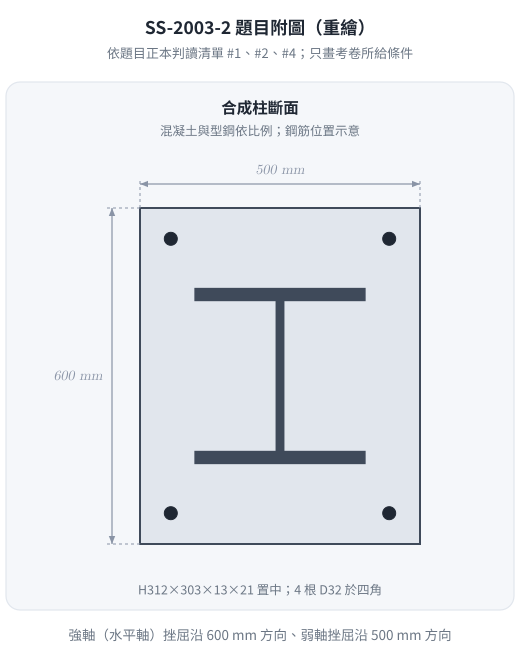
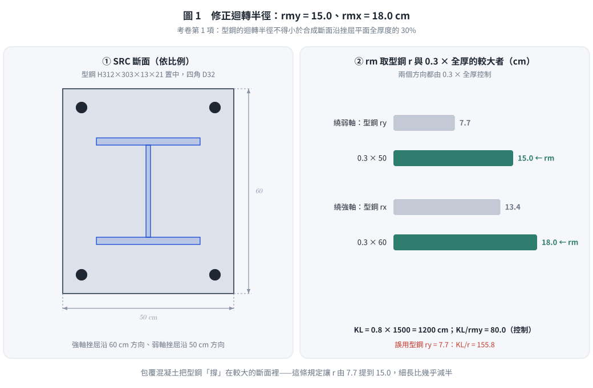
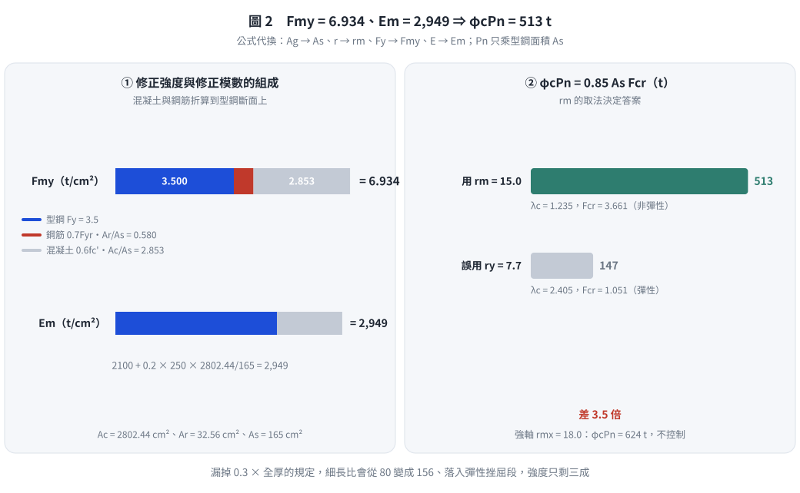

# 考題編號：SS-2003-2

**主分類：** `SS-U1-1` 拉力及壓力桿件
**副分類：**（無）
**設計法：** LRFD
**標籤：** `SRC複合柱` `包覆型複合柱` `有效降伏強度Fmy` `修正彈性模數Em` `整體挫屈` `非彈性挫屈` `λc` `Fcr` `φcPn` `H型鋼` `A572` `SD420` `rm下限` `0.3倍全厚`

---

## 1. 題目（考卷原文見題目正本）

> 考卷原文、公式／附表、附圖與判讀清單（已確認）見 [`SS-2003-2-problem.md`](SS-2003-2-problem.md)。本節只列**解題時最容易讀錯的地方**與本解使用的記號；題意以題目正本為準。

*圖 1　題目附圖重繪（依題目正本判讀清單 #1、#2、#4）。混凝土外廓與型鋼依比例，500 mm 為水平寬、600 mm 為垂直高，攔下兩個方向對調而取錯 $r_m$ 下限（全厚度的 30%）的誤讀。*

### 常見誤讀

| 項目 | 正確判讀 | 常見誤讀 |
|------|---------|---------|
| $r_m$ | 不小於挫屈平面全厚度之 30%：弱軸 $\max(7.7,\,0.3 \times 50) = 15.0$、強軸 $\max(13.4,\,0.3 \times 60) = 18.0$ cm | 直接用型鋼 $r_y = 7.7$ cm（舊版解析即如此，$\phi_cP_n$ 147 t） |
| 全厚度方向 | 繞強軸 → 600 mm、繞弱軸 → 500 mm | 兩者對調 |
| 公式代換 | $A_g, r, F_y, E$ 依序換成 $A_s, r_m, F_{my}, E_m$ | $P_n$ 用混凝土＋鋼的總面積 |

**本解記號：** H312×303×13×21：$A_s = 165$ cm²；$A_r = 4 \times 8.14 = 32.56$ cm²；$A_c = 50 \times 60 - A_s - A_r$；$F_y = 3.5$、$F_{yr} = 4.2$、$E = 2100$、$E_c = 250$ t/cm²，$f'_c = 0.28$ t/cm²；$kL = 0.8 \times 1500 = 1200$ cm。

---

## 2. 考題核心精神與出題者意圖 (Core Concepts & Examiner's Intent)

**核心觀念：** 舊版 AISC LRFD 合成柱採「等效鋼柱法」——把鋼筋與混凝土的貢獻折算進 $F_{my}$、$E_m$，再套純鋼柱的柱強度曲線。等效之後還差一件事：**迴轉半徑**。型鋼自己的 $r$ 只反映鋼骨，但包在外面的混凝土讓整根柱實際上粗很多，所以規範規定 $r_m$ 不得小於「挫屈平面方向全厚度的 0.3 倍」（矩形斷面 $r = h/\sqrt{12} \approx 0.289h$，取 0.3 即是以整個混凝土斷面估迴轉半徑）。

**出題意圖：**
1. 能否正確套用 $F_{my}$、$E_m$ 的修正（$f'_c$ 單位換算、C 係數選包覆型）
2. **能否讀到並落實 $r_m$ 的下限規定**——這是本題分水嶺：漏掉它，弱軸 $KL/r$ 由 80 變成 156、誤判為彈性挫屈，答案低估約 3.5 倍
3. 兩個方向都要檢核，判斷控制軸

---

## 3. 解題戰略地圖與陷阱分析 (Strategic Roadmap & Trap Analysis)

**解題順序：**
$$A_r, A_c \to F_{my}, E_m \to r_m = \max(r_{型鋼},\ 0.3h_{挫屈方向}) \to KL/r_m \to \lambda_c \to F_{cr} \to \phi_cP_n$$

**關鍵陷阱：**

| 陷阱 | 錯誤做法 | 正確做法 |
|------|---------|---------|
| ❶ **漏用 $r_m$ 下限**（本題最大陷阱） | 直接用型鋼 $r_y = 7.7$ cm → $KL/r = 155.8$、$\lambda_c = 2.405$、$\phi_cP_n \approx 147$ tf | $r_{my} = \max(7.7,\ 0.3\times50) = 15.0$ cm → $KL/r = 80$、$\lambda_c = 1.235$、$\phi_cP_n \approx 513$ tf |
| ❷ 挫屈平面的「全厚度」取錯邊 | 弱軸用 600 mm | 弱軸挫屈時斷面沿**水平**（500 mm 方向）位移 → 用 500 mm；強軸用 600 mm |
| ❸ $f'_c$ 單位 | 直接代 280 | $280$ kg/cm² $= 0.280$ t/cm² |
| ❹ C 係數 | 用充填型 1.0／0.85／0.4 | 包覆型 0.7／0.6／0.2 |
| ❺ 乘的面積 | $P_n = A_{g,合成}F_{cr}$ | $P_n = A_sF_{cr}$（考卷明文「$A_s$ 代替 $A_g$」） |
| ❻ 控制軸 | 只算弱軸 | 兩軸 $r_m$ 不同，都要算；本題弱軸控制 |

---

## 3.5 變數層次分析（Variable Hierarchy Analysis）

> 複習提示：解題後，在每個卡住的知識點「卡關?」欄標記 `⚠`；第二次複習時只看有 `⚠` 的項目。

**最終目標：** $A_c$ → $\boxed{F_{my}}$、$\boxed{E_m}$ → $\boxed{r_m}$（取型鋼 $r$ 與 0.3 倍全厚之大者）→ $\boxed{\lambda_c}$ → $\boxed{F_{cr}}$（非彈性挫屈）→ $\boxed{\phi_c P_n} = 513$ tf

### 主要公式（$\boxed{\phantom{x}}$ = 未知，待推導）

$$A_c = A_g - A_s - A_r = 3000 - 165 - 32.56 = \boxed{2802.44}\ \text{cm}^2$$
$$\boxed{F_{my}} = F_y + 0.7F_{yr}\frac{A_r}{A_s} + 0.6f'_c\frac{A_c}{A_s} = 6.934\ \text{t/cm}^2,\qquad \boxed{E_m} = E + 0.2E_c\frac{A_c}{A_s} = 2949\ \text{t/cm}^2$$
$$\boxed{r_{my}} = \max(r_y,\ 0.3\times 50) = 15.0\ \text{cm},\qquad \boxed{r_{mx}} = \max(r_x,\ 0.3\times 60) = 18.0\ \text{cm}$$
$$\boxed{\lambda_c} = \frac{KL}{\pi r_{my}}\sqrt{\frac{F_{my}}{E_m}} = 1.235 \le 1.5 \Rightarrow \boxed{F_{cr}} = e^{-0.419\lambda_c^2}F_{my} = 3.661\ \text{t/cm}^2$$
$$\boxed{\phi_cP_n} = 0.85\times165\times3.661 = 513\ \text{t}$$

### L1：題目直接給定

| 符號 | 數值 | 說明 |
|------|------|------|
| 合成斷面 | 500（寬）× 600（高）mm | $A_g = 3000$ cm² |
| 型鋼 | H312×303×13×21 | $A_s = 165$ cm²，$r_x = 13.4$、$r_y = 7.7$ cm |
| 鋼筋 | 4 根 D32 | 每根 8.14 cm²，$F_{yr} = 4.2$ t/cm² |
| $F_y$、$E$ | 3.5、2100 t/cm² | 鋼骨 |
| $f'_c$、$E_c$ | 280 kg/cm²、250 t/cm² | 混凝土 |
| $L$、$K$ | 15 m、0.8 | 兩平面相同 |
| $C_1, C_2, C_3$ | 0.7、0.6、0.2 | 混凝土包覆型鋼 |
| $r_m$ 下限 | 0.3 × 挫屈平面全厚 | **考卷明文** |

### L2：需知識點推導

**Step 1：面積**

| 符號 | 公式 / 來源 | 卡關? |
|------|------------|:-----:|
| $A_r$ | $4\times8.14 = 32.56$ cm² | |
| $A_c$ | $3000 - 165 - 32.56 = 2802.44$ cm² | |

**Step 2：$F_{my}$、$E_m$**

| 符號 | 公式 / 來源 | 卡關? |
|------|------------|:-----:|
| $f'_c$ | $0.280$ t/cm²（單位換算） | |
| $F_{my}$ | $3.5 + 0.7(4.2)(0.1973) + 0.6(0.280)(16.985) = 6.934$ t/cm² | |
| $E_m$ | $2100 + 0.2(250)(16.985) = 2949$ t/cm² | |

**Step 3：$r_m$ 與細長比（本題關鍵）**

| 符號 | 公式 / 來源 | 卡關? |
|------|------------|:-----:|
| 弱軸挫屈方向全厚 | 500 mm（斷面沿寬度方向位移） | |
| $r_{my}$ | $\max(7.7,\ 0.3\times50=15.0) = 15.0$ cm | |
| $r_{mx}$ | $\max(13.4,\ 0.3\times60=18.0) = 18.0$ cm | |
| $KL/r_{my}$、$KL/r_{mx}$ | $1200/15 = 80.0$、$1200/18 = 66.7$ → 弱軸控制 | |

**Step 4：強度**

| 符號 | 公式 / 來源 | 卡關? |
|------|------------|:-----:|
| $\lambda_c$ | $\frac{80}{\pi}\sqrt{6.934/2949} = 1.235 \le 1.5$ → 非彈性 | |
| $F_{cr}$ | $e^{-0.419(1.235)^2}\times6.934 = 3.661$ t/cm² | |
| $\phi_cP_n$ | $0.85\times165\times3.661 = 513.4$ t | |

### L3：深層知識（不懂就卡住）

| 知識點 | 說明 | 卡關? |
|--------|------|:-----:|
| 為什麼 $r_m \ge 0.3h$ | 混凝土包覆後整根柱的抗彎勁度遠大於鋼骨；矩形斷面 $r = h/\sqrt{12} = 0.289h$，規範取 0.3 作為下限 | |
| 「挫屈平面之全厚度」 | 柱在哪個方向側彎，就量那個方向的斷面尺寸；弱軸挫屈 → 沿寬度位移 → 用寬度 | |
| $P_n = A_sF_{cr}$ | 鋼筋與混凝土的貢獻已折算進 $F_{my}$，只乘鋼骨面積 | |
| $\lambda_c$ 分界 1.5 | $\le 1.5$ 用指數式（非彈性）、$>1.5$ 用 $0.877/\lambda_c^2$（彈性） | |
| 包覆型 vs 充填型 C 係數 | 包覆型 0.7／0.6／0.2；充填型 1.0／0.85／0.4 | |

---

## 4. 步驟化詳細計算過程 (Step-by-Step Detailed Calculation)

### 步驟 1：各斷面積

$$A_g = 50\times60 = 3000\ \text{cm}^2,\qquad A_s = 165\ \text{cm}^2,\qquad A_r = 4\times8.14 = 32.56\ \text{cm}^2$$

$$A_c = A_g - A_s - A_r = 3000 - 165 - 32.56 = 2802.44\ \text{cm}^2$$

（鋼骨比 $A_s/A_g = 165/3000 = 5.5\% \ge 4\%$，可依合成柱設計。）

### 步驟 2：修正降伏強度 $F_{my}$

$$F_{my} = 3.5 + 0.7\times4.2\times\frac{32.56}{165} + 0.6\times0.280\times\frac{2802.44}{165}$$

$$= 3.5 + 0.580 + 2.853 = \boxed{6.934\ \text{t/cm}^2}$$

### 步驟 3：修正彈性模數 $E_m$

$$E_m = 2100 + 0.2\times250\times\frac{2802.44}{165} = 2100 + 849.2 = \boxed{2949\ \text{t/cm}^2}$$

### 步驟 4：修正迴轉半徑 $r_m$（考卷第 1 項規定）

型鋼的迴轉半徑不得小於「合成斷面沿挫屈平面之全厚度」的 30%：

| 挫屈方向 | 斷面位移方向 | 全厚度 | 型鋼 $r$ | $0.3\times$全厚 | $r_m$ |
|:---|:---|:---:|:---:|:---:|:---:|
| 繞弱軸 $y$ | 水平（寬度方向） | 50 cm | 7.7 | 15.0 | **15.0** |
| 繞強軸 $x$ | 垂直（高度方向） | 60 cm | 13.4 | 18.0 | **18.0** |

兩個方向都由 0.3 倍全厚控制。

### 步驟 5：細長比與 $\lambda_c$

$$KL = 0.8\times1500 = 1200\ \text{cm}$$

$$\left(\frac{KL}{r_m}\right)_y = \frac{1200}{15.0} = 80.0\ \text{（控制）},\qquad \left(\frac{KL}{r_m}\right)_x = \frac{1200}{18.0} = 66.7$$

$$\lambda_c = \frac{KL}{\pi r_{my}}\sqrt{\frac{F_{my}}{E_m}} = \frac{80.0}{\pi}\sqrt{\frac{6.934}{2949}} = 25.46\times0.04849 = \boxed{1.235} \le 1.5$$

→ **非彈性挫屈**，用公式 (2)。

**雙路徑驗算：** $F_e = \pi^2E_m/(KL/r_m)^2 = \pi^2(2949)/80^2 = 4.548$ t/cm²，$\lambda_c = \sqrt{F_{my}/F_e} = \sqrt{6.934/4.548} = 1.235$ ✓

*圖 1　修正迴轉半徑 $r_m$ 取型鋼 $r$ 與 $0.3\times$全厚的大者：弱軸 $7.7 \to 15.0$ cm、強軸 $13.4 \to 18.0$ cm。這張圖攔的是直接用型鋼 $r_y$（細長比翻倍、落入彈性段）或把 0.3 乘錯方向的厚度。*

### 步驟 6：臨界應力與設計強度

$$F_{cr} = \exp(-0.419\times1.235^2)\times6.934 = \exp(-0.6388)\times6.934 = 0.5279\times6.934 = \boxed{3.661\ \text{t/cm}^2}$$

$$P_n = A_sF_{cr} = 165\times3.661 = 604.0\ \text{t}$$

$$\boxed{\phi_cP_n = 0.85\times604.0 = 513\ \text{t}}$$

*圖 2　$F_{my} = 6.934$、$E_m = 2{,}949$ t/cm²，$\phi_cP_n = 513$ t；若漏了 $0.3\times$全厚的規定只剩 147 t。這張圖攔的是 $P_n$ 乘成總面積（應乘型鋼 $A_s$），以及修正項的面積比分母寫錯。*

### 驗算：強軸不控制

$$\lambda_{c,x} = \frac{66.7}{\pi}\sqrt{\frac{6.934}{2949}} = 1.029,\quad F_{cr,x} = e^{-0.419(1.029)^2}\times6.934 = 4.450\ \text{t/cm}^2,\quad \phi_cP_{n,x} = 624\ \text{t} > 513\ \text{t}$$

**結論：弱軸控制，$\phi_cP_n \approx 513$ t。**

---

## 5. 關鍵爭議點與進階探討 (Critical Issues & Advanced Discussion)

### 5.1 漏用 $r_m$ 下限會差多少？

| 做法 | $r_y$ 取值 | $KL/r$ | $\lambda_c$ | 挫屈型態 | $\phi_cP_n$ |
|:---|:---:|:---:|:---:|:---:|:---:|
| 依考卷規定（本解） | 15.0 cm | 80.0 | 1.235 | 非彈性 | **513 t** |
| 只用型鋼 $r_y$（常見錯誤） | 7.7 cm | 155.8 | 2.405 | 彈性 | 147 t |

差距約 3.5 倍，而且連挫屈型態都判錯。本題考卷把 $r_m$ 的規定與 $A_s$ 寫在同一項，很容易只看到「$A_s$ 代替 $A_g$」就跳過。

### 5.2 為什麼是 0.3 倍全厚？

包覆型合成柱真正抵抗側彎的是整個混凝土斷面加鋼骨。矩形斷面的迴轉半徑 $r = h/\sqrt{12} = 0.289h$；規範以 $0.3h$ 作為鋼骨迴轉半徑的下限，等於承認「柱的粗細由混凝土外廓決定」。本題鋼骨弱軸 $r_y = 7.7$ cm 只有 $0.3\times50 = 15$ cm 的一半，可見忽略外包混凝土的勁度會嚴重低估柱強度。

### 5.3 C 係數為何包覆型較小？

| 型式 | $C_1$（鋼筋） | $C_2$（混凝土） | $C_3$（勁度） | 原因 |
|------|:---:|:---:|:---:|------|
| 包覆型 SRC | 0.7 | 0.6 | 0.2 | 保護層受壓後易剝落，混凝土無圍束 |
| 充填型 CFT | 1.0 | 0.85 | 0.4 | 鋼管圍束混凝土 |

---

## 6. 依最新規範（AISC 360-16／-22）對照

AISC 360 自 2005 年版起廢除 $F_{my}$、$E_m$、$r_m$ 的等效鋼柱法，改用「斷面強度 $P_{no}$ ＋ 有效勁度 $EI_{eff}$」：

$$P_{no} = F_yA_s + F_{ysr}A_{sr} + 0.85f'_cA_c,\qquad EI_{eff} = E_sI_s + 0.5E_sI_{sr} + C_1E_cI_c$$
$$P_e = \frac{\pi^2EI_{eff}}{(KL)^2},\qquad P_n = \begin{cases}P_{no}\,0.658^{P_{no}/P_e} & P_{no}/P_e \le 2.25\\ 0.877P_e & P_{no}/P_e > 2.25\end{cases},\qquad \phi_c = 0.75$$

| 版本 | $C_1$ |
|:---|:---|
| 360-16 | $0.1 + 2\dfrac{A_s}{A_c + A_s} \le 0.3$ |
| 360-22 | $0.25 + 3\dfrac{A_s + A_{sr}}{A_g} \le 0.7$ |

**估算（假設）：** 題目未給鋼筋位置與型鋼慣性矩，以下取鋼筋中心距斷面邊 6 cm、$I_s = A_sr^2$，僅作量級比較：

| 項目 | 弱軸 | 強軸 |
|:---|:---:|:---:|
| $I_s$（cm⁴） | 9,783 | 29,627 |
| $I_{sr}$（cm⁴） | 11,754 | 18,755 |
| $I_c$（cm⁴） | 603,463 | 851,618 |
| $P_{no}$（t） | 1,381 | 1,381 |
| 360-16：$C_1 = 0.211$ → $\phi_cP_n$ | **292 t**（$P_{no}/P_e = 3.11$，彈性） | 533 t |
| 360-22：$C_1 = 0.448$ → $\phi_cP_n$ | **447 t**（$P_{no}/P_e = 2.01$） | 644 t |

| 項目 | 考卷（舊 LRFD 等效鋼柱法） | AISC 360-16 | AISC 360-22 |
|:---|:---:|:---:|:---:|
| 混凝土強度貢獻 | $C_2 = 0.6$ 折算進 $F_{my}$ | $0.85f'_cA_c$ 全額計入斷面強度 | 同左 |
| 勁度 | $E_m$ ＋ $r_m \ge 0.3h$ | $EI_{eff}$，混凝土勁度大幅折減 | $C_1$ 放寬 |
| $\phi_c$ | 0.85 | 0.75 | 0.75 |
| 本題 $\phi_cP_n$（弱軸） | 513 t | 約 292 t | 約 447 t |

**觀察：** 新規範對細長的包覆型柱明顯較保守（360-16 只有舊法的 57%），主因是混凝土開裂後的勁度折減（$C_1 \approx 0.2$）遠比舊法 $r_m = 0.3h$ 所隱含的「整個混凝土斷面有效」嚴格；360-22 調高 $C_1$ 後差距縮小。**考場依考卷給的公式作答**；國內 SRC 構造另有《鋼骨鋼筋混凝土構造設計規範與解說》，實務設計應以現行規範為準。

---

*解析完成時間：2026-04-xx*
*修正日期：2026-11-01（考卷明文規定 $r_m$ 不得小於挫屈平面全厚度之 30%，原解直接取型鋼 $r_y = 7.7$ cm，致 $KL/r$ 155.8、$\lambda_c$ 2.405、誤判彈性挫屈，$\phi_cP_n$ 由 147 t 更正為 **513 t**；補強軸檢核與雙路徑驗算；新增 §6 AISC 360-16／-22 對照）*
*圖解補繪：2026-11-03（向量圖 2 張，腳本 `gen_SS-2003-2.py`，改輸入可原地重跑；SVG 供 wiki／PDF，2× PNG 供 pptx／影片）*
*驗證狀態：unverified*

*修正日期：2026-11-02（§1 全文重述改為指向題目正本 `SS-2003-2-problem.md`（已確認）＋常見誤讀＋本解記號，避免題意兩份不同步；解題內容與答案不變）*

*修正日期：2026-11-03（§1 補入題目附圖重繪 `figs/SS-2003-2-fig-1-problem.svg`（依已確認的題目正本判讀清單，腳本 `gen_SS-2003-2.py`，可重跑）；解題內容與答案不變）*
