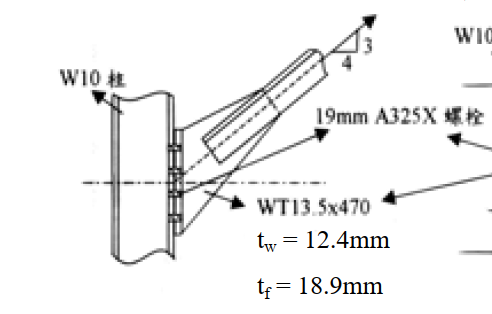
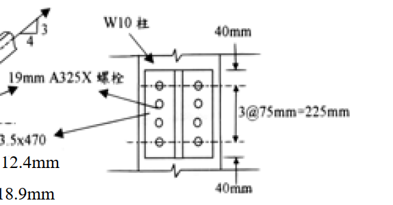

# SS-2003-3 題目正本

> 本檔只記錄**考卷上寫了什麼、圖上畫了什麼**，不含任何解法。解析見同資料夾 `SS-2003-3.md`。
> 判讀清單經使用者確認前，狀態為「待確認」；確認後本檔原則上不再修改（改動須回考卷原圖並記 log）。

| 項目 | 內容 |
|------|------|
| 考卷 | `raw/exams/SS-2003_鋼結構設計.pdf` 第 1（正面）題文、2（背面）附表 頁，第三題 |
| 考年 | 民國 92 年（2003） |
| 配分 | 25 分 |
| 附圖 | 2 張：接合側視 `SS-2003-3-fig-1.png`；WT 翼板螺栓配置 `SS-2003-3-fig-2.png` |
| 判讀狀態 | **已確認**（2026-11-02 使用者確認，含「不確定」項之解讀；轉錄同日，PyMuPDF 110 dpi 全頁＋關鍵處 400–500 dpi 局部目視，盲讀後才比對既有解析） |

## 1. 考卷原文（逐字）

> 三、如圖示長肢背對背雙角鋼受拉構材與柱之接合，接合全部採用標稱直徑 19 mm 之 A325X 承壓型螺栓（標準孔），螺栓孔附近之變形非為設計之考量因素。計算時必須扣除之螺栓孔徑為 22 mm。已知柱和 WT 型鋼強度足夠。（25 分）
> ㈠試依極限設計法決定雙角鋼與 WT 型鋼腹板接合所需螺栓數量。假設螺栓至構材邊距大於 1.5 倍之螺栓直徑，且螺栓心距大於 3 倍之螺栓直徑，並將螺栓排成一列。不必考慮塊狀剪力。
> ㈡已知柱和 WT 型鋼以 8 顆螺栓接合，試依極限設計法此接合強度是否足夠？
>
> 參考資料：
> 構材之 $F_y = 2.5\ \text{ton/cm}^2$、$F_u = 4.1\ \text{ton/cm}^2$　雙角鋼：厚度 $t = 9.5$ mm、雙角鋼總面積 $A_g = 34.45\ \text{cm}^2$
> 螺栓：斷面積 $A_b = 2.85\ \text{cm}^2$，$F_v = 4.2\ \text{ton/cm}^2$，$F_t = 6.3\ \text{ton/cm}^2$　$P_n = F_yA_g$，$\phi_t = 0.9$　$P_n = F_uA_e$，$\phi_t = 0.75$

## 2. 考卷給的公式、附表與參數

第 2 頁（背面）附表照錄（同頁第四題 ASD 公式不屬本題）：

**表 A　螺栓強度**

| 螺栓類別 | 拉力強度 $\phi$ | 拉力標稱強度 | 承壓式接合剪力強度 $\phi$ | 剪力標稱強度 |
|---|---|---|---|---|
| A325 螺栓、螺紋不在剪力平面 | 0.75 | 6.30 t/cm² | 0.75 | 3.36 t/cm² |
| A325 螺栓、螺紋在剪力平面 | 0.75 | 6.30 t/cm² | 0.75 | 4.20 t/cm² |

**表 B　承壓型接合所用聯結物之極限拉應力（$F_t$），t/cm²**

| 聯結物種類 | 螺紋在剪力平面 | 螺紋不在剪力平面 | $\phi$ |
|---|---|---|---|
| A325 螺栓 | $8.2 - 1.9f_v \le 6.3$ | $8.2 - 1.9f_v \le 6.3$ | 0.75 |

**表 C　有效面積**　$A_e = UA_n$　$A_e = UA_g$
1. 翼板寬度與斷面深度之比不小於 2/3 之 W、H、S 或 I 型鋼，及由此類型鋼切割或符合前述尺度需求之銲接 T 型鋼，且接合須在翼板處。若以螺栓接合則接合處沿應力方向每行螺栓數不少於 3 根 ⋯⋯ $U = 0.90$
2. 不合於上款之 W、H、S、I 或 T 型鋼，及包括組合斷面之其他各種斷面。若以螺栓接合則接合處沿應力方向每行螺栓數不少於 3 根 ⋯⋯ $U = 0.85$
3. 以螺栓接合之所有各種斷面且在接合處沿應力方向每行僅有 2 根螺栓 ⋯⋯ $U = 0.75$

**表 D　螺栓孔承壓強度**　$\phi R_n$，其中 $\phi = 0.75$，$R_n$＝標稱承壓強度
1. 當 $L_e \ge 1.5d$ 且 $S \ge 3d$ 且作用力方向該排有二個（含）以上之螺栓時，
   ⑴ 標準孔、或垂直於作用力之槽孔，或摩阻型超大孔或平行於作用力方向之摩阻型槽孔。
   　當螺栓孔附近之變形非為設計之考量因素時，$R_n = 2.4dtF_u$
   　當螺栓孔附近之變形為設計之考量因素時，$R_n = L_etF_u \le 3.0dtF_u$
   ⑵ 對於其他之螺栓接合型式，$R_n = (S - 0.5d)tF_u \le 2.4dtF_u$
   ⑶ 作用力於垂直方向之長槽孔，$R_n = 2.0dtF_u$
2. 當 $L_e < 1.5d$ 或作用力方向該排僅有一顆螺栓
   ⑴ 標準孔、或垂直於作用力之槽孔，或摩阻型超大孔或平行於作用力方向之摩阻型槽孔。$R_n = L_etF_u \le 2.4dtF_u$
   ⑵ 其他螺栓接合，$R_n = (S - 0.5d)tF_u \le 2.4dtF_u$
   ⑶ 當作用力於平行方向之長槽孔螺栓接合，對單支螺栓或二支螺栓以上（含）之最靠近邊緣之螺栓，$R_n = L_etF_u \le 2.0dtF_u$；其他螺栓接合，$R_n = (S - 0.5d)tF_u \le 2.0dtF_u$

**照錄時注意到的考卷原樣（不修正）：**
- 表 A 剪力兩列：「螺紋不在剪力平面」3.36、「螺紋在剪力平面」4.20——與一般規定（螺紋不在剪力面強度較高）相反；題文第 1 頁另直接給 $F_v = 4.2$。
- 表 B 兩欄印成相同的 $8.2 - 1.9f_v \le 6.3$。
- 表 D 1⑴ 兩種條件的公式對應與 AISC LRFD 相反（AISC：變形為考量時 $2.4dtF_u$）。

## 3. 附圖

*圖面文字照錄：W10 柱；3；4；19mm A325X 螺栓；WT13.5x470；$t_w$ = 12.4mm；$t_f$ = 18.9mm。*

*圖面文字照錄：W10 柱；40mm；3@75mm=225mm；40mm。*

## 4. 判讀清單

「把握」標**不確定**者請優先確認；解讀類項目（題目用字的意思）另標「解讀」。

| # | 項目 | 判讀 | 圖上／題文依據 | 把握 |
|---|------|------|---------------|------|
| 1 | 構材 | 長肢背對背雙角鋼，兩角鋼長肢夾住 WT 腹板 | 題文「長肢背對背」；側視圖 | 確定 |
| 2 | 角鋼—WT 腹板螺栓的剪力面 | 雙剪（角鋼／WT 腹板／角鋼三層） | 側視圖構材夾 WT 腹板（解讀） | 不確定 → 使用者確認 |
| 3 | 拉力方向 | 斜率 垂直 3：水平 4，作用線通過 WT 翼板螺栓群 | 側視圖斜率三角形；中心點線（400 dpi） | 確定 |
| 4 | WT 斷面 | WT13.5x470（照圖面），$t_w = 12.4$ mm、$t_f = 18.9$ mm | 側視圖文字；「470」疑為 47.0 印法，照錄 | 確定 |
| 5 | WT 翼板—柱螺栓 | 8 顆＝2 列 × 4 顆；垂直間距 3@75 = 225 mm，上下端距 40 mm | 附圖 2 尺寸線；題文「8 顆螺栓」 | 確定 |
| 6 | ㈡ 檢核對象 | WT 翼板與柱翼板間 8 顆螺栓，承受斜向拉力分解的剪力＋拉力 | 題文「柱和 WT 型鋼以 8 顆螺栓接合」（解讀） | 不確定 → 使用者確認 |
| 7 | ㈠ 所求構材設計拉力 | 題目未給設計載重，須由雙角鋼拉力強度（$F_yA_g$、$F_uA_e$ 取小）決定螺栓所需數量 | 題文只給 $P_n$ 兩式與 $\phi_t$（解讀） | 不確定 → 使用者確認 |
| 8 | $F_v$ 取值 | 依題文第 1 頁 $F_v = 4.2$ t/cm²（不從表 A 選列） | 題文（解讀） | 不確定 → 使用者確認 |
| 9 | 承壓公式 | 依題文「變形非為設計之考量因素」＋表 D 1⑴ → $R_n = 2.4dtF_u$（照考卷表） | 題文＋表 D | 確定 |
| 10 | 孔徑 | 淨斷面扣孔 22 mm；承壓用標稱直徑 19 mm | 題文 | 確定 |
| 11 | 塊狀剪力 | ㈠ 不考慮 | 題文 | 確定 |

---

*轉錄：2026-11-02（SS-U1-1 題目正本推廣・批 1）｜確認：2026-11-02 使用者確認*
