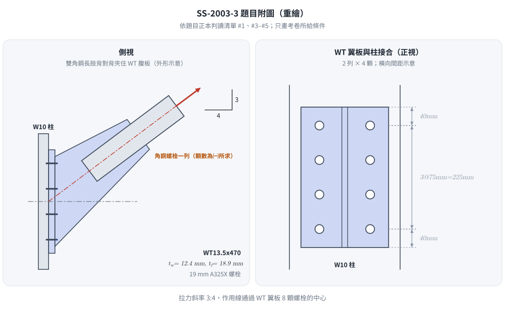
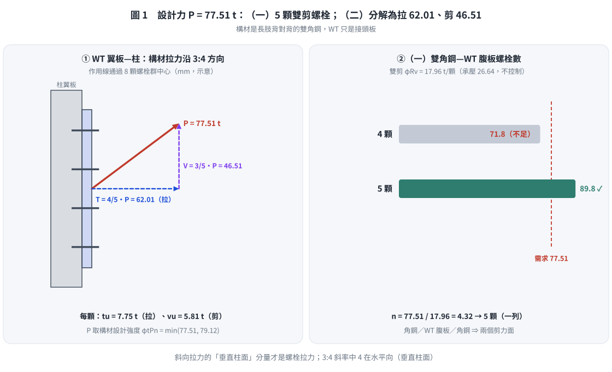
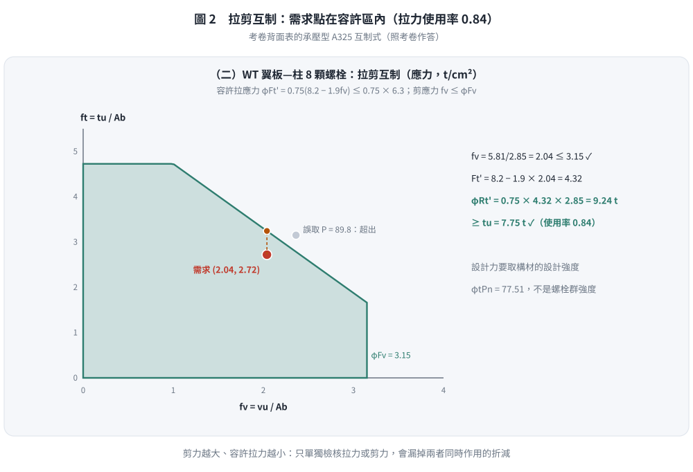

# 考題編號：SS-2003-3

**主分類：** `SS-U1-1` 拉力及壓力桿件
**副分類：** `SS-U1-4` 接合之分析與設計
**設計法：** LRFD
**標籤：** `接合設計` `剪力遲滯` `U值` `螺栓接合` `A325X` `淨斷面斷裂` `WT斷面` `承壓型螺栓` `有效淨面積` `雙角鋼` `雙剪` `拉剪互制` `螺栓數量設計`

---

## 1. 題目（考卷原文見題目正本）

> 考卷原文、公式／附表、附圖與判讀清單（已確認）見 [`SS-2003-3-problem.md`](SS-2003-3-problem.md)。本節只列**解題時最容易讀錯的地方**與本解使用的記號；題意以題目正本為準。



*圖 1　題目附圖重繪（依題目正本判讀清單 #1、#3–#5；WT 外形與螺栓橫向間距為示意）。斜率三角形標出 3:4、作用線畫到翼板螺栓群中心，攔下斜率讀反或把作用線偏心；正視圖標出 40／3@75／40 mm，攔下端距與間距讀錯。*

### 常見誤讀

| 項目 | 正確判讀 | 常見誤讀 |
|------|---------|---------|
| 構材 | 長肢背對背雙角鋼；WT 為接頭板 | 把 WT 當成受拉構材（舊版解析即如此） |
| 角鋼—WT 腹板螺栓 | 角鋼／WT 腹板／角鋼 → **雙剪** | 單剪 |
| ㈠ 所求 | 題未給外力，以雙角鋼設計拉力強度決定螺栓數 | 自行假設設計載重 |
| ㈡ 檢核對象 | WT 翼板—柱 8 顆螺栓，受 3:4 斜向力分解之拉剪互制 | 檢核角鋼那一列螺栓 |
| 考卷背面表 | 剪力表兩列、承壓表兩條件與 AISC 相反，照考卷作答；$F_v$ 取題文 4.2 t/cm² | 改用 AISC 值或自行對調 |

**本解記號：** 螺栓 $d = 19$ mm（扣孔 22 mm）、$A_b = 2.85$ cm²；雙角鋼 $t = 0.95$ cm、$A_g = 34.45$ cm²；$F_y = 2.5$、$F_u = 4.1$、$F_v = 4.2$、$F_t = 6.3$ t/cm²；力的斜率 垂直 3：水平 4。

---

## 2. 考題核心精神與出題者意圖 (Core Concepts & Examiner's Intent)

本題是一個**兩段式傳力**的斜撐接頭：

```
雙角鋼（拉力構材） ──(一) 一列螺栓、雙剪──▶ WT 腹板 ──WT 本身（題目說強度足夠）──▶ WT 翼板 ──(二) 8 顆螺栓、拉＋剪──▶ 柱翼板
```

**出題意圖：**
1. **（一）設計題**：題目沒給外力，接合要能發揮構材本身的設計強度 → 先算構材 $\phi_tP_n$（降伏、斷裂取小），再以「單栓強度」反推顆數。關鍵是看出**雙角鋼夾 WT 腹板＝雙剪**。
2. **（二）檢核題**：力是斜的（3:4），到了柱面，水平分量把螺栓**拉離柱面**、垂直分量讓螺栓**受剪** → 承壓型螺栓的**拉剪互制**。
3. 題目刻意交代「變形非設計考量」、「邊距 > 1.5d、心距 > 3d」（對應背面承壓表第 1 款）、「不必考慮塊狀剪力」、「扣除孔徑 22 mm」；背面還印了拉剪互制式 $F_t = 8.2 - 1.9f_v$——這些都是作答要照用的條件。

---

## 3. 解題戰略地圖與陷阱分析 (Strategic Roadmap & Trap Analysis)

**（一）** 構材 $\phi_tP_n$（GSY、NSF 取小）→ 單栓設計強度（雙剪 vs 承壓取小）→ $n = \phi_tP_n / \phi R_n$ 無條件進位
**（二）** $P$ 分解為拉 $0.8P$、剪 $0.6P$ → 每栓 $t_u, v_u$ → 剪力檢核 → 互制後的容許拉應力 $F_t'$ → 拉力檢核

| 陷阱 | 錯誤做法 | 正確做法 |
|------|---------|---------|
| ❶ 讀錯題意 | 把（一）當成「已知 3 顆求強度」、（二）當成「8 顆的塊狀剪力」 | （一）是**決定顆數**；（二）是 **WT 與柱之間** 8 顆螺栓受**拉＋剪** |
| ❷ 單剪／雙剪 | 單剪 $0.75F_vA_b = 8.98$ t | 雙角鋼夾 WT 腹板，兩個剪力面：**17.96 t/顆** |
| ❸ 扣除孔徑 | 自行加 2 mm 用 2.4 cm | 題目明寫「計算時必須扣除之螺栓孔徑為 22 mm」→ 2.2 cm |
| ❹ 扣孔的板厚 | 扣 WT 腹板厚 1.24 cm | 構材是**雙角鋼**：每支角鋼扣一孔，$2\times2.2\times0.95$ |
| ❺ 塊狀剪力 | 自行檢核塊狀剪力 | 題目明示不必考慮 |
| ❻ 斜向力 | 8 顆只檢核剪力 | 水平分量使螺栓受拉，要做拉剪互制 |

---

## 3.5 變數層次分析（Variable Hierarchy Analysis）

> 複習提示：解題後，在每個卡住的知識點「卡關?」欄標記 `⚠`；第二次複習時只看有 `⚠` 的項目。

**最終目標：**（一）構材 $\boxed{\phi_tP_n} = 77.5$ t → 單栓雙剪 $\boxed{\phi R_n} = 17.96$ t → $\boxed{n} = 5$ 顆；（二）每栓 $t_u = 7.75$ t、$v_u = 5.81$ t → $\boxed{\phi R_t'} = 9.24$ t ≥ 7.75 t → **足夠**

### 主要公式（$\boxed{\phantom{x}}$ = 未知，待推導）

$$\boxed{\phi_tP_n} = \min\left(0.9F_yA_g,\ 0.75F_uUA_n\right),\quad A_n = A_g - 2d_ht$$
$$\boxed{\phi R_n} = \min\left(0.75F_vA_b\times2,\ 0.75\times2.4\,d\,(2t)F_u\right),\qquad \boxed{n} = \left\lceil\frac{\phi_tP_n}{\phi R_n}\right\rceil$$
$$t_u = \frac{0.8P}{8},\quad v_u = \frac{0.6P}{8},\quad f_v = \frac{v_u}{A_b},\quad \boxed{F_t'} = 8.2 - 1.9f_v \le 6.3\ \text{t/cm}^2\ \text{（考卷表）}$$

### L1：題目直接給定

| 符號 | 數值 | 說明 |
|------|------|------|
| $F_y$、$F_u$ | 2.5、4.1 t/cm² | 構材 |
| $A_g$、$t$ | 34.45 cm²、0.95 cm | 雙角鋼總面積、單支角鋼厚 |
| $d$、$d_h$ | 1.9 cm、2.2 cm | 螺栓直徑、扣除孔徑（題目指定） |
| $A_b$、$F_v$、$F_t$ | 2.85 cm²、4.2、6.3 t/cm² | A325X |
| 力的方向 | 垂直 3：水平 4 | 圖示 |
| 柱面螺栓 | 8 顆（2 列 × 4） | 圖示 |
| 承壓 | 變形非考量 → $R_n = 2.4dtF_u$ | 考卷背面表 |
| 拉剪互制 | $F_t = 8.2 - 1.9f_v \le 6.3$，$\phi = 0.75$ | 考卷背面表 |

### L2：需知識點推導

**Step 1：構材設計強度**

| 符號 | 公式 / 來源 | 卡關? |
|------|------------|:-----:|
| GSY | $0.9\times2.5\times34.45 = 77.51$ t | |
| $A_n$ | $34.45 - 2\times2.2\times0.95 = 30.27$ cm² | |
| $U$ | 單列 ≥ 3 栓、僅長肢連接 → 0.85 | |
| NSF | $0.75\times4.1\times0.85\times30.27 = 79.12$ t | |
| $\phi_tP_n$ | 77.51 t（降伏控制） | |

**Step 2：（一）螺栓數量**

| 符號 | 公式 / 來源 | 卡關? |
|------|------------|:-----:|
| 雙剪 | $0.75\times4.2\times2.85\times2 = 17.96$ t | |
| 承壓 | $0.75\times2.4\times1.9\times1.9\times4.1 = 26.64$ t（考卷表：變形非考量） | |
| $n$ | $77.51/17.96 = 4.32$ → **5 顆** | |

**Step 3：（二）柱面 8 顆拉剪互制**

| 符號 | 公式 / 來源 | 卡關? |
|------|------------|:-----:|
| $T$、$V$ | $0.8\times77.51 = 62.01$ t、$0.6\times77.51 = 46.51$ t | |
| $t_u$、$v_u$ | 7.75 t、5.81 t | |
| $f_v$ | $5.81/2.85 = 2.04 \le \phi F_v = 3.15$ ✓ | |
| $F_t'$ | $8.2 - 1.9(2.04) = 4.32 \le 6.3$ t/cm² | |
| $\phi R_t'$ | $0.75\times4.32\times2.85 = 9.24$ t ≥ 7.75 ✓ | |

### L3：深層知識（不懂就卡住）

| 知識點 | 說明 | 卡關? |
|--------|------|:-----:|
| 雙角鋼夾板＝雙剪 | 螺栓穿過三層板，有兩個剪力面 | |
| 沒給外力怎麼設計接合 | 接合要發揮構材強度：以構材 $\phi_tP_n$ 為設計力 | |
| $U = 0.85$ | 舊 LRFD 表列：非 W 形斷面、每列 ≥ 3 栓 | |
| 承壓公式的條件 | 邊距 ≥ 1.5d、心距 ≥ 3d、力方向 ≥ 2 顆才適用第 1 款；考卷表的「變形是否為考量」與 AISC 對應相反，作答照考卷 | |
| 承壓型螺栓拉剪互制 | 受剪會降低可用的拉力強度：考卷表 $F_t = 8.2 - 1.9f_v \le 6.3$ t/cm² | |

---

## 4. 步驟化詳細計算過程 (Step-by-Step Detailed Calculation)

### 4.1 構材設計強度（兩小題共用的設計力）

**全斷面降伏：**
$$\phi_tP_n = 0.9\times2.5\times34.45 = 77.51\ \text{t}$$

**淨斷面斷裂：** 兩支角鋼各扣一個孔（單列螺栓），扣除孔徑依題目取 2.2 cm：
$$A_n = 34.45 - 2\times2.2\times0.95 = 30.27\ \text{cm}^2$$

只有長肢連接、短肢未連接 → 有剪力遲滯。角鋼尺寸未給，無法算 $1 - \bar x/L$；依舊版 LRFD（B3）表列，非 W 形斷面、每列螺栓 ≥ 3 顆時 $U = 0.85$（（一）的結果為 5 顆，符合）：
$$A_e = 0.85\times30.27 = 25.73\ \text{cm}^2,\qquad \phi_tP_n = 0.75\times4.1\times25.73 = 79.12\ \text{t}$$

$$\boxed{\phi_tP_n = \min(77.51,\ 79.12) = 77.51\ \text{t}\ \ \text{（降伏控制）}}$$

### 4.2（一）雙角鋼與 WT 腹板所需螺栓數

**單栓剪力（雙剪）：** 螺栓穿過「角鋼—WT 腹板—角鋼」，兩個剪力面；A325X 螺紋不在剪力面上，$F_v = 4.2$ t/cm²：
$$\phi R_v = 0.75\times4.2\times2.85\times2 = 17.96\ \text{t/顆}$$

**單栓承壓：** 邊距 ≥ 1.5d、心距 ≥ 3d、一列多顆 → 背面承壓表第 1 款；題目說孔附近變形非設計考量 → 照考卷表 $R_n = 2.4dtF_u$。WT 強度足夠，只檢核兩支角鋼（總厚 $2\times0.95 = 1.9$ cm）：
$$\phi R_p = 0.75\times2.4\times1.9\times1.9\times4.1 = 26.64\ \text{t/顆} > 17.96$$

→ 單栓由剪力控制，17.96 t。

$$n = \frac{77.51}{17.96} = 4.32 \quad\Rightarrow\quad \boxed{n = 5\ \text{顆（排成一列）}}$$

檢核：$5\times17.96 = 89.8\ \text{t} \ge 77.51\ \text{t}$ ✓；每列 5 顆 ≥ 3 顆，$U = 0.85$ 的前提成立 ✓。（塊狀剪力依題意不檢核。）



*圖 1　設計力取構材設計強度 $\phi_tP_n = 77.51$ t：（一）雙剪每顆 17.96 t，需 5 顆；（二）沿 3:4 分解為拉 62.01、剪 46.51 t。這張圖攔的是把 WT 當構材、用單剪、3:4 分量對調（拉剪互換）。*

### 4.3（二）WT 翼板與柱的 8 顆螺栓

**設計力：** 取構材設計強度 $P = 77.51$ t，沿 3:4 方向：
$$T = \tfrac{4}{5}P = 62.01\ \text{t（垂直柱面，使螺栓受拉）},\qquad V = \tfrac{3}{5}P = 46.51\ \text{t（平行柱面，使螺栓受剪）}$$

作用線通過螺栓群中心（圖示），8 顆均分：
$$t_u = \frac{62.01}{8} = 7.75\ \text{t},\qquad v_u = \frac{46.51}{8} = 5.81\ \text{t}$$

**剪力檢核（單剪）：**
$$f_v = \frac{5.81}{2.85} = 2.04\ \text{t/cm}^2 \le \phi F_v = 0.75\times4.2 = 3.15\ \text{t/cm}^2\ \ \checkmark$$

**拉剪互制（承壓型 A325）：** 依考卷背面表，$F_t = 8.2 - 1.9f_v \le 6.3$ t/cm²，$\phi = 0.75$：
$$F_t' = 8.2 - 1.9\times2.04 = 4.32\ \text{t/cm}^2 \le 6.3\ \text{t/cm}^2$$
$$\phi R_t' = 0.75\times4.32\times2.85 = 9.24\ \text{t/顆} \ \ge\ t_u = 7.75\ \text{t}\ \ \checkmark$$

（若依 AISC LRFD 原表對螺紋不在剪力面的 A325-X：$F_t' = 117 - 1.5f_v$ ksi $= 8.23 - 1.5\times2.04 = 5.17$ t/cm²，$\phi R_t' = 11.04$ t，結論相同。）

**雙路徑驗算（以題給 $F_t = 6.3$ 做圓形互制）：**
$$\left(\frac{7.75}{0.75\times6.3\times2.85}\right)^2 + \left(\frac{5.81}{0.75\times4.2\times2.85}\right)^2 = 0.576^2 + 0.648^2 = 0.75 \le 1.0\ \ \checkmark$$

**柱面承壓：** 柱與 WT 強度足夠（題目）。

$$\boxed{\text{8 顆螺栓接合強度足夠（拉力使用率 0.84、剪力 0.65）}}$$

> 設計力的取法：接合要能傳遞構材的設計強度，故取 $P = \phi_tP_n = 77.51$ t。若誤取（一）螺栓群的強度 $5\times17.96 = 89.8$ t：$f_v = 2.36$、$F_t' = 3.71$、$\phi R_t' = 7.93$ t < $t_u = 8.98$ t，會判為不足——設計力的定義會改變結論，作答時要寫清楚。



*圖 2　拉剪互制：$f_v = 2.04$ 時容許 $\phi R_t' = 9.24$ t ≥ $t_u = 7.75$ t（使用率 0.84）。這張圖攔的是拉力、剪力分開檢核而漏掉互制折減，以及拿螺栓群強度 89.8 t 當設計力。*

---

## 5. 關鍵爭議點與進階探討 (Critical Issues & Advanced Discussion)

### 5.1 為什麼是「雙剪」？

「長肢背對背」的雙角鋼中間留有間隙，正好夾住 WT 的腹板。螺栓穿過三層鋼板，構材的力由兩支角鋼分別傳給中間的 WT 腹板，每顆螺栓有**兩個剪力面**。誤用單剪會讓顆數算成 $77.51/8.98 = 8.6 \to 9$ 顆，多出將近一倍。

### 5.2 考卷承壓表與 AISC 的對應相反

考卷背面寫「變形**非**為設計考量 → $R_n = 2.4dtF_u$；變形**為**設計考量 → $R_n = L_etF_u \le 3.0dtF_u$」。AISC LRFD J3.10 的原意相反：變形是設計考量時用較保守的 $2.4dtF_u$，不是考量時才放寬到 $L_etF_u \le 3.0dtF_u$。

本題照考卷表取 $2.4dtF_u$（26.64 t/顆），不控制。若依 AISC 原意取 $L_etF_u$、且 $L_e$ 只知「大於 1.5d」而取 1.5d：最靠端部那顆 $\phi R_n = 0.75\times1.5\times1.9\times1.9\times4.1 = 16.65$ t，略小於雙剪 17.96 t；5 顆的群組強度 $16.65 + 4\times17.96 = 88.5$ t ≥ 77.51 t，**仍為 5 顆**。兩種讀法答案一致。

### 5.3 撬力（prying action）

WT 翼板受拉時若翼板不夠厚，翼板外緣會壓在柱面上產生撬力，使螺栓實際拉力大於 $t_u$。題目未給螺栓列距與翼板寬度，且說「柱和 WT 強度足夠」，故不計；實務設計須檢核（$t_f = 18.9$ mm 相對 19 mm 螺栓屬厚翼板，撬力通常不大）。

### 5.4 舊解錯在哪裡

| 項目 | 舊解 | 更正 |
|:---|:---|:---|
| 構材 | 「WT13.5×470 拉力構材」 | 構材是**雙角鋼**，WT 是接頭板 |
| （一） | 已知 3 顆，求各破壞模式強度 | **決定顆數** → 5 顆 |
| 剪力面 | 單剪 | **雙剪** |
| 扣除孔徑 | 2.2 + 0.2 = 2.4 cm | 題目明定 **2.2 cm** |
| 淨面積 | $34.45 - 2.4\times1.24$（扣 WT 腹板厚） | $34.45 - 2\times2.2\times0.95$（兩支角鋼各扣一孔） |
| （二） | 8 顆的塊狀剪力 | WT 與柱之間 8 顆的**拉剪互制** → 足夠 |

---

## 6. 依最新規範（AISC 360-16／-22）對照

| 項目 | 考卷（舊 LRFD） | AISC 360-16／-22 | 對本題的影響 |
|:---|:---|:---|:---|
| A325-X 剪力 $F_{nv}$ | 60 ksi（4.2 t/cm²） | 68 ksi（4.78 t/cm²） | 雙剪 20.44 t/顆 → $77.51/20.44 = 3.8$ → **4 顆** |
| $U$ | 表列 0.85 | 表 D3.1：$1 - \bar x/l$，或雙角鋼 Case 8（每列 ≥ 4 栓 0.80、3 栓 0.60） | 角鋼尺寸未給，無法精算；若 4 顆取 0.80 → NSF 74.5 t，改由斷裂控制 |
| 承壓 | 考卷表：$2.4dtF_u$（變形非考量） | $\min(2.4dtF_u,\ 1.2l_ctF_u)$（變形為考量）；$\min(3.0dtF_u,\ 1.5l_ctF_u)$（非考量） | 不控制 |
| 拉剪互制 | 考卷表：$F_t = 8.2 - 1.9f_v \le 6.3$ t/cm² | $F_{nt}' = 1.3F_{nt} - \dfrac{F_{nt}}{\phi F_{nv}}f_{rv} \le F_{nt}$ | $\phi R_t' = 9.89$ t ≥ 7.75 t，仍足夠 |
| 撬力 | 未規定 | AISC Manual Part 9 須檢核 | 實務需另算 |

**結論：** 新規範下單栓剪力提高（60 → 68 ksi），（一）可減為 4 顆，但 $U$ 改以幾何決定、可能使斷裂改為控制；（二）在新互制式下仍足夠。**考場依考卷給的參考資料作答。**

---

*解析完成時間：2026-04-xx*
*修正日期：2026-11-01（題意整題重判：構材為長肢背對背雙角鋼、WT 為接頭板。（一）改為「決定螺栓數」，雙剪 17.96 t/顆、構材 77.51 t → **5 顆**；（二）改為 WT 與柱之間 8 顆螺栓受 3:4 斜向力之拉剪互制，依考卷背面表 $F_t = 8.2 - 1.9f_v$ → **足夠**（使用率 0.84）。更正扣除孔徑為題目指定之 2.2 cm、淨面積改扣兩支角鋼；刪除題目明示不必考慮之塊狀剪力；新增 §6 AISC 360-16／-22 對照）*
*圖解補繪：2026-11-03（向量圖 2 張，腳本 `gen_SS-2003-3.py`，改輸入可原地重跑；SVG 供 wiki／PDF，2× PNG 供 pptx／影片）*
*驗證狀態：unverified*

*修正日期：2026-11-02（§1 全文重述改為指向題目正本 `SS-2003-3-problem.md`（已確認）＋常見誤讀＋本解記號，避免題意兩份不同步；解題內容與答案不變）*

*修正日期：2026-11-03（§1 補入題目附圖重繪 `figs/SS-2003-3-fig-1-problem.svg`（依已確認的題目正本判讀清單，腳本 `gen_SS-2003-3.py`，可重跑）；解題內容與答案不變）*
