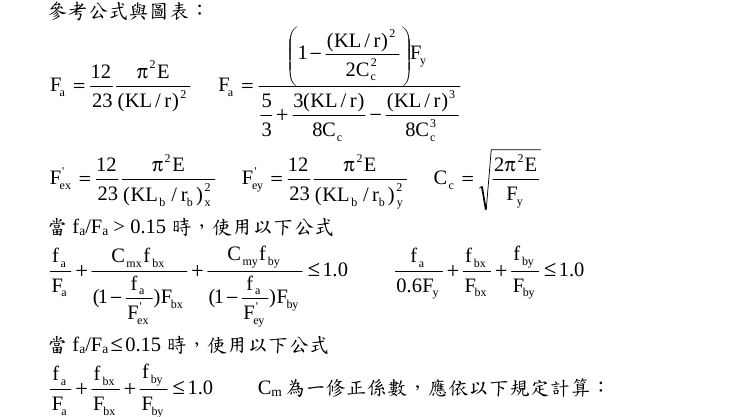
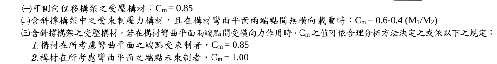
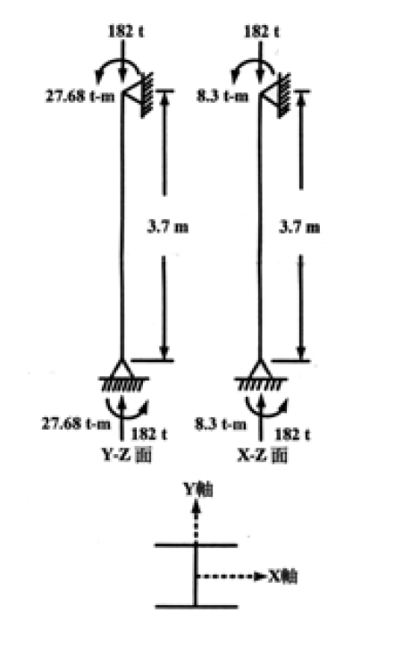

# SS-2003-4 題目正本

> 本檔只記錄**考卷上寫了什麼、圖上畫了什麼**，不含任何解法。解析見同資料夾 `SS-2003-4.md`。
> 判讀清單經使用者確認前，狀態為「待確認」；確認後本檔原則上不再修改（改動須回考卷原圖並記 log）。

| 項目 | 內容 |
|------|------|
| 考卷 | `raw/exams/SS-2003_鋼結構設計.pdf` 第 2 頁（全一張・背面），第四題 |
| 考年 | 民國 92 年（2003） |
| 配分 | 25 分 |
| 附圖 | 1 張（Y-Z 面、X-Z 面受力圖＋斷面軸向），`SS-2003-4-fig-1.png`；題內參考公式截圖 `SS-2003-4-eqn-1.png`、`SS-2003-4-eqn-2.png` |
| 判讀狀態 | **待確認**（轉錄 2026-11-02，PyMuPDF 110 dpi 全頁＋附圖 450–800 dpi 局部目視，盲讀後才比對既有解析） |

## 1. 考卷原文（逐字）

> 四、有一梁柱構材長度為 L，其斷面為 W12×170 型鋼且為結實斷面，受一軸向載重 (P) 及端點之強軸、弱軸彎矩如附圖所示，使用 A36 鋼材，假設其 $K_x = K_y = 1.0$，試檢核該構材是否滿足容許應力法 (ASD) 之要求？（25 分）
>
> W12×170 斷面參數：
> $A$ = 322.58 cm²、$S_x$ = 3850.96 cm³、$r_x$ = 14.58 cm、$S_y$ = 1348.66 cm³、$r_y$ = 8.18 cm、$L_c$ = 4.05 m、$L_u$ = 19.6 m
>
> A36 鋼材：$F_y$ = 2.50 t/cm²、$F_u$ = 4.10 t/cm²、$E$ = 2.1×10³ t/cm²
>
> 軸向載重 $P$ = 182 ton、彎矩 $M_x$ = 27.68 t-m、$M_y$ = 8.30 t-m、長度 $L$ = 3.7 m
>
> 參考公式與圖表：（見 §2）

## 2. 考卷給的公式、附表與參數

- 題文：W12×170 斷面參數、A36 材料、$P$、$M_x$、$M_y$、$L$（照錄於 §1）；$K_x = K_y = 1.0$；結實斷面。
- 題內「參考公式與圖表」照錄：

$$F_a = \frac{12}{23}\frac{\pi^2E}{(KL/r)^2}\qquad F_a = \frac{\left(1 - \dfrac{(KL/r)^2}{2C_c^2}\right)F_y}{\dfrac53 + \dfrac{3(KL/r)}{8C_c} - \dfrac{(KL/r)^3}{8C_c^3}}$$
$$F'_{ex} = \frac{12}{23}\frac{\pi^2E}{(KL_b/r_b)_x^2}\qquad F'_{ey} = \frac{12}{23}\frac{\pi^2E}{(KL_b/r_b)_y^2}\qquad C_c = \sqrt{\frac{2\pi^2E}{F_y}}$$
$$\text{當 } f_a/F_a > 0.15:\quad \frac{f_a}{F_a} + \frac{C_{mx}f_{bx}}{\left(1 - \dfrac{f_a}{F'_{ex}}\right)F_{bx}} + \frac{C_{my}f_{by}}{\left(1 - \dfrac{f_a}{F'_{ey}}\right)F_{by}} \le 1.0,\qquad \frac{f_a}{0.6F_y} + \frac{f_{bx}}{F_{bx}} + \frac{f_{by}}{F_{by}} \le 1.0$$
$$\text{當 } f_a/F_a \le 0.15:\quad \frac{f_a}{F_a} + \frac{f_{bx}}{F_{bx}} + \frac{f_{by}}{F_{by}} \le 1.0$$

  「$C_m$ 為一修正係數，應依以下規定計算：㈠可側向位移構架之受壓構材：$C_m = 0.85$；㈡含斜撐構架中之受束制壓力構材，且在構材彎曲平面兩端點間無橫向載重時：$C_m = 0.6 - 0.4(M_1/M_2)$；㈢含斜撐構架之受壓構材，若在構材彎曲平面兩端點間受橫向力作用時，$C_m$ 之值可依合理分析方法決定之或依以下之規定：1. 構材在所考慮彎曲平面之端點受束制者，$C_m = 0.85$；2. 構材在所考慮彎曲平面之端點未束制者，$C_m = 1.00$」

  

  

- 考卷 $C_m = 0.6 - 0.4(M_1/M_2)$ **沒有寫 ≥ 0.4 下限**，也沒有寫 $M_1/M_2$ 的正負號規定。
- **沒有給 $F_{bx}$、$F_{by}$ 的數值或公式**（只給 $L_c$、$L_u$），**沒有給 $C_b$**。
- 同頁上半部的螺栓表、$A_e$、承壓強度屬第三題，與本題無關。
- 卷首注意事項：不必抄題，作答時請將試題題號及答案依照順序寫在試卷上；可以使用電子計算器，但需詳列解答過程。

## 3. 附圖

*圖面文字照錄：182 t；27.68 t-m；3.7 m；27.68 t-m；182 t；Y-Z 面；182 t；8.3 t-m；3.7 m；8.3 t-m；182 t；X-Z 面；Y軸；X軸。*

## 4. 判讀清單

「把握」標**不確定**者請優先確認；解讀類項目（題目用字的意思）另標「解讀」。

| # | 項目 | 判讀 | 圖上／題文依據 | 把握 |
|---|------|------|---------------|------|
| 1 | 端點彎矩轉向 | 上、下端彎矩**同為逆時針**（兩面皆同）→ 構材為**反向（雙）曲率**，$\lvert M_1/M_2\rvert = 1$ | 附圖為 149×305 點陣圖，800 dpi 放大：上端弧箭頭在左側朝下、下端弧箭頭在右側朝上 | 確定 |
| 2 | 彎矩對應軸 | Y-Z 面 27.68 t-m＝$M_x$（強軸）；X-Z 面 8.3 t-m＝$M_y$（弱軸） | 題文「強軸、弱軸彎矩」＋斷面軸向圖（X 軸垂直腹板） | 確定 |
| 3 | 支承 | 上端側向支承（三角形抵牆）、下端鉸支 → 兩端不側移（含斜撐構架之構材） | 附圖支承符號 | 確定（解讀） |
| 4 | 跨間載重 | 兩端點間無橫向載重 → 適用考卷 $C_m$ 規定㈡ | 附圖只有端點力與端點彎矩 | 確定（解讀） |
| 5 | $C_m$ 下限 | 考卷 $C_m = 0.6 - 0.4(M_1/M_2)$ 未列 ≥ 0.4 下限 | 題內公式照錄 | 確定 |
| 6 | 長度 | $L$ = 3.7 m，$K_xL = K_yL$ = 3.7 m；側向無支撐長度亦為 3.7 m（題未另給） | 題文＋附圖 3.7 m | 確定（解讀） |
| 7 | 容許彎曲應力 | 題未給 $F_{bx}$、$F_{by}$；給 $L_c$ = 4.05 m、$L_u$ = 19.6 m 與「結實斷面」供考生判斷 | 題文 | 確定 |
| 8 | $M_y$ 數值 | 題文 8.30 t-m、圖上 8.3 t-m，一致 | 題文＋圖 | 確定 |

---

*轉錄：2026-11-02（SS-U1-3 題目正本推廣・批 1）*
