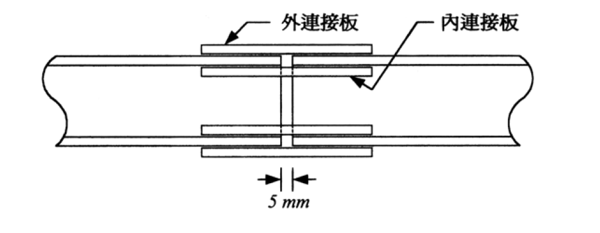

# SS-2004-2 題目正本

> 本檔只記錄**考卷上寫了什麼、圖上畫了什麼**，不含任何解法。解析見同資料夾 `SS-2004-2.md`。
> 判讀清單經使用者確認前，狀態為「待確認」；確認後本檔原則上不再修改（改動須回考卷原圖並記 log）。

| 項目 | 內容 |
|------|------|
| 考卷 | `raw/exams/SS-2004_鋼結構設計.pdf` 第 1 頁（全一張之正面），第二題 |
| 考年 | 民國 93 年（2004） |
| 配分 | 25 分 |
| 附圖 | 1 張（翼板續接立面），`SS-2004-2-fig-1.png`；聯結物容許應力表照錄於 §2 |
| 判讀狀態 | **待確認**（轉錄 2026-11-02，PyMuPDF 110 dpi 全頁＋附圖 400 dpi 局部目視，盲讀後才比對既有解析） |

## 1. 考卷原文（逐字）

> 二、下圖所示為一 H150×150×7×10 斷面拉力構材之續接。該構材承受靜載重 DL＝40 t 及活載重 LL＝30 t，在服務載重下該接合不可產生滑動。以容許應力（ASD）法設計此接合，且在規定範圍內盡量縮短接合之長度。設計內容包括螺栓之直徑 d、個數、配置方式，連接板（外連接板及內連接板）之厚度、寬度、長度，螺栓孔形式、配置（繪簡圖標示之）。拉力構材及連接板使用 A36 鋼材（$F_y$＝2.5 t/cm²，$F_u$＝4.1 t/cm²），假設連接板為全斷面積降伏控制；使用 A325 螺栓，螺栓孔最小邊距為 1.5d，最小間距為 3d，所有尺寸皆以 1mm 為最小增量。<u>H150×150×7×10：A＝40.1 cm²，翼板與腹板交接處彎角之半徑 R＝11 mm</u>。（本設計僅在翼板連結，不在腹板接合）。（25 分）

## 2. 考卷給的公式、附表與參數

- 題文：DL＝40 t、LL＝30 t；A36，$F_y$＝2.5、$F_u$＝4.1 t/cm²；A325；邊距 ≥ 1.5d、間距 ≥ 3d；尺寸以 1 mm 為增量；A＝40.1 cm²；R＝11 mm。
- 「聯結物之容許應力（t/cm²）表」（照錄）：

| 聯結物種類 | 容許張應力 $F_t$ | 摩阻型 標準孔 | 摩阻型 擴大孔及短槽孔 | 摩阻型 長槽孔 載重垂直 | 摩阻型 長槽孔 載重平行 | 承壓式接合 |
|---|---|---|---|---|---|---|
| A307 螺栓 | 1.40 | | | | | 0.70 |
| A325 螺栓、螺紋在剪力平面 | 3.05 | 1.19 | 1.05 | 0.84 | 0.70 | 1.45 |
| A325 螺栓、螺紋不在剪力平面 | 3.05 | 1.19 | 1.05 | 0.84 | 0.70 | 2.10 |
| A490 螺栓、螺紋在剪力平面 | 3.75 | 1.47 | 1.26 | 1.05 | 0.91 | 1.95 |
| A490 螺栓、螺紋不在剪力平面 | 3.75 | 1.47 | 1.26 | 1.05 | 0.91 | 2.80 |
| 螺牙桿件符合 3.5 節規定螺栓、螺紋在剪力平面 | 0.33 $F_u$ | | | | | 0.17 $F_u$ |
| 螺牙桿件符合 3.5 節規定螺栓、螺紋不在剪力平面 | 0.33 $F_u$ | | | | | 0.17 $F_u$ |

- 卷首注意事項：㈠不必抄題；㈡可以使用電子計算器。

## 3. 附圖

*圖面文字照錄：外連接板；內連接板；5 mm。*

## 4. 判讀清單

「把握」標**不確定**者請優先確認；解讀類項目（題目用字的意思）另標「解讀」。

| # | 項目 | 判讀 | 圖上／題文依據 | 把握 |
|---|------|------|---------------|------|
| 1 | 連接板配置 | 每片翼板外側一片外連接板、內側腹板兩側各一片內連接板 → 螺栓雙剪 | 附圖 400 dpi＋題文「外連接板及內連接板」 | 確定 |
| 2 | 間隙 5 mm | 兩段構材端面間隙 | 附圖 | 確定 |
| 3 | 服務拉力 | DL＋LL＝70 t，兩翼板各分擔一半 | 題文＋「僅在翼板連結」 | 確定（解讀） |
| 4 | 不可滑動 | 摩阻型、標準孔 $F_v$＝1.19 t/cm² | 題文＋附表 | 確定（解讀） |
| 5 | 內連接板寬 | 受腹板厚與彎角半徑 R 限制 | 題給 R＝11 mm | 確定（解讀） |
| 6 | 連接板強度 | 「全斷面積降伏控制」→ $F_t = 0.6F_y$ 檢核毛面積 | 題文 | 確定（解讀） |
| 7 | 拉力構材本身 | 是否須檢核構材翼板淨斷面（題文只說連接板全斷面控制） | 題文 | 不確定（解讀） |
| 8 | 螺栓直徑 | 由考生自選（題未指定），以縮短接合長度為目標 | 題文 | 確定 |

---

*轉錄：2026-11-02（SS-U1-4 題目正本推廣・批 1）*
