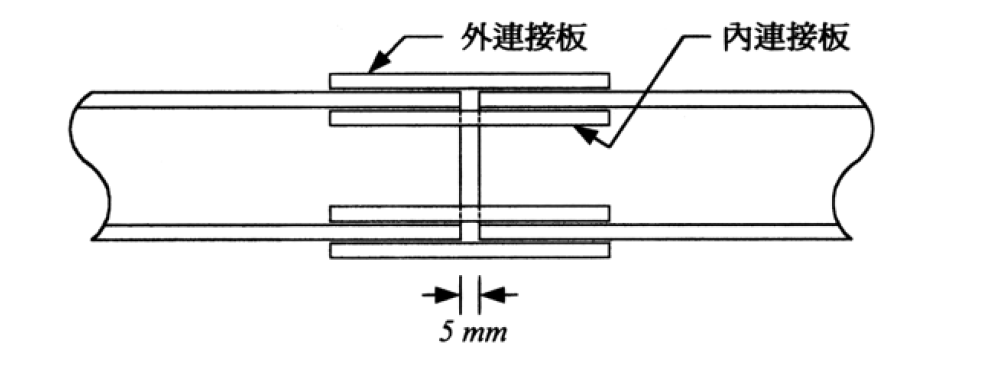
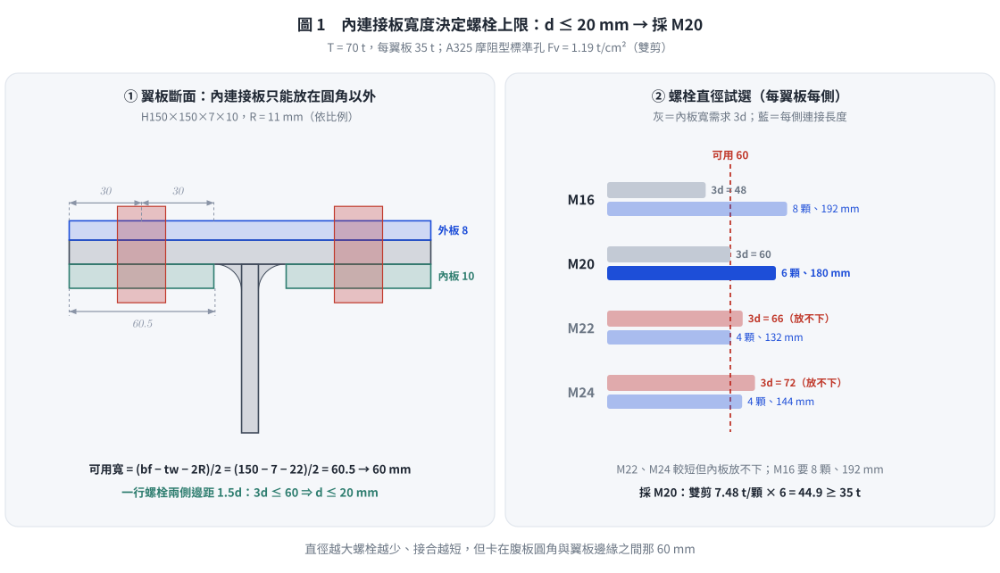
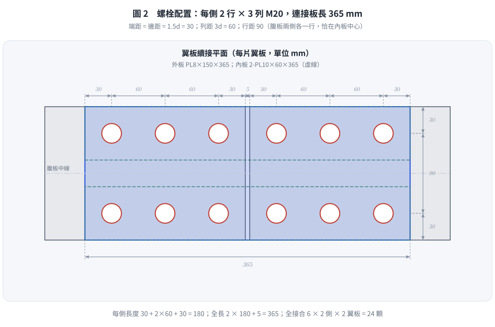

# 考題編號：SS-2004-2

**主分類：** `SS-U1-4` 接合之分析與設計
**副分類：** `SS-U1-1` 拉力及壓力桿件
**設計法：** ASD
**標籤：** `拉力構材續接` `高拉力螺栓` `摩阻型接合` `A325` `翼板連接` `連接板設計` `最短接合長度` `ASD` `內連接板寬度限制` `雙剪`

---

## 1. 原始題目重述

> 二、下圖所示為一 H150×150×7×10 斷面拉力構材之續接。該構材承受靜載重 DL＝40 t 及活載重 LL＝30 t，在服務載重下該接合不可產生滑動。以容許應力（ASD）法設計此接合，且在規定範圍內盡量縮短接合之長度。設計內容包括螺栓之直徑 d、個數、配置方式，連接板（外連接板及內連接板）之厚度、寬度、長度，螺栓孔形式、配置（繪簡圖標示之）。拉力構材及連接板使用 A36 鋼材（$F_y = 2.5\ \text{t/cm}^2$，$F_u = 4.1\ \text{t/cm}^2$），假設連接板為全斷面積降伏控制；使用 A325 螺栓，螺栓孔最小邊距為 1.5d，最小間距為 3d，所有尺寸皆以 1mm 為最小增量。H150×150×7×10：A＝40.1 cm²，翼板與腹板交接處彎角之半徑 R＝11 mm。（本設計僅在翼板連結，不在腹板接合）。（25 分）
>
> 附「聯結物之容許應力表」：A325 螺栓摩阻型接合、標準孔 $F_v = 1.19\ \text{t/cm}^2$。



*圖說（依考卷原圖目視判讀，使用者確認）：兩段 H150×150×7×10 對接，間隙 5 mm，只在上、下翼板設連接板：每一翼板**外側一片外連接板**、**內側（腹板兩側）各一片內連接板**，螺栓穿過外連接板＋翼板＋內連接板 → **雙剪**。內連接板受腹板與彎角限制，每片可用寬度 $(150 - 7 - 2 \times 11)/2 = 60.5$ mm。*

**設計條件：**

| 項目 | 值 |
|------|----|
| 服務拉力 | $T = 40 + 30 = 70$ t → 每翼板 35 t |
| 螺栓 | A325，摩阻型（服務載重不滑動），標準孔，$F_v = 1.19\ \text{t/cm}^2$ |
| 連接板 | A36，全斷面降伏控制 $F_t = 0.6F_y = 1.5\ \text{t/cm}^2$ |
| 尺寸規定 | 邊距 ≥ 1.5d、間距 ≥ 3d、尺寸以 1 mm 為增量 |

---

## 2. 考題核心精神與出題者意圖

本題是**設計題**，核心是「在幾何限制下選螺栓直徑，讓接合最短」：
1. 雙剪摩阻型螺栓容量 $2F_vA_b$ 決定螺栓數；
2. 內連接板夾在腹板與翼板邊緣之間，**可用寬度只有 60.5 mm**，一片內板上只能放一行螺栓且兩側邊距都要 ≥ 1.5d → 直徑上限 $d \le 60.5/3 = 20.2$ mm；
3. 螺栓不能放在翼板中央（那裡是腹板），每翼板只能在腹板兩側各一行；
4. 連接板厚度以全斷面降伏 $0.6F_yA_g$ 決定。

出題者給 R＝11 mm 就是要考生算出內板寬度並發現大直徑螺栓放不下。

---

## 3. 解題戰略地圖與陷阱分析

$$T \to \text{每翼板 } 35\text{ t} \to \text{內板寬 } 60.5 \Rightarrow d \le 20 \to n = \lceil 35/(2F_vA_b) \rceil \to \text{配置（2 行）} \to \text{板厚、板長}$$

**關鍵陷阱：**

1. **螺栓位置**：翼板中央是腹板，不能放螺栓；螺栓必須分居腹板兩側（每翼板兩行）。
2. **內連接板是兩片**：腹板兩側各一片，每片寬 60 mm，不是一整片跨過腹板。
3. **直徑上限**：一片內板上的螺栓兩側邊距皆 ≥ 1.5d → $3d \le 60.5$ mm → M22（需 66 mm）、M24 以上都放不下。
4. **雙剪**：外板＋內板夾住翼板，每顆螺栓兩個剪力面。
5. **板厚分配**：雙剪下內、外板各傳一半力，各自需 $A_g \ge 17.5/1.5 = 11.67$ cm²。

---

## 3.5 變數層次分析（Variable Hierarchy Analysis）

> 依考卷原卷重建（2026-11-01 勘誤）。

### 主要公式（$\boxed{\phantom{x}}$ = 未知，待推導）

$$\boxed{b_{in}} = \frac{b_f - t_w - 2R}{2},\qquad 3\boxed{d} \le b_{in}$$

$$\boxed{n} = \left\lceil \frac{T/2}{2F_vA_b} \right\rceil,\qquad \boxed{L_{side}} = 1.5d + (m - 1)\,3d + 1.5d$$

$$\boxed{t_{out}} \ge \frac{T/4}{0.6F_y\,b_f},\qquad \boxed{t_{in}} \ge \frac{T/4}{0.6F_y\,(2b_{in})}$$

### L1：題目直接給定

| 變數 | 值 |
|------|----|
| $T$ | DL 40＋LL 30＝70 t |
| 斷面 | $b_f = 150$、$t_w = 7$、$t_f = 10$ mm、$R = 11$ mm、$A = 40.1$ cm² |
| $F_v$ | 1.19 t/cm²（A325 摩阻型、標準孔） |
| $F_y$ | 2.5 t/cm² |
| 邊距／間距 | ≥ 1.5d／≥ 3d，1 mm 增量 |

### L2：需知識點推導

| 變數 | 推導 | 值 |
|------|------|----|
| 每翼板設計力 | $T/2$（只接翼板） | 35 t |
| 內板寬 $b_{in}$ | $(150 - 7 - 22)/2$ | 60.5 → 60 mm |
| $d_{max}$ | $3d \le 60$ | 20 mm |
| 每顆容量 | $2 \times 1.19 \times 3.14$ | 7.48 t |
| $n$（每翼板每側） | $35/7.48 = 4.68$ → 取偶數 | 6 顆（2 行 × 3 列） |

### L3：深層知識（不懂就卡住）

| 知識點 | 說明 |
|--------|------|
| 摩阻型接合 | 服務載重不滑動 → 用摩阻型容許剪應力，雙剪乘 2 |
| H 型鋼翼板續接幾何 | 腹板與彎角佔去翼板中段，內板只能分兩片放在兩側 |
| 「最短接合」 | 直徑越大列數越少，但受內板寬度上限約束 |

---

## 4. 步驟化詳細計算過程

### 4.1 設計荷重與幾何

$$T = DL + LL = 40 + 30 = 70\ \text{t},\qquad T_{flange} = 35\ \text{t}$$

內連接板可用寬度：

$$b_{in} = \frac{b_f - t_w - 2R}{2} = \frac{150 - 7 - 2 \times 11}{2} = 60.5\ \text{mm} \rightarrow 60\ \text{mm}$$

### 4.2 螺栓直徑選擇

每片內板放一行螺栓，兩側邊距 ≥ 1.5d：$3d \le 60$ mm → $d \le 20$ mm。

| $d$ (mm) | $A_b$ (cm²) | 雙剪 $2F_vA_b$ (t) | 所需顆數（每翼板每側） | 列數 | 每側長度 $1.5d + (m-1)3d + 1.5d$ | 內板寬需求 $3d$ |
|:---:|:---:|:---:|:---:|:---:|:---:|:---:|
| 16 | 2.01 | 4.79 | 7.31 → 8 | 4 | 192 mm | 48 ✓ |
| **20** | **3.14** | **7.48** | **4.68 → 6** | **3** | **180 mm** | **60 ✓** |
| 22 | 3.80 | 9.05 | 3.87 → 4 | 2 | 132 mm | 66 ✗ |
| 24 | 4.52 | 10.77 | 3.25 → 4 | 2 | 144 mm | 72 ✗ |

（螺栓分居腹板兩側，顆數取偶數。）M22 以上雖然更短，但內板放不下。

$$\boxed{d = 20\ \text{mm（A325，摩阻型，標準孔 } \phi 22\text{ mm）}}$$



*圖 1　內連接板只能放在腹板圓角與翼板邊緣之間（60 mm），一行螺栓兩側各留 1.5d ⇒ $d \le 20$ mm。這張圖攔的是為了縮短接合而選 M22 以上、卻沒檢查內板放不放得下，以及忽略圓角 $R$。*

### 4.3 螺栓數量

$$n = \left\lceil \frac{35}{7.48} \right\rceil = 5 \rightarrow \boxed{6\ \text{顆／翼板／側}}\ (2\ \text{行} \times 3\ \text{列}),\qquad 6 \times 7.48 = 44.9\ \text{t} \ge 35\ \text{t}\ \checkmark$$

全接合：$6 \times 2\ \text{側} \times 2\ \text{翼板} = \boxed{24\ \text{顆 M20}}$

### 4.4 螺栓配置

- **橫向**：兩行分居腹板兩側，各距翼板邊緣 30 mm（＝1.5d），兩行中心距 $150 - 2 \times 30 = 90$ mm；每行恰在內連接板中心（距內板兩緣各 30 mm）。螺栓中心距腹板面 $75 - 3.5 - 30 = 41.5$ mm，距彎角止點 30.5 mm，可施工。
- **縱向（每側）**：第一列距構材端 30 mm，列距 60 mm（＝3d），最後一列距連接板端 30 mm：

$$L_{side} = 30 + 2 \times 60 + 30 = 180\ \text{mm}$$

- **連接板全長**：$2 \times 180 + 5 = \boxed{365\ \text{mm}}$

```
        ←30→←60→←60→←30→ 5 ←30→←60→←60→←30→
翼板緣 ┌──────────────────┬─┬──────────────────┐
  30   │  ●    ●    ●     │ │     ●    ●    ●  │   ← 第 1 行（腹板一側）
  90   │                  │間│                  │   （腹板）
  30   │  ●    ●    ●     │隙│     ●    ●    ●  │   ← 第 2 行（腹板另一側）
翼板緣 └──────────────────┴─┴──────────────────┘
```



*圖 2　螺栓配置平面。每側 $30 + 2 \times 60 + 30 = 180$ mm，全長 $2 \times 180 + 5 = 365$ mm，兩行螺栓恰在兩片內板中心；這張圖攔的是端距、列距配錯與漏算構材間隙。*

### 4.5 連接板設計（全斷面降伏，$F_t = 1.5\ \text{t/cm}^2$）

雙剪下外板與兩片內板各傳一半：$35/2 = 17.5$ t，各需 $A_g \ge 17.5/1.5 = 11.67\ \text{cm}^2$。

| 板 | 寬度 | 需要厚度 | 採用 | $A_g$ |
|----|------|---------|------|------|
| 外連接板（1 片） | 150 mm | $11.67/15 = 0.78$ cm | **8 mm** | 12.0 cm² ✓ |
| 內連接板（2 片） | 2 × 60 mm | $11.67/12 = 0.97$ cm | **10 mm** | 12.0 cm² ✓ |

**驗算（總面積法）：** $15 \times 0.8 + 12 \times 1.0 = 24.0\ \text{cm}^2 \ge 70/2/1.5 = 23.33\ \text{cm}^2$ ✓

### 4.6 承壓補充檢核

每顆螺栓 $35/6 = 5.83$ t。翼板 $t = 1.0$ cm 最薄：內部螺栓 $1.2F_u\,d\,t = 4.92 \times 2.0 \times 1.0 = 9.84$ t；端部螺栓邊距 $L = 3.0$ cm＝1.5d，$F_p = LF_u/2d = 3.0 \times 4.1/4.0 = 3.08$ t/cm² → 6.15 t ≥ 5.83 t ✓。

### 4.7 設計成果

| 項目 | 設計 |
|------|------|
| 螺栓 | A325、**M20**、摩阻型、標準孔 φ22 mm |
| 數量 | 每翼板每側 6 顆（2 行 × 3 列），全接合 **24 顆** |
| 配置 | 行距 90 mm（腹板兩側、距翼板緣 30 mm）；列距 60 mm；端距 30 mm |
| 外連接板 | **PL 8 × 150 × 365**（每翼板 1 片，共 2 片） |
| 內連接板 | **PL 10 × 60 × 365**（每翼板 2 片，共 4 片） |

$$\boxed{\text{M20 × 24 顆；外板 PL8×150×365、內板 2-PL10×60×365（每翼板）；板長 365 mm}}$$

---

## 5. 關鍵爭議點與進階探討

### 5.1 為何直徑不能再加大？

接合長度隨直徑增大而縮短（M22 只要 2 列、每側 132 mm），但內連接板寬只有 60.5 mm，放 M22 需要 66 mm。題目給彎角半徑 R＝11 mm 正是為了這個限制。若內板改成跨過腹板的一整片在幾何上不可能（腹板擋住），把螺栓放在翼板中央也不可能。

### 5.2 摩阻型 vs 承壓型

題目要求服務載重下不得滑動 → 摩阻型（$F_v = 1.19$），遠低於承壓型 2.10。若改承壓型，M20 每顆雙剪 13.2 t，每側 4 顆即可，但服務載重下會滑動。

### 5.3 板厚的另一種取法

若不區分內外板、以總面積 $(15 + 12)t \ge 23.33$ 設計，$t \ge 0.864$ cm → 內外板同取 9 mm（$A_g = 24.3$ cm²）亦可接受；但雙剪時兩個剪力面各傳一半，內板較窄，分開檢核較合理。

### 5.4 構材本身（題目未要求）

H150×150×7×10 本身：$0.6F_yA_g = 0.6 \times 2.5 \times 40.1 = 60.2$ t < 70 t，**構材全斷面已不足**，扣孔後淨斷面更不足。題目只要求設計續接，但實務上應先加大構材斷面。

---

## 6. 依最新規範（AISC 360-16／-22）對照

| 項目 | 考卷（ASD 1989 系） | AISC 360-16／-22（ASD） |
|:---|:---|:---|
| 摩阻型強度 | $F_vA_b = 1.19A_b$（每剪力面） | $R_n = \mu D_u h_f T_b n_s$，$\Omega = 1.50$（標準孔） |
| M20 每顆雙剪 | 7.48 t | $\mu = 0.30$（Class A）、$D_u = 1.13$、$T_b = 142$ kN（14.5 t）→ $0.30 \times 1.13 \times 14.5 \times 2/1.5 = 6.54$ t |
| 所需顆數（每翼板每側） | 4.68 → 6 | 5.35 → 6 |
| 邊距、間距 | 1.5d、3d（題目指定） | 間距建議 3d；最小邊距依表 J3.4（M20 為 26 mm） |

**本題以 360-16 估算：** 每翼板每側仍為 6 顆，設計不變。

---

*修正日期：2026-11-01（依考卷原圖：內連接板在腹板兩側各一片，螺栓須分居腹板兩側。原解把每排 1 顆螺栓「置中於翼板」（該處為腹板）、內連接板作一整片 120 mm 跨過腹板，配置無法施工；且未檢核內板寬度限制，選用 M25（需內板寬 ≥ 75 mm）。更正：內板可用寬 60.5 mm → 螺栓上限 M20；每翼板每側 6 顆（2 行 × 3 列）、全接合 24 顆；外連接板 PL8×150×365、內連接板 2-PL10×60×365（原解 M25 × 12 顆、板厚 9 mm、板長 457 mm）。新增直徑比較表、承壓補充檢核、構材本身不足之提醒與 §6 對照）*
*圖解補繪：2026-11-03（向量圖 2 張，腳本 `gen_SS-2004-2.py`，改輸入可原地重跑；SVG 供 wiki／PDF，2× PNG 供 pptx／影片）*
*驗證狀態：unverified*
