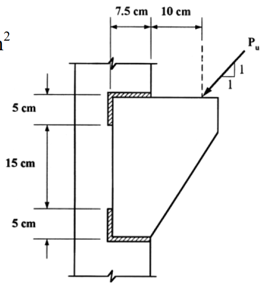

# SS-2004-3 題目正本

> 本檔只記錄**考卷上寫了什麼、圖上畫了什麼**，不含任何解法。解析見同資料夾 `SS-2004-3.md`。
> 判讀清單經使用者確認前，狀態為「待確認」；確認後本檔原則上不再修改（改動須回考卷原圖並記 log）。

| 項目 | 內容 |
|------|------|
| 考卷 | `raw/exams/SS-2004_鋼結構設計.pdf` 第 2 頁（全一張之背面），第三題 |
| 考年 | 民國 93 年（2004） |
| 配分 | 25 分 |
| 附圖 | 1 張（托架銲接），`SS-2004-3-fig-1.png`；題內表 10.2.5 照錄於 §2 |
| 判讀狀態 | **待確認**（轉錄 2026-11-02，PyMuPDF 110 dpi 全頁＋附圖 400 dpi 局部目視，盲讀後才比對既有解析） |

## 1. 考卷原文（逐字）

> 三、有一托架（bracket）承受一偏心因數化載重（factored load, $P_u$），托架上下端分別銲接於柱子翼板，接頭與銲接相關尺寸如附圖所示。柱子為 W 型鋼，鋼柱、雙角鋼皆使用 A36 鋼材，使用填角銲（fillet weld）與 E70XX 銲條，假設接合相關各接板強度足夠。若使用銲接尺寸（weld size）為 10 mm 之填角銲，試根據極限設計法規範，以彈性分析法求該托架所能承受之最大因數化載重（$P_u$）。（25 分）

## 2. 考卷給的公式、附表與參數

- 參考資料：A36 鋼材：$F_y$ = 2.50 t/cm²。E70XX 銲條 $F_{EXX}$ = 4.93 t/cm²。
- 附錄 鋼結構極限設計法規範及解說 表 10.2.5 銲接之設計強度（填角銲部分，照錄）：

| 銲接與應力型態 | 材料 | 強度係數 $\phi$ | 標稱強度 $F_{BM}$ 或 $F_W$ | 銲接強度 |
|---|---|---|---|---|
| 有效面積上之剪力 | 母材／銲材 | 0.75 | $0.6F_{EXX}$ | 可採小於或等於相稱之銲材 |
| 平行於銲軸之拉力或壓力 | 母材 | 0.90 | | |

- 卷首注意事項：㈠不必抄題；㈡可以使用電子計算器。

## 3. 附圖

*圖面文字照錄：7.5 cm；10 cm；Pu；1；1；5 cm；15 cm；5 cm。*

## 4. 判讀清單

「把握」標**不確定**者請優先確認；解讀類項目（題目用字的意思）另標「解讀」。

| # | 項目 | 判讀 | 圖上／題文依據 | 把握 |
|---|------|------|---------------|------|
| 1 | 銲道形狀 | 上、下各一組：水平 7.5 cm（沿托架上／下緣）＋垂直 5 cm（沿托架左緣），中段 15 cm 不銲 | 斜線區（400 dpi） | 確定 |
| 2 | 7.5 cm | 托架左緣至柱翼板右緣（托架搭接在翼板上的寬度） | 尺寸線端點 | 確定 |
| 3 | 10 cm | 柱翼板右緣至 $P_u$ 作用點（虛線） | 尺寸線端點 | 確定 |
| 4 | $P_u$ | 作用於托架上緣，1:1 向左下（水平、垂直分量相等） | 箭頭與斜率三角形 | 確定 |
| 5 | 銲道面數 | 只畫一面（托架與翼板搭接的一側），單面填角銲 | 立面圖只見一面；題文未說兩面 | 不確定（解讀） |
| 6 | 「雙角鋼」 | 題文提雙角鋼，圖上為單一托架板；以圖為準，視為一塊托架板 | 題文與圖不一致 | 不確定（解讀） |
| 7 | 銲道強度 | 喉厚 $0.707 \times 10$ mm，$\phi(0.6F_{EXX})$，$\phi = 0.75$ | 表 10.2.5 | 確定 |

---

*轉錄：2026-11-02（SS-U1-4 題目正本推廣・批 1）*
