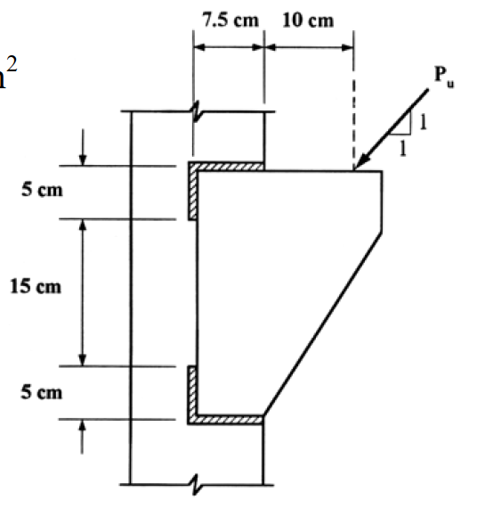
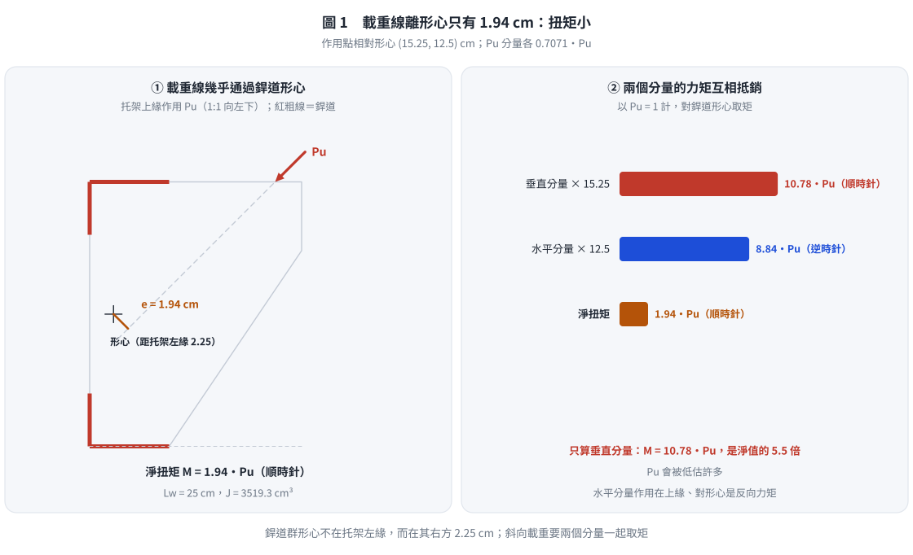
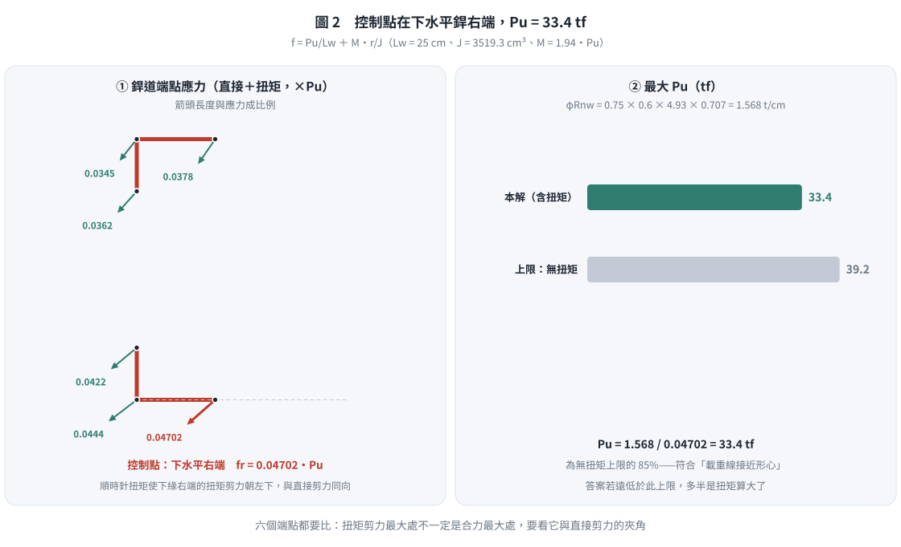

# 考題編號：SS-2004-3

**主分類：** `SS-U1-4` 接合之分析與設計
**副分類：** （無）
**設計法：** LRFD
**標籤：** `填角銲` `偏心接合` `彈性向量法` `托架` `E70XX` `雙角鋼` `LRFD` `極慣性矩` `⊐形銲道` `斜向載重力矩方向`

---

## 1. 原始題目重述

（依考卷原文，93 年第 2 頁第三題）

> 三、有一托架（bracket）承受一偏心因數化載重（factored load, $P_u$），托架上下端分別銲接於柱子翼板，接頭與銲接相關尺寸如附圖所示。柱子為 W 型鋼，鋼柱、雙角鋼皆使用 A36 鋼材，使用填角銲（fillet weld）與 E70XX 銲條，假設接合相關各接板強度足夠。若使用銲接尺寸（weld size）為 10 mm 之填角銲，試根據極限設計法規範，以彈性分析求該托架所能承受之最大因數化載重（$P_u$）。（25 分）
>
> 參考資料：A36 鋼材：$F_y = 2.50$ t/cm²。E70XX 銲條 $F_{EXX} = 4.93$ t/cm²。附錄 鋼結構極限設計法規範及解說 表 10.2.5（填角銲有效面積上之剪力：$\phi = 0.75$，標稱強度 $0.6F_{EXX}$）。

*圖說（依考卷原圖 400 dpi 目視判讀，2026-11-01 更正）：托架板搭在柱翼板上，上、下各有一組 **⊐ 形**填角銲（斜線區）：沿托架上（下）緣的**水平段 7.5 cm**（自托架左緣至柱翼板右緣），加上沿托架左緣的**垂直段 5 cm**；中間 15 cm 不銲。托架總高 5＋15＋5＝25 cm。$P_u$ 作用於托架上緣、距柱翼板右緣 10 cm 處，箭頭以 **1:1 斜率指向左下（朝柱）**。*

**判讀表**

| 項目 | 判讀 |
|:---|:---|
| 銲道 | 上、下各一組 ⊐ 形：水平 7.5 cm＋垂直 5 cm；單面銲，總長 $L_w = 2(7.5+5) = 25$ cm |
| 銲腳 | $w = 10$ mm → 喉厚 $a = 0.707$ cm |
| 載重作用點 | 托架上緣，距銲道左緣 $7.5 + 10 = 17.5$ cm |
| 載重方向 | 1:1 向左下：$P_x = P_u/\sqrt{2}$（←）、$P_y = P_u/\sqrt{2}$（↓） |
| 求 | 彈性法（向量法）最大 $P_u$ |

---

## 2. 考題核心精神與出題者意圖

本題測驗 **LRFD 偏心填角銲群的彈性向量法**：

1. **讀圖決定銲道群**：上下各一組 ⊐ 形（水平＋垂直段），不是只有兩段水平銲
2. **斜向載重兩分量的力矩方向**：垂直分量（↓、作用於形心右側）產生順時針矩；水平分量（←、作用於形心上方）產生**逆時針**矩，兩者**相減**
3. 出題者刻意讓載重作用線幾乎通過銲道形心，淨扭矩很小 → 直接剪力主控，$P_u$ 比「兩分量相加」大得多
4. 銲縫群線性質（形心、$I_x$、$I_y$、$J$）與最不利點的向量疊加

---

## 3. 解題戰略地圖與陷阱分析

**作戰計畫：**
1. $\phi R_{nw}$（每 cm 銲道設計強度）
2. 銲道群形心 $\bar{x}$ 與 $J = I_x + I_y$
3. 作用點相對形心的座標 → 淨扭矩 $M = x\,P_y' - y\,P_x'$（帶正負號）
4. 各角點：直接剪力＋扭矩剪力向量疊加，取最大
5. $f_{r,\max} = \phi R_{nw}$ 解 $P_u$

**陷阱分析：**

| 陷阱 | 說明 | 應對策略 |
|:---|:---|:---|
| ⚠️ 漏看垂直銲段 | 斜線區是 ⊐ 形，上下各含 5 cm 垂直段 | 放大附圖逐段數；$L_w = 25$ cm |
| ⚠️ 載重方向看反 | 箭頭指向托架（朝柱、向左下），水平分量向左 | 水平分量力矩與垂直分量**反向** |
| ⚠️ 偏心量的起點 | 10 cm 量自柱翼板右緣，不是銲道形心 | 形心距左緣 2.25 cm → $x = 17.5 - 2.25 = 15.25$ cm |
| ⚠️ 形心不在銲道中點 | 垂直段在左緣，形心偏左 | $\bar{x} = \Sigma L x / \Sigma L$ |
| ⚠️ 喉厚 | 公制 $a = 0.707w$ | $a = 0.707$ cm |

## 3.5 變數層次分析（Variable Hierarchy Analysis）

> 複習提示：解題後，在每個卡住的知識點「卡關?」欄標記 `⚠`；第二次複習時只看有 `⚠` 的項目。

**最終目標：** LRFD 偏心填角銲（彈性向量法）→ 銲道群性質 → 帶正負號的淨扭矩 → 最不利點合力 → $P_u$

### 主要公式（$\boxed{\phantom{x}}$ = 未知，待推導）

$$\phi R_{nw} = 0.75 \times 0.6F_{EXX} \times \boxed{a}, \qquad a = 0.707w$$

$$\boxed{\bar{x}} = \frac{\Sigma L_i x_i}{\Sigma L_i}, \qquad \boxed{J} = I_x + I_y$$

$$\boxed{M} = x_P\,P_y - y_P\,P_x \quad \text{（帶正負號，逆時針為正）}$$

$$f_x = \frac{P_x}{L_w} - \frac{M\,y}{J}, \qquad f_y = \frac{P_y}{L_w} + \frac{M\,x}{J}, \qquad \boxed{f_r} = \sqrt{f_x^2 + f_y^2} \le \phi R_{nw}$$

### L1：題目直接給定

| 符號 | 數值 | 說明 |
|:---|:---|:---|
| $w$ | 10 mm | 填角銲尺寸 |
| $F_{EXX}$ | 4.93 t/cm² | E70XX |
| 銲道 | ⊐ 形 ×2：水平 7.5 cm、垂直 5 cm | 附圖斜線區 |
| 上下銲道間距 | 25 cm（5＋15＋5） | 附圖 |
| 偏心 | 載重距柱翼板右緣 10 cm | 附圖 |
| 方向 | 1:1 向左下 | 附圖箭頭 |

### L2：需知識點推導

| 符號 | 公式 / 來源 | 卡關? |
|:---|:---|:---:|
| $\phi R_{nw}$ | $0.75 \times 0.6 \times 4.93 \times 0.707 = 1.568$ t/cm | |
| $L_w$ | $2(7.5 + 5) = 25$ cm | |
| $\bar{x}$ | $2(7.5 \times 3.75)/25 = 2.25$ cm（自左緣） | |
| $I_x$ | 水平 $2 \times 7.5 \times 12.5^2$＋垂直 $2(5 \times 10^2 + 5^3/12)$ = 3364.6 cm³ | |
| $I_y$ | 水平 $2[7.5^3/12 + 7.5(1.5)^2]$＋垂直 $2 \times 5 \times 2.25^2$ = 154.7 cm³ | |
| $J$ | 3519.3 cm³ | |
| 作用點 | $(x_P, y_P) = (15.25,\ 12.5)$ cm | |
| $M$ | $15.25(-0.7071P_u) - 12.5(-0.7071P_u) = -1.944P_u$（順時針，很小） | |
| 控制點 | 右下角 $(5.25, -12.5)$：$f_r = 0.04702P_u$ | |

### L3：深層知識（不懂就卡住）

| 知識點 | 說明 | 卡關? |
|:---|:---|:---:|
| 力矩帶正負號 | 兩分量對形心的力矩方向要各自判斷，不可一律相加 | |
| 載重線接近形心 | 淨扭矩小 → 接近純剪，強度由 $\phi R_{nw} L_w$ 主控（上限 $1.568 \times 25 = 39.2$ t） | |
| 彈性法 vs 瞬心法 | 彈性法偏保守；ICR 法可得較高強度 | |

---

## 4. 步驟化詳細計算過程

### 4.1 填角銲設計強度

$$a = 0.707 \times 1.0 = 0.707\ \text{cm}$$

$$\phi R_{nw} = 0.75 \times 0.6 \times 4.93 \times 0.707 = \boxed{1.568\ \text{t/cm}}$$

### 4.2 銲道群線性質（以托架左緣、上下中點為原點）

| 銲段 | 長度 (cm) | 位置 |
|:---|:---:|:---|
| 上水平 | 7.5 | $y = +12.5$，$x = 0 \sim 7.5$ |
| 上垂直 | 5 | $x = 0$，$y = 7.5 \sim 12.5$ |
| 下水平 | 7.5 | $y = -12.5$，$x = 0 \sim 7.5$ |
| 下垂直 | 5 | $x = 0$，$y = -7.5 \sim -12.5$ |

$$L_w = 25\ \text{cm}, \qquad \bar{x} = \frac{2 \times 7.5 \times 3.75}{25} = 2.25\ \text{cm}, \qquad \bar{y} = 0$$

$$I_x = 2(7.5)(12.5^2) + 2\left[5(10^2) + \frac{5^3}{12}\right] = 2343.75 + 1020.83 = 3364.6\ \text{cm}^3$$

$$I_y = 2\left[\frac{7.5^3}{12} + 7.5(3.75 - 2.25)^2\right] + 2\left[5(2.25)^2\right] = 104.06 + 50.63 = 154.7\ \text{cm}^3$$

$$J = I_x + I_y = \boxed{3519.3\ \text{cm}^3}$$

### 4.3 淨扭矩（逆時針為正）

作用點相對形心：$x_P = 17.5 - 2.25 = 15.25$ cm，$y_P = 12.5$ cm；$P_x = P_y = -0.7071P_u$（向左、向下）。

$$M = x_P P_y - y_P P_x = 15.25(-0.7071P_u) - 12.5(-0.7071P_u) = \boxed{-1.944\,P_u\ \text{t}\cdot\text{cm}}\ \text{（順時針）}$$

垂直分量產生順時針 $10.78P_u$、水平分量產生逆時針 $8.84P_u$，兩者大部分抵銷——載重作用線幾乎通過銲道形心。

*圖 1　載重線幾乎通過銲道形心：兩個分量的力矩大部分抵銷，淨扭矩只有 $1.944P_u$。這張圖攔的是把形心放在托架左緣，或只用垂直分量取矩（扭矩放大 5.5 倍、$P_u$ 嚴重低估）。*

### 4.4 各點應力（每 cm 銲道，$\times P_u$）

直接剪力：$f_{dx} = f_{dy} = -0.7071/25 = -0.02828$

扭矩剪力：$f_{tx} = -My/J$，$f_{ty} = Mx/J$

| 點 | $(x, y)$ 相對形心 | $f_x$ | $f_y$ | $f_r$ |
|:---|:---:|:---:|:---:|:---:|
| 上水平右端 | (5.25, 12.5) | −0.02138 | −0.03119 | 0.03781 |
| 上垂直上端 | (−2.25, 12.5) | −0.02138 | −0.02704 | 0.03447 |
| 上垂直下端 | (−2.25, 7.5) | −0.02414 | −0.02704 | 0.03625 |
| **下水平右端** | **(5.25, −12.5)** | **−0.03519** | **−0.03119** | **0.04702** |
| 下垂直下端 | (−2.25, −12.5) | −0.03519 | −0.02704 | 0.04438 |
| 下垂直上端 | (−2.25, −7.5) | −0.03243 | −0.02704 | 0.04222 |

控制點：**下水平銲右端**，$f_r = 0.04702P_u$ t/cm（順時針扭矩使下緣右端的扭矩剪力朝左下，與直接剪力同向）。

### 4.5 求解最大 $P_u$

$$0.04702\,P_u = 1.568 \quad\Rightarrow\quad \boxed{P_u = 33.4\ \text{tf}}$$

### 4.6 雙路徑驗算

- **路徑二（離散積分）**：把四段銲道各切 600 等分，逐點計算面積、形心、$J$ 與合力，得 $\bar{x} = 2.25$、$J = 3519.3$、$f_{r,\max} = 0.04702P_u$，與閉合式一致。
- **上限檢查**：若無扭矩（純剪），$P_u = 1.568 \times 25 = 39.2$ t；本解 33.4 t 小於上限且接近，符合「載重線接近形心」的判斷。

*圖 2　六個端點的應力向量與最大 $P_u$。控制點在下水平銲右端（$0.04702P_u$），$P_u = 33.4$ tf 為無扭矩上限的 85%；這張圖攔的是選錯控制點，以及答案遠低於上限仍不察覺扭矩算大了。*

---

## 5. 設計成果彙整

| 項目 | 結果 |
|:---|:---|
| 每 cm 設計強度 | $\phi R_{nw} = 1.568$ t/cm |
| 銲道群 | ⊐ 形 ×2，$L_w = 25$ cm，$\bar{x} = 2.25$ cm，$J = 3519.3$ cm³ |
| 淨扭矩 | $M = 1.944P_u$ t·cm（順時針） |
| 控制點 | 下水平銲右端，$f_r = 0.04702P_u$ |
| **最大因數化載重** | $\boxed{P_u = 33.4\ \text{tf}}$ |

### 原解錯在哪（2026-11-01 勘誤）

| 項目 | 原解 | 更正 |
|:---|:---|:---|
| 銲道 | 只有上下兩段 7.5 cm 水平銲（$L_w = 15$） | ⊐ 形，含兩段 5 cm 垂直銲（$L_w = 25$） |
| 載重方向 | 水平分量「向外（向右）」，兩分量力矩同向相加，$M = 22.5P_u/\sqrt{2}$ | 箭頭向左下，兩分量力矩反向，$M = 1.944P_u$ |
| 偏心 | 10 cm 當成距銲道形心 | 10 cm 量自柱翼板右緣，距形心 15.25 cm |
| $P_u$ | 10.6 tf | **33.4 tf** |

---

## 6. 依最新規範（AISC 360-16／-22）對照

| 項目 | 考卷（LRFD 1993 系，表 10.2.5） | AISC 360-16／-22 |
|:---|:---|:---|
| 填角銲強度 | $\phi = 0.75$，$0.6F_{EXX} \times A_{we}$ | 相同（J2.4，$\phi = 0.75$） |
| 方向性增強 | 無 | 可採 $F_{nw} = 0.6F_{EXX}(1.0 + 0.5\sin^{1.5}\theta)$，或以瞬心法（Manual Table 8-4～8-11 類）計算偏心銲群 |
| 母材檢核 | 題目假設足夠 | J4 須另檢核母材剪力降伏／斷裂 |

本題以 360-16 的彈性法計算結果相同（33.4 tf）。若改用瞬心法並計入方向性增強，強度可再提高（彈性法偏保守），但考試仍依題目指定的彈性分析作答。

---

*修正日期：2026-11-01（依考卷原圖 400 dpi 目視判讀：銲道為上下兩組 ⊐ 形，原解漏掉兩段 5 cm 垂直銲（$L_w$ 15 → 25 cm）；$P_u$ 箭頭以 1:1 指向左下（朝柱），原解把水平分量看成向外並與垂直分量力矩相加（$M = 22.5P_u/\sqrt{2}$），更正為兩分量力矩反向、淨扭矩 $1.944P_u$；偏心 10 cm 量自柱翼板右緣，距銲道形心 15.25 cm。$P_u$ 由 10.6 更正為 **33.4 tf**。依題文重述題目，新增雙路徑驗算與 §6 對照）*
*圖解補繪：2026-11-03（向量圖 2 張，腳本 `gen_SS-2004-3.py`，改輸入可原地重跑；SVG 供 wiki／PDF，2× PNG 供 pptx／影片）*
*驗證狀態：unverified*
