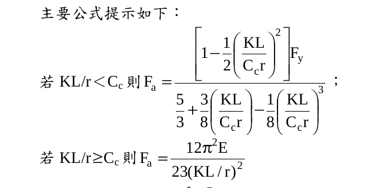
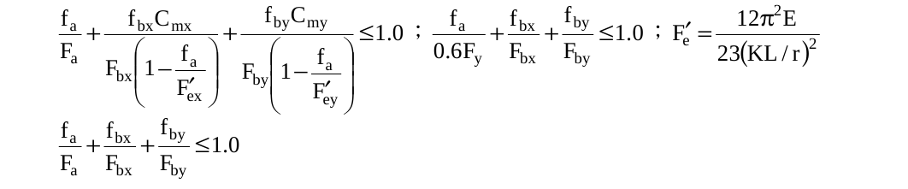
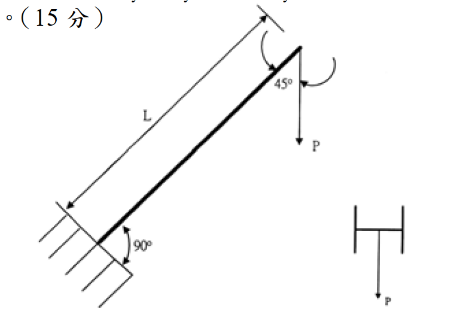

# SS-2004-4 題目正本

> 本檔只記錄**考卷上寫了什麼、圖上畫了什麼**，不含任何解法。解析見同資料夾 `SS-2004-4.md`。
> 判讀清單經使用者確認前，狀態為「待確認」；確認後本檔原則上不再修改（改動須回考卷原圖並記 log）。

| 項目 | 內容 |
|------|------|
| 考卷 | `raw/exams/SS-2004_鋼結構設計.pdf` 第 2 頁（全一張・背面），第四題 |
| 考年 | 民國 93 年（2004） |
| 配分 | 25 分（㈠ 5、㈡ 5、㈢ 15） |
| 附圖 | 1 張（懸臂構材立面與斷面），`SS-2004-4-fig-1.png`；題內公式截圖 `SS-2004-4-eqn-1.png`、`SS-2004-4-eqn-2.png` |
| 判讀狀態 | **待確認**（轉錄 2026-11-02，PyMuPDF 110 dpi 全頁＋附圖 400 dpi 局部目視＋抽出文字核對，盲讀後才比對既有解析） |

## 1. 考卷原文（逐字）

> 四、依據我國鋼結構容許應力設計法規範及解說：
>
> ㈠試述為何要採用 $C_m$ 係數？（5 分）
>
> ㈡原本 $C_m = 0.6-0.4\,(M_1/M_2) \ge 0.4$ 的大於等於 0.4 為何我國規範不再採用？（5 分）
>
> ㈢一支懸臂鋼構材，自由端承受垂直力 $P$ = 2000 kg，構材長度 $L$ = 350 cm，構材為結實斷面，強軸彈性斷面模數 $S_x$ = 451 cm³，弱軸彈性斷面模數 $S_y$ = 152 cm³，迴轉半徑 $r_x$ = 8.81 cm，$r_y$ = 5.13 cm，斷面積 $A$ = 59 cm²，彈性模數 $E$ = 2.1×10³ t/cm²，$F_y$ = 2.5 t/cm²，忽略自重與剪應力的影響，且強軸有充分側向支撐，構材僅會繞弱軸彎曲，有效長度係數 $K$ = 2.1，$C_c$ = 127，$F_{bx}$ = 0.66 $F_y$，$F_{by}$ = 0.75 $F_y$，$C_m$ = 0.85，試求構材是否滿足容許應力設計法的規定。（15 分）
>
> 主要公式提示如下：（見 §2）

## 2. 考卷給的公式、附表與參數

- 題文：$P$ = 2000 kg；$L$ = 350 cm；$S_x$、$S_y$、$r_x$、$r_y$、$A$、$E$、$F_y$（照錄於 §1）；$K$ = 2.1；$C_c$ = 127；$F_{bx} = 0.66F_y$、$F_{by} = 0.75F_y$；$C_m$ = 0.85。
- 「主要公式提示如下」照錄：

$$\text{若 } KL/r < C_c \text{ 則 } F_a = \frac{\left[1 - \dfrac12\left(\dfrac{KL}{C_cr}\right)^2\right]F_y}{\dfrac53 + \dfrac38\left(\dfrac{KL}{C_cr}\right) - \dfrac18\left(\dfrac{KL}{C_cr}\right)^3}\;;\qquad \text{若 } KL/r \ge C_c \text{ 則 } F_a = \frac{12\pi^2E}{23(KL/r)^2}$$
$$\frac{f_a}{F_a} + \frac{f_{bx}C_{mx}}{F_{bx}\left(1 - \dfrac{f_a}{F'_{ex}}\right)} + \frac{f_{by}C_{my}}{F_{by}\left(1 - \dfrac{f_a}{F'_{ey}}\right)} \le 1.0\;;\quad \frac{f_a}{0.6F_y} + \frac{f_{bx}}{F_{bx}} + \frac{f_{by}}{F_{by}} \le 1.0\;;\quad F'_e = \frac{12\pi^2E}{23(KL/r)^2}$$
$$\frac{f_a}{F_a} + \frac{f_{bx}}{F_{bx}} + \frac{f_{by}}{F_{by}} \le 1.0$$

  

  

- 公式提示**沒有寫各交互式的適用條件**（$f_a/F_a$ > 0.15 或 ≤ 0.15），只列出三式。
- $P$ 與構材的夾角**題文沒寫**，只在圖上標 45°；題文也**沒有給端點彎矩**。
- 卷首注意事項：不必抄題，作答時請將試題題號及答案依照順序寫在試卷上；可以使用電子計算器。

## 3. 附圖

*圖面文字照錄：L；45°；P；90°；P。*

## 4. 判讀清單

「把握」標**不確定**者請優先確認；解讀類項目（題目用字的意思）另標「解讀」。

| # | 項目 | 判讀 | 圖上／題文依據 | 把握 |
|---|------|------|---------------|------|
| 1 | $P$ 與構材夾角 | 構材軸線與鉛直 $P$ 夾 45° → $P$ 分為沿軸向 $P\cos45°$ 與垂直構材 $P\sin45°$ | 圖標 45°（400 dpi） | 確定 |
| 2 | 軸力性質 | 軸向分量指向固定端 → **壓力** | $P$ 向下作用於右上自由端、固定端在左下 | 確定（解讀） |
| 3 | 固定端 | 構材與牆面垂直（90°），固定支承 | 圖標 90°＋牆面斜線 | 確定 |
| 4 | 彎曲軸 | $P$ 平行翼板 → 繞**弱軸**彎曲，與題文「僅會繞弱軸彎曲」一致；$f_{bx}$ = 0 | 斷面小圖（翼板垂直、P 鉛直） | 確定 |
| 5 | 自由端弧箭頭 | 兩個弧形箭頭為 45° 角度標註，**不是外加彎矩** | 兩箭頭分別指向構材與 $P$ 作用線，45° 字樣在其間；題文未給端彎矩 | 確定（解讀） |
| 6 | $L$ | 350 cm 為沿構材軸長度 | 尺寸線平行構材 | 確定 |
| 7 | 有效長度 | $K$ = 2.1（題給），$KL$ = 735 cm；題文只給一個 $K$ | 題文 | 確定 |
| 8 | 交互式條件 | 公式提示未標適用條件，考生須自行依 $f_a/F_a$ 選式 | 題內公式照錄 | 確定 |
| 9 | ㈠㈡ | 說明題，依我國容許應力設計法規範及解說 | 題文 | 確定 |

---

*轉錄：2026-11-02（SS-U1-3 題目正本推廣・批 1）*
