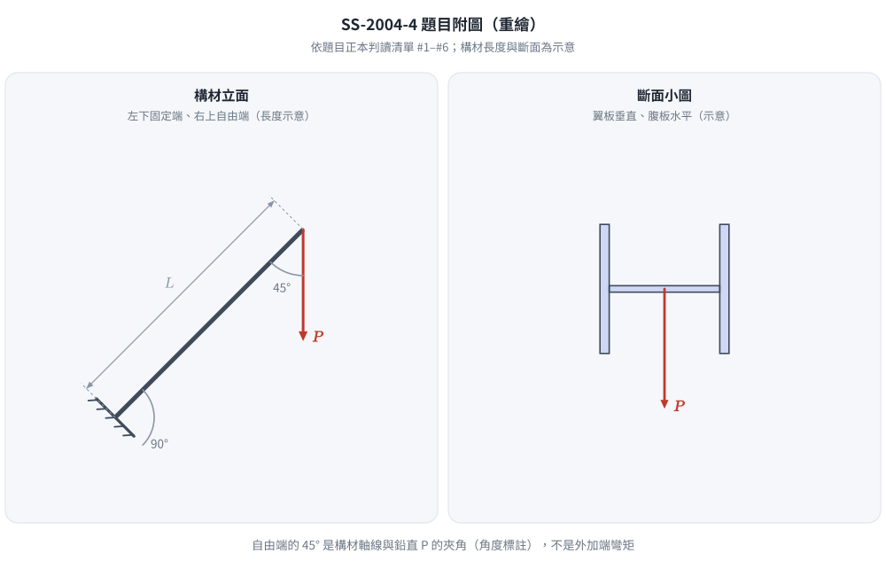
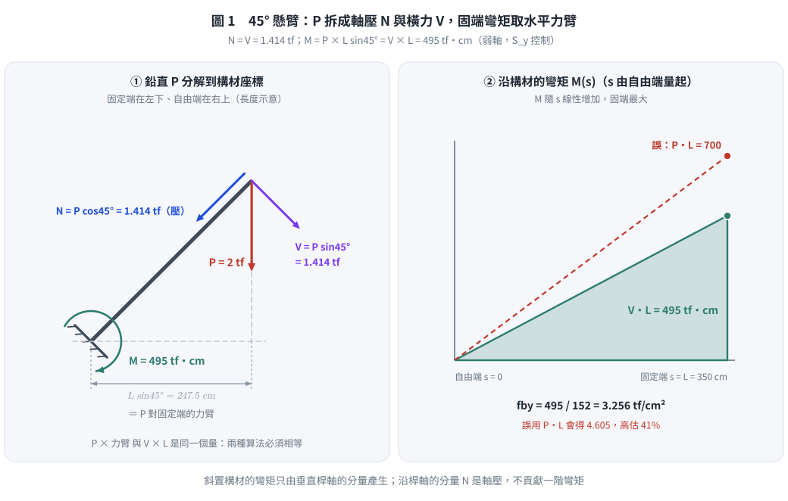
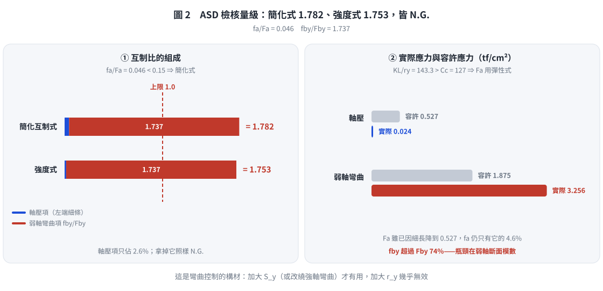

# 考題編號：SS-2004-4

**主分類：** `SS-U1-3` 梁柱桿件
**副分類：** （無）
**設計法：** ASD
**標籤：** `梁柱桿件` `ASD` `Cm係數` `懸臂柱` `弱軸彎曲` `45°斜置構材` `互制方程式` `有效長度` `Cm下限0.4廢止` `M1/M2正負號`

---

## 1. 題目（考卷原文見題目正本）

> 考卷原文、公式提示、附圖與判讀清單（**待確認**）見 [`SS-2004-4-problem.md`](SS-2004-4-problem.md)。本節只列**解題時最容易讀錯的地方**與本解使用的記號；題意以題目正本為準。

*題目附圖重繪（依題目正本判讀清單 #1–#6）。自由端的 45° 是構材軸線與鉛直 $P$ 的夾角標註，不是外加端彎矩；$P$ 平行翼板，構材繞**弱軸**彎曲。*

### 常見誤讀

| 項目 | 正確判讀 | 常見誤讀 |
|------|---------|---------|
| ㈡ 問什麼 | 舊式 $C_m = 0.6-0.4(M_1/M_2) \geq 0.4$ 的「$\geq 0.4$」**為何我國規範不再採用** | 讀成「此式的適用條件與 0.4 下限的工程意義」，反而論證下限有必要（舊版解析即如此） |
| $M_1/M_2$ 正負號 | **雙曲率為正、單曲率為負**（規範 8.2 節本文） | 正負號顛倒（舊版解析即如此） |
| 自由端弧形箭頭 | 45° 角度標註 | 外加端彎矩 |
| 彎曲軸 | $P$ 平行翼板 → 繞弱軸，$f_{bx} = 0$ | 繞強軸 |
| 交互式條件 | 考卷公式提示**沒寫**適用條件，須依 $f_a/F_a$ 自行選式 | 以為考卷有給 |

**本解記號：** $P = 2$ tf；$L = 350$ cm（沿構材軸）；$N = P\cos45°$（沿桿軸，壓）、$V = P\sin45°$（垂直桿軸）；$M = V \cdot L$（$= P \times L\sin45°$）；$K = 2.1$、$C_c = 127$；$F_y = 2.5$、$E = 2100$ t/cm²；$F_{by} = 0.75F_y$；$C_m = 0.85$（題給）。

---

## 2. 考題核心精神與出題者意圖

本題三小題涵蓋：

1. **觀念題 ㈠（為何用 $C_m$）**：考驗對 ASD 梁柱設計哲學的理解——$C_m$ 是等效均勻彎矩係數，反映實際彎矩分佈對穩定性的影響
2. **觀念題 ㈡（為何廢止 $C_m \geq 0.4$）**：考的是下限的**來歷**——0.4 原為梁的側向扭轉挫屈而訂，不適用於梁柱的彎矩放大，以及 Zandonini（1985）證實取消後 $C_m$ 式仍適用
3. **計算題**：45° 斜置懸臂構材，**需正確分解荷載為軸力 + 橫向力**，再進行 ASD 互制公式驗算

---

## 3. 解題戰略地圖與陷阱分析

**作戰計畫：**
1. 回答 (一)(二) 觀念題
2. 分解 45° 斜置垂直荷載為軸力與橫向分量
3. 計算 $f_a$（軸壓應力）與 $f_{by}$（弱軸彎曲應力）
4. 計算允許壓縮應力 $F_a$（依 $KL/r_y$ 與 $C_c$ 判斷公式）
5. 判斷 $f_a/F_a$ 是否 $\geq 0.15$，選用適當互制方程式
6. 代入互制公式，得出結論

**陷阱分析：**

| 陷阱 | 說明 | 應對策略 |
|------|------|---------|
| ⚠️ 45° 荷載分解方向 | P 為鉛直力，需分解至「沿桿軸」與「垂直桿軸」兩分量 | 軸壓 $= P\cos45°=P/\sqrt{2}$，橫向 $= P\sin45°=P/\sqrt{2}$ |
| ⚠️ 弱軸用 $r_y$ 計算 $F_a$ | 弱軸彎曲 → 弱軸挫屈控制 → $KL/r_y$ | $r_y = 5.13\ \text{cm}$，不用 $r_x$ |
| ⚠️ $KL/r > C_c$ → 用尤拉公式 | $143.3 > 127$ → 進入彈性挫屈區 | $F_a = 12\pi^2E/[23(KL/r)^2]$ |
| ⚠️ $f_a/F_a < 0.15$ → 用簡化式 | 軸壓力極小，採簡化互制式 | $f_a/F_a + f_{by}/F_{by}$ 即可 |
| ⚠️ ㈡ 問的是「為何不再採用」 | 不是問 0.4 下限的意義，而是問它為何被廢止 | 依規範解說 C8.2：下限原為梁 LTB 而訂（$C_b$ 上限 2.3 之倒數），不適用於彎矩放大；Zandonini (1985) |
| ⚠️ $C_m$ 選用款別 | 懸臂自由端可側移（$K = 2.1$），屬第 (1) 款「可側向位移構架」→ 0.85；第 (2) 款 $0.6-0.4M_1/M_2$ 只用於有側撐、兩端點間無橫向載重 | 題目已給 $C_m = 0.85$；本題 $f_a/F_a < 0.15$ 用簡化式，$C_m$ 不進入計算 |

## 3.5 變數層次分析（Variable Hierarchy Analysis）

> 複習提示：解題後，在每個卡住的知識點「卡關?」欄標記 `⚠`；第二次複習時只看有 `⚠` 的項目。

**最終目標：** 說明 $C_m$ 係數概念與 $\geq 0.4$ 下限廢止的理由 → 分解 45° 斜置懸臂構材荷載 → ASD 梁柱互制驗算（彈性挫屈區）

### 主要公式（$\boxed{\phantom{x}}$ = 未知，待推導）

$$N = P\cos45°,\quad V = P\sin45° \quad \text{（荷載分解）}$$

$$\boxed{M} = V \times L \quad \text{（懸臂固端彎矩）}$$

$$\boxed{f_a} = N/A,\quad \boxed{f_{by}} = M/S_y$$

$$\frac{KL}{r_y} > C_c \Rightarrow \boxed{F_a} = \frac{12\pi^2 E}{23(KL/r)^2} \quad \text{（彈性挫屈區）}$$

$$\frac{f_a}{F_a} < 0.15 \Rightarrow \frac{f_a}{F_a} + \frac{f_{by}}{F_{by}} \leq 1.0 \quad \text{（簡化式）}$$

### L1：題目直接給定

| 符號 | 數值 | 說明 |
|------|------|------|
| $P$ | 2 tf（2000 kg） | 頂端垂直靜載重 |
| $L$ | 350 cm | 構材長度 |
| $K$ | 2.1 | 懸臂有效長度係數 |
| $C_c$ | 127 | 彈性/非彈性分界細長比 |
| $S_x$ | 451 cm³ | 強軸斷面模數 |
| $S_y$ | 152 cm³ | 弱軸斷面模數 |
| $r_x$ | 8.81 cm | 強軸迴轉半徑 |
| $r_y$ | 5.13 cm | 弱軸迴轉半徑 |
| $A$ | 59 cm² | 斷面積 |
| $E$ | 2100 tf/cm² | 彈性模數 |
| $F_{bx}$ | $0.66F_y$ | 強軸允許彎曲應力 |
| $F_{by}$ | $0.75F_y$ = 1.875 tf/cm² | 弱軸允許彎曲應力 |
| $C_m$ | 0.85 | 等效均勻彎矩係數（直接給定） |
| 構材方向 | 弱軸彎曲 | 橫向荷載沿弱軸 |

### L2：需知識點推導

**Step 1：荷載分解（45° 斜置）**

| 符號 | 公式 / 來源 | 卡關? |
|------|------------|:-----:|
| $N$（軸壓） | $P\cos45° = 2/\sqrt{2} = 1.414$ tf | |
| $V$（弱軸橫向） | $P\sin45° = 2/\sqrt{2} = 1.414$ tf | |
| $M$（固端） | $V \times L = 1.414 \times 350 = 495$ tf·cm | |

**Step 2：實際應力**

| 符號 | 公式 / 來源 | 卡關? |
|------|------------|:-----:|
| $f_a$ | $N/A = 1.414/59 = 0.024$ tf/cm² | |
| $f_{by}$ | $M/S_y = 494.97/152 = 3.256$ tf/cm² | |
| $f_{bx}$ | 0（無強軸彎矩） | |

**Step 3：允許壓縮應力（彈性挫屈區）**

| 符號 | 公式 / 來源 | 卡關? |
|------|------------|:-----:|
| $KL/r_y$ | $2.1 \times 350 / 5.13 = 143.3$ | |
| 判斷 | $143.3 > C_c = 127$ → 彈性挫屈區 | |
| $F_a$ | $12\pi^2 E / [23(143.3)^2] = 0.527$ tf/cm² | |

**Step 4：互制方程式驗算**

| 符號 | 公式 / 來源 | 卡關? |
|------|------------|:-----:|
| $f_a/F_a$ | $0.024/0.527 = 0.046 < 0.15$ → 簡化式 | |
| 簡化式 | $0.0455 + 3.256/1.875 = 0.0455 + 1.7368 = 1.782 > 1.0$ ❌ | |
| 強度式 | $0.016 + 1.737 = 1.753 > 1.0$ ❌ | |

### L3：深層知識（不懂就卡住）

| 知識點 | 說明 | 卡關? |
|--------|------|:-----:|
| $C_m$ 係數的物理意義 | 等效均勻彎矩係數，校正非均勻彎矩分佈對穩定性的有利影響 | |
| $C_m = 0.6-0.4(M_1/M_2)$ 適用條件與正負號 | 第 (2) 款：有側撐、彎曲平面兩端點間無橫向載重；**雙曲率 $M_1/M_2$ 為正、單曲率為負**；懸臂（可側移）屬第 (1) 款 $C_m = 0.85$ | |
| $\geq 0.4$ 下限為何廢止 | 1978 AISC 收錄、1986 AISC-LRFD 與我國規範不採用；原為梁的側向扭轉挫屈而訂（$1/C_{b,\max} = 1/2.3 \approx 0.43$），不適用於彎矩放大 | |
| ASD 柱設計 $C_c$ 分界 | $KL/r < C_c$ 非彈性；$> C_c$ 改用尤拉公式，$F_a$ 大幅降低 | |
| 弱軸彎曲的嚴重性 | $S_y = 152$ vs $S_x = 451$，弱軸抗彎只有強軸 33%；方向選擇至關重要 | |
| $f_a/F_a < 0.15$ 判斷 | 軸壓比小於 0.15 才用簡化式；否則需用含 $C_m/(1-f_a/F'_e)$ 的穩定式 | |
| $F'_e$（尤拉彈性挫屈應力） | $12\pi^2E/[23(KL/r)^2]$，既是 $F_a$（彈性區）也出現在分母放大係數中 | |

---

## 4. 步驟化詳細計算過程

### (一) $C_m$ 係數的意義（5分）

**$C_m$（等效均勻彎矩係數，Equivalent Moment Factor）** 用於 ASD 梁柱穩定互制公式中，目的是：

1. **校正彎矩分佈形狀的影響**：穩定公式的推導假設構材承受「均勻彎矩（uniform moment）」，此時放大效果最嚴重。當實際彎矩分佈非均勻（如三角形、拋物線）時，實際的二次效應較小。
2. **換算為等效均勻彎矩**：$C_m \leq 1.0$ 表示實際彎矩分佈比均勻彎矩「溫和」，允許承受更大的彎矩；$C_m = 1.0$ 為最保守，等同均勻彎矩假設。
3. **物理意義**：$C_m/(1 - f_a/F'_e)$ 是考慮 P-δ 效應後的放大係數，$C_m < 1.0$ 反映非均勻彎矩對穩定性的有利影響。

---

### (二) $C_m \geq 0.4$ 的下限為何不再採用（5分）

**先釐清式子本身**（我國容許應力設計法 8.2 節第 (2) 款）：$C_m = 0.6 - 0.4(M_1/M_2)$ 用於含斜撐構架中的受束制壓力構材、且彎曲平面兩端點間無橫向載重；$M_1/M_2$ 為兩端較小與較大彎矩之比，**構材受彎成雙曲率時為正值、單曲率時為負值**。故單曲率均勻彎矩（$M_1/M_2 = -1$）得 $C_m = 1.0$（最不利），雙曲率反對稱（$M_1/M_2 = +1$）得 $C_m = 0.2$（最有利）——0.4 下限只在雙曲率一側（$M_1/M_2 > 0.5$）才會起作用。

**下限 0.4 的來歷與廢止理由**（規範解說 C8.2）：

1. **來歷**：「$\geq 0.4$」收錄於 1978 年版 AISC 規範；1986 年版 AISC-LRFD 規範及我國規範均已不再採用。
2. **用錯地方**：這個 0.4 主要是針對**梁的側向扭轉挫屈**而訂，並不適用於梁柱彎矩放大（P-δ）的修正。梁的側向扭轉挫屈以 $C_b$ 修正，$C_b$ 上限為 2.3，其倒數 $1/2.3 \approx 0.43$ 與 0.4 十分接近——0.4 是把 LTB 的彎矩梯度上限搬到 $C_m$ 上，對彎矩放大並無依據。
3. **研究證實不需要**：Zandonini（1985）指出，取消 0.4 的限制後，$C_m$ 公式仍可適用於彎矩放大效應的修正。

**補充：取消後為何不會不安全。** $C_m$ 很小（接近反對稱雙曲率）時，構材最大彎矩發生在**端部**而非跨中，此時由不含 $C_m$ 的強度式 $f_a/0.6F_y + f_b/F_b \leq 1.0$（端部斷面檢核）控制；穩定式只負責跨中的二階放大，不需要人為的地板值。SS-2003-4（$C_m = 0.2$，強度式控制）即為一例。

> **答題要點：** ① 0.4 原為梁的側向扭轉挫屈而訂（與 $C_b \leq 2.3$ 的倒數相當），不適用於彎矩放大；② Zandonini（1985）證實取消後 $C_m$ 式仍適用；③ 端部斷面強度另由強度式檢核。

---

### (三) 45° 懸臂梁柱 ASD 驗算（15分）

#### 4.1 荷載分解

構材斜置 45°，自由端承受鉛直向下力 $P = 2000\ \text{kg} = 2\ \text{tf}$：

$$\text{沿桿軸壓力（軸壓）：}\quad N = P\cos 45° = \frac{2}{\sqrt{2}} = \sqrt{2} \approx 1.414\ \text{tf（壓縮）}$$

$$\text{垂直桿軸橫向力（弱軸彎曲）：}\quad V = P\sin 45° = \frac{2}{\sqrt{2}} = \sqrt{2} \approx 1.414\ \text{tf}$$

> 因構材弱軸方向承受橫向載重，彎矩作用於**弱軸**（$S_y$ 控制）

#### 4.2 固端彎矩（懸臂）

$$M = V \times L = \sqrt{2} \times 350 = 494.97 \approx 495\ \text{tf}\cdot\text{cm}$$

*圖 1　$P$ 拆成軸壓 $N$ 與橫力 $V$，固端彎矩等於 $P$ 乘水平力臂（$= V \cdot L$）。這張圖攔的是把整個 $P$ 當橫力而得 $M = P \cdot L = 700$ tf·cm（$f_{by}$ 高估 41%）。*

---

#### 4.3 實際應力

**軸壓應力：**
$$f_a = \frac{N}{A} = \frac{\sqrt{2}}{59} = \frac{1.414}{59} = \boxed{0.02397\ \text{tf/cm}^2}$$

**弱軸彎曲應力：**
$$f_{by} = \frac{M}{S_y} = \frac{494.97}{152} = \boxed{3.256\ \text{tf/cm}^2}$$

（無強軸彎曲，$f_{bx} = 0$）

---

#### 4.4 允許應力

**弱軸彎曲允許應力：**
$$F_{by} = 0.75 F_y = 0.75 \times 2.5 = \boxed{1.875\ \text{tf/cm}^2}$$

**細長比（弱軸，控制）：**
$$\frac{KL}{r_y} = \frac{2.1 \times 350}{5.13} = \frac{735}{5.13} = \boxed{143.3}$$

判斷：$KL/r_y = 143.3 > C_c = 127$ → **彈性挫屈區，採尤拉公式：**

$$F_a = \frac{12\pi^2 E}{23\left(\dfrac{KL}{r}\right)^2} = \frac{12\pi^2 \times 2100}{23 \times 143.3^2} = \frac{248{,}714}{23 \times 20{,}535} = \frac{248{,}714}{472{,}305} = \boxed{0.527\ \text{tf/cm}^2}$$

---

#### 4.5 ASD 互制方程式驗算

**判斷適用公式：**
$$\frac{f_a}{F_a} = \frac{0.02397}{0.527} = 0.0455 < 0.15$$

→ 採**簡化互制公式**：

$$\frac{f_a}{F_a} + \frac{f_{by}}{F_{by}} \leq 1.0$$

$$0.0455 + \frac{3.256}{1.875} = 0.0455 + 1.7368 = \boxed{1.782 > 1.0\ ❌}$$

**參考：強度方程式**（$f_a/F_a \leq 0.15$ 時規範以上述簡化式取代穩定式與強度式，此處僅示意斷面強度同樣不足）：

$$\frac{f_a}{0.6F_y} + \frac{f_{by}}{F_{by}} = \frac{0.024}{1.5} + \frac{3.256}{1.875} = 0.016 + 1.737 = \boxed{1.753 > 1.0\ ❌}$$

---

#### 4.6 結論

$$\boxed{\text{本構材不滿足 ASD 梁柱互制需求，設計 NG}}$$

| 驗算項目 | 計算值 | 允許值 | 結果 |
|---------|-------|-------|------|
| $f_{by}$ 單獨 | $3.256\ \text{tf/cm}^2$ | $F_{by} = 1.875\ \text{tf/cm}^2$ | ❌ 超出 $1.74\times$ |
| 簡化互制 $f_a/F_a + f_{by}/F_{by}$ | $1.782$ | $\leq 1.0$ | ❌ |
| 強度方程式 $f_a/0.6F_y + f_{by}/F_{by}$ | $1.753$ | $\leq 1.0$ | ❌ |

**主要失敗原因：** 弱軸彎曲應力 $f_{by} = 3.256\ \text{tf/cm}^2$ 遠超允許彎曲應力 $F_{by} = 1.875\ \text{tf/cm}^2$（超出 74%）。軸壓分量 $f_a/F_a = 0.046$ 極小，影響微乎其微。

*圖 2　互制比的組成。軸壓項只佔 2.6%，N.G. 幾乎全來自弱軸彎曲 $f_{by}/F_{by} = 1.737$；這張圖攔的是看到 $KL/r_y > C_c$ 就誤判為軸壓控制、去加大 $r_y$ 而非 $S_y$。*

---

## 5. 設計成果彙整

| 項目 | 數值 |
|------|------|
| 軸壓力 | $N = \sqrt{2} = 1.414\ \text{tf}$ |
| 橫向力（弱軸） | $V = \sqrt{2} = 1.414\ \text{tf}$ |
| 固端彎矩 $M$ | $495\ \text{tf}\cdot\text{cm}$ |
| 軸壓應力 $f_a$ | $0.024\ \text{tf/cm}^2$ |
| 弱軸彎曲應力 $f_{by}$ | $3.256\ \text{tf/cm}^2$ |
| $KL/r_y$ | $143.3 > C_c = 127$（彈性區） |
| 允許壓縮應力 $F_a$ | $0.527\ \text{tf/cm}^2$ |
| 允許弱軸彎曲 $F_{by}$ | $1.875\ \text{tf/cm}^2$ |
| 互制比（簡化式） | $\mathbf{1.782 \gg 1.0}$（NG） |
| **判斷** | **不滿足，需加大斷面或改變幾何** |

---

## 6. 關鍵爭議點與進階探討

### 6.1 為何弱軸彎曲如此嚴重？

弱軸彎矩 $M = 495\ \text{tf}\cdot\text{cm}$，僅 $2\ \text{tf}$ 的小載重即造成如此大的彎曲應力，原因：
- 弱軸斷面模數 $S_y = 152\ \text{cm}^3$ 遠小於強軸 $S_x = 451\ \text{cm}^3$（弱軸抗彎能力僅強軸的 $33\%$）
- 懸臂長度 $L = 350\ \text{cm}$ 對彎矩放大效果顯著
- 若改用強軸承受橫向彎矩：$f_{bx} = 495/451 = 1.098\ \text{tf/cm}^2 < F_{bx} = 1.65\ \text{tf/cm}^2\ \checkmark$（通過）

這說明**斷面方向的選擇對斜置梁柱的設計至關重要**。

### 6.2 懸臂構材的 $C_m$

本題 $C_m = 0.85$ 為直接給定。懸臂自由端可側向位移（題給 $K = 2.1$ 即為旁證），屬規範 8.2 節第 (1) 款「可側向位移構架之受壓構材」，該款即取 $C_m = 0.85$；第 (2) 款的 $0.6-0.4(M_1/M_2)$ 只適用於含斜撐構架、彎曲平面兩端點間無橫向載重的構材，懸臂不適用。又本題 $f_a/F_a = 0.0455 < 0.15$，採簡化式，$C_m$ 實際上不進入計算。

### 6.3 為何使用弱軸而非強軸？

從附圖的截面示意可知，橫向荷載方向沿弱軸（$y$ 軸），故彎矩作用在弱軸方向，控制設計。若構材能旋轉 90° 使橫向荷載作用在強軸方向，則設計強度大幅提升（$S_x/S_y = 451/152 = 2.97\times$）。

### 6.4 改善方向

1. **改變斷面方向**：旋轉 90° 使強軸承受橫向彎矩
2. **加大斷面**：選用 $S_y \geq 277\ \text{cm}^3$ 的斷面（僅彎曲需 $M/F_{by} = 495/1.875 = 264\ \text{cm}^3$；計入軸壓項 $1 - f_a/F_a = 0.954$ 後需 $264/0.954 \approx 277\ \text{cm}^3$；換斷面後 $F_a$ 隨 $r_y$ 改變，須重算）
3. **縮短有效長度**：在中間增設側向支撐，降低 $KL$
4. **減小作用荷載或增設斜撐**：使構材軸線更接近垂直，減少橫向分量

---

*修正日期：2026-11-03（**解析勘誤**：① ㈡ 題意讀錯——考卷問「$C_m \geq 0.4$ 的大於等於 0.4 為何我國規範不再採用」，舊解重述成「適用條件與下限意義」並論證下限必要，答案方向相反；改依容許應力設計法規範解說 C8.2（下限原為梁的側向扭轉挫屈而訂、$C_b$ 上限 2.3 之倒數、Zandonini 1985）重寫；② $M_1/M_2$ 正負號顛倒，依規範 8.2 節本文改為雙曲率正、單曲率負；③ 陷阱表、L3、§6.2 的 $C_m = 0.85$ 改述為第 (1) 款可側移構件；④ §4.5 刪除「無論 $f_a/F_a$ 大小皆須驗算強度式」；⑤ 尾數：$f_a$ 0.02396 → 0.02397、$f_{by}$ 3.257 → 3.256、$12\pi^2E$ 248,808 → 248,714、簡化式 1.783 → **1.782**；§6.4 所需 $S_y$ 330 → 277 cm³；⑥ §1 改為指向題目正本＋常見誤讀。驗證：考卷第 2 頁 110／300 dpi 轉圖目視；腳本重算 21 個數值 MISMATCHES: 0。㈢ 結論 N.G. 不變）*
*圖解補繪：2026-11-03（向量圖 2 張，腳本 `gen_SS-2004-4.py`，改輸入可原地重跑；SVG 供 wiki／PDF，2× PNG 供 pptx／影片）*
*驗證狀態：unverified*
