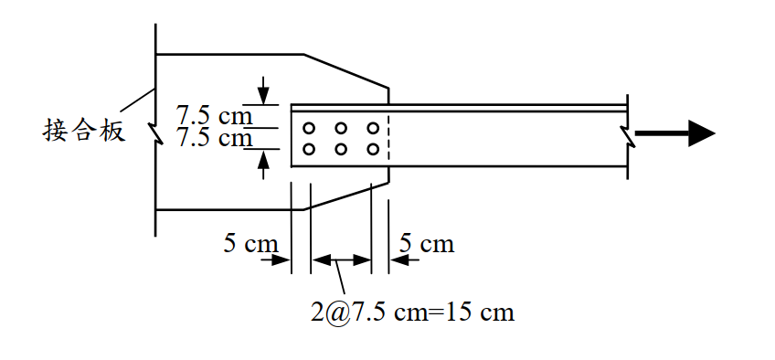

# SS-2005-1 題目正本

> 本檔只記錄**考卷上寫了什麼、圖上畫了什麼**，不含任何解法。解析見同資料夾 `SS-2005-1.md`。
> 判讀清單經使用者確認前，狀態為「待確認」；確認後本檔原則上不再修改（改動須回考卷原圖並記 log）。

| 項目 | 內容 |
|------|------|
| 考卷 | `raw/exams/SS-2005_鋼結構設計.pdf` 第 1（正面） 頁，第一題 |
| 考年 | 民國 94 年（2005） |
| 配分 | 25 分 |
| 附圖 | 1 張（角鋼與接合板螺栓配置），`SS-2005-1-fig-1.png` |
| 判讀狀態 | **已確認**（2026-11-02 使用者確認，含「不確定」項之解讀；轉錄同日，PyMuPDF 110 dpi 全頁＋關鍵處 400–500 dpi 局部目視，盲讀後才比對既有解析） |

## 1. 考卷原文（逐字）

> 一、如圖所示為一單角鋼與鋼板以螺栓之接合。角鋼為 L200×200×20（mm），鋼材 $F_y = 2.5\ \text{tf/cm}^2$，$F_u = 4.1\ \text{tf/cm}^2$。承壓型螺栓直徑為 22 mm，螺栓標稱剪力強度為 4.2 tf/cm²，螺紋不在剪力平面上，螺栓孔直徑為 23.5 mm。試依極限設計法規範，假設接合板強度足夠，計算角鋼能承受之設計拉力強度 $\phi P_n$。（25 分）

## 2. 考卷給的公式、附表與參數

題內「參考資料」照錄：

> 1. 翼板寬度與斷面深度之比不小於 2/3 之 W、H、S 或 I 型鋼，及由此類型鋼切割或符合前述尺度需求之銲接 T 型鋼，且接合須在翼板處。若以螺栓接合則接合處沿應力方向每行螺栓數不少於 3 根 ⋯⋯ $U = 0.90$
> 2. 不合於上款之 W、H、S、I 或 T 型鋼，及包括組合斷面之其他各種斷面。若以螺栓接合則接合處沿應力方向每行螺栓數不少於 3 根 ⋯⋯ $U = 0.85$
> 3. 以螺栓接合之所有各種斷面且在接合處沿應力方向每行僅有 2 根螺栓 ⋯⋯ $U = 0.75$
>
> 螺栓孔承壓強度 $\phi R_n$，採用 $R_n = 2.4dtF_u$

- 考卷**沒給** $\phi$ 值（拉力降伏、斷裂、螺栓剪力、承壓）與角鋼斷面積，須依規範與尺寸自取。

## 3. 附圖

*圖面文字照錄：接合板；7.5 cm；7.5 cm；5 cm；5 cm；2@7.5 cm=15 cm。*

## 4. 判讀清單

「把握」標**不確定**者請優先確認；解讀類項目（題目用字的意思）另標「解讀」。

| # | 項目 | 判讀 | 圖上／題文依據 | 把握 |
|---|------|------|---------------|------|
| 1 | 螺栓數 | 6 顆＝沿力方向 2 排 × 每排 3 顆 | 圖上圓孔（450 dpi） | 確定 |
| 2 | 橫向尺寸 | 自角鋼**背**（上緣雙線＝外伸肢側視）量 7.5 cm 至第 1 排、再 7.5 cm 至第 2 排；第 2 排至肢趾未標（推得 5 cm） | 左側尺寸線上界對齊角鋼上緣雙線（450 dpi） | 確定 |
| 3 | 縱向尺寸 | 角鋼端部至第 1 顆 5 cm；螺栓間距 2@7.5 cm = 15 cm；末顆至接合板邊緣 5 cm | 下方尺寸線：左 5 cm 界線對齊角鋼端、右 5 cm 界線對齊接合板斜邊端（450 dpi） | 確定 |
| 4 | 外伸肢位置 | 未連接肢在圖上緣（背側） | 上緣細雙線（解讀） | 確定 |
| 5 | 剪力面 | 單剪（單角鋼單面搭接一片接合板） | 題文「單角鋼與鋼板」（解讀） | 確定 |
| 6 | $U$ 適用款 | 單角鋼屬第 2 款「其他各種斷面」，每排 3 根 → 0.85 | 參考資料（解讀） | 不確定 → 使用者確認 |
| 7 | 承壓用 $t$ | 角鋼厚 20 mm（接合板假設足夠） | 題文「假設接合板強度足夠」（解讀） | 確定 |
| 8 | 所求 | 角鋼設計拉力強度 $\phi P_n$（需含螺栓剪力、承壓等接合控制？） | 題文「角鋼能承受之設計拉力強度」（解讀） | 不確定 → 使用者確認 |

---

*轉錄：2026-11-02（SS-U1-1 題目正本推廣・批 1）｜確認：2026-11-02 使用者確認*
