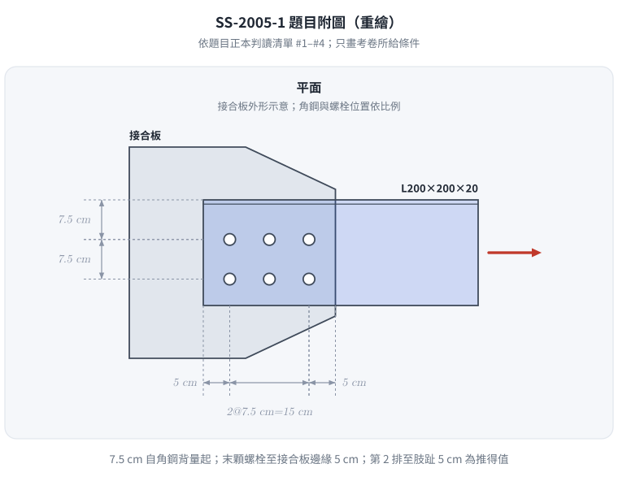
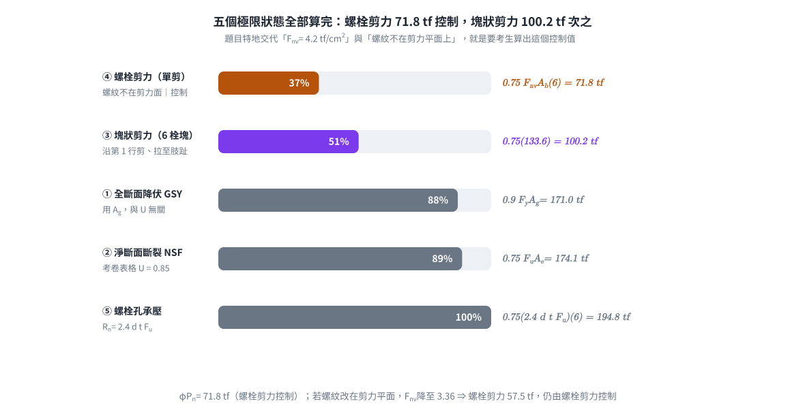

# 考題編號：SS-2005-1

**主分類：** `SS-U1-1` 拉力及壓力桿件
**副分類：** `SS-U1-4` 接合之分析與設計
**設計法：** LRFD
**標籤：** `拉力桿件` `剪力遲滯` `U值` `淨斷面斷裂` `塊狀剪力` `螺栓接合` `等肢角鋼` `有效淨面積` `螺栓剪力` `螺栓承壓`

---

## 1. 題目（考卷原文見題目正本）

> 考卷原文、公式／附表、附圖與判讀清單（已確認）見 [`SS-2005-1-problem.md`](SS-2005-1-problem.md)。本節只列**解題時最容易讀錯的地方**與本解使用的記號；題意以題目正本為準。



*圖 1　題目附圖重繪（依題目正本判讀清單 #1–#4；接合板外形為示意）。7.5 cm 的量測基準畫在角鋼背、右側 5 cm 量到接合板邊緣，攔下自肢趾量起或把 5 cm 當成角鋼端距的誤讀。*

### 常見誤讀

| 項目 | 正確判讀 | 常見誤讀 |
|------|---------|---------|
| 螺栓配置 | 6 顆＝沿力方向每排 3 顆 × 2 排 | 讀成每排 2 顆（$U$ 會變 0.75） |
| 橫向尺寸起點 | 自角鋼**背**量 7.5＋7.5 cm，第 2 排至肢趾剩 5 cm | 自肢趾量起 |
| $U$ | 考卷表第 2 款 → 0.85 | 改用 $1 - \bar x/L$ |
| 所求範圍 | 設計拉力強度含螺栓剪力、承壓等接合控制 | 只算 $\phi F_yA_g$、$\phi F_uA_e$ |
| 剪力面 | 單角鋼單面搭接 → 單剪 | 雙剪 |

**本解記號：** L200×200×20；螺栓 $d = 22$ mm、孔 23.5 mm；$F_y = 2.5$、$F_u = 4.1$、螺栓 $F_v = 4.2$ tf/cm²；端距 5 cm、間距 7.5 cm。

---

## 2. 考題核心精神與出題者意圖

本題測驗 **LRFD 螺栓接合拉力構件的「五個極限狀態」全套檢核**，且刻意布置成「非最明顯者控制」：

1. **剪力遲滯係數 $U$**：單角鋼僅一肢連接，強制 $U < 1$
2. **五個極限狀態**：全斷面降伏（GSY）／有效淨斷面斷裂（NSF）／**塊狀剪力（BSR）**／**螺栓剪力**／螺栓孔承壓

> **出題者的兩個伏筆：**
> ① 題目特地給了「**螺栓標稱剪力強度 4.2 tf/cm²**」與「**螺紋不在剪力平面上**」——這兩項**只有算螺栓剪力才會用到**。
> 若解答裡沒出現 $\phi R_n = 0.75 F_{nv} A_b n$，就是漏了一個極限狀態——本題該值 71.8 tf，**正是控制項**。
> ② 塊狀剪力要取「**含全部 6 栓**的撕出塊」（沿第 1 行剪、經第 2 行拉至肢趾）＝ 100.2 tf；只沿第 2 行撕出肢趾 5 cm 窄條的塊
> 只含 3 栓、只承 $P/2$，不可直接拿來和全部拉力 $P$ 比（否則會誤得 68.5 tf）。

---

## 3. 解題戰略地圖與陷阱分析

**作戰計畫：**
```
Step 1  角鋼斷面性質：Ag、x̄
Step 2  U 值（依考卷表格；並與最新規範公式對照）
Step 3  ① GSY：φtPn = 0.9 Fy Ag
Step 4  ② NSF：An → Ae = U·An → φtPn = 0.75 Fu Ae
Step 5  ③ BSR：主算含 6 栓撕出塊（沿第 1 行剪＋拉至肢趾）；單行窄條路徑只承 P/2，按分擔換算
Step 6  ④ 螺栓剪力：φRn = 0.75 × Fnv × Ab × 6（單剪）  ← 別漏
Step 7  ⑤ 螺栓孔承壓：φRn = 0.75 × 2.4dtFu × 6
Step 8  取五者最小值
```

**陷阱分析：**

| 陷阱 | 說明 | 應對策略 |
|:---|:---|:---|
| ⚠️ **漏算螺栓剪力** | 題目給 $F_{nv} = 4.2$ tf/cm² 與「螺紋不在剪力平面」就是要你算；本題 71.8 tf，**就是控制項** | 五個極限狀態逐一列表，缺一不可 |
| ⚠️ 單剪 vs 雙剪 | 角鋼只搭接**一片**接合板 → **單剪**（1 個剪力面）。誤判雙剪會把螺栓剪力翻倍成 143.7 tf，控制項就錯成塊狀剪力 100.2 tf | 數接合板片數 |
| ⚠️ 混淆 $U$ 值適用款次 | $U = 0.90$ 只適用 W／H／S／I／T 型鋼**翼板**連接，**不適用角鋼** | 角鋼屬「其他各種斷面」，每行 ≥ 3 顆 → 情況 2，$U = 0.85$ |
| ⚠️ 淨面積扣孔數 | 臨界橫斷面上有 **2 個**孔（2 行），非 6 個 | $A_n = A_g - 2 d_h t$ |
| ⚠️ BSR 撕出塊與載重不對應 | 只沿第 2 行撕出肢趾 5 cm 窄條的塊只含 3 栓、只承 $P/2$；直接和全部 $P$ 比會誤得 68.5 tf。正確主算為含 6 栓的撕出塊（沿第 1 行剪、經第 2 行拉至肢趾）＝ 100.2 tf | 每條路徑先問「撕出塊內有幾顆螺栓、承擔多少力」，部分塊按分擔換算成等效總力 |
| ⚠️ $U$ 只影響 NSF | 全斷面降伏用 $A_g$（無 $U$），斷裂才用 $A_e = UA_n$ | 分開記 |

## 3.5 變數層次分析（Variable Hierarchy Analysis）

> 複習提示：解題後，在每個卡住的知識點「卡關?」欄標記 `⚠`；第二次複習時只看有 `⚠` 的項目。

**最終目標：** LRFD 螺栓接合單角鋼拉力構件 → 五個極限狀態（GSY／NSF／BSR／螺栓剪力／螺栓承壓）取最小值

### 主要公式（$\boxed{\phantom{x}}$ = 未知，待推導）

$$\text{① GSY:}\quad \phi_t P_n = 0.9\,F_y\,A_g$$

$$\text{② NSF:}\quad \boxed{A_n} = A_g - 2 d_h t,\quad \boxed{A_e} = U\,\boxed{A_n},\quad \phi_t P_n = 0.75\,F_u\,\boxed{A_e}$$

$$\text{③ BSR（台灣二式）:}\quad F_uA_{nt} \ge 0.6F_uA_{nv}:\ \boxed{R_n} = 0.6F_yA_{gv} + F_uA_{nt};\quad 0.6F_uA_{nv} > F_uA_{nt}:\ \boxed{R_n} = 0.6F_uA_{nv} + F_yA_{gt};\quad \boxed{R_n} \le 0.6F_uA_{nv} + F_uA_{nt},\quad \phi = 0.75$$

$$\text{④ 螺栓剪力:}\quad \boxed{A_b} = \frac{\pi d_b^2}{4},\quad \phi R_n = 0.75\,F_{nv}\,\boxed{A_b}\,n\quad(n = 6,\ \text{單剪})$$

$$\text{⑤ 承壓:}\quad \phi R_n = 0.75\,(2.4\,d_b\,t\,F_u)\,n$$

$$\boxed{\phi P_n} = \min\left(①,②,③,④,⑤\right)$$

### L1：題目直接給定

_看到題目就能讀出的數字，不需要任何公式。_

| 符號 | 數值 | 說明 |
|:---:|:---|:---|
| 斷面 | L200×200×20 mm | 等肢單角鋼，$t = 2.0$ cm |
| $F_y$ | 2.5 tf/cm² | 降伏應力 |
| $F_u$ | 4.1 tf/cm² | 抗拉強度 |
| $d_b$ | 22 mm = 2.2 cm | 螺栓直徑（承壓型） |
| $F_{nv}$ | 4.2 tf/cm² | 螺栓標稱剪力強度（螺紋**不在**剪力平面） |
| $d_h$ | 23.5 mm = 2.35 cm | 螺栓孔徑 |
| 螺栓數 | 6 顆（2 行 × 3 列） | 單剪 |
| 行距（橫向） | 7.5 cm | 兩行間距 |
| 邊距（自肢背） | 7.5 cm | 至第 1 行 |
| 邊距（至肢趾） | 5 cm | 第 2 行至自由邊 |
| 列距 $s$ | 7.5 cm | 沿載重方向 |
| 端距 $e$ | 5 cm | 至角鋼端 |
| 接合方式 | 僅通過一肢 | 需考慮剪力遲滯 |
| 接合板 | 強度足夠（題目假設） | 不需檢核接合板 |

### L2：需知識點推導

_需要知道公式名稱與適用條件，套入 L1 即可算出。_

**Step 1：角鋼斷面性質**

| 符號 | 公式／來源 | 卡關? |
|:---:|:---|:---|
| $A_g$ | $(200+200-20)\times20 = 7600$ mm² $= 76.0$ cm² | |
| $\bar x$ | 兩矩形分割求形心距肢背 $= 5.74$ cm（型鋼表 5.67 cm） | |
| $L_{conn}$ | $2s = 15$ cm（沿載重方向的接合長度） | |

**Step 2：剪力遲滯係數 $U$**

| 符號 | 公式／來源 | 卡關? |
|:---:|:---|:---|
| 考卷表格值 | 角鋼＝「其他各種斷面」、每行 3 顆 ≥ 3 → 情況 2 → $U = 0.85$ | |
| 最新規範公式 | $U = 1-\bar x/L_{conn} = 1-5.74/15 = 0.617$（AISC Table D3.1 Case 2） | |
| 最新規範單角鋼專款 | 每行 3 顆 → $U = 0.60$（Case 8）；取兩者較大 → 0.617 | |

**Step 3：① 全斷面降伏 GSY**

| 符號 | 公式／來源 | 卡關? |
|:---:|:---|:---|
| $\phi_t P_n$ | $0.9 \times 2.5 \times 76.0 = 171.0$ tf | |

**Step 4：② 有效淨斷面斷裂 NSF**

| 符號 | 公式／來源 | 卡關? |
|:---:|:---|:---|
| $A_n$ | $76.0 - 2(2.35)(2.0) = 66.6$ cm² | |
| $A_e$（考卷 $U=0.85$） | $0.85 \times 66.6 = 56.61$ cm² | |
| $\phi_t P_n$ | $0.75 \times 4.1 \times 56.61 = 174.1$ tf | |

**Step 5：③ 塊狀剪力 BSR（台灣二式；主算含 6 栓撕出塊）**

| 符號 | 公式／來源 | 卡關? |
|:---:|:---|:---|
| 剪切長度 | $e + 2s = 5+15 = 20$ cm | |
| $A_{gv}$（每面） | $20 \times 2.0 = 40$ cm² | |
| $A_{nv}$（每面） | $[20 - 2.5(2.35)] \times 2.0 = 28.25$ cm²（扣 2.5 孔） | |
| **主算：6 栓撕出塊**（沿第 1 行剪、經第 2 行拉至肢趾 12.5 cm） | $A_{gt} = 25.0$、$A_{nt} = (12.5-1.5\times2.35)(2.0) = 17.95$ cm²；$F_uA_{nt} = 73.6 \ge 0.6F_uA_{nv} = 69.5$ → $R_n = 60.0+73.6 = 133.6$（上限 143.1）→ $\phi R_n = 100.2$ tf | |
| 路徑 A（只沿第 2 行，肢趾 5 cm 窄條，**僅 3 栓、承 $P/2$**） | $A_{nt} = 7.65$ cm²；二式 $\phi R_n = 70.9$ tf → 等效總力 $2\times70.9 = 141.7$ tf（單式 68.5 → 137.0 tf），不控制 | |
| 路徑 B（只沿第 1 行拉至肢背，僅 3 栓） | $A_{nt} = 12.65$ cm²；二式 $\phi R_n = 80.2$ tf → 等效 160.5 tf，且須剪斷外伸肢，實務不發生 | |
| 路徑 C（兩行之間 7.5 cm，雙剪面） | $A_{nt} = 10.3$ cm²；二式 $\phi R_n = 132.4$ tf（單式 121.7） | |

**Step 6：④ 螺栓剪力（單剪）**

| 符號 | 公式／來源 | 卡關? |
|:---:|:---|:---|
| $A_b$ | $\pi(2.2)^2/4 = 3.801$ cm² | |
| 每顆 $\phi R_n$ | $0.75 \times 4.2 \times 3.801 = 11.97$ tf | |
| 6 顆合計 | $6 \times 11.97 = 71.8$ tf | |

**Step 7：⑤ 螺栓孔承壓**

| 符號 | 公式／來源 | 卡關? |
|:---:|:---|:---|
| 每顆 $R_n$ | $2.4 d_b t F_u = 2.4(2.2)(2.0)(4.1) = 43.3$ tf | |
| 每顆 $\phi R_n$ | $0.75 \times 43.3 = 32.5$ tf | |
| 6 顆合計 | $194.8$ tf | |

### L3：深層知識（不懂就卡住）

| 知識點 | 說明 | 卡關? |
|:---|:---|:---|
| 剪力遲滯係數 $U$ 的款次判定 | W／H／S／I／T 翼板連接 $U=0.90$；其他斷面（含角鋼）每行≥3 顆 $U=0.85$；每行僅 2 顆 $U=0.75$ | |
| $U$ 只影響淨斷面斷裂 | 全斷面降伏用 $A_g$（無 $U$）；斷裂用 $A_e = UA_n$ | |
| 塊狀剪力二式的選式與上限 | 比較 $F_uA_{nt}$ 與 $0.6F_uA_{nv}$：拉力斷裂較大用 $0.6F_yA_{gv}+F_uA_{nt}$，剪力斷裂較大用 $0.6F_uA_{nv}+F_yA_{gt}$；兩式皆 $\le 0.6F_uA_{nv}+F_uA_{nt}$（AISC 360-05 起改為單式，見 §5.5） | |
| 塊狀剪力扣孔的 2.5 顆慣例 | 剪力面通過 3 個孔，末端孔只切到一半 → 扣 $2.5 d_h$；拉力面經過幾個孔就扣幾個（主算塊 1.5 孔） | |
| 撕出塊要對應它承擔的力 | 撕出塊只含部分螺栓時，只承擔那幾顆螺栓傳來的力（本題單行 3 栓＝$P/2$），須換算成等效總力再比較；含全部螺栓的塊才直接對 $P$ | |
| 肢背側 BSR 路徑為何不成立 | 肢背是折角、外伸肢仍相連，該路徑要同時剪斷外伸肢，容量遠高於算式值 | |
| 螺栓剪力面數判定 | 單面搭接一片接合板 → 單剪（$n$ 個剪力面 = 螺栓數）；夾在兩片板中 → 雙剪（$2n$） | |
| 螺紋在／不在剪力平面 | 不在剪力平面（X 型）用全桿身面積 $A_b$；在剪力平面（N 型）標稱剪力強度約降至 0.8 倍 | |

---

## 4. 步驟化詳細計算過程

### 4.1 角鋼斷面性質

**L200×200×20 mm（等肢角鋼）：**

$$A_g = (200 + 200 - 20) \times 20 = 380 \times 20 = 7600\ \text{mm}^2 = 76.0\ \text{cm}^2$$

**形心距離 $\bar{x}$**（距角鋼背面）：以肢背為原點，分為兩矩形

- 水平肢：$A_1 = 200 \times 20 = 4000$ mm²，$x_1 = 100$ mm
- 垂直肢（扣除重疊）：$A_2 = 180 \times 20 = 3600$ mm²，$x_2 = 10$ mm

$$\bar{x} = \frac{4000(100) + 3600(10)}{7600} = \frac{436{,}000}{7600} = 57.4\ \text{mm} = 5.74\ \text{cm}$$

*（型鋼規格表值 $C_x = 5.67$ cm，含圓角；差異 1.2%，不影響結論。）*

---

### 4.2 剪力遲滯係數 $U$

**依考卷提供之表格（＝台灣現行極限設計法規範 §4.3）：**

角鋼不屬 W／H／S／I／T 型鋼，歸入情況 2「包括組合斷面之其他各種斷面」；接合處沿應力方向**每行 3 根**螺栓（$\ge 3$）：

$$\boxed{U = 0.85}$$

**依最新規範（AISC 360-16／-22 Table D3.1）之對照：**

| 條款 | 規定 | 本題值 |
|:---|:---|:---:|
| Case 2 | $U = 1 - \bar x / l$，$l$ = 接合長度 | $1 - 5.74/15 = 0.617$ |
| Case 8（單角鋼專款） | 每行 4 顆以上 $U = 0.80$；**每行 3 顆 $U = 0.60$** | 0.60 |
| 取用 | 兩者取較大 | **0.617** |

> ⚠️ 最新規範的 $U = 0.617$ 比考卷表格的 0.85 **嚴格得多**（$A_e$ 少 27%）。所幸本題 NSF 兩者皆不控制（見 4.7），
> 故最終答案不變。**考場請照考卷給的表格取 $U = 0.85$**；本對照僅供理解規範演進方向。

---

### 4.3 極限狀態①：全斷面降伏（Gross Section Yielding, GSY）

$$\phi_t P_n = 0.9 \times F_y \times A_g = 0.9 \times 2.5 \times 76.0 = \boxed{171.0\ \text{tf}}$$

---

### 4.4 極限狀態②：淨斷面斷裂（Net Section Fracture, NSF）

**淨斷面積**（臨界橫斷面上有 **2 個**螺栓孔，即 2 行螺栓同時被截到）：

$$A_n = A_g - 2 d_h t = 76.0 - 2(2.35)(2.0) = 76.0 - 9.4 = 66.6\ \text{cm}^2$$

**有效淨斷面積與強度（$U = 0.85$）：**

$$A_e = U A_n = 0.85 \times 66.6 = 56.61\ \text{cm}^2$$

$$\phi_t P_n = 0.75 \times F_u \times A_e = 0.75 \times 4.1 \times 56.61 = \boxed{174.1\ \text{tf}}$$

*（若依最新規範 $U = 0.617$：$A_e = 41.1$ cm²，$\phi_t P_n = 126.4$ tf——仍不控制。）*

---

### 4.5 極限狀態③：塊狀剪力破壞（Block Shear Rupture, BSR）

**採用公式：考卷時代台灣規範（極限設計法）之二式**（與 104 年考卷所附參考公式相同），$\phi = 0.75$：

$$F_uA_{nt} \ge 0.6F_uA_{nv}:\quad R_n = 0.6F_yA_{gv} + F_uA_{nt}\ \le\ 0.6F_uA_{nv} + F_uA_{nt}$$

$$0.6F_uA_{nv} > F_uA_{nt}:\quad R_n = 0.6F_uA_{nv} + F_yA_{gt}\ \le\ 0.6F_uA_{nv} + F_uA_{nt}$$

（AISC 360-05 起之單式 $R_n = 0.6F_uA_{nv} + U_{bs}F_uA_{nt} \le 0.6F_yA_{gv} + U_{bs}F_uA_{nt}$ 列於 §5.5 對照。）

**幾何（連接肢寬 20 cm、厚 2 cm）：**

| 位置 | 距肢背（heel） | 距肢趾（toe） |
|:---|:---:|:---:|
| 第 1 行 | 7.5 cm | 12.5 cm |
| 第 2 行 | 15.0 cm | **5.0 cm** |

縱向剪切長度（自角鋼端至最遠螺栓）：$L_{sh} = e + 2s = 5 + 7.5 + 7.5 = 20$ cm

每一剪力面：$A_{gv} = 20 \times 2.0 = 40$ cm²；$A_{nv} = [20 - 2.5(2.35)] \times 2.0 = 28.25$ cm²

> **先決原則：撕出塊要對應它所承擔的力。** 6 顆螺栓分 2 行、每行 3 顆，兩行等分拉力。撕出塊若**包含全部 6 栓**，才直接與總拉力 $P$ 比較；
> 若只包含其中一行（3 栓），該塊只承受 $P/2$，其容量須乘 2 換算成等效總力。


*圖 2　剪力面（紫）是自角鋼端到最遠螺栓的 20 cm，拉力面（紅）位於最遠螺栓處；紫色網底為撕出塊，橘色實心孔為塊內螺栓。含全部 6 栓的撕出塊（100.2 tf）才直接與總拉力 $P$ 比較；只含一行 3 栓的窄條只承 $P/2$，須除以 0.5 換算成等效總力（A 141.7、B 160.5 tf）。換算後所有路徑都大於螺栓剪力 71.8 tf，塊狀剪力不控制。**攔錯：** 把只含 3 栓的單行窄條直接和總拉力比較（單式會誤得 68.5 tf 並判為控制），並漏算含全部 6 栓的撕出塊。*


---

**主算：6 栓撕出塊——沿第 1 行剪出 ＋ 經第 2 行拉裂至肢趾（拉力寬 12.5 cm）**

剪力面沿第 1 行（距肢背 7.5 cm）自角鋼端至最遠螺栓，拉力面自第 1 行穿過第 2 行至肢趾，撕出塊包含**全部 6 栓**：

$$A_{gt} = 12.5 \times 2.0 = 25.0\ \text{cm}^2,\qquad A_{nt} = (12.5 - 1.5 \times 2.35)(2.0) = 8.975 \times 2.0 = 17.95\ \text{cm}^2$$

$$F_uA_{nt} = 4.1(17.95) = 73.6\ \text{tf}\ \ \ge\ \ 0.6F_uA_{nv} = 0.6(4.1)(28.25) = 69.5\ \text{tf} \;\Rightarrow\; \text{第一式}$$

$$R_n = 0.6F_yA_{gv} + F_uA_{nt} = 0.6(2.5)(40) + 73.6 = 60.0 + 73.6 = 133.6\ \text{tf}\ \le\ \text{上限 } 69.5 + 73.6 = 143.1\ \text{tf}$$

$$\phi R_n^{BSR} = 0.75 \times 133.6 = \boxed{100.2\ \text{tf}}$$

*雙路徑檢核：AISC 360-05 起單式 $\min(0.6F_uA_{nv},\ 0.6F_yA_{gv}) + F_uA_{nt} = \min(69.5,\ 60.0) + 73.6 = 133.6$ tf → $\phi R_n = 100.2$ tf，兩式同值。*

---

**路徑 A（說明用，不控制）：只沿第 2 行剪出 ＋ 拉裂至肢趾（拉力寬 5.0 cm）——撕出塊僅含 3 栓、承 $P/2$**

$$A_{gt} = 5.0 \times 2.0 = 10.0\ \text{cm}^2,\qquad A_{nt} = (5.0 - 0.5 \times 2.35)(2.0) = 7.65\ \text{cm}^2$$

$$F_uA_{nt} = 31.4\ \text{tf} < 0.6F_uA_{nv} = 69.5\ \text{tf} \;\Rightarrow\; R_n = 69.5 + 2.5(10.0) = 94.5\ \text{tf}\ \le\ \text{上限 } 69.5 + 31.4 = 100.9\ \text{tf}$$

$$\phi R_n^{A} = 0.75 \times 94.5 = 70.9\ \text{tf}\quad(\text{該塊承 } P/2) \;\Rightarrow\; P \le 2 \times 70.9 = 141.7\ \text{tf}$$

*（若用 AISC 單式：$\min(69.5,\ 60.0) + 31.4 = 91.4$ tf → $\phi R_n = 68.5$ tf → 等效總力 $2 \times 68.5 = 137.0$ tf。）*

> **⚠️ 舊解勘誤（2026-11-03）：** 舊版把此路徑的 68.5 tf 直接與總拉力 $P$ 比較而判為控制。此塊只含第 2 行 3 栓，只承擔 $P/2$，
> 換算後等效總力 137.0～141.7 tf，**不控制**。

---

**路徑 B（說明用）：只沿第 1 行剪出 ＋ 拉裂至肢背（拉力寬 7.5 cm）——僅含 3 栓**

$$A_{nt} = (7.5 - 0.5 \times 2.35)(2.0) = 12.65\ \text{cm}^2,\qquad A_{gt} = 15.0\ \text{cm}^2$$

$$F_uA_{nt} = 51.9 < 69.5 \;\Rightarrow\; R_n = 69.5 + 2.5(15.0) = 107.0\ \text{tf}\ \le\ 121.4 \;\Rightarrow\; \phi R_n^{B} = 80.2\ \text{tf} \;\Rightarrow\; P \le 160.5\ \text{tf}$$

> **註：** 此路徑的破壞面須自肢背（折角處）撕出，實際上還要一併剪斷**未連接的外伸肢**，真實容量遠高於算式值，因此不會控制。

---

**路徑 C（說明用）：兩行同時剪出 ＋ 拉裂行間（拉力寬 7.5 cm，兩個剪力面）**

$$A_{gv} = 2(40) = 80\ \text{cm}^2,\qquad A_{nv} = 2(28.25) = 56.5\ \text{cm}^2,\qquad A_{gt} = 15.0\ \text{cm}^2$$

$$A_{nt} = (7.5 - 2.35)(2.0) = 10.3\ \text{cm}^2$$

$$F_uA_{nt} = 42.2 < 0.6F_uA_{nv} = 139.0 \;\Rightarrow\; R_n = 139.0 + 2.5(15.0) = 176.5\ \text{tf}\ \le\ 181.2 \;\Rightarrow\; \phi R_n^{C} = 132.4\ \text{tf}$$

*（AISC 單式：$\min(139.0,\ 120.0) + 42.2 = 162.2$ tf → 121.7 tf。）*

---

### 4.6 極限狀態④：螺栓剪力（本題的第二關鍵，勿漏）

角鋼僅搭接**一片**接合板 $\Rightarrow$ **單剪**，剪力面數 = 螺栓數 = 6。

螺紋**不在**剪力平面上 $\Rightarrow$ 剪力面採**全桿身面積**：

$$A_b = \frac{\pi d_b^2}{4} = \frac{\pi (2.2)^2}{4} = 3.801\ \text{cm}^2$$

每顆螺栓：

$$\phi R_n = \phi F_{nv} A_b = 0.75 \times 4.2 \times 3.801 = 11.97\ \text{tf/bolt}$$

6 顆合計：

$$\boxed{\phi R_n = 6 \times 11.97 = 71.8\ \text{tf}}$$

> ⚠️ 這一項就是**控制項**（五個極限狀態中最小）。題目給「$F_{nv} = 4.2$ tf/cm²」與「螺紋不在剪力平面上」
> 就是為了設這道關卡——不算就等於漏掉控制的極限狀態。

---

### 4.7 極限狀態⑤：螺栓孔承壓

依題目給定 $R_n = 2.4 d t F_u$（$t$ 取角鋼厚 2.0 cm）：

$$R_n = 2.4(2.2)(2.0)(4.1) = 43.3\ \text{tf/bolt} \;\Rightarrow\; \phi R_n = 0.75 \times 43.3 = 32.5\ \text{tf/bolt}$$

$$\phi R_{n,\text{total}} = 6 \times 32.5 = \boxed{194.8\ \text{tf}}$$

*（依最新規範 AISC 360-16 J3.10 尚須檢核撕出：端部螺栓 $L_c = 5 - 2.35/2 = 3.825$ cm，
$1.2L_ctF_u = 1.2(3.825)(2.0)(4.1) = 37.6$ tf/bolt $< 43.3$ → 該顆改由撕出控制；
但即使 6 顆全取 37.6 tf，$\phi\sum R_n = 169$ tf 仍遠大於 71.8 tf，不控制。）*

---

### 4.8 設計拉力強度彙整

| 極限狀態 | $\phi P_n$（tf） | 備註 |
|:---|:---:|:---|
| ④ **螺栓剪力（單剪，6 顆）** | **71.8** | ← **控制** |
| ③ 塊狀剪力 BSR（6 栓撕出塊，沿第 1 行剪＋拉至肢趾） | 100.2 | 台灣二式；單式同值。單行路徑 A／B 只承 $P/2$，等效 141.7／160.5（單式 A 為 137.0）；行間路徑 C 132.4 |
| ① 全斷面降伏 GSY | 171.0 | |
| ② 淨斷面斷裂 NSF（$U=0.85$） | 174.1 | 依最新規範 $U=0.617$ 則為 126.4 |
| ⑤ 螺栓孔承壓（6 顆） | 194.8 | |

$$\boxed{\phi P_n = 71.8\ \text{tf}\quad\text{（由螺栓剪力控制）}}$$



*圖 3　五個極限狀態並排：第 ④ 項螺栓剪力（71.8 tf）最小，是全題控制項；塊狀剪力（6 栓撕出塊）100.2 tf 次之，高出 40%。**攔錯：** 漏算螺栓剪力——題目給的 $F_{nv} = 4.2$ tf/cm² 與「螺紋不在剪力平面上」若沒用到，就漏掉了控制的極限狀態；或把單行撕出塊誤判為控制項。*


---

## 5. 關鍵爭議點與進階探討

### 5.1 螺栓剪力主控：只有全斷面降伏的 42%

$$\frac{\phi P_n^{\text{bolt}}}{\phi P_n^{GSY}} = \frac{71.8}{171.0} = 0.42$$

原因：

- 單角鋼單面搭接 → **單剪**，6 顆 M22 只有 6 個剪力面（$\sum A_b = 22.8$ cm²），遠小於角鋼斷面積 76 cm²
- 構材本身的極限狀態中，最弱的是 6 栓撕出塊的塊狀剪力（100.2 tf，為 GSY 的 59%），仍比螺栓剪力高 40%

**改善順序（效益由大到小）：** ① 改為雙剪（兩片接合板夾住或雙角鋼）→ 螺栓剪力翻倍 143.7 tf；② 增加螺栓數或加大直徑；
此時塊狀剪力（100.2 tf）會接手控制，再以加大端距 $e$、增加列數（拉長 $L_{sh}$）提高。

### 5.2 螺栓剪力與塊狀剪力：為何不能拿單行撕出塊比總力

$$\phi R_n^{\text{bolt shear}} = 71.8\ \text{tf} \quad\text{vs}\quad \phi R_n^{BSR,\ 6\text{ 栓}} = 100.2\ \text{tf}$$

舊版解析曾以「只沿第 2 行撕出肢趾 5 cm 窄條」的 68.5 tf 判為控制、並稱與螺栓剪力只差 4.8% 為「雙瓶頸」。
此塊只含 3 栓、只承 $P/2$，等效總力 137.0 tf（台灣二式 141.7 tf），遠高於螺栓剪力，**不存在雙瓶頸**。

若螺栓改為**螺紋在剪力平面上**（N 型），$F_{nv}$ 約降至 $0.8 \times 4.2 = 3.36$ tf/cm²，則

$$\phi R_n = 0.75(3.36)(3.801)(6) = 57.5\ \text{tf}$$

螺栓剪力仍控制且更低。題目交代「螺紋不在剪力平面上」是為了決定 $F_{nv}$ 取值（即控制值本身）。

### 5.3 $U$ 值：考卷表格 vs 最新規範

| 依據 | $U$ | $A_e$ | $\phi P_n^{NSF}$ |
|:---|:---:|:---:|:---:|
| 考卷表格（台灣現行規範 §4.3 情況 2） | 0.85 | 56.6 cm² | 174.1 tf |
| AISC 360-16／-22 Case 2（$1-\bar x/l$） | 0.617 | 41.1 cm² | 126.4 tf |
| AISC 360-16／-22 Case 8（單角鋼，每行 3 顆） | 0.60 | 40.0 cm² | 122.9 tf |

**規範演進的方向：** 舊表格用「螺栓根數」一刀切給 0.85，過於寬鬆；新規範改為**顯式的偏心距公式** $1-\bar x/l$
並對單角鋼另訂下限（3 顆 0.60、4 顆以上 0.80），能反映「接合越短、偏心越大 → 剪力遲滯越嚴重」的物理。

本題由螺栓剪力控制，$U$ 的差異不改變答案；但若題目把肢趾邊距加大（BSR 不控制），新舊規範就會給出
174 tf vs 126 tf 的顯著差別。**考場依考卷給的表格作答**，實務設計則應用現行 AISC 條款。

### 5.4 若雙肢均連接，$U$ 可提升至 1.0

若改為背靠背雙角鋼、或以兩片接合板將兩肢均連接，則「所有元件均已連接」，$U = 1.0$：

$$\phi_t P_n^{NSF} = 0.75(4.1)(66.6) = 204.8\ \text{tf} > 171.0\ \text{tf}\ (\text{GSY})$$

此時 NSF 不再控制，且螺栓改為**雙剪**（$\phi R_n = 143.7$ tf），BSR 剪力面也加倍 → 整體容量可逼近全斷面降伏容量。

### 5.5 最新規範對本題其他項目的影響彙整

| 項目 | 考卷／台灣現行規範（99 年版） | AISC 360-16／-22 | 對本題答案的影響 |
|:---|:---|:---|:---|
| $\phi_t$（GSY／NSF） | 0.90／0.75 | 0.90／0.75 | 無變動 |
| $U$（單角鋼） | 表格 0.85 | $\max(1-\bar x/l,\ 0.60) = 0.617$ | NSF 由 174 → 126 tf，仍不控制 |
| 塊狀剪力 | 二式：$F_uA_{nt}\ge0.6F_uA_{nv}$ 時 $0.6F_yA_{gv}+F_uA_{nt}$，否則 $0.6F_uA_{nv}+F_yA_{gt}$；皆 $\le 0.6F_uA_{nv}+F_uA_{nt}$ | J4.3 單式：$0.6F_uA_{nv}+U_{bs}F_uA_{nt} \le 0.6F_yA_{gv}+U_{bs}F_uA_{nt}$（$U_{bs}=1.0$） | 6 栓撕出塊兩式同為 100.2 tf；單行路徑 A 二式 70.9、單式 68.5（皆只承 $P/2$，不控制） |
| 螺栓剪力 $\phi$ | 0.75 | 0.75 | 無變動 |
| 承壓 | $R_n = 2.4dtF_u$ | $R_n = \min(2.4dtF_u,\ 1.2L_ctF_u)$（-22 版另列撕出） | 端栓由 43.3 → 37.6 tf，仍不控制 |

$\Rightarrow$ **本題最終答案在新舊規範下皆為 $\phi P_n = 71.8$ tf（螺栓剪力控制）。**

*解析完成時間：2026-04-xx*
*修正日期：2026-08-22（補算漏掉的螺栓剪力極限狀態 71.8 tf；修正 BSR 路徑之肢背／肢趾判讀與 $2.4dtF_u = 43.3$ tf 之算術；加入最新規範 $U$ 值對照）*
*圖解補繪：2026-08-29（向量圖，腳本 `gen_SS-2005-1.py`，可重跑）*
*驗證狀態：unverified*

*修正日期：2026-11-02（§1 全文重述改為指向題目正本 `SS-2005-1-problem.md`（已確認）＋常見誤讀＋本解記號，避免題意兩份不同步；解題內容與答案不變）*

*修正日期：2026-11-03（盲解比對發現：舊解把只含第 2 行 3 栓、只承 $P/2$ 的肢趾窄條撕出塊（68.5 tf）直接與總拉力比較而判為控制，且漏算含全部 6 栓的撕出塊（沿第 1 行剪、經第 2 行拉至肢趾）。塊狀剪力主算改為 6 栓撕出塊 100.2 tf（改用考卷時代台灣二式，與 AISC 單式雙路徑同值），單行路徑換算等效總力 137.0～141.7 tf 不控制；最終答案由 68.5 tf（塊狀剪力）更正為 **71.8 tf（螺栓剪力控制）**。各數值以 Python 重算二式／單式交叉核對，並回 94 年考卷第 1 頁附圖 400 dpi 確認螺栓配置與邊距判讀不變；圖 2、圖 3 以 `gen_SS-2005-1.py` 改用二式與受力分擔重繪。）*

*修正日期：2026-11-03（§1 補入題目附圖重繪 `figs/SS-2005-1-fig-1-problem.svg`（依已確認的題目正本判讀清單，腳本 `gen_SS-2005-1.py`，可重跑）；解題內容與答案不變）*
