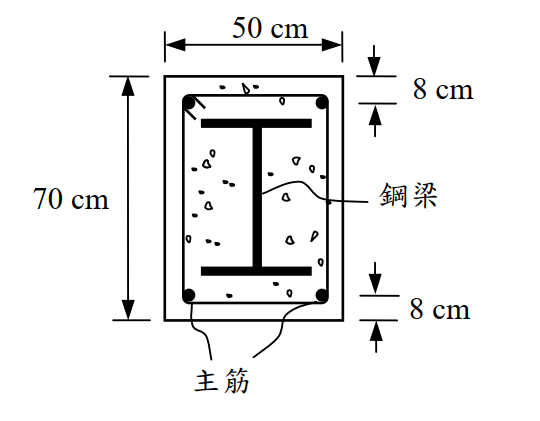

# SS-2005-2 題目正本

> 本檔只記錄**考卷上寫了什麼、圖上畫了什麼**，不含任何解法。解析見同資料夾 `SS-2005-2.md`。
> 判讀清單經使用者確認前，狀態為「待確認」；確認後本檔原則上不再修改（改動須回考卷原圖並記 log）。

| 項目 | 內容 |
|------|------|
| 考卷 | `raw/exams/SS-2005_鋼結構設計.pdf` 第 1 頁（全一張之正面），第二題 |
| 考年 | 民國 94 年（2005） |
| 配分 | 25 分 |
| 附圖 | 1 張（混凝土包覆梁斷面），`SS-2005-2-fig-1.png` |
| 判讀狀態 | **待確認**（轉錄 2026-11-02，PyMuPDF 110 dpi 全頁＋附圖 450 dpi 局部目視，盲讀後才比對既有解析） |

## 1. 考卷原文（逐字）

> 二、鋼結構極限強度設計法規範對於混凝土包覆梁之設計撓曲強度訂為 $\phi_bM_n$，$\phi_b$=0.9，$M_n$ 依塑性應力分析而得。試依塑性應力分析，計算圖示混凝土包覆合成梁之標稱撓曲強度 $M_n$。假設鋼梁與鋼筋全斷面達降伏應力，並考慮鋼梁、主筋與混凝土之貢獻。鋼梁為 H488×300×11×18（$d \times b_f \times t_w \times t_f$，mm）之型鋼，置於梁斷面中心位置，鋼材 $F_y$ = 2.5 tf/cm²，$F_u$ = 4.1 tf/cm²。四支主筋為 D32 鋼筋（每支截面積為 8.19 cm²），$F_y$ = 4200 kgf/cm²。混凝土 $f'_c$=210 kgf/cm²。（25 分）

## 2. 考卷給的公式、附表與參數

- 題文：$\phi_b = 0.9$；H488×300×11×18；鋼材 $F_y = 2.5$、$F_u = 4.1$ tf/cm²；D32 每支 8.19 cm²、$F_y = 4200$ kgf/cm²；$f'_c = 210$ kgf/cm²。
- 圖面：斷面 50 cm × 70 cm；主筋距上、下緣 8 cm。
- 本題**沒有印公式**（混凝土應力塊係數等需自取）；單位混用 tf 與 kgf。
- 卷首注意事項：㈠不必抄題；㈡可以使用電子計算器，但需詳列解答過程。

## 3. 附圖

*圖面文字照錄：50 cm；70 cm；8 cm；8 cm；鋼梁；主筋。*

## 4. 判讀清單

「把握」標**不確定**者請優先確認；解讀類項目（題目用字的意思）另標「解讀」。

| # | 項目 | 判讀 | 圖上／題文依據 | 把握 |
|---|------|------|---------------|------|
| 1 | 斷面尺寸 | 寬 50 cm、高 70 cm | 附圖尺寸線 | 確定 |
| 2 | 8 cm | 上、下緣至主筋**中心**（尺寸線端點對齊鋼筋圓心，不是箍筋線） | 附圖 450 dpi | 確定 |
| 3 | 主筋配置 | 上 2 支、下 2 支，位於四角 | 附圖 | 確定 |
| 4 | 鋼梁位置 | 直立置中（強軸水平），上下翼板外緣距斷面緣各 $(70 - 48.8)/2 = 10.6$ cm | 題文「置於梁斷面中心位置」＋附圖 | 確定 |
| 5 | 所求 | 標稱 $M_n$（不乘 $\phi_b$），塑性應力分布，計入鋼梁、主筋、混凝土 | 題文 | 確定 |
| 6 | 混凝土受拉 | 塑性中性軸以下混凝土不計 | 塑性應力分析慣例 | 確定（解讀） |
| 7 | 混凝土應力 | 受壓區取 $0.85f'_c$ 均佈（係數題未給） | 題文未給 | 不確定（解讀） |
| 8 | 鋼筋處混凝土 | 受壓區是否扣除鋼梁與鋼筋所佔面積 | 題文未提 | 不確定（解讀） |

---

*轉錄：2026-11-02（SS-U1-2 題目正本推廣・批 1）*
