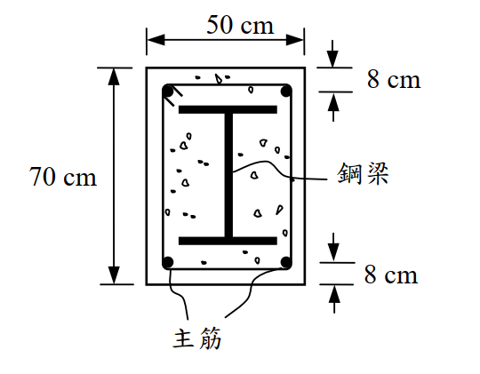
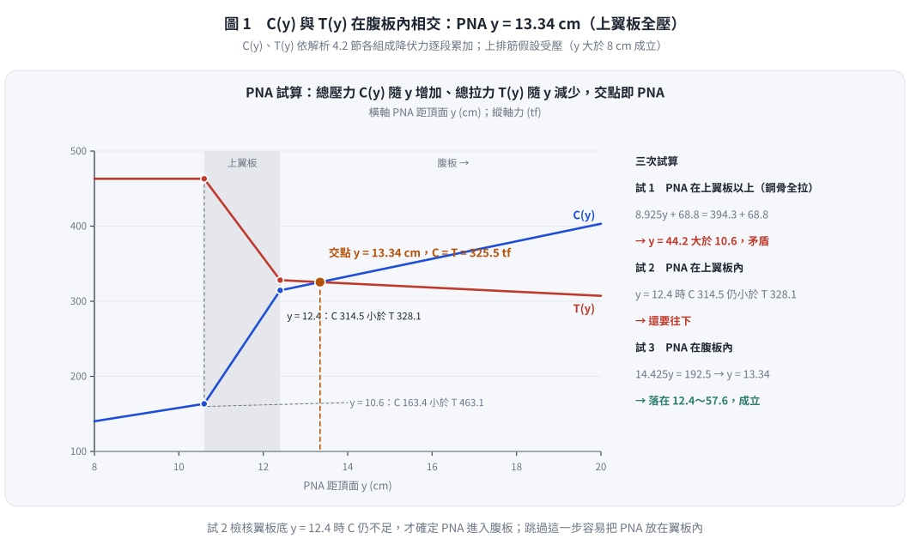
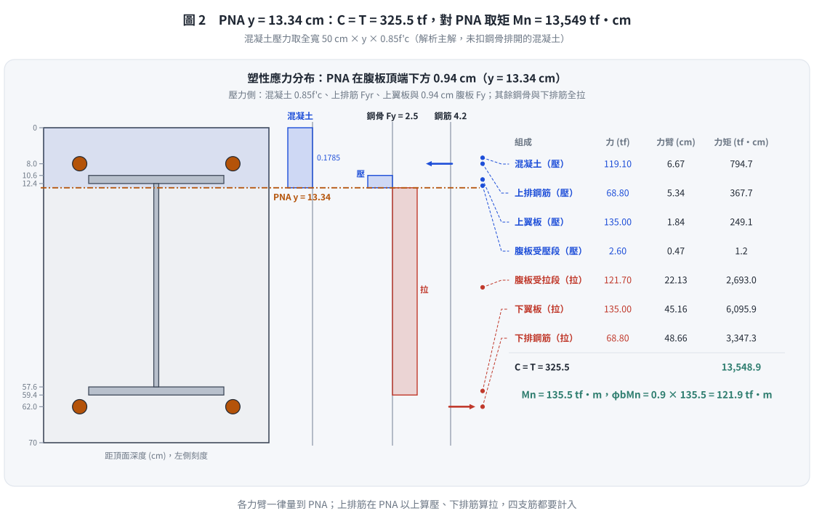

# 考題編號：SS-2005-2

**主分類：** `SS-U1-2` 梁桿件
**副分類：** （無）
**設計法：** LRFD（塑性應力分佈法）
**標籤：** `SRC鋼骨鋼筋混凝土` `塑性應力分佈法` `公稱彎矩強度` `塑性中性軸` `降伏力` `合成斷面` `單位換算`

---

## 1. 原始題目重述

鋼結構極限強度設計法規範對於混凝土包覆梁之設計撓曲強度訂為 $\phi_bM_n$，$\phi_b = 0.9$，$M_n$ 依塑性應力分析而得。試依塑性應力分析，計算圖示混凝土包覆合成梁之標稱撓曲強度 $M_n$。假設鋼梁與鋼筋全斷面達降伏應力，並考慮鋼梁、主筋與混凝土之貢獻。鋼梁為 H488×300×11×18（$d \times b_f \times t_w \times t_f$，mm）之型鋼，置於梁斷面中心位置，鋼材 $F_y = 2.5$ tf/cm²，$F_u = 4.1$ tf/cm²。四支主筋為 D32 鋼筋（每支截面積 8.19 cm²），$F_y = 4200$ kgf/cm²。混凝土 $f'_c = 210$ kgf/cm²。（25 分）

*圖說（依考卷原圖 450 dpi 目視判讀）：斷面寬 50 cm、高 70 cm；H 型鋼置中，上下翼板外緣距斷面上下緣各 $(70 - 48.8)/2 = 10.6$ cm；四支 D32 位於四角，上下各 2 支，鋼筋中心距上、下緣各 8 cm（尺寸線量至鋼筋中心）。*

**單位換算（注意）：**

$$f'_c = 210\ \text{kgf/cm}^2 = 0.21\ \text{tf/cm}^2,\qquad 0.85f'_c = 0.1785\ \text{tf/cm}^2$$

$$F_{yr} = 4200\ \text{kgf/cm}^2 = 4.2\ \text{tf/cm}^2$$

---

## 2. 考題核心精神與出題者意圖

本題測驗**包覆型合成梁（SRC 梁）的塑性應力分布法**：混凝土受壓區取 $0.85f'_c$ 均勻應力，鋼骨與鋼筋各自全斷面降伏（受壓或受拉），由力平衡找塑性中性軸（PNA），再取力矩得 $M_n$。

關鍵在判斷 PNA 落在哪裡。混凝土強度只有鋼材的 1/12～1/20，靠混凝土單獨平衡全部鋼骨＋鋼筋拉力需要很深的壓力區；實際上 PNA 會往下進到型鋼上翼板以下，**上排鋼筋與上翼板都在受壓區**。

---

## 3. 解題戰略地圖與陷阱分析

**作戰計畫：**
1. 建立座標（頂面為 0、向下為正），列出各材料位置與降伏力
2. 先試 PNA 在上翼板以上：所需壓力區深度遠超過上翼板位置 → 不成立
3. 設 PNA 在腹板內（深度 $y$），以 $C = T$ 解 $y$
4. 對 PNA 取力矩求 $M_n$；$\phi_bM_n = 0.9M_n$

**陷阱分析：**

| 陷阱 | 說明 | 應對策略 |
|------|------|---------|
| ⚠️ $0.85f'_c$ 單位 | 210 kgf/cm² = **0.21** tf/cm²，$0.85f'_c = 0.1785$ tf/cm²；寫成 1.785 會讓混凝土強度放大 10 倍 | 換算後對照「混凝土約為鋼材 1/12」做合理性檢查 |
| ⚠️ PNA 位置 | 不能先假設 PNA 在混凝土頂部；要用力平衡試算 | 依序試「上翼板以上」→「腹板內」 |
| ⚠️ 上排鋼筋受壓 | PNA 在 13.3 cm，上排筋（8 cm）與上翼板受壓 | 受壓鋼材也以 $F_y$ 計 |

---

## 3.5 變數層次分析（Variable Hierarchy Analysis）

> 複習提示：解題後，在每個卡住的知識點「卡關?」欄標記 `⚠`；第二次複習時只看有 `⚠` 的項目。

**最終目標：** SRC 梁塑性應力分佈法 → 確定 PNA 位置 → 對 PNA 取矩求 $M_n$

### 主要公式（$\boxed{\phantom{x}}$ = 未知，待推導）

$$0.85f'_c\,b\,\boxed{y} + \sum F_{\text{鋼，壓}} = \sum F_{\text{鋼，拉}}\quad(\text{力平衡求 PNA 深度 } y)$$

$$\boxed{M_n} = \sum F_i\,|y_i - y|,\qquad \phi_bM_n = 0.9M_n$$

### L1：題目直接給定

| 符號 | 數值 | 說明 |
|------|------|------|
| 斷面 | 50 × 70 cm | 混凝土外廓 |
| 鋼梁 | H488×300×11×18 | 置中，頂緣距斷面頂 10.6 cm |
| $F_y$ | 2.5 tf/cm² | 鋼梁 |
| 主筋 | 4-D32（8.19 cm²/支），上下各 2 支 | 中心距上下緣 8 cm |
| $F_{yr}$ | 4.2 tf/cm² | 鋼筋 |
| $f'_c$ | 0.21 tf/cm² | 混凝土 |
| $\phi_b$ | 0.9 | 題目給定 |

### L2：需知識點推導

| 符號 | 公式 / 來源 | 卡關? |
|------|------------|:-----:|
| 鋼梁降伏力 | 翼板 $30 \times 1.8 \times 2.5 = 135.0$ t（各）；腹板 $45.2 \times 1.1 \times 2.5 = 124.3$ t；合計 394.3 t | |
| 鋼筋降伏力 | $2 \times 8.19 \times 4.2 = 68.8$ t（上、下各） | |
| 試 PNA 在上翼板以上 | 需 $0.1785 \times 50 \times y + 68.8 = 394.3 + 68.8$ → $y = 44.2$ cm，超過上翼板（10.6 cm）→ 不成立 | ⚠ |
| PNA（腹板內） | $8.925y + 68.8 + 135.0 + 2.75(y - 12.4) = 2.75(57.4 - y) + 135.0 + 68.8$ → **$y = 13.34$ cm** | |
| $C = T$ | 325.5 t | |
| $M_n$ | 13,549 t·cm = **135.5 t·m** | |
| $\phi_bM_n$ | $0.9 \times 135.5 = $ **121.9 t·m** | |

### L3：深層知識（不懂就卡住）

| 知識點 | 說明 | 卡關? |
|--------|------|:-----:|
| 塑性應力分布法 | 混凝土受壓 $0.85f'_c$ 矩形塊（不計抗拉），鋼材受拉、受壓皆取 $F_y$ | |
| PNA 位置判斷 | 先比較「各區段以上的壓力上限」與「以下的拉力」，逐段試 | |
| 單位換算 | kgf/cm² ÷ 1000 = tf/cm² | |
| 包覆梁與純鋼梁 | 本題 $M_n$ 約為鋼梁單獨 $M_p$（77.5 t·m）的 1.75 倍 | |

---

## 4. 步驟化詳細計算過程

### 4.1 幾何位置（以頂面為零點，向下為正）

| 組成 | 位置 (cm) |
|------|------|
| 上排鋼筋中心 | 8.0 |
| 上翼板 | 10.6 ～ 12.4 |
| 腹板 | 12.4 ～ 57.6 |
| 下翼板 | 57.6 ～ 59.4 |
| 下排鋼筋中心 | 62.0 |

### 4.2 各組成材料降伏力

| 組成材料 | 面積 (cm²) | 強度 (tf/cm²) | 降伏力 (tf) |
|---------|:---:|:---:|:---:|
| 混凝土受壓區 | $50 \times y$ | 0.1785 | $8.925y$ |
| 上排鋼筋 2-D32 | 16.38 | 4.2 | 68.8 |
| 上翼板 | 54.0 | 2.5 | 135.0 |
| 腹板 | 49.72 | 2.5 | 124.3（每 cm 2.75） |
| 下翼板 | 54.0 | 2.5 | 135.0 |
| 下排鋼筋 2-D32 | 16.38 | 4.2 | 68.8 |

### 4.3 塑性中性軸（PNA）位置

**試 1：PNA 在上翼板以上（鋼骨全受拉）**

$$8.925y + 68.8 = 394.3 + 68.8\ \Rightarrow\ y = 44.2\ \text{cm} > 10.6\ \text{cm}\quad\text{✗（矛盾）}$$

**試 2：PNA 在上翼板內（$10.6 \le y \le 12.4$）**

$y = 12.4$ 時壓力 $= 8.925 \times 12.4 + 68.8 + 135.0 = 314.5$ t < 拉力 $124.3 + 135.0 + 68.8 = 328.1$ t → PNA 還要再往下 ✗

**試 3：PNA 在腹板內（$12.4 \le y \le 57.6$）**

$$\underbrace{8.925y + 68.8 + 135.0 + 2.75(y - 12.4)}_{C} = \underbrace{2.75(57.6 - y) + 135.0 + 68.8}_{T}$$

$$14.425y = 158.4 + 34.1\ \Rightarrow\ \boxed{y = 13.34\ \text{cm}}\quad(\text{落在腹板頂端下方 0.94 cm})\ \checkmark$$

*圖 1　$C(y)$ 與 $T(y)$ 在腹板內相交，PNA $y = 13.34$ cm：試 1 假設鋼骨全拉得 $y = 44.2$ 矛盾；試 2 在上翼板底 $y = 12.4$ 時 $C = 314.5 < T = 328.1$，還要往下；試 3 在腹板內成立。這張圖攔的是 PNA 停在上翼板內就作答，或試 1 矛盾後沒有換段重算。*

### 4.4 公稱彎矩強度 $M_n$（對 PNA 取矩）

| 組成 | 壓／拉 | 力 (tf) | 作用位置 (cm) | 力臂 (cm) | 力矩 (tf·cm) |
|------|:---:|:---:|:---:|:---:|:---:|
| 混凝土 | 壓 | 119.10 | 6.67 | 6.67 | 794.7 |
| 上排鋼筋 | 壓 | 68.80 | 8.00 | 5.34 | 367.7 |
| 上翼板 | 壓 | 135.00 | 11.50 | 1.84 | 249.1 |
| 腹板受壓段 | 壓 | 2.60 | 12.87 | 0.47 | 1.2 |
| 腹板受拉段 | 拉 | 121.70 | 35.47 | 22.13 | 2,693.0 |
| 下翼板 | 拉 | 135.00 | 58.50 | 45.16 | 6,095.9 |
| 下排鋼筋 | 拉 | 68.80 | 62.00 | 48.66 | 3,347.3 |
| **合計** | | $C = T = 325.5$ | | | **13,548.9** |

$$\boxed{M_n = 13{,}549\ \text{tf}\cdot\text{cm} \approx 135.5\ \text{tf}\cdot\text{m}}$$

$$\phi_bM_n = 0.9 \times 135.5 = \boxed{121.9\ \text{tf}\cdot\text{m}}$$

**雙路徑驗算：** 以頂面為力矩中心，$M_n = \sum T_iy_i - \sum C_iy_i = 13{,}549$ tf·cm ✔。若扣除型鋼在受壓區排開的混凝土（上翼板與 0.94 cm 腹板處不計混凝土），PNA 移至 14.04 cm，$M_n = 135.3$ tf·m，差 0.2%。

*圖 2　七個力對 PNA 取矩合計 13,548.9 tf·cm，$M_n = 135.5$ tf·m，$\phi_bM_n = 121.9$ tf·m；下翼板（45.16 cm）與下排筋（48.66 cm）力臂最長，貢獻七成力矩。這張圖攔的是力臂沒量到 PNA、漏了上排或下排鋼筋，或混凝土壓力深度取錯。*

---

## 5. 關鍵爭議點與進階探討

### 5.1 舊版解析的單位錯誤

舊版把 $0.85f'_c$ 寫成 $1.785$ tf/cm²（應為 0.1785），混凝土強度被放大 10 倍，於是只需 5.96 cm 的壓力區就能平衡全部鋼材拉力，得到「所有鋼骨與鋼筋都受拉」、$M_n = 170.3$ tf·m 的錯誤結果。

**合理性檢查：** 鋼材 $F_y = 2.5$ tf/cm²，混凝土 $0.85f'_c$ 只有 0.18 tf/cm²，約為鋼材的 1/14。一個 50 cm 寬、6 cm 深的混凝土塊（300 cm²）只能提供 54 t，遠小於型鋼 394 t 的拉力——看到 PNA 只有幾公分深就該警覺。

### 5.2 PNA 為何停在上翼板下方

壓力區混凝土貢獻有限，主要靠上翼板（135 t）與上排鋼筋（69 t）受壓來平衡。這兩項加上 12.4 cm 深的混凝土（111 t）已達 314 t，只差一點點，所以 PNA 只往腹板內走了 0.94 cm。

### 5.3 與純鋼梁的比較

$$M_{p,鋼} = F_yZ_x = 2.5 \times 3{,}099.8 = 7{,}750\ \text{tf}\cdot\text{cm} = 77.5\ \text{tf}\cdot\text{m}$$

包覆後 $M_n = 135.5$ tf·m，約為純鋼梁的 **1.75 倍**。增量主要來自上下鋼筋形成的力偶（約 $68.8 \times 54 = 3{,}715$ tf·cm）以及混凝土讓 PNA 上移後鋼骨拉力臂加長。

---

## 6. 依最新規範（AISC 360-16／-22）對照

| 項目 | 考卷（我國極限設計法，$\phi_b = 0.9$） | AISC 360-16 §I3.3 |
|:---|:---|:---|
| 方法 | 合成斷面塑性應力分布 | 可用 (a) 鋼骨單獨塑性 $M_p$、(b) 合成斷面塑性應力分布（需有剪力連接）或 (c) 應變相容法 |
| $\phi_b$ | 0.9 | 0.90 |
| 本題 | $M_n = 135.5$ t·m | 方法 (b) 相同 135.5 t·m；若無剪力釘只能用 (a)：$M_n = 77.5$ t·m |

**觀察：** 我國鋼骨鋼筋混凝土構造設計規範對 SRC 梁另有規定，實務設計應依該規範；考題依題意以塑性應力分布計算即可。

---

*修正日期：2026-11-01（原解將 $0.85f'_c$ 誤寫為 1.785 tf/cm²（應為 0.1785），致 PNA 誤落在 5.96 cm、全部鋼材受拉；更正 PNA 為距頂 13.34 cm（上翼板下方腹板內），上排鋼筋與上翼板受壓，$M_n$ 由 170.3 更正為 **135.5 tf·m**、$\phi_bM_n$ 由 153.3 更正為 **121.9 tf·m**；依原卷重述題目（原解自行增列「列出各組成材料降伏力」子題）；新增雙路徑驗算與 §6 對照）*
*圖解補繪：2026-11-03（向量圖 2 張，腳本 `gen_SS-2005-2.py`，改輸入可原地重跑；SVG 供 wiki／PDF，2× PNG 供 pptx／影片）*
*驗證狀態：unverified*
