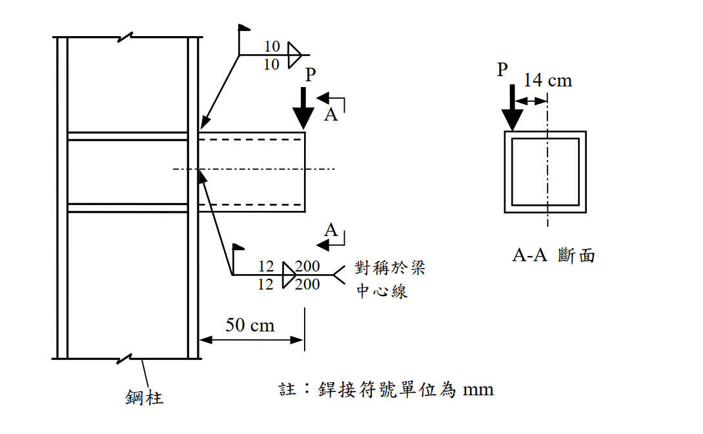

# SS-2005-3 題目正本

> 本檔只記錄**考卷上寫了什麼、圖上畫了什麼**，不含任何解法。解析見同資料夾 `SS-2005-3.md`。
> 判讀清單經使用者確認前，狀態為「待確認」；確認後本檔原則上不再修改（改動須回考卷原圖並記 log）。

| 項目 | 內容 |
|------|------|
| 考卷 | `raw/exams/SS-2005_鋼結構設計.pdf` 第 2 頁（全一張之背面），第三題 |
| 考年 | 民國 94 年（2005） |
| 配分 | 25 分 |
| 附圖 | 1 張（箱型懸臂梁銲接於柱、A-A 斷面），`SS-2005-3-fig-1.png` |
| 判讀狀態 | **待確認**（轉錄 2026-11-02，PyMuPDF 110 dpi 全頁＋附圖 450 dpi 局部目視，盲讀後才比對既有解析） |

## 1. 考卷原文（逐字）

> 三、有一懸臂鋼梁銲接於鋼柱，鋼梁承受偏心載重 P（工作載重）。鋼梁為 300×300×18×18（mm）之箱型組合斷面，鋼柱為 H 型鋼，皆使用鋼材 $F_y$ = 2.5 tf/cm²，$F_u$ = 4.1 tf/cm²。鋼梁銲接於鋼柱如圖所示，銲材為 E70XX，$F_u$ = 4.9 tf/cm²。試根據容許應力設計法規範，忽略鋼梁自重並假設鋼梁強度足夠，以彈性分析法計算此銲接所能提供之工作載重 P。（25 分）

## 2. 考卷給的公式、附表與參數

- 題文：箱型 300×300×18×18 mm；$F_y$ = 2.5、$F_u$ = 4.1 tf/cm²；E70XX，$F_u$ = 4.9 tf/cm²。
- 圖面：P 距柱面 50 cm；A-A 斷面 P 距梁中心線 14 cm；銲接符號兩組（見 §3）。
- 本題**沒有印公式**，也沒有給銲道容許應力。
- 卷首注意事項：㈠不必抄題；㈡可以使用電子計算器，但需詳列解答過程。

## 3. 附圖

*圖面文字照錄：10；10；P；A；A；12；200；12；200；對稱於梁中心線；50 cm；鋼柱；註：銲接符號單位為 mm；P；14 cm；A-A 斷面。*

## 4. 判讀清單

「把握」標**不確定**者請優先確認；解讀類項目（題目用字的意思）另標「解讀」。

| # | 項目 | 判讀 | 圖上／題文依據 | 把握 |
|---|------|------|---------------|------|
| 1 | 第一組銲道 | 上翼板與柱面：10 mm 填角銲，箭頭側與另一側各一道（雙面），未標長度 → 全寬 30 cm | 符號 10/10（450 dpi），箭頭指上翼板 | 確定（解讀） |
| 2 | 第二組銲道 | 腹板與柱面：12 mm 填角銲雙面，每道 200 mm，對稱於梁中心線（$y$ = −10 ～ +10 cm）；兩片腹板皆有 | 符號 12/200（450 dpi）＋尾註 | 確定（解讀） |
| 3 | **下翼板** | 圖上沒有銲接符號 → 不銲、不計 | 只有兩個符號 | 不確定（解讀） |
| 4 | 箱內側銲道 | 「雙面」含箱內側；箱梁端部封在柱面後內側施銲不易，題目照符號計入 | 符號雙面三角 | 不確定（解讀） |
| 5 | 偏心 | P 距柱面 50 cm（彎矩）、距梁中心線 14 cm（扭矩） | 立面與 A-A 斷面 | 確定 |
| 6 | 容許應力 | 填角銲喉部 $0.3F_u$（銲材），題未給 | ASD 規範 | 確定（解讀） |

---

*轉錄：2026-11-02（SS-U1-4 題目正本推廣・批 1）*
