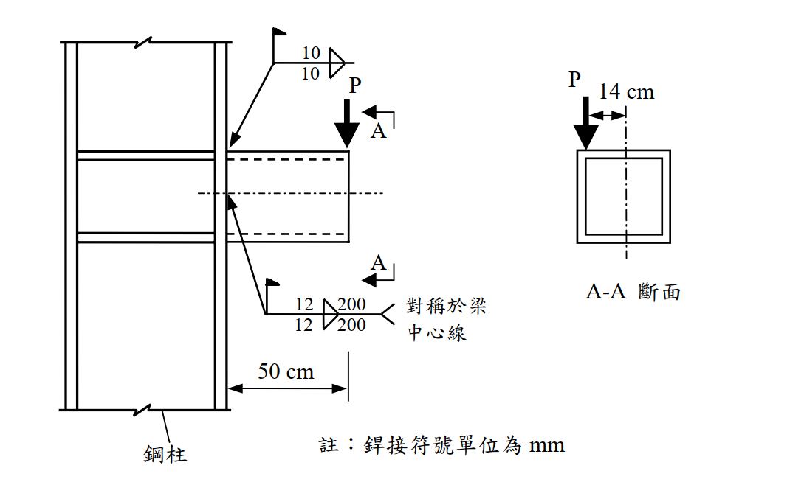
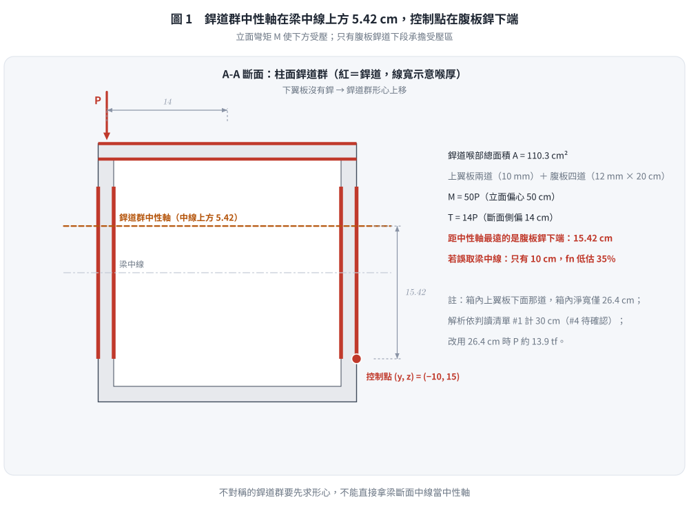
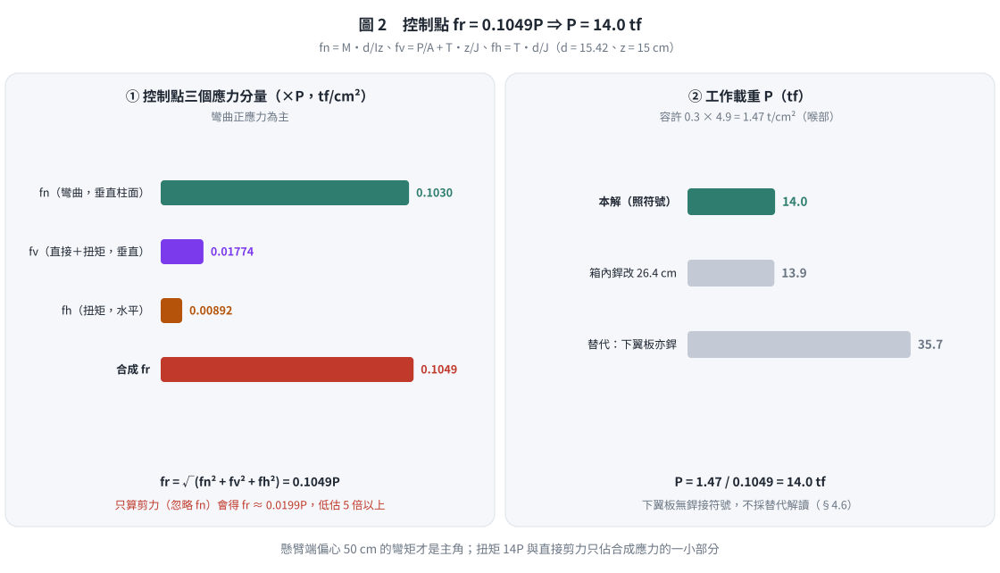

# 考題編號：SS-2005-3

**主分類：** `SS-U1-4` 接合之分析與設計
**副分類：** （無）
**設計法：** ASD
**標籤：** `填角銲` `偏心接合` `箱形斷面` `牛腿接合` `銲接群分析` `彎矩剪力接合` `扭矩` `E70XX` `銲接符號判讀` `不對稱銲道群`

---

## 1. 原始題目重述

（依考卷原文，94 年第 2 頁第三題）

> 三、有一懸臂鋼梁銲接於鋼柱，鋼梁承受偏心載重 $P$（工作載重）。鋼梁為 300×300×18×18（mm）之箱型組合斷面，鋼柱為 H 型鋼，皆使用鋼材 $F_y = 2.5$ tf/cm²，$F_u = 4.1$ tf/cm²。鋼梁銲接於鋼柱如圖所示，銲材為 E70XX，$F_u = 4.9$ tf/cm²。試根據**容許應力設計法**規範，忽略鋼梁自重並假設鋼梁強度足夠，以彈性分析計算此銲接所能提供之**工作載重 $P$**。（25 分）　註：銲接符號單位為 mm。

*圖說（依考卷原圖 400 dpi 目視判讀，2026-11-01 更正）：第一個銲接符號（10/10，雙面三角）箭頭指向**上翼板**與柱面交角 → 上翼板上、下兩面各一道 10 mm 填角銲，全寬 30 cm。第二個銲接符號（12/12、200/200，註「對稱於梁中心線」）箭頭指向梁中心線（點劃線）高度的**腹板** → 箱型兩片腹板的內、外兩面各一道 12 mm、長 200 mm 填角銲，上下對稱於梁中心線（$y = \pm 10$ cm）。**下翼板沒有銲接符號**。$P$ 距柱面 50 cm；A-A 斷面中 $P$ 距梁中心線 14 cm（偏心造成扭矩）。*

**判讀表**

| 項目 | 判讀 |
|:---|:---|
| 上翼板銲 | 10 mm × 2 道（上、下面），各 30 cm，位於 $y = +15$、$+13.2$ cm |
| 腹板銲 | 12 mm × 4 道（兩腹板 × 內外），各 20 cm，$y = -10 \sim +10$，位於 $z = \pm 15$、$\pm 13.2$ cm |
| 下翼板 | 無銲接符號 → 不計 |
| 載重 | $V = P$；$M = 50P$（柱面）；$T = 14P$ |
| 容許應力 | 填角銲喉部 $0.3F_u = 0.3 \times 4.9 = 1.47$ tf/cm²（ASD） |
| 求 | 工作載重 $P$ |

---

## 2. 考題核心精神與出題者意圖

本題測驗 **ASD 銲道群同時承受剪力、彎矩、扭矩的彈性分析**：

1. **讀銲接符號**：箭頭落點決定銲道在哪一片板、雙面符號代表板兩面都銲、「對稱於梁中心線」決定腹板銲道位置
2. **銲道群不對稱**：只有上翼板與腹板有銲 → 形心上移，下端腹板銲距中性軸最遠，彎曲應力最大
3. **三種內力疊加**：$V$ 均布剪力、$M$ 垂直柱面之正應力、$T$ 扭矩剪力，於同一點向量合成
4. 題目要**求 $P$**，不是給定 $P$ 檢核

---

## 3. 解題戰略地圖與陷阱分析

**作戰計畫：**
1. 依銲接符號列出 6 道銲道（位置、長度、喉厚）
2. 以喉部面積計算銲道群 $A$、形心 $\bar{y}$、$I_z$（抗彎）、$I_y$、$J = I_z + I_y$（抗扭）
3. 柱面內力：$V = P$、$M = 50P$、$T = 14P$
4. 各點 $f_n = My/I_z$、$f_v = V/A \pm T\,z/J$、$f_h = T\,y/J$，合成 $f_r$
5. $f_{r,\max} = 1.47$ 解 $P$

**陷阱分析：**

| 陷阱 | 說明 | 應對策略 |
|:---|:---|:---|
| ⚠️ 腹板銲當成下翼板銲 | 12/12×200 的箭頭指向梁中心線高度的腹板 | 「對稱於梁中心線」是腹板銲道上下對稱 |
| ⚠️ 自行補下翼板銲 | 圖上下翼板沒有符號 | 照圖不計；銲道群形心因此上移 |
| ⚠️ 設計法 | 題目指定容許應力設計法 | 填角銲 $0.3F_u$，不是 $\phi 0.6F_{EXX}$ |
| ⚠️ 題目求 $P$ | 不可自訂 $P$ 檢核 | 以單位 $P$ 求應力係數再反算 |
| ⚠️ 兩種喉厚 | 10 mm 與 12 mm 銲道喉厚不同 | 以喉部面積（$t_e \times L$）計性質 |

## 3.5 變數層次分析（Variable Hierarchy Analysis）

> 複習提示：解題後，在每個卡住的知識點「卡關?」欄標記 `⚠`；第二次複習時只看有 `⚠` 的項目。

**最終目標：** ASD 銲道群彈性分析 → 不對稱銲道群性質 → $V$、$M$、$T$ 應力疊加 → 工作載重 $P$

### 主要公式（$\boxed{\phantom{x}}$ = 未知，待推導）

$$\boxed{\bar{y}} = \frac{\Sigma A_i y_i}{\Sigma A_i}, \qquad \boxed{I_z},\ \boxed{J} = I_z + I_y \quad \text{（喉部面積）}$$

$$f_n = \frac{M(y - \bar{y})}{I_z}, \qquad f_v = \frac{V}{A} + \frac{T\,z}{J}, \qquad f_h = \frac{T(y - \bar{y})}{J}$$

$$\boxed{f_r} = \sqrt{f_n^2 + f_v^2 + f_h^2} \le F_w = 0.3F_u = 1.47\ \text{tf/cm}^2$$

### L1：題目直接給定

| 符號 | 數值 | 說明 |
|:---|:---|:---|
| 箱型梁 | 300×300×18×18 mm | |
| 上翼板銲 | 10/10，全寬 30 cm | 銲接符號 1 |
| 腹板銲 | 12/12×200，對稱於梁中心線 | 銲接符號 2 |
| 偏心 | 距柱面 50 cm、距中心線 14 cm | 附圖 |
| $F_u$（銲材） | 4.9 tf/cm² | E70XX |

### L2：需知識點推導

| 符號 | 公式 / 來源 | 卡關? |
|:---|:---|:---:|
| 喉厚 | $0.707 \times 1.0 = 0.707$；$0.707 \times 1.2 = 0.848$ cm | |
| $A$ | $2 \times 30 \times 0.707 + 4 \times 20 \times 0.848 = 42.42 + 67.87 = 110.3$ cm² | |
| $\bar{y}$ | $(42.42 \times 14.1 \text{ 平均})/110.3 = +5.42$ cm（中心線以上） | |
| $I_z$ | 7486.6 cm⁴ | |
| $I_y$ | 16730.1 cm⁴ | |
| $J$ | 24216.7 cm⁴ | |
| 控制點 | 腹板外側銲道下端 $(y = -10, z = 15)$：$f_r = 0.1049P$ | |
| $P$ | $1.47/0.1049 = 14.0$ tf | |

### L3：深層知識（不懂就卡住）

| 知識點 | 說明 | 卡關? |
|:---|:---|:---:|
| 銲接符號判讀 | 箭頭落點＝銲接位置；上下都有數字＝雙面銲；長度數字在右 | |
| 不對稱銲道群 | 中性軸移向銲道多的一側，遠端（腹板下端）應力最大 | |
| ASD 填角銲容許應力 | $0.3F_u$（銲材）作用於喉部 | |

---

## 4. 步驟化詳細計算過程

### 4.1 銲道配置與喉部面積

座標：$y$ 向上、$z$ 水平（A-A 斷面），原點在梁斷面中心。

| 銲道 | 喉厚 (cm) | 長度 (cm) | 位置 | 面積 (cm²) |
|:---|:---:|:---:|:---|:---:|
| 上翼板上面 | 0.707 | 30 | $y = 15$ | 21.21 |
| 上翼板下面 | 0.707 | 30 | $y = 13.2$ | 21.21 |
| 腹板外側 ×2 | 0.848 | 20 | $z = \pm 15$，$y = -10 \sim 10$ | 33.94 |
| 腹板內側 ×2 | 0.848 | 20 | $z = \pm 13.2$，$y = -10 \sim 10$ | 33.94 |
| 合計 | | | | **110.3** |

### 4.2 銲道群性質

$$\bar{y} = \frac{21.21(15) + 21.21(13.2) + 67.87(0)}{110.3} = \boxed{5.42\ \text{cm}}$$

$$I_z = 21.21(15 - 5.42)^2 + 21.21(13.2 - 5.42)^2 + 4\left[\frac{0.848 \times 20^3}{12} + 16.97(5.42)^2\right] = \boxed{7486.6\ \text{cm}^4}$$

$$I_y = 2 \times \frac{0.707 \times 30^3}{12} + 2 \times 16.97(15^2 + 13.2^2) = \boxed{16730.1\ \text{cm}^4}, \qquad J = \boxed{24216.7\ \text{cm}^4}$$

*圖 1　下翼板沒有銲，銲道群中性軸上移 5.42 cm，控制點在腹板銲下端（距中性軸 15.42 cm）。這張圖攔的是拿梁中線當中性軸（$d$ 只有 10 cm，$f_n$ 低估約 35%）；圖上並註明箱內那道銲的長度判讀（清單 #4 待確認，改用淨寬 26.4 cm 時 $P$ 約 13.9 tf）。*

### 4.3 柱面內力（以 $P$ 表示）

$$V = P, \qquad M = 50P\ \text{tf}\cdot\text{cm}, \qquad T = 14P\ \text{tf}\cdot\text{cm}$$

### 4.4 控制點應力

彎曲正應力在離中性軸最遠的**腹板銲道下端**（$y = -10$，距 $\bar{y}$ 15.42 cm）最大；扭矩剪力在 $P$ 偏心另一側的外側腹板（$z = 15$）與直接剪力同向。

$$f_n = \frac{50P \times 15.42}{7486.6} = 0.1030P \quad \text{（壓，垂直柱面）}$$

$$f_v = \frac{P}{110.3} + \frac{14P \times 15}{24216.7} = 0.00907P + 0.00867P = 0.01774P \quad \text{（垂直向）}$$

$$f_h = \frac{14P \times 15.42}{24216.7} = 0.00892P \quad \text{（水平向）}$$

$$f_r = \sqrt{0.1030^2 + 0.01774^2 + 0.00892^2}\,P = \boxed{0.1049P\ \text{tf/cm}^2}$$

比較：上翼板上面銲道 $y = 15$ 距 $\bar{y}$ 僅 9.58 cm，$f_r \approx 0.066P$，不控制。

### 4.5 求解工作載重

$$0.1049P = 0.3 \times 4.9 = 1.47 \quad\Rightarrow\quad \boxed{P = 14.0\ \text{tf}}$$

### 4.6 雙路徑驗算

- **路徑二（離散積分）**：六道銲道各切 400 等分，逐點計算喉部面積、形心、$I_z$、$J$，掃描全部點的 $f_r$，最大值 $0.1048P$ 出現在 $(y, z) = (-10, 15)$，$P = 14.0$ tf，與閉合式一致。
- **替代解讀（下翼板亦有 10/10 銲）**：銲道群對稱，$A = 152.7$、$I_z = 19198$、$J = 39110$，控制點改為上翼板角點 $f_r = 0.0412P$ → $P = 35.7$ tf。圖上下翼板無符號，不採此解讀（使用者 2026-11-01 看圖確認）。

*圖 2　控制點三個應力分量。懸臂彎矩造成的 $f_n$ 是主角；這張圖攔的是只算剪力而忽略彎曲正應力（$f_r$ 低估 5 倍以上），以及把無符號的下翼板也當成有銲。*

---

## 5. 關鍵爭議點與進階探討

### 5.1 為什麼下端腹板銲控制

下翼板沒有銲，銲道群形心上移 5.42 cm，懸臂彎矩造成的受壓區由腹板銲道下段單獨承擔。這是本題的設計缺陷——若補上下翼板 10 mm 雙面銲，容量可提高約 2.5 倍（14.0 → 35.7 tf）。

### 5.2 扭矩貢獻

扭矩在控制點只貢獻約 2%（$f_r$ 0.1030P → 0.1049P），彎矩是主控因素；但閉合箱型的扭矩應以銲道群極慣性矩計算，不可忽略。

### 5.3 母材

題目假設鋼梁強度足夠。箱型壁厚 18 mm，母材剪力 $0.4F_y t = 0.4 \times 2.5 \times 1.8 = 1.8$ tf/cm 大於 12 mm 銲道 $1.47 \times 0.848 = 1.25$ tf/cm，不控制。

### 原解錯在哪（2026-11-01 勘誤）

| 項目 | 原解 | 更正 |
|:---|:---|:---|
| 題意 | 自行假設 $P = 25$ tf 做檢核，結論「12 mm 不足、改 15 mm」 | 題目要**求工作載重 $P$** |
| 設計法 | $\phi 0.6F_{EXX}$（LRFD） | 題目指定 **ASD**：$0.3F_u = 1.47$ tf/cm² |
| 銲道配置 | 「下翼板兩道 12 mm×200 mm」 | 12/12×200 為**腹板**銲道；下翼板無銲 |
| 答案 | 無 $P$ | $\boxed{P = 14.0\ \text{tf}}$ |

---

## 6. 依最新規範（AISC 360-16／-22）對照

| 項目 | 考卷（ASD，1989 系） | AISC 360-16／-22（ASD） |
|:---|:---|:---|
| 填角銲強度 | $0.3F_u$（銲材）× 喉部面積 | $R_n/\Omega = 0.6F_{EXX}A_{we}/2.00 = 0.3F_{EXX}A_{we}$，相同 |
| 方向性增強 | 無 | J2.4 允許 $1.0 + 0.5\sin^{1.5}\theta$（受力與銲軸夾角），彈性法下保守不計 |
| 母材 | 未要求 | J4 須檢核母材剪力降伏 $0.6F_yA_g/1.50$ 與斷裂 $0.6F_uA_{nv}/2.00$ |

本題以 360-16 ASD 計算，$P$ 仍為 14.0 tf。

---

*修正日期：2026-11-01（依考卷原文與原圖 400 dpi 目視判讀：題目要求**以容許應力設計法求工作載重 P**，原解自行假設 P = 25 tf 做檢核並改用 LRFD φ0.6F_EXX；12/12×200「對稱於梁中心線」之銲接符號箭頭指向**腹板**，原解誤作下翼板銲道；下翼板無銲接符號，照圖不計（使用者看圖確認）。更正為不對稱銲道群（上翼板 10/10 全寬＋四道腹板 12 mm×20 cm），ASD 0.3Fu = 1.47 tf/cm²，控制點腹板下端 f_r = 0.1049P → **P = 14.0 tf**；新增離散積分驗算、替代解讀（下翼板亦銲 35.7 tf）與 §6 對照。設計法標頭 LRFD → ASD）*
*圖解補繪：2026-11-03（向量圖 2 張，腳本 `gen_SS-2005-3.py`，改輸入可原地重跑；SVG 供 wiki／PDF，2× PNG 供 pptx／影片）*
*驗證狀態：unverified*
