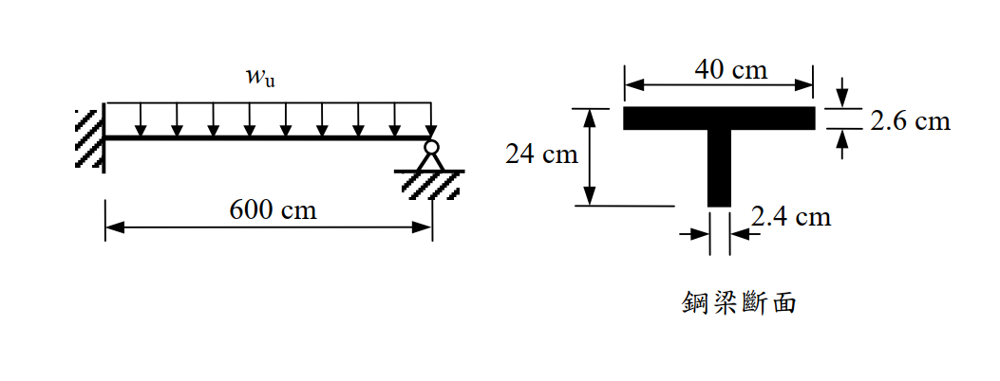

# SS-2005-4 題目正本

> 本檔只記錄**考卷上寫了什麼、圖上畫了什麼**，不含任何解法。解析見同資料夾 `SS-2005-4.md`。
> 判讀清單經使用者確認前，狀態為「待確認」；確認後本檔原則上不再修改（改動須回考卷原圖並記 log）。

| 項目 | 內容 |
|------|------|
| 考卷 | `raw/exams/SS-2005_鋼結構設計.pdf` 第 2（背面） 頁，第四題 |
| 考年 | 民國 94 年（2005） |
| 配分 | 25 分 |
| 附圖 | 1 張（梁立面＋鋼梁斷面），`SS-2005-4-fig-1.png` |
| 判讀狀態 | **已確認**（2026-11-02 使用者確認，含「不確定」項之解讀；轉錄同日，PyMuPDF 110 dpi 全頁＋關鍵尺寸 220–400 dpi 局部目視，盲讀後才比對既有解析） |

## 1. 考卷原文（逐字）

> 四、有一靜不定鋼梁兩端分別為固接與簡支，鋼梁斷面為 T 型，使用鋼材 $F_y = 2.5\ \text{tf/cm}^2$，$F_u = 4.1\ \text{tf/cm}^2$。假設鋼梁有足夠側向支撐且為結實斷面。試以塑性設計法（Plastic design），僅考慮撓曲強度，計算鋼梁所能承受之因數化載重 $w_u$（不考慮鋼梁自重）。（25 分）

## 2. 考卷給的公式、附表與參數

無（本卷無參考公式區）。

## 3. 附圖

*圖面文字照錄：$w_u$；600 cm；40 cm；2.6 cm；24 cm；2.4 cm；鋼梁斷面。*

## 4. 判讀清單

「把握」標**不確定**者請優先確認；解讀類項目（題目用字的意思）另標「解讀」。

| # | 項目 | 判讀 | 圖上／題文依據 | 把握 |
|---|------|------|---------------|------|
| 1 | 結構型式 | 單跨梁 1 根，跨度 600 cm | 600 cm 尺寸線兩端對齊左牆面與右支承 | 確定 |
| 2 | 左端支承 | 固接 | 牆面斜線剖面；題文「固接」 | 確定 |
| 3 | 右端支承 | 鉸支（簡支） | 三角形＋圓圈＋地面斜線；題文「簡支」 | 確定 |
| 4 | 載重 | 均布 $w_u$，向下，滿跨 | 整排箭頭由左端到右端 | 確定 |
| 5 | 斷面方向 | T 型，翼板在上、腹板（肢）向下 | 斷面圖 | 確定 |
| 6 | 翼板寬 | 40 cm | 上方尺寸線跨翼板全寬 | 確定 |
| 7 | 翼板厚 | 2.6 cm | 右側一對箭頭夾翼板上、下緣 | 確定 |
| 8 | 全深 | **24 cm（翼板頂至腹板底）**；腹板淨高 21.4 cm 為推得值 | 左側尺寸線上界線與翼板頂齊平，下界線是由腹板底引出的水平線（400 dpi） | 確定 |
| 9 | 腹板厚 | 2.4 cm | 底部一對箭頭夾腹板兩側 | 確定 |
| 10 | $F_u$ | 題目有給，但「僅考慮撓曲強度」故不使用 | 題文 | 確定 |
| 11 | 「因數化載重 $w_u$」 | 以 $M_p$ 直接求崩塌載重，不另乘強度折減係數（題目未給 $\phi$） | 題文「以塑性設計法」（解讀） | 不確定 → 使用者確認 |

---

*轉錄：2026-11-02（U2-1 題目／解答拆分試做）｜確認：2026-11-02 使用者確認*
