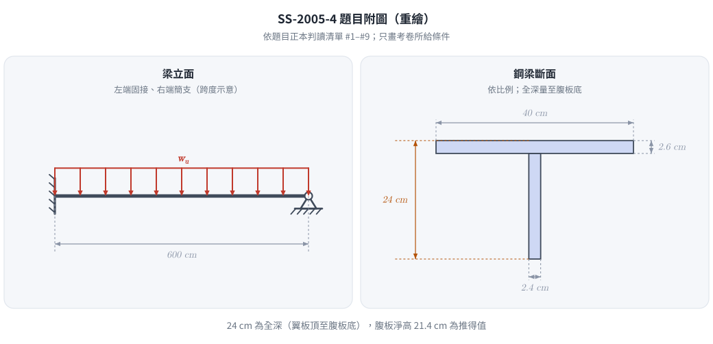
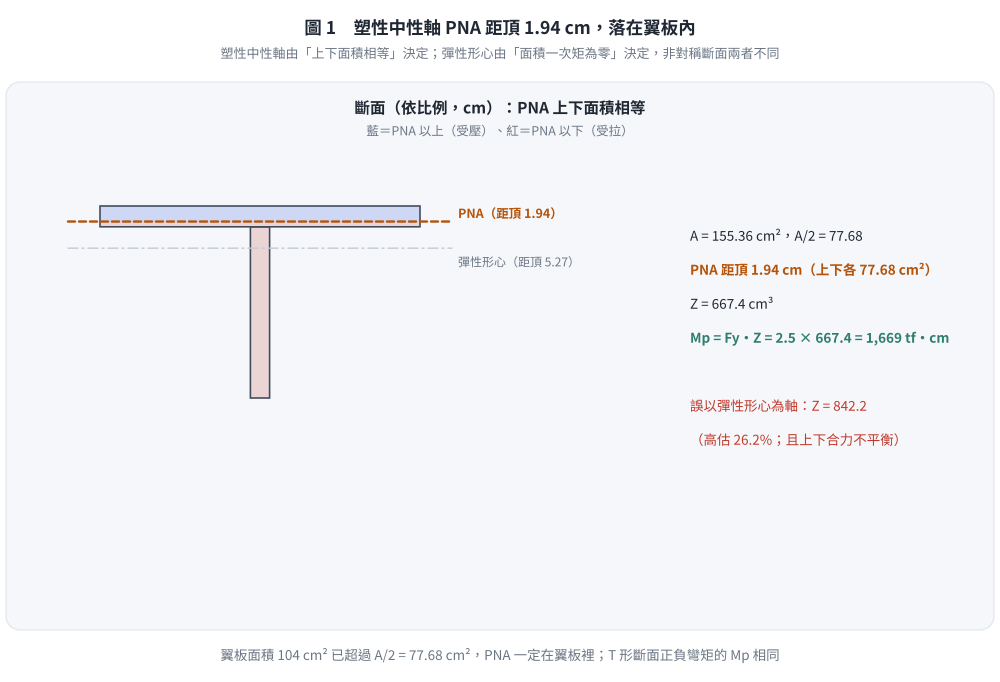
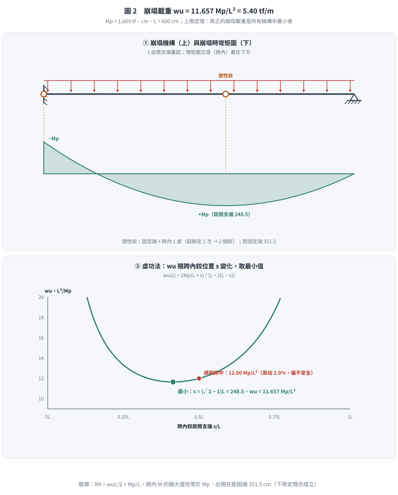

# 考題編號：SS-2005-4

**主分類：** `SS-U2-1` 塑性分析與設計
**副分類：** `SS-U1-2` 梁桿件
**設計法：** 塑性分析
**標籤：** `塑性分析` `崩塌機制` `塑性鉸` `固端梁` `T型斷面` `塑性斷面模數` `虛功法` `均布載重` `propped cantilever`

---

## 1. 題目（考卷原文見題目正本）

> 考卷原文、公式／附表、附圖與判讀清單（已確認）見同資料夾 `SS-2005-4-problem.md`（題目瀏覽頁最上方「📄 題目正本」區塊）。本節只列**解題時最容易讀錯的地方**與本解使用的記號；題意以題目正本為準。

*圖 1　題目附圖重繪（依題目正本判讀清單 #1–#9）。全深尺寸線以橘色標出、由翼板頂量到腹板底，攔下「24 cm 是腹板高、全深 26.6 cm」的誤讀；右端畫成鉸支，攔下多算一個塑性鉸。*

### 常見誤讀

| 項目 | 正確判讀 | 常見誤讀 |
|------|---------|---------|
| 全深 24 cm | 翼板頂至腹板底（全深），腹板淨高 $24 - 2.6 = 21.4$ cm | 當成腹板高、全深 26.6 cm（$M_p$ 高估 22%，舊版解析即如此） |
| 右端支承 | 鉸支（簡支），不形成塑性鉸、不耗能 | 當成固定端，多算一個鉸 |
| 跨間鉸位置 | 未知，需設 $x$ 求最小 $w_u$ | 直接放在跨中 |
| 「因數化載重 $w_u$」 | 以 $M_p$ 直接求崩塌載重，不乘 $\phi$ | 再乘 0.9 |

**本解記號：** $L = 600$ cm；$b_f = 40$、$t_f = 2.6$、$d = 24$、$t_w = 2.4$ cm；$F_y = 2.5$ tf/cm²（$F_u$ 不使用）；$x$ 自固定端 A 量起。

---

## 2. 考題核心精神與出題者意圖

本題測驗**塑性分析（plastic analysis）**的完整流程：
1. 識別結構超靜定次數 → 確定崩塌所需塑性鉸個數
2. 計算 T 型斷面的**塑性斷面模數 Z** 與 **Mp**（PNA 位置判斷）
3. 以**虛功法（virtual work method）**推導均布載重下的崩塌載重

核心難點：propped cantilever 的跨間鉸位置 $x$ 不固定，需對 $x$ 求極值，導出含 $\sqrt{2}$ 的解；以及從附圖正確讀出「24 cm」是全深。

---

## 3. 解題戰略地圖與陷阱分析

**作戰計畫：**
1. 確認崩塌機制：固端 + 跨間某點 = 2 個塑性鉸
2. 計算 T 型斷面 PNA、Z、Mp
3. 設跨間鉸距固端 $x$，用虛功法建立方程
4. 對 $x$ 求最小 $w_u$
5. 代入解析解 $x = L(2-\sqrt{2})$，平衡法驗算

**陷阱分析：**

| 陷阱 | 說明 | 應對策略 |
|------|------|---------|
| ⚠️ 斷面尺寸讀錯 | 「24 cm」是**全深**，腹板淨高為 21.4 cm；誤當腹板高再加翼板（26.6 cm）會高估 $M_p$ 22% | 看尺寸線界線落點 |
| ⚠️ 誤以為鉸在中央 | 均布載重的跨間鉸 **不在跨中** | 對 $x$ 微分 → $x = L(2-\sqrt{2}) \approx 0.586L$ |
| ⚠️ PNA 誤算 | 先比較翼板面積與半面積 | 104 > 77.68 → PNA 在翼板內 |
| ⚠️ 負彎矩也需達 Mp | 固端為負彎矩 | T 斷面 $Z^+ = Z^-$（等面積分割與方向無關） |

## 3.5 變數層次分析（Variable Hierarchy Analysis）

> 複習提示：解題後，在每個卡住的知識點「卡關?」欄標記 `⚠`；第二次複習時只看有 `⚠` 的項目。

**最終目標：** propped cantilever T 型梁塑性分析 → $M_p = 1668.6$ tf·cm → 崩塌載重 $w_u = 5.40$ tf/m

### 主要公式（$\boxed{\phantom{x}}$ = 未知，待推導）

$$\text{半面積} = A_g/2 \Rightarrow \boxed{c_{\text{PNA}}} \quad \text{（PNA 在翼板內）}$$

$$\boxed{Z} = \Sigma A_i |y_i - c_{\text{PNA}}|, \qquad \boxed{M_p} = F_y \times \boxed{Z}$$

$$w_u(x) = \frac{2M_p(2L-x)}{Lx(L-x)}, \qquad \frac{dw_u}{dx} = 0 \Rightarrow \boxed{x} = L(2-\sqrt{2})$$

$$\boxed{w_u} = (6+4\sqrt{2})\frac{M_p}{L^2}$$

### L1：題目直接給定

| 符號 | 數值 | 說明 |
|------|------|------|
| $L$ | 600 cm | 梁跨度 |
| $F_y$ | 2.5 tf/cm² | 材料強度 |
| 邊界條件 | 左端固接、右端簡支 | 超靜定次數 1 |
| $b_f$、$t_f$ | 40 cm、2.6 cm | 翼板 |
| $d$ | 24 cm | **全深** |
| $t_w$ | 2.4 cm | 腹板厚 |

### L2：需知識點推導

| 符號 | 公式 / 來源 | 卡關? |
|------|------------|:-----:|
| $h_w$ | $24 - 2.6 = 21.4$ cm | |
| $A_g$ | $40\times2.6 + 21.4\times2.4 = 104 + 51.36 = 155.36$ cm² | |
| $A/2$ | 77.68 cm² < 翼板 104 → PNA 在翼板內 | |
| $c_{\text{PNA}}$ | $77.68/40 = 1.942$ cm（距翼板頂） | |
| $Z$ | $75.43 + 8.66 + 583.35 = 667.43$ cm³ | |
| $M_p$ | $2.5 \times 667.43 = 1668.6$ tf·cm | |
| $x$ | $L(2-\sqrt{2}) = 351.5$ cm | |
| $w_u$ | $11.657 \times 1668.6/600^2 = 0.0540$ tf/cm | |

### L3：深層知識（不懂就卡住）

| 知識點 | 說明 | 卡關? |
|--------|------|:-----:|
| 塑性鉸機構分析 | 超靜定次數 $n$ → 需 $n+1$ 個塑性鉸才能崩塌 | |
| propped cantilever 鉸位置 | 均布載重的跨間鉸在 $x = 0.586L$（距固端），非 $L/2$ | |
| T 型斷面 PNA | 先比較翼板面積與半面積，確認 PNA 所在區域 | |
| 尺寸線判讀 | 尺寸線兩條界線各對齊哪一個邊，決定量的是全深或腹板高 | |

---

## 4. 步驟化詳細計算過程

### 4.1 超靜定次數與崩塌機制

一端固接、一端簡支，**超靜定次數 = 1** → 崩塌需 **2 個塑性鉸**：固端 A（$-M_p$）與跨間 C（距 A 為 $x$，$+M_p$）。

### 4.2 T 型斷面 PNA 與 Z

$$h_w = d - t_f = 24 - 2.6 = 21.4\ \text{cm}$$

$$A_g = 40 \times 2.6 + 21.4 \times 2.4 = 104 + 51.36 = 155.36\ \text{cm}^2, \qquad \frac{A}{2} = 77.68\ \text{cm}^2$$

翼板面積 104 > 77.68 → PNA 在翼板內：

$$40\bar{y} = 77.68 \Rightarrow \boxed{\bar{y} = 1.942\ \text{cm（距翼板頂面）}}$$

| 區塊 | 面積 (cm²) | 形心距 PNA (cm) | 貢獻 (cm³) |
|------|-----------|----------------|-----------|
| 翼板 PNA 以上 | $40 \times 1.942 = 77.68$ | 0.971 | 75.43 |
| 翼板 PNA 以下 | $40 \times 0.658 = 26.32$ | 0.329 | 8.66 |
| 腹板 | $21.4 \times 2.4 = 51.36$ | $0.658 + 10.7 = 11.358$ | 583.35 |
| **合計** | | | **667.43** |

$$M_p = F_y Z = 2.5 \times 667.43 = \boxed{1668.6\ \text{tf}\cdot\text{cm} = 16.69\ \text{tf}\cdot\text{m}}$$

（驗算：PNA 上下面積各 77.68 cm² ✓；T 斷面正負彎矩 $M_p$ 相同。）

*圖 1　PNA 由上下面積相等決定，T 形斷面的 PNA 落在翼板內（距頂 1.942 cm），與彈性形心（5.27 cm）不同。這張圖攔的是以彈性形心為軸算 $Z$（高估約 26%），以及把 PNA 放進腹板。*

### 4.3 虛功法

令固端 A 虛轉角 $\theta_A$，C 點虛位移 $\delta_C = x\theta_A$，CB 段轉角 $x\theta_A/(L-x)$，C 點相對轉角 $\theta_A L/(L-x)$：

$$W_{ext} = w_u \frac{L\,\delta_C}{2} = w_u\frac{Lx\theta_A}{2}, \qquad W_{int} = M_p\theta_A\frac{2L-x}{L-x}$$

$$w_u(x) = \frac{2M_p(2L-x)}{Lx(L-x)}$$

### 4.4 求最小崩塌載重

$$\frac{dw_u}{dx} = 0 \Rightarrow x^2 - 4Lx + 2L^2 = 0 \Rightarrow \boxed{x = L(2-\sqrt{2}) = 351.5\ \text{cm（距固端）}}$$

$$w_u = (6+4\sqrt{2})\frac{M_p}{L^2} = \frac{11.657 \times 1668.6}{600^2} = \boxed{0.0540\ \text{tf/cm} = 5.40\ \text{tf/m}}$$

### 4.5 驗算（平衡法）

$$R_A = \frac{w_uL}{2} + \frac{M_p}{L} = \frac{0.05403 \times 600}{2} + \frac{1668.6}{600} = 16.21 + 2.78 = 18.99\ \text{tf}$$

$$M(x) = R_A x - \frac{w_u x^2}{2} - M_p = 18.99 \times 351.5 - \frac{0.05403 \times 351.5^2}{2} - 1668.6 = 1668.6\ \text{tf}\cdot\text{cm} = M_p\ \checkmark$$

且沿全跨數值掃描 $M_{max}$ 恰在 $x = 351.5$ cm、等於 $M_p$，不超過 $M_p$（下限定理成立）。

*圖 2　虛功法的 $w_u$ 隨跨內鉸位置變化，取最小值：鉸距固定端 351.5 cm、$w_u = 11.657M_p/L^2 = 5.40$ tf/m。這張圖攔的是把跨內鉸放在跨中（$w_u$ 偏大 2.9%，偏不安全）與鉸距量錯端點。*

---

## 5. 關鍵爭議點與進階探討

### 5.1 解析解化簡

代入 $x = L(2-\sqrt{2})$、$L-x = L(\sqrt{2}-1)$、$2L-x = L\sqrt{2}$：

$$w_u = \frac{2\sqrt{2}}{(2-\sqrt{2})(\sqrt{2}-1)}\frac{M_p}{L^2} = \frac{2\sqrt{2}}{3\sqrt{2}-4}\frac{M_p}{L^2} = (6+4\sqrt{2})\frac{M_p}{L^2} \approx 11.657\frac{M_p}{L^2}$$

### 5.2 與彈性設計比較

彈性中性軸距頂面 $\bar{Y} = (104 \times 1.3 + 51.36 \times 13.3)/155.36 = 5.27$ cm；$I = 6969.5$ cm⁴；$S_{bot} = 6969.5/(24 - 5.27) = 372.0$ cm³。

彈性分析固端負彎矩 $wL^2/8$ 控制，肢端（底緣）先降伏——固端為負彎矩，肢端**受壓**，且離彈性中性軸 $24 - 5.27 = 18.73$ cm，遠大於翼板頂的 5.27 cm：

$$w_e = \frac{8F_yS_{bot}}{L^2} = \frac{8 \times 2.5 \times 372.0}{600^2} = 0.0207\ \text{tf/cm}$$

$w_u / w_e = 2.61$：T 型斷面形狀因子大（$Z/S_{bot} = 1.79$），加上彎矩重分配，塑性設計容量明顯較高。

### 5.3 結實斷面檢核

翼板 $\dfrac{b_f/2}{t_f} = \dfrac{20}{2.6} = 7.69 \le \lambda_{pd} = 14/\sqrt{F_y} = 8.85$ ✓（塑性分析需塑性鉸持續轉動，國內規範以「塑性設計斷面」$\lambda_{pd}$ 檢核，較結實斷面 $\lambda_p = 17/\sqrt{F_y} = 10.75$ 嚴；本題兩者皆通過）；腹板（T 肢）$d/t_w = 24/2.4 = 10$，甚小 ✓。

### 5.4 更正說明

舊版解答把「24 cm」當腹板高、全深取 26.6 cm，得 $M_p = 2032.5$ tf·cm、$w_u = 6.58$ tf/m，高估約 22%。依原圖全深為 24 cm，正確 $w_u = 5.40$ tf/m。

---

## 6. 依最新規範（AISC 360-16／-22）對照

| 項目 | 考卷（塑性設計） | AISC 360-16／-22 |
|:---|:---|:---|
| 塑性分析 | 機構法，$w_u = 11.657M_p/L^2$ | 附錄 1「以非彈性分析設計」允許，但限結實斷面、側撐間距 $L_{pd}$ 等條件 |
| T 型斷面 $M_n$ | $M_p = F_yZ$ | F9：肢受拉時 $M_p = F_yZ_x \le 1.6M_y$；肢受壓（負彎矩）$M_p \le M_y$；$M_y = F_yS_x$，$S_x$ 取**肢端**（先降伏、較小者） |

**本題以 360-16 F9 估算：** $M_y = F_yS_x = 2.5 \times 372.0 = 930.1$ tf·cm（$S_x$ 取至肢端，T 型梁最先降伏處；Kloiber, *Engineering Journal* 對 WT 撓曲強度的說明亦取「肢降伏之較小值」）。

- 正彎矩（跨間 C，肢受拉）：$1.6M_y = 1{,}488.2$ tf·cm $< M_p = 1{,}668.6$ → $M_C = 1{,}488.2$ tf·cm（由 1.6$M_y$ 控制）
- 負彎矩（固端 A，肢受壓）：$M_A = M_y = 930.1$ tf·cm

兩鉸強度不同時，虛功式為 $w(x) = \dfrac{2[M_A(L-x) + M_C L]}{L\,x\,(L-x)}$；$dw/dx = 0 \Rightarrow M_A x^2 - 2L(M_A+M_C)x + (M_A+M_C)L^2 = 0$，

$$x = L\,\frac{(M_A+M_C) - \sqrt{(M_A+M_C)M_C}}{M_A} = 0.5604L = 336.2\ \text{cm},\qquad w_u = 0.04278\ \text{tf/cm} = 4.28\ \text{tf/m}$$

（數值掃描最小值同為 4.278 tf/m；代回平衡：$R_A = w_uL/2 + M_A/L$，跨間最大正彎矩恰為 $M_C = 1{,}488.2$ tf·cm、全跨無一處超過，上下限重合。）較考卷版 5.40 tf/m 低約 21%。新版對 T 型肢受壓的限制正是為了避免肢部局部降伏後失穩。

---

*修正日期：2026-11-01（依考卷原圖 600 dpi：T 型斷面「24 cm」為全深（翼板頂至腹板底），原解誤作腹板高 24 cm、全深 26.6 cm。更正腹板淨高 21.4 cm、$A$ = 155.36 cm²、PNA 距頂 1.942 cm、$Z$ 813.0 → **667.4 cm³**、$M_p$ 2032.5 → **1668.6 tf·cm**，$w_u$ 6.58 → **5.40 tf/m**；平衡法與全跨彎矩掃描驗算；§5.2 刪除殘留英文草稿並重算彈性比較；新增 §6 對照）*
*圖解補繪：2026-11-03（向量圖 2 張，腳本 `gen_SS-2005-4.py`，改輸入可原地重跑；SVG 供 wiki／PDF，2× PNG 供 pptx／影片）*
*驗證狀態：unverified*
*第二次修正日期：2026-11-01（§5.2 肢端在固端負彎矩下為受壓（原誤寫受拉，數值不變）；§5.3 改以塑性設計斷面 $\lambda_{pd} = 14/\sqrt{F_y}$ 檢核；§6 F9 之 $1.6M_y$ 原以翼板側 $S$ = 1323.2 計得 5293，應以肢端 $S_x$ = 372.0 計得 1488.2，跨間正彎矩改由 $1.6M_y$ 控制，並補兩鉸不等強度之閉合解與下限檢核，$w_u$ 由「約 4.2」更正為 **4.28 tf/m**（低約 21%）。考卷 94 年第四題原圖目視確認題意不變）*

*修正日期：2026-11-02（§1 全文重述改為指向題目正本 `SS-2005-4-problem.md`（已確認）＋常見誤讀＋本解記號，避免題意兩份不同步；解題內容與答案不變）*

*修正日期：2026-11-03（§1 補入題目附圖重繪 `figs/SS-2005-4-fig-1-problem.svg`（依已確認的題目正本判讀清單，腳本 `gen_SS-2005-4.py`，可重跑）；解題內容與答案不變）*
