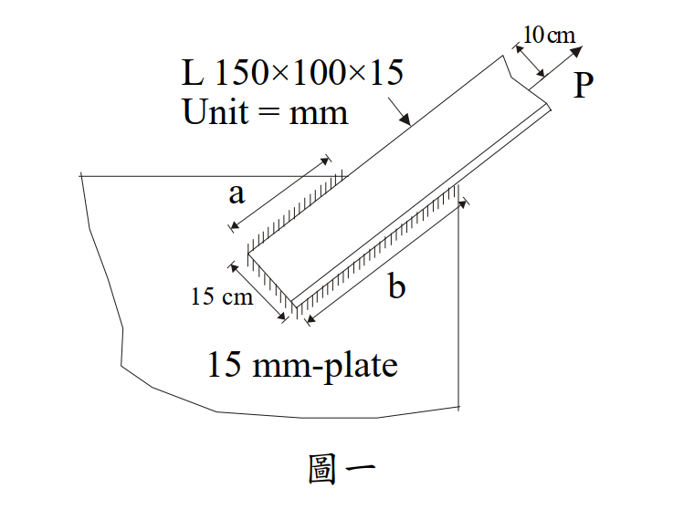

# SS-2007-1 題目正本

> 本檔只記錄**考卷上寫了什麼、圖上畫了什麼**，不含任何解法。解析見同資料夾 `SS-2007-1.md`。
> 判讀清單經使用者確認前，狀態為「待確認」；確認後本檔原則上不再修改（改動須回考卷原圖並記 log）。

| 項目 | 內容 |
|------|------|
| 考卷 | `raw/exams/SS-2007_鋼結構設計.pdf` 第 1 頁（全三頁之第一頁），第一題 |
| 考年 | 民國 96 年（2007） |
| 配分 | 25 分 |
| 附圖 | 1 張（圖一：角鋼銲接於連接板），`SS-2007-1-fig-1.png` |
| 判讀狀態 | **待確認**（轉錄 2026-11-02，PyMuPDF 110 dpi 全頁＋圖一 400 dpi 局部目視，盲讀後才比對既有解析） |

## 1. 考卷原文（逐字）

> 一、有一角鋼（L 150 mm×100 mm×15 mm）使用填角焊焊接在一塊連接板（厚度 1.5 cm）上，使用此角鋼之材料強度，試依據工作應力法（ASD）設計焊接長度 a 及 b。（25 分）
> 鋼材之降伏強度 $F_y$ = 3.5 tf/cm²，抗拉強度 $F_u$ = 4.8 tf/cm²，焊材之 $F_u$ = 4.9 tf/cm²，填角焊腳長（Leg length）使用 1.2 cm，角鋼之形心離端點長度為 10 cm（如圖一中外力 P 離端點之長度，P 為斷面上之總外力），面積折減係數 U = 0.85。（註：圖一中斜線部分表示填角焊之區域）

## 2. 考卷給的公式、附表與參數

- 題文：L150×100×15；連接板厚 1.5 cm；$F_y$ = 3.5、$F_u$ = 4.8 tf/cm²；焊材 $F_u$ = 4.9 tf/cm²；腳長 1.2 cm；形心距 10 cm；U = 0.85。
- 本題**沒有印公式**，也沒有給角鋼斷面積（須由尺寸計算或查表）。
- 第 3 頁公式集為梁柱用，與本題無關。
- 卷首注意事項：㈠可以使用電子計算器；㈡不必抄題。

## 3. 附圖

*圖面文字照錄：L 150×100×15；Unit = mm；10 cm；P；a；15 cm；b；15 mm-plate；圖一。*

## 4. 判讀清單

「把握」標**不確定**者請優先確認；解讀類項目（題目用字的意思）另標「解讀」。

| # | 項目 | 判讀 | 圖上／題文依據 | 把握 |
|---|------|------|---------------|------|
| 1 | 貼板的肢 | 150 mm 肢平貼連接板（端部橫向焊標 15 cm） | 圖一 | 確定 |
| 2 | 焊道 | 三段：上緣縱向 a、下緣縱向 b、端部橫向 15 cm | 斜線區（400 dpi） | 確定 |
| 3 | 肢背側 | 下緣（b 側）有另一肢的稜線 → b 側為肢背、a 側為趾 | 下緣平行線 | 確定（解讀） |
| 4 | 「端點」與 10 cm | 由上緣（a 側、趾）量到 P 作用線 10 cm，即距 b 側（肢背）5 cm | 尺寸線端點＋題文「如圖一中外力 P 離端點之長度」 | 確定（解讀） |
| 5 | 設計力 | 「使用此角鋼之材料強度」→ P 取角鋼拉力容許強度（全斷面降伏與有效淨斷面斷裂取小） | 題文＋給 U | 確定（解讀） |
| 6 | 焊道容許應力 | 喉部 $0.3F_u$（焊材 4.9），題未給 | ASD 規範 | 確定（解讀） |
| 7 | 端部橫向焊 | 計入焊道群（平衡焊道設計時三段共同分擔） | 斜線區含端部 | 確定（解讀） |

---

*轉錄：2026-11-02（SS-U1-4 題目正本推廣・批 1）*
