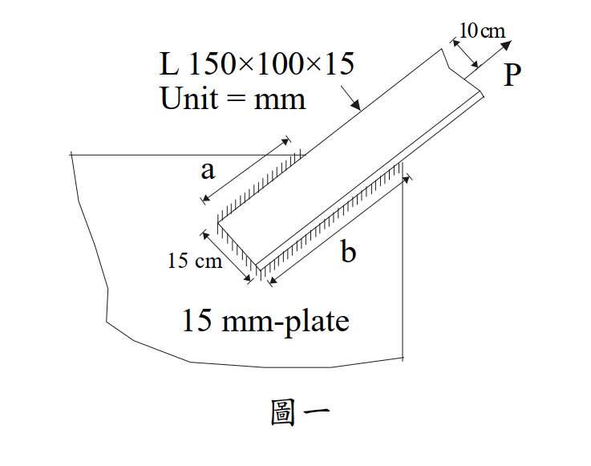
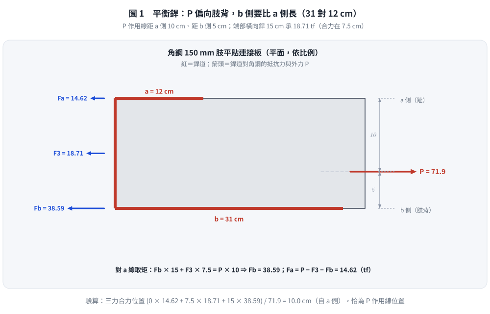
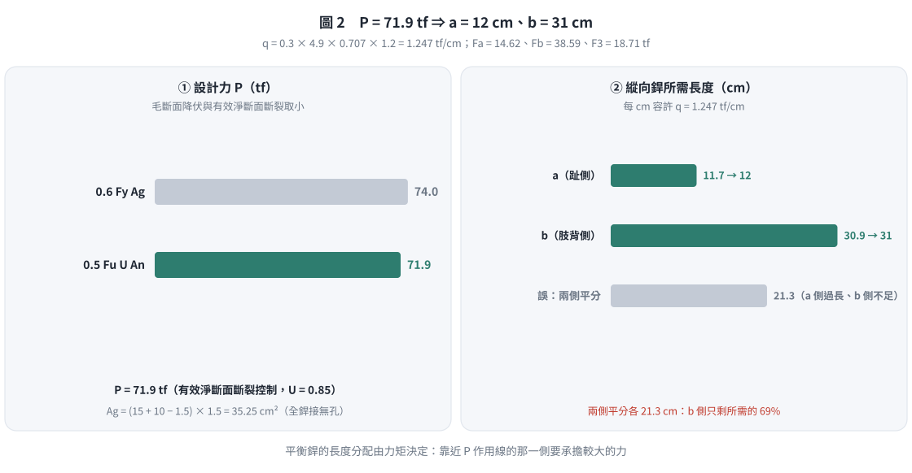

# 考題編號：SS-2007-1

**主分類：** `SS-U1-4` 接合之分析與設計
**副分類：** `SS-U1-1` 拉力及壓力桿件
**設計法：** ASD
**標籤：** `填角銲` `ASD` `平衡銲道` `不等肢角鋼` `剪力遲滯` `U值` `拉力桿件` `銲道容許應力`

---

## 1. 原始題目重述

（依考卷原文，96 年第 1 頁第一題）

> 一、有一角鋼（L 150 mm×100 mm×15 mm）使用填角焊焊接在一塊連接板（厚度 1.5 cm）上，使用此角鋼之材料強度，試依據工作應力法（ASD）設計焊接長度 a 及 b。（25 分）
>
> 鋼材之降伏強度 $F_y = 3.5$ tf/cm²，抗拉強度 $F_u = 4.8$ tf/cm²，焊材之 $F_u = 4.9$ tf/cm²，填角焊腳長（Leg length）使用 1.2 cm，角鋼之形心離端點長度為 10 cm（如圖一中外力 P 離端點之長度，P 為斷面上之總外力），面積折減係數 $U = 0.85$。（註：圖一中斜線部分表示填角焊之區域）

*圖說（依考卷原圖 450 dpi 目視判讀，2026-11-01 更正）：角鋼 150 mm 長肢平貼連接板，斜線區為三段填角銲：沿上緣的縱向銲 **a**、沿下緣的縱向銲 **b**、以及角鋼端部的**橫向銲 15 cm**（圖中「15 cm」為長肢寬）。右上角「10cm」尺寸線由角鋼**上緣（a 側）**量到 $P$ 作用線，在角鋼平面內 → $P$ 距 b 側 5 cm。下緣畫有雙線（外伸短肢所在，即肢背），角鋼形心距肢背約 5.06 cm、距趾端 9.94 cm ≈ 10 cm，與題文一致。*

**判讀表**

| 項目 | 判讀 |
|:---|:---|
| 銲道 | 縱向 a（上緣，趾側）、縱向 b（下緣，肢背側）、端部橫向 15 cm |
| $P$ 位置 | 平面內，距 a 側 10 cm、距 b 側 5 cm（通過角鋼形心） |
| 設計力 | 「使用此角鋼之材料強度」→ $P$ = 角鋼拉力容許強度 |
| 銲腳 | 1.2 cm → 喉厚 0.848 cm |
| 求 | 平衡銲道長度 a、b（使銲道群合力通過形心） |

---

## 2. 考題核心精神與出題者意圖

本題是經典的**平衡填角銲設計（balanced weld design）**：

1. 先求角鋼本身的 ASD 拉力強度（全斷面降伏 vs 有效淨斷面斷裂，$U = 0.85$）作為設計力 $P$
2. 端部橫向銲長固定為肢寬 15 cm，其力 $F_3$ 作用於肢寬中點
3. 對 a 線（或 b 線）取力矩，使三段銲道合力通過角鋼形心 → 消除平面內偏心
4. $F_a$、$F_b$ 除以每 cm 容許強度得 a、b

「10 cm」是**形心到端點（邊緣）的平面內距離**，不是面外偏心。

---

## 3. 解題戰略地圖與陷阱分析

**作戰計畫：**
1. $A_g$ → $P = \min(0.6F_yA_g,\ 0.5F_uUA_n)$
2. 每 cm 銲道容許力 $q = 0.3F_u^{weld} \times 0.707w$
3. $F_3 = 15q$（作用於距兩緣 7.5 cm）
4. $\Sigma M_{a} = 0$：$F_b \times 15 + F_3 \times 7.5 = P \times 10$
5. $\Sigma F = 0$：$F_a = P - F_3 - F_b$
6. $a = F_a/q$、$b = F_b/q$，取整

**陷阱分析：**

| 陷阱 | 說明 | 應對策略 |
|:---|:---|:---|
| ⚠️ 把 10 cm 當面外偏心 | 題文明寫「形心離端點長度」，圖上尺寸在角鋼平面內 | 10 cm 用於平衡銲道的取矩 |
| ⚠️ 漏掉端部橫向銲 | 斜線區含角鋼端部 15 cm | $F_3 = 15q$ 先扣除 |
| ⚠️ 設計力取誰 | 「使用此角鋼之材料強度」 | $P$ = 角鋼容許拉力，不是銲道容量 |
| ⚠️ a、b 對應哪一側 | P 距 a 側 10 cm、距 b 側 5 cm | 靠近 $P$ 的 b 較長 |
| ⚠️ 喉厚 | $0.707 \times 1.2 = 0.848$ cm | |

## 3.5 變數層次分析（Variable Hierarchy Analysis）

> 複習提示：解題後，在每個卡住的知識點「卡關?」欄標記 `⚠`；第二次複習時只看有 `⚠` 的項目。

**最終目標：** 角鋼 ASD 拉力強度 → 平衡銲道取矩 → a、b 長度

### 主要公式（$\boxed{\phantom{x}}$ = 未知，待推導）

$$\boxed{P} = \min(0.6F_yA_g,\ 0.5F_uUA_n)$$

$$q = 0.3F_u^{weld} \times 0.707w, \qquad F_3 = q \times 15$$

$$\boxed{F_b} = \frac{P \times 10 - F_3 \times 7.5}{15}, \qquad \boxed{F_a} = P - F_3 - F_b$$

$$a = F_a/q, \qquad b = F_b/q$$

### L1：題目直接給定

| 符號 | 數值 | 說明 |
|:---|:---|:---|
| 角鋼 | L150×100×15 | 長肢貼板 |
| $F_y$／$F_u$ | 3.5／4.8 tf/cm² | 角鋼 |
| $F_u^{weld}$ | 4.9 tf/cm² | 銲材 |
| $w$ | 1.2 cm | 銲腳 |
| 形心距 a 側 | 10 cm | 附圖 |
| $U$ | 0.85 | |

### L2：需知識點推導

| 符號 | 公式 / 來源 | 卡關? |
|:---|:---|:---:|
| $A_g$ | $(15 + 10 - 1.5) \times 1.5 = 35.25$ cm² | |
| $0.6F_yA_g$ | 74.0 tf | |
| $0.5F_uUA_n$ | $0.5 \times 4.8 \times 0.85 \times 35.25 = 71.9$ tf（控制） | |
| $q$ | $0.3 \times 4.9 \times 0.848 = 1.247$ tf/cm | |
| $F_3$ | $1.247 \times 15 = 18.71$ tf | |
| $F_b$ | $(71.9 \times 10 - 18.71 \times 7.5)/15 = 38.59$ tf | |
| $F_a$ | $71.9 - 18.71 - 38.59 = 14.62$ tf | |
| a、b | 11.7 → **12 cm**；30.9 → **31 cm** | |

### L3：深層知識（不懂就卡住）

| 知識點 | 說明 | 卡關? |
|:---|:---|:---:|
| 平衡銲道 | 銲道群合力需通過構材形心，避免偏心造成額外彎矩與剪力遲滯 | |
| 剪力遲滯 $U$ | 只銲長肢，外伸肢應力傳遞不均 → 有效淨面積 $UA_n$ | |
| ASD 填角銲 | 喉部容許剪應力 $0.3F_u^{weld}$ | |

---

## 4. 步驟化詳細計算過程

### Step 1：角鋼容許拉力（設計力 $P$）

$$A_g = (15 + 10 - 1.5) \times 1.5 = 35.25\ \text{cm}^2 \quad \text{（不計圓角）}$$

全銲接無孔：$A_n = A_g$，$A_e = UA_n = 0.85 \times 35.25 = 29.96$ cm²

$$0.6F_yA_g = 0.6 \times 3.5 \times 35.25 = 74.0\ \text{tf}$$

$$0.5F_uA_e = 0.5 \times 4.8 \times 29.96 = 71.9\ \text{tf}$$

$$\boxed{P = 71.9\ \text{tf}}\ \text{（有效淨斷面斷裂控制）}$$

### Step 2：每 cm 銲道容許力

$$q = 0.3 \times 4.9 \times 0.707 \times 1.2 = \boxed{1.247\ \text{tf/cm}}$$

尺寸限制：長肢厚 15 mm，最大銲腳 $15 - 1.6 = 13.4$ mm ≥ 12 mm OK；母材剪力 $0.4F_yt = 0.4 \times 3.5 \times 1.5 = 2.1$ tf/cm > $q$，銲道控制。

### Step 3：端部橫向銲

$$F_3 = 1.247 \times 15 = 18.71\ \text{tf}\quad \text{（作用於距 a、b 兩緣各 7.5 cm）}$$

### Step 4：平衡取矩（對 a 線）

$$F_b \times 15 + F_3 \times 7.5 = P \times 10$$

$$F_b = \frac{71.9 \times 10 - 18.71 \times 7.5}{15} = \boxed{38.59\ \text{tf}}$$

$$F_a = 71.9 - 18.71 - 38.59 = \boxed{14.62\ \text{tf}}$$

*圖 1　平衡銲：三段銲道的合力必須落在 $P$ 的作用線上，所以靠近作用線的肢背側 b（31 cm）比趾側 a（12 cm）長得多。這張圖攔的是兩側等長、取矩線選錯，以及忽略端部橫向銲的力矩貢獻。*

### Step 5：銲道長度

$$a = \frac{14.62}{1.247} = 11.7\ \text{cm} \rightarrow \boxed{a = 12\ \text{cm}}$$

$$b = \frac{38.59}{1.247} = 30.9\ \text{cm} \rightarrow \boxed{b = 31\ \text{cm}}$$

（皆 ≥ 4w = 4.8 cm 最小長度；縱向銲長 ≥ 兩銲道間距 15 cm 之規定，a 為 12 cm 但有端部橫向銲閉合，可接受）

### Step 6：雙路徑驗算

**對 b 線取矩**：$F_a \times 15 + F_3 \times 7.5 = P \times 5$ → $F_a = (359.6 - 140.3)/15 = 14.62$ tf，與 Step 4 一致。

**合力位置檢查**：$(14.62 \times 0 + 18.71 \times 7.5 + 38.59 \times 15)/71.9 = 10.0$ cm（自 a 側），恰為形心位置。

### 結論彙整

| 項目 | 結果 |
|:---|:---|
| 設計力 | $P = 71.9$ tf（$0.5F_uUA_n$ 控制） |
| 每 cm 容許力 | $q = 1.247$ tf/cm |
| 端部橫向銲 | 15 cm，18.71 tf |
| **a（趾側，距 P 10 cm）** | $\boxed{12\ \text{cm}}$（14.62 tf） |
| **b（肢背側，距 P 5 cm）** | $\boxed{31\ \text{cm}}$（38.59 tf） |

*圖 2　設計力由有效淨斷面斷裂控制（71.9 tf），再依力矩分配兩側銲長。這張圖攔的是以 $0.6F_yA_g$ 為設計力，以及兩側平分銲長（b 側只剩所需的 69%）。*

---

## 5. 關鍵爭議點與進階探討

### 5.1 若「10 cm」量自 b 側

a、b 對調（a = 31、b = 12 cm）。圖上尺寸線自上緣起算，且角鋼形心距趾端 9.94 cm、距肢背 5.06 cm（肢背在下緣雙線處），兩者一致指向 P 距 a 側 10 cm。

### 5.2 不設端部橫向銲

$F_b = P \times 10/15 = 47.9$ tf → b = 38.4 cm；$F_a = 24.0$ tf → a = 19.2 cm；總長 57.6 cm，比含端銲的 58 cm（12＋31＋15）相近，但構材總長較長。

### 5.3 原解錯在哪（2026-11-01 勘誤）

| 項目 | 原解 | 更正 |
|:---|:---|:---|
| 10 cm 的意義 | 「P 距連接板面 10 cm」（面外偏心），另加彎矩 $10P$ | 平面內：形心距 a 側邊緣 10 cm |
| 銲道長度 | 自行假設 a = b = 25 cm、無端銲 | 題目要求**設計** a、b；含端部 15 cm 橫向銲 |
| 答案 | 容許 $P = 37.4$ tf（未設計 a、b） | $P = 71.9$ tf，**a = 12 cm、b = 31 cm** |

---

## 6. 依最新規範（AISC 360-16／-22）對照

| 項目 | 考卷（ASD 1989 系） | AISC 360-16／-22（ASD） |
|:---|:---|:---|
| 拉力構材 | $0.6F_yA_g$、$0.5F_uA_e$ | $F_yA_g/1.67$、$F_uA_e/2.00$，相同 |
| $U$ | 題目給 0.85 | 表 D3.1 case 4（縱向＋橫向銲）依 $l/w$ 取值 |
| 填角銲 | $0.3F_u^{weld}$ | $0.6F_{EXX}/2.00 = 0.3F_{EXX}$，相同 |
| 縱橫向銲合併 | 直接相加 | J2.4(c)：$R_n = \max(R_{nwl} + R_{nwt},\ 0.85R_{nwl} + 1.5R_{nwt})$ |

以 360-16 第二式估算：$0.85q(a+b) + 1.5 \times 18.71 = 71.9$ → $a + b = 41.4$ cm（考卷版 42.7 cm），縱向銲總長可省約 3%。

---

*修正日期：2026-11-01（依考卷原文與原圖 450 dpi 目視判讀：「角鋼之形心離端點長度為 10 cm」為角鋼平面內 P 作用線距 a 側邊緣之距離（P 距 b 側 5 cm），原解誤作「P 距連接板面 10 cm」之面外偏心並另加彎矩；原解自行假設 a = b = 25 cm 且漏掉端部 15 cm 橫向銲，只求出容許 P = 37.4 tf，未依題意設計 a、b。更正為平衡銲道設計：P = 角鋼 ASD 強度 71.9 tf（0.5FuUAn 控制），端銲 18.71 tf，對 a 線取矩得 **a = 12 cm、b = 31 cm**；新增對 b 線取矩與合力位置雙路徑驗算、§6 對照）*
*圖解補繪：2026-11-03（向量圖 2 張，腳本 `gen_SS-2007-1.py`，改輸入可原地重跑；SVG 供 wiki／PDF，2× PNG 供 pptx／影片）*
*驗證狀態：unverified*
