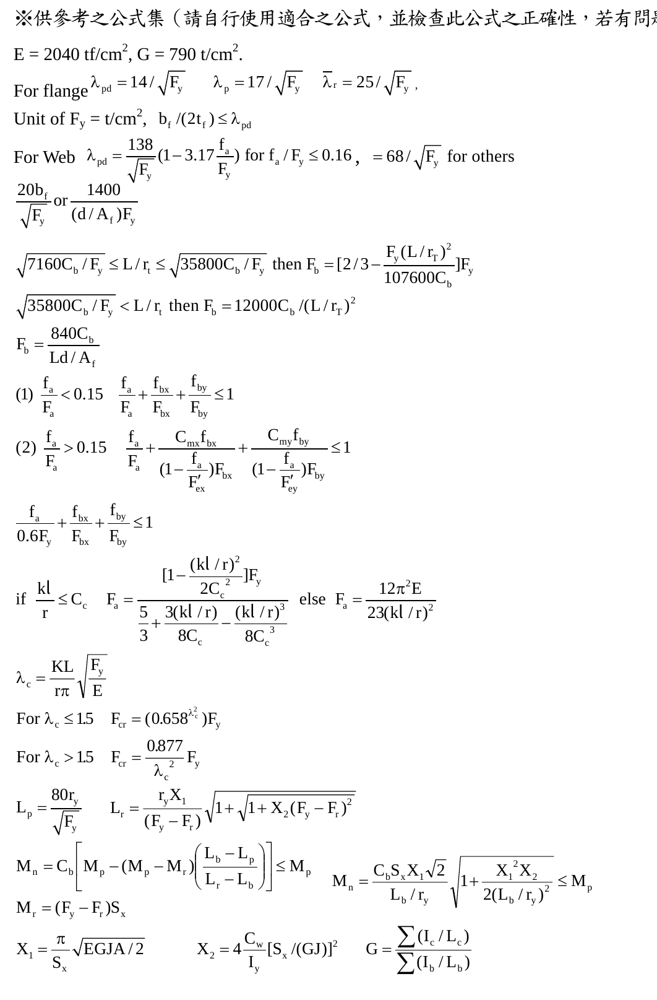
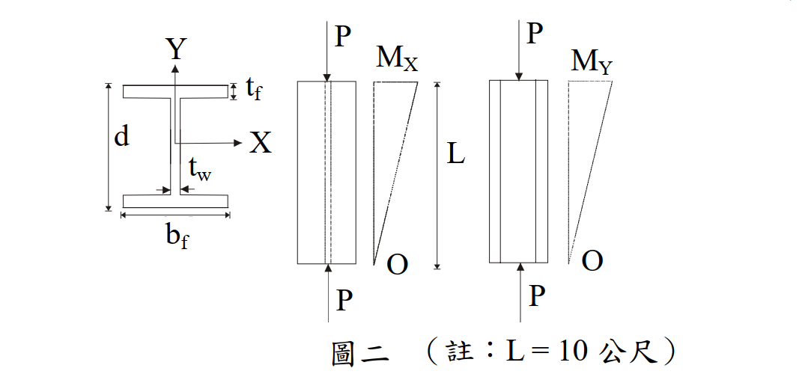

# SS-2007-2 題目正本

> 本檔只記錄**考卷上寫了什麼、圖上畫了什麼**，不含任何解法。解析見同資料夾 `SS-2007-2.md`。
> 判讀清單經使用者確認前，狀態為「待確認」；確認後本檔原則上不再修改（改動須回考卷原圖並記 log）。

| 項目 | 內容 |
|------|------|
| 考卷 | `raw/exams/SS-2007_鋼結構設計.pdf` 第 1 頁（全三頁・第一頁），第二題；公式集在第 3 頁 |
| 考年 | 民國 96 年（2007） |
| 配分 | 25 分 |
| 附圖 | 1 張（圖二：斷面、$M_X$ 與 $M_Y$ 彎矩圖），`SS-2007-2-fig-1.png`；第 3 頁公式集截圖 `SS-2007-2-eqn-1.png` |
| 判讀狀態 | **待確認**（轉錄 2026-11-02，PyMuPDF 110 dpi 全頁＋附圖 300 dpi 局部目視（向量圖）＋抽出文字核對，盲讀後才比對既有解析） |

## 1. 考卷原文（逐字）

> 二、如圖二所示，一 H 500×300×15×20 鋼柱（型鋼所示尺寸 d×bf×tw×tf，單位均為 mm）承受軸壓力（$P$ = 40 tf）及雙軸力矩（$M_x$ = 20 m-tf, $M_Y$ = 10 m-tf），柱長 $L$ = 10 公尺，兩端鉸接，試用 ASD 法檢核此結構是否適當？（25 分）
>
> 假設 $C_m = 0.6-0.4(M_1/M_2)$ 及 $C_b = 1.75+1.05(M_1/M_2)+0.3(M_1/M_2)^2 \le 2.3$。所有之鋼板為 $F_y$ = 3.5tf/cm² 及 $F_u$ = 5 tf/cm²。
>
> （H 500×300, $d$ = 50 cm, $t_w$ = 1.5 cm, $b_f$ = 30 cm, $t_f$ = 2 cm, $A$ = 189 cm², $r_x$ = 20.74 cm, $r_Y$ = 6.91 cm, $r_T$ = 7.94 cm, $S_X$ = 3253 cm³, $S_Y$ = 600 cm³, $I_X$ = 81327 cm⁴, $I_Y$ = 9012 cm⁴）

## 2. 考卷給的公式、附表與參數

- 題文：斷面性質（照錄於 §1）；$P$ = 40 tf；$M_x$ = 20 m-tf、$M_Y$ = 10 m-tf；$L$ = 10 m；$F_y$ = 3.5、$F_u$ = 5 tf/cm²；$C_m$、$C_b$ 公式。
- 第 3 頁「※供參考之公式集（請自行使用適合之公式，並檢查此公式之正確性，若有問題，應自行修正）」與本題相關者照錄：

$$E = 2040\ \text{tf/cm}^2,\quad G = 790\ \text{t/cm}^2$$
$$\text{For flange: } \lambda_{pd} = 14/\sqrt{F_y},\ \lambda_p = 17/\sqrt{F_y},\ \lambda_r = 25/\sqrt{F_y}\ (F_y\ \text{單位 t/cm}^2),\ b_f/(2t_f) \le \lambda_{pd}$$
$$\text{For web: } \lambda_{pd} = \frac{138}{\sqrt{F_y}}\left(1 - 3.17\frac{f_a}{F_y}\right)\ \text{for}\ f_a/F_y \le 0.16,\quad = 68/\sqrt{F_y}\ \text{for others}$$
$$\frac{20b_f}{\sqrt{F_y}}\ \text{or}\ \frac{1400}{(d/A_f)F_y}$$
$$\sqrt{7160C_b/F_y} \le L/r_t \le \sqrt{35800C_b/F_y}\ \text{then}\ F_b = \left[\frac23 - \frac{F_y(L/r_T)^2}{107600C_b}\right]F_y\;;\qquad \sqrt{35800C_b/F_y} < L/r_t\ \text{then}\ F_b = 12000C_b/(L/r_T)^2$$
$$F_b = \frac{840C_b}{Ld/A_f}$$
$$(1)\ \frac{f_a}{F_a} < 0.15:\ \frac{f_a}{F_a} + \frac{f_{bx}}{F_{bx}} + \frac{f_{by}}{F_{by}} \le 1\qquad (2)\ \frac{f_a}{F_a} > 0.15:\ \frac{f_a}{F_a} + \frac{C_{mx}f_{bx}}{\left(1 - \dfrac{f_a}{F'_{ex}}\right)F_{bx}} + \frac{C_{my}f_{by}}{\left(1 - \dfrac{f_a}{F'_{ey}}\right)F_{by}} \le 1$$
$$\frac{f_a}{0.6F_y} + \frac{f_{bx}}{F_{bx}} + \frac{f_{by}}{F_{by}} \le 1$$
$$\text{if } \frac{kl}{r} \le C_c:\ F_a = \frac{\left[1 - \dfrac{(kl/r)^2}{2C_c^2}\right]F_y}{\dfrac53 + \dfrac{3(kl/r)}{8C_c} - \dfrac{(kl/r)^3}{8C_c^3}}\quad \text{else}\ F_a = \frac{12\pi^2E}{23(kl/r)^2}$$

  

- 公式集**沒有給 $F'_e$ 的定義式**、**沒有給 $C_c$ 式**（交互式用到 $F'_{ex}$、$F'_{ey}$）；條件 (1)(2) 寫「< 0.15」「> 0.15」，等號兩邊都沒有。
- 題文**沒有給 $K$、側向無支撐長度、$E$**（$E$ 只在公式集）；**沒有給構架是否可側移**。
- 卷首注意事項：㈠可以使用電子計算器；㈡不必抄題。

## 3. 附圖

*圖面文字照錄：Y；tf；d；X；tw；bf；P；MX；L；O；P；P；MY；O；P；圖二（註：L = 10 公尺）。*

## 4. 判讀清單

「把握」標**不確定**者請優先確認；解讀類項目（題目用字的意思）另標「解讀」。

| # | 項目 | 判讀 | 圖上／題文依據 | 把握 |
|---|------|------|---------------|------|
| 1 | 彎矩分布 | $M_X$、$M_Y$ 皆為三角形：上端最大（20、10 m-tf）、下端為 0 → $M_1/M_2 = 0$ | 圖二彎矩圖下端標 O（300 dpi 向量圖） | 確定 |
| 2 | 軸向 | X 軸垂直腹板 → $M_x$ 為強軸彎矩、$M_Y$ 為弱軸彎矩 | 斷面圖軸向 | 確定 |
| 3 | 有效長度 | 兩端鉸接 → $K_x = K_y = 1$，$KL$ = 10 m（題未給 $K$） | 題文「兩端鉸接」 | 確定（解讀） |
| 4 | 側向無支撐長度 | 全長 10 m（題未給 $L_b$） | 題文＋圖無中間支撐 | 確定（解讀） |
| 5 | 構架型式 | 題給 $C_m = 0.6-0.4(M_1/M_2)$ → 視為不側移構材 | 題文 | 確定（解讀） |
| 6 | $E$ | 題文未給，公式集 $E$ = 2040 tf/cm² | 第 3 頁 | 確定 |
| 7 | $F'_e$ | 公式集未給定義式，考生須自備 | 第 3 頁 | 確定 |
| 8 | $F_u$ | 題給 5 tf/cm²，本題檢核用不到 | 題文 | 確定（解讀） |

---

*轉錄：2026-11-02（SS-U1-3 題目正本推廣・批 1）*
