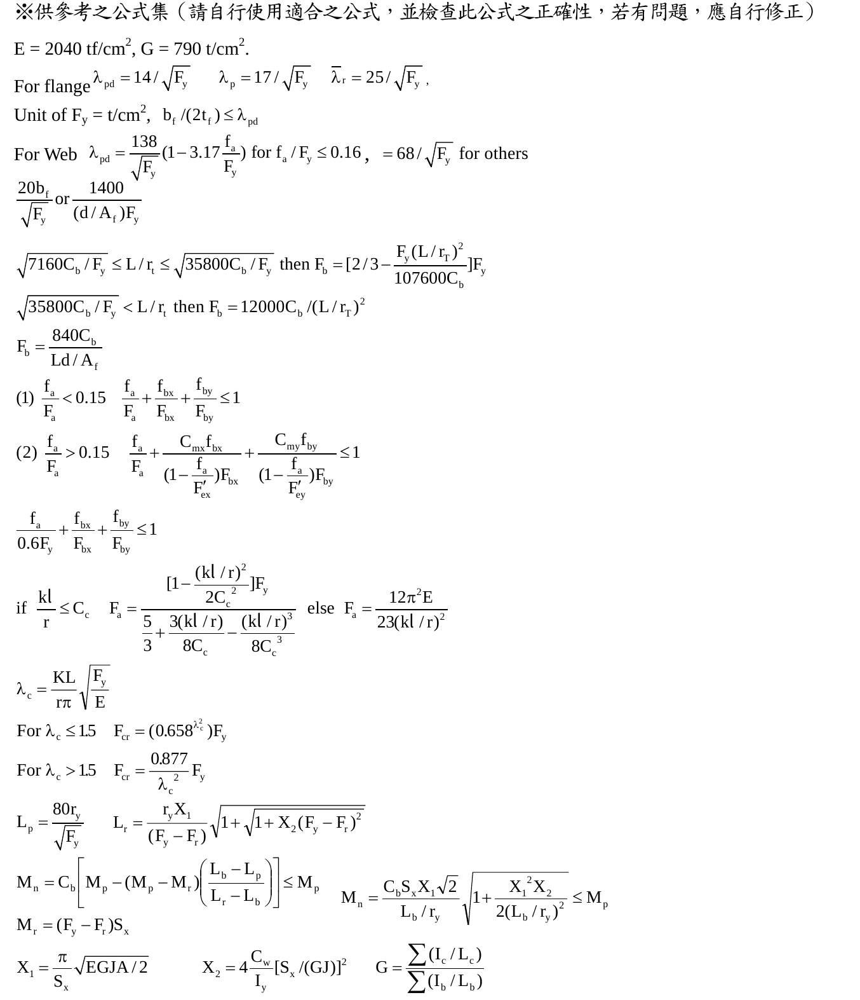

# SS-2007-3 題目正本

> 本檔只記錄**考卷上寫了什麼、圖上畫了什麼**，不含任何解法。解析見同資料夾 `SS-2007-3.md`。
> 判讀清單經使用者確認前，狀態為「待確認」；確認後本檔原則上不再修改（改動須回考卷原圖並記 log）。

| 項目 | 內容 |
|------|------|
| 考卷 | `raw/exams/SS-2007_鋼結構設計.pdf` 第 2 頁（全三頁之第二頁），第三題；公式集在第 3 頁 |
| 考年 | 民國 96 年（2007） |
| 配分 | 25 分（㈠ 8、㈡ 8、㈢ 9） |
| 附圖 | 無；第 3 頁公式集截圖 `SS-2007-3-eqn-1.png` |
| 判讀狀態 | **待確認**（轉錄 2026-11-02，PyMuPDF 110 dpi 全頁＋公式集 150 dpi 目視，盲讀後才比對既有解析） |

## 1. 考卷原文（逐字）

> 三、試用 LRFD 法計算㈠-㈢之設計彎曲強度（design bending strength）$\phi_bM_n$，樑為 H 700×200×12×25（尺寸 $d \times b_f \times t_w \times t_f$ 之單位為 mm），$F_y$ = 3.5 tf/cm²，條件為：
> ㈠樑全長均有側向支撐。（8 分）
> ㈡側向支撐長度為 5m 及 $C_b$ = 1。（8 分）
> ㈢側向支撐長度為 8m 及 $C_b$ = 1.7。（9 分）
> （d = 70 cm, $t_w$ = 1.2 cm, $b_f$ = 20 cm, $t_f$ = 2.5 cm, A = 178 cm², $I_X$ = 141421 cm⁴, $I_Y$ = 3343 cm⁴, $S_X$ = 4040.6 cm³, $S_Y$ = 334.3 cm³, $r_X$ = 28.19 cm, $r_Y$ = 4.33 cm, $Z_X$ = 4642.5 cm³, $Z_Y$ = 523.4 cm³, J = 245.77 cm⁴, $C_w$ = 3807536.63 cm⁶, 殘留應力 $F_r$ = 1.16 tf/cm²）

## 2. 考卷給的公式、附表與參數

- 題文：H 700×200×12×25 斷面性質（照錄於 §1）；$F_y = 3.5$ tf/cm²；$F_r = 1.16$ tf/cm²；㈡ $L_b = 5$ m、$C_b = 1$；㈢ $L_b = 8$ m、$C_b = 1.7$。
- 第 3 頁「※供參考之公式集（請自行使用適合之公式，並檢查此公式之正確性，若有問題，應自行修正）」，與本題相關者照錄：

$$E = 2040\ \text{tf/cm}^2,\quad G = 790\ \text{t/cm}^2$$
$$\text{For flange: } \lambda_{pd} = 14/\sqrt{F_y},\quad \lambda_p = 17/\sqrt{F_y},\quad \lambda_r = 25/\sqrt{F_y};\quad b_f/(2t_f) \le \lambda_{pd}$$
$$\text{For web: } \lambda_{pd} = \frac{138}{\sqrt{F_y}}\left(1 - 3.17\frac{f_a}{F_y}\right)\ \text{for}\ f_a/F_y \le 0.16,\quad = 68/\sqrt{F_y}\ \text{for others}$$
$$L_p = \frac{80r_y}{\sqrt{F_y}},\qquad L_r = \frac{r_yX_1}{(F_y - F_r)}\sqrt{1 + \sqrt{1 + X_2(F_y - F_r)^2}}$$
$$M_n = C_b\left[M_p - (M_p - M_r)\left(\frac{L_b - L_p}{L_r - L_b}\right)\right] \le M_p,\qquad M_n = \frac{C_bS_xX_1\sqrt2}{L_b/r_y}\sqrt{1 + \frac{X_1^2X_2}{2(L_b/r_y)^2}} \le M_p$$
$$M_r = (F_y - F_r)S_x,\qquad X_1 = \frac{\pi}{S_x}\sqrt{EGJA/2},\qquad X_2 = 4\frac{C_w}{I_y}[S_x/(GJ)]^2$$

  **注意**：考卷的非彈性 $M_n$ 式分母印成 $L_r - L_b$（規範為 $L_r - L_p$）；卷首已要求考生自行檢查修正。
- 公式集截圖：

  
- **沒有給 $\phi_b$**。
- 卷首注意事項：㈠可以使用電子計算器；㈡不必抄題。

## 3. 附圖

本題無附圖。

## 4. 判讀清單

「把握」標**不確定**者請優先確認；解讀類項目（題目用字的意思）另標「解讀」。

| # | 項目 | 判讀 | 圖上／題文依據 | 把握 |
|---|------|------|---------------|------|
| 1 | $E$、$G$ | 用公式集首行 $E = 2040$、$G = 790$ | 第 3 頁 | 確定 |
| 2 | ㈠ | 全長側撐 → 不受 LTB 控制，$M_n$ 由斷面（含寬厚比）決定 | 題文 | 確定（解讀） |
| 3 | ㈡、㈢ | $L_b$ 與 $C_b$ 為題給，不需自算 $C_b$ | 題文 | 確定 |
| 4 | 公式筆誤 | 非彈性 $M_n$ 式分母照規範改為 $L_r - L_p$ | 公式集＋卷首「自行修正」 | 確定 |
| 5 | $\phi_b$ | 題未給，依規範取 0.9 | 題文未給 | 確定（解讀） |
| 6 | 寬厚比 | 是否須檢核翼板／腹板結實性（公式集給了 $\lambda$ 式） | 公式集 | 確定（解讀） |

---

*轉錄：2026-11-02（SS-U1-2 題目正本推廣・批 1）*
