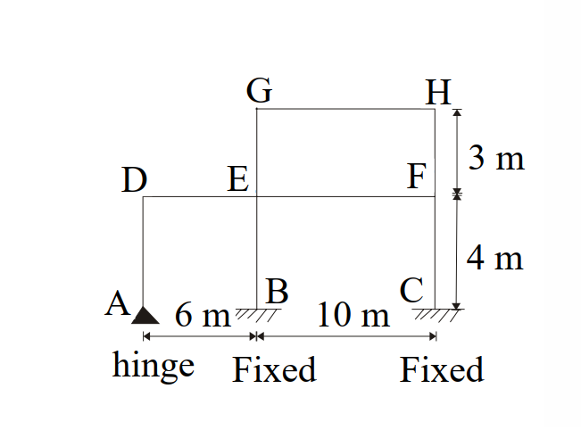
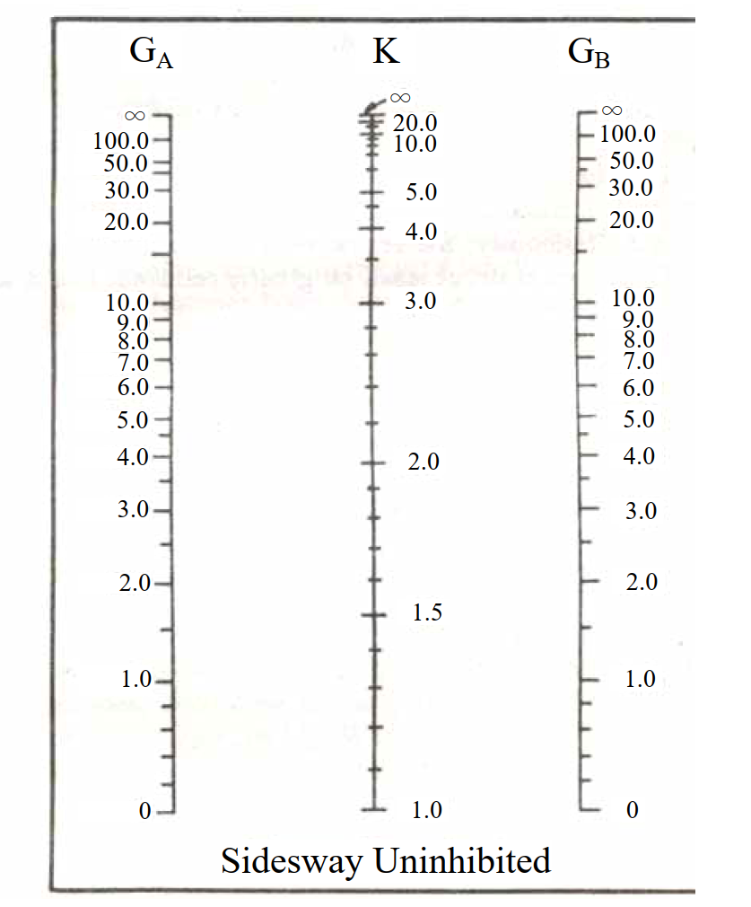

# SS-2007-4 題目正本

> 本檔只記錄**考卷上寫了什麼、圖上畫了什麼**，不含任何解法。解析見同資料夾 `SS-2007-4.md`。
> 判讀清單經使用者確認前，狀態為「待確認」；確認後本檔原則上不再修改（改動須回考卷原圖並記 log）。

| 項目 | 內容 |
|------|------|
| 考卷 | `raw/exams/SS-2007_鋼結構設計.pdf` 第 2（全三頁之第二頁） 頁，第四題 |
| 考年 | 民國 96 年（2007） |
| 配分 | 25 分 |
| 附圖 | 2 張：圖三構架 `SS-2007-4-fig-1.png`；側移未束制對位圖 `SS-2007-4-fig-2.png` |
| 判讀狀態 | **已確認**（2026-11-02 使用者確認，含「不確定」項之解讀；轉錄同日，PyMuPDF 110 dpi 全頁＋關鍵處 400–500 dpi 局部目視，盲讀後才比對既有解析） |

## 1. 考卷原文（逐字）

> 四、計算精確的有效長度係數在鋼結構設計中相當重要，請用查圖的方法，試求圖三結構各柱子之有效長度係數（K）。（25 分）
> （鉸接（hinge）時 G 可使用 10，固接（fixed）時 G 可使用 1。）

## 2. 考卷給的公式、附表與參數

柱與梁之 I 值表（單位：cm⁴）照錄：

| | 柱 AD, BE, and CF | 柱 EG, and FH | 梁 DE | 梁 EF, and GH |
|---|---|---|---|---|
| I 值 | 15000 | 4000 | 17000 | 36000 |

- 對位圖只給「Sidesway Uninhibited」一張（$G_A$、$K$、$G_B$ 三軸）。
- 考卷**沒給**各構材的 $E$（視為相同）、梁遠端條件修正係數、是否為 LRFD／ASD（題文未指定設計法）。

## 3. 附圖

*圖面文字照錄：G；H；D；E；F；3 m；4 m；A；6 m；B；10 m；C；hinge；Fixed；Fixed；圖三。*

*圖面文字照錄：$G_A$；K；$G_B$；Sidesway Uninhibited。*

## 4. 判讀清單

「把握」標**不確定**者請優先確認；解讀類項目（題目用字的意思）另標「解讀」。

| # | 項目 | 判讀 | 圖上／題文依據 | 把握 |
|---|------|------|---------------|------|
| 1 | 支承 | A 鉸接（hinge）、B 固接、C 固接 | 圖三下方文字與符號（400 dpi） | 確定 |
| 2 | 跨度 | A-B 6 m（梁 DE）、B-C 10 m（梁 EF、GH） | 圖三尺寸線 | 確定 |
| 3 | 層高 | 一層 4 m（AD、BE、CF）、二層 3 m（EG、FH） | 圖三右側尺寸線 | 確定 |
| 4 | 二層範圍 | 只在 B-C 跨上方：柱 EG、FH，梁 GH；D 上方無柱 | 圖三（400 dpi） | 確定 |
| 5 | 側移條件 | 側移未束制（只給 Sidesway Uninhibited 對位圖） | 對位圖標題（解讀） | 確定 |
| 6 | G 的邊界值 | 鉸接 G = 10、固接 G = 1（題目指定） | 題文括號 | 確定 |
| 7 | 所求 | 五根柱 AD、BE、CF、EG、FH 的 K（查圖值） | 題文「各柱子」 | 確定 |
| 8 | 設計法 | 題文未指定 LRFD／ASD，只要求「查圖」 | 題文 | 確定 |

---

*轉錄：2026-11-02（SS-U1-1 題目正本推廣・批 1）｜確認：2026-11-02 使用者確認*
