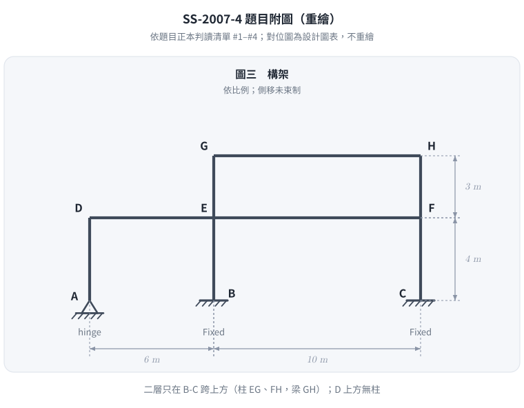
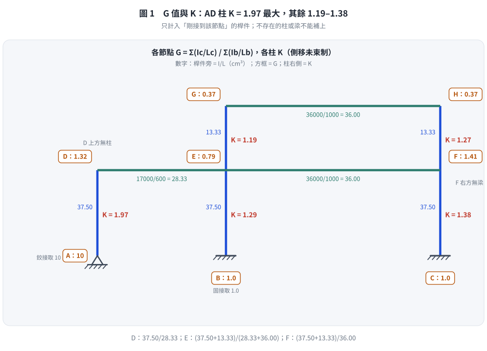
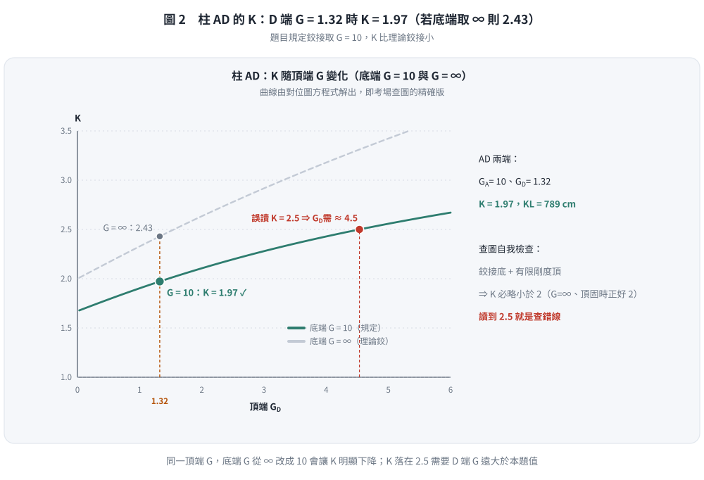

# 考題編號：SS-2007-4

**主分類：** `SS-U1-1` 拉力及壓力桿件
**副分類：** 無
**設計法：** LRFD
**標籤：** `壓力桿件` `有效長度` `K係數` `對位圖` `nomograph` `側移構架` `G值` `多層框架` `鉸接` `固接` `對位圖方程式`

---

## 1. 題目（考卷原文見題目正本）

> 考卷原文、公式／附表、附圖與判讀清單（已確認）見 [`SS-2007-4-problem.md`](SS-2007-4-problem.md)。本節只列**解題時最容易讀錯的地方**與本解使用的記號；題意以題目正本為準。

*圖 1　題目附圖重繪（依題目正本判讀清單 #1–#4；對位圖為設計圖表，不重繪）。依比例畫出 D 上方無柱、二層只在 B-C 跨，並標出 A 為鉸接，攔下多畫柱或把 A 端當固接而算錯 $G_A$ 的誤讀。*

### 常見誤讀

| 項目 | 正確判讀 | 常見誤讀 |
|------|---------|---------|
| 設計法 | 題文只要求「查圖」，**未指定** LRFD／ASD | 寫成「以 LRFD 法求」（舊版解析即如此） |
| 二層範圍 | 只在 B-C 跨上方（柱 EG、FH，梁 GH）；D 上方無柱 | 以為 D 上方也有柱 |
| G 邊界值 | 鉸接 $G = 10$、固接 $G = 1$（題目指定） | 用理論值 ∞、0 |
| 讀值 | 以對位圖方程式精確解 | 目視讀圖（舊版解析 $K_{AD}$ 2.5，正確 1.97） |

**本解記號：** 柱 AD、BE、CF：$I = 15{,}000$ cm⁴、$L = 400$ cm；柱 EG、FH：4,000 cm⁴、300 cm；梁 DE：17,000 cm⁴、600 cm；梁 EF、GH：36,000 cm⁴、1,000 cm。

---

## 2. 考題核心精神與出題者意圖

本題核心：**多層不規則側移框架的精確 K 值計算（nomograph 法）**。

難點在於：
1. D 節點只有一根柱（AD）和一根梁（DE），非典型對稱節點
2. F 節點只有右側梁 EF（無右方梁），需注意分母只有單梁
3. G 節點（頂層，只有 GH 梁，無左方梁）

出題意圖：考生須能正確識別每個節點的 $\Sigma(I_c/L_c)$ 和 $\Sigma(I_b/L_b)$，並在對位圖上精確查讀 K 值。

---

## 3. 解題戰略地圖與陷阱分析

**解題步驟：**
1. 計算每根柱的 $I_c/L_c$（柱貢獻）
2. 計算每根梁的 $I_b/L_b$（梁貢獻）
3. 對各節點計算 $G = \Sigma(I_c/L_c) / \Sigma(I_b/L_b)$
4. 代入對位圖查讀 K

**關鍵陷阱：**
1. **D 節點無上方柱**：G_D 的分子只有 AD 柱（向下），無上方柱，分母只有梁 DE（無右側以外方向的梁）
2. **F 節點右方無梁**：G_F 的分母只有梁 EF（向左），因 F 為最右側節點
3. **鉸接基礎 G = 10（非 ∞）**：實用設計取 G = 10，避免算出過高的 K 值
4. **二樓柱 EG/FH 的底端 G 值**：用的是節點 E 和 F 的 G 值（已含一樓梁和柱影響）

---

## 3.5 變數層次分析（Variable Hierarchy Analysis）

> 複習提示：解題後，在每個卡住的知識點「卡關?」欄標記 `⚠`；第二次複習時只看有 `⚠` 的項目。

**最終目標：** 計算各節點 G 值 → 查 Sidesway Uninhibited 對位圖 → 求各柱有效長度係數 K

### 主要公式（$\boxed{\phantom{x}}$ = 未知，待推導）

$$G = \frac{\sum (I_c/L_c)}{\sum (I_b/L_b)}$$

$$\boxed{G_D} = \frac{I_{AD}/L_{AD}}{\sum I_b/L_b \text{ at D}}, \quad \boxed{G_E} = \frac{I_{BE}/L_{BE} + I_{EG}/L_{EG}}{\sum I_b/L_b \text{ at E}}$$

$$\boxed{G_F} = \frac{I_{CF}/L_{CF} + I_{FH}/L_{FH}}{I_{EF}/L_{EF}}, \quad \boxed{G_G} = \frac{I_{EG}/L_{EG}}{I_{GH}/L_{GH}}, \quad \boxed{G_H} = \frac{I_{FH}/L_{FH}}{I_{GH}/L_{GH}}$$

$$\boxed{K} \leftarrow \text{對位圖查讀}(G_{\text{底}},\, G_{\text{頂}}) \quad \Rightarrow \quad KL = \boxed{KL}$$

### L1：題目直接給定

| 符號 | 數值 | 說明 |
|------|------|------|
| $I_{AD}=I_{BE}=I_{CF}$ | 15000 cm⁴ | 一樓柱慣性矩 |
| $L_{AD}=L_{BE}=L_{CF}$ | 400 cm | 一樓柱長 |
| $I_{EG}=I_{FH}$ | 4000 cm⁴ | 二樓柱慣性矩 |
| $L_{EG}=L_{FH}$ | 300 cm | 二樓柱長 |
| $I_{DE}$ | 17000 cm⁴ | 梁 DE 慣性矩 |
| $L_{DE}$ | 600 cm | 梁 DE 長度 |
| $I_{EF}=I_{GH}$ | 36000 cm⁴ | 梁 EF / GH 慣性矩 |
| $L_{EF}=L_{GH}$ | 1000 cm | 梁 EF / GH 長度 |
| $G_A$ | 10（規定值） | 鉸接底部邊界條件 |
| $G_B=G_C$ | 1.0（規定值） | 固接底部邊界條件 |

### L2：需知識點推導

**Step 1：計算各構件 $I/L$**

| 符號 | 公式 / 來源 | 卡關? |
|------|------------|:-----:|
| $(I_c/L_c)_{AD}$ | $15000/400 = 37.50$ cm³ | |
| $(I_c/L_c)_{EG}$ | $4000/300 = 13.33$ cm³ | |
| $(I_b/L_b)_{DE}$ | $17000/600 = 28.33$ cm³ | |
| $(I_b/L_b)_{EF}$ | $36000/1000 = 36.00$ cm³ | |

**Step 2：各節點 G 值**

| 符號 | 公式 / 來源 | 卡關? |
|------|------------|:-----:|
| $G_D$ | $37.50/28.33 = 1.323$（D 僅一根下柱、一根梁） | |
| $G_E$ | $(37.50+13.33)/(28.33+36.00) = 0.790$ | |
| $G_F$ | $(37.50+13.33)/36.00 = 1.412$（F 無右梁） | |
| $G_G$ | $13.33/36.00 = 0.370$（G 無上柱、無左梁） | |
| $G_H$ | $13.33/36.00 = 0.370$ | |

**Step 3：查對位圖得 K，求 KL**

| 符號 | 公式 / 來源 | 卡關? |
|------|------------|:-----:|
| $K_{AD}$ | 對位圖 $(G_A=10,\, G_D=1.323)$ → $1.97$ | ⚠ |
| $K_{BE}$ | 對位圖 $(G_B=1.0,\, G_E=0.790)$ → $1.29$ | |
| $K_{CF}$ | 對位圖 $(G_C=1.0,\, G_F=1.412)$ → $1.38$ | |
| $K_{EG}$ | 對位圖 $(G_E=0.790,\, G_G=0.370)$ → $1.19$ | |
| $K_{FH}$ | 對位圖 $(G_F=1.412,\, G_H=0.370)$ → $1.28$ | |

### L3：深層知識（不懂就卡住）

| 知識點 | 說明 | 卡關? |
|--------|------|:-----:|
| 有效長度係數 K | 側移構架 K > 1，須用 Sidesway Uninhibited 對位圖，非側移用另一圖 | |
| G 值定義與邊界條件 | $G = \Sigma(I_c/L_c)/\Sigma(I_b/L_b)$；鉸接 G = 10，固接 G = 1.0（規定值） | |
| 不對稱節點處理 | D 節點無上方柱、F 節點無右側梁，分子/分母只計實際存在的構件 | |
| 對位圖讀值精確性 | 連接 $G_{\text{底}}$ 與 $G_{\text{頂}}$ 的直線與 K 軸交點，讀值有人為誤差，K 偏大偏保守 | |
| 靠柱效應（進階） | 鉸接底柱（靠桿）的 P-Δ 效應可能轉嫁給其他柱，考場不要求但實務注意 | |

---

## 4. 步驟化詳細計算過程

### Step 1：各構件 Ic/Lc 及 Ib/Lb

**柱（Ic/Lc）：**

| 柱 | $I_c$ (cm⁴) | $L_c$ (cm) | $I_c/L_c$ (cm³) |
|----|-------------|------------|-----------------|
| AD | 15000 | 400 | **37.50** |
| BE | 15000 | 400 | **37.50** |
| CF | 15000 | 400 | **37.50** |
| EG | 4000 | 300 | **13.33** |
| FH | 4000 | 300 | **13.33** |

**梁（Ib/Lb）：**

| 梁 | $I_b$ (cm⁴) | $L_b$ (cm) | $I_b/L_b$ (cm³) |
|----|-------------|------------|-----------------|
| DE | 17000 | 600 | **28.33** |
| EF | 36000 | 1000 | **36.00** |
| GH | 36000 | 1000 | **36.00** |

### Step 2：各節點 G 值計算

$$G = \frac{\sum (I_c/L_c)_{\text{柱}}}{\sum (I_b/L_b)_{\text{梁}}}$$

**節點 A（柱 AD 底部，鉸接）：**
$$G_A = 10 \quad \text{（鉸接邊界條件，依規定取 10）}$$

**節點 D（柱 AD 頂端，梁 DE 左端）：**
- 分子（柱）：僅有柱 DA 向下 → $37.50$
- 分母（梁）：僅有梁 DE 向右 → $28.33$（D 無上方柱，亦無左方梁）

$$G_D = \frac{37.50}{28.33} = \mathbf{1.323}$$

**節點 B（柱 BE 底部，固接）：**
$$G_B = 1.0 \quad \text{（固接邊界條件）}$$

**節點 E（柱 BE 頂端 + 柱 EG 底端，梁 DE 右端 + 梁 EF 左端）：**
- 分子（柱）：$37.50\ (\text{BE}) + 13.33\ (\text{EG}) = 50.83$
- 分母（梁）：$28.33\ (\text{DE}) + 36.00\ (\text{EF}) = 64.33$

$$G_E = \frac{50.83}{64.33} = \mathbf{0.790}$$

**節點 C（柱 CF 底部，固接）：**
$$G_C = 1.0$$

**節點 F（柱 CF 頂端 + 柱 FH 底端，梁 EF 右端）：**
- 分子（柱）：$37.50\ (\text{CF}) + 13.33\ (\text{FH}) = 50.83$
- 分母（梁）：$36.00\ (\text{EF})$（F 為最右節點，右方無梁）

$$G_F = \frac{50.83}{36.00} = \mathbf{1.412}$$

**節點 G（柱 EG 頂端，梁 GH 左端）：**
- 分子（柱）：$13.33\ (\text{EG})$（G 無上方柱）
- 分母（梁）：$36.00\ (\text{GH})$（G 無左方梁）

$$G_G = \frac{13.33}{36.00} = \mathbf{0.370}$$

**節點 H（柱 FH 頂端，梁 GH 右端）：**
- 分子（柱）：$13.33\ (\text{FH})$（H 無上方柱）
- 分母（梁）：$36.00\ (\text{GH})$（H 無右方梁）

$$G_H = \frac{13.33}{36.00} = \mathbf{0.370}$$

*圖 1　G 值只計入剛接到該節點的桿件：D 只有下柱與梁 DE、F 只有梁 EF。這張圖攔的是在 D 補上不存在的上柱、在 F 多算右梁、A 取固接，或把柱梁 I/L 放錯分子分母。（FH 柱方程式精確解 1.27，與查圖值 1.28 差在讀圖容許內。）*

### Step 3：各柱 K 值（對位圖查讀）

依 Sidesway Uninhibited 對位圖（圖三），連接各柱兩端 G 值，讀取中間 K 軸數值。對位圖本身就是下列方程式的圖解，考場查圖、這裡以方程式精確解核對（查圖讀值落在 ±0.05 內即可）：

$$\frac{G_AG_B(\pi/K)^2 - 36}{6(G_A + G_B)} = \frac{\pi/K}{\tan(\pi/K)}$$

| 柱 | $G_{\text{底端}}$ | $G_{\text{頂端}}$ | K |
|----|-----------------|-----------------|:---:|
| **AD** | $G_A = 10$ | $G_D = 1.323$ | **1.97** |
| **BE** | $G_B = 1.0$ | $G_E = 0.790$ | **1.29** |
| **CF** | $G_C = 1.0$ | $G_F = 1.412$ | **1.38** |
| **EG** | $G_E = 0.790$ | $G_G = 0.370$ | **1.19** |
| **FH** | $G_F = 1.412$ | $G_H = 0.370$ | **1.28** |

**查圖自我檢查：**
- 柱 AD：$G_A = 10$、$G_D = 1.32$，對位圖上直線交 K 軸在 2.0 刻度稍下。若讀成 2.5，代表 $G_D$ 要大到約 4.5，與 1.32 不符。
- 理論上底鉸（$G = \infty$）頂固（$G = 0$）可側移的 K 是 2.0；本題頂端 $G_D = 1.32$ 不是固接，若底端真用 $\infty$，K = 2.43。題目規定鉸接取 $G = 10$，讓 K 降到 1.97。
- 其餘四柱兩端 G 都在 0.4～1.4 之間，K 應在 1.15～1.40 之間，愈大的 G 對應愈大的 K（CF 的 $G_F$ 最大 → 1.38 最大）。

*圖 2　柱 AD：$G_D = 1.32$ 時 $K = 1.97$（底端取 ∞ 則 2.43），曲線由對位圖方程式解出。這張圖攔的是 AD 在對位圖上查成 2.5（那需要 $G_D \approx 4.5$），以及鉸接底取 ∞ 而非題目規定的 10。*

### Step 4：有效長度 KL 彙整

| 柱 | K | L (cm) | KL (cm) |
|----|:---:|:---:|:---:|
| AD | 1.97 | 400 | **789** |
| BE | 1.29 | 400 | 514 |
| CF | 1.38 | 400 | 550 |
| EG | 1.19 | 300 | 356 |
| FH | 1.28 | 300 | 382 |

> **最關鍵柱為 AD**：底部鉸接（$G = 10$），K ≈ 2，有效長度約為柱長的兩倍。

---

## 5. 關鍵爭議點與進階探討

**爭議點一：D 節點無上方柱的處理**

節點 D 只有柱 DA（向下）和梁 DE（向右），無向上的柱。這種「頂端不延伸」的節點在計算 G 時，分子僅計下方柱，不應補充虛擬柱。結果 G_D = 1.323（中等值），不會使 K 過大。

**爭議點二：F 節點只有單側梁**

F 為框架最右端，梁 EF 是唯一連接的梁，分母只有 36.00，使 G_F = 1.412，相對於對稱節點（有兩側梁的情況）偏高，導致柱 CF 的 K 值略大於 BE。這反映了**邊柱效應**：邊柱比內柱更容易發生側移。

**爭議點三：鉸接 G = 10 vs. G = ∞**

理論上，鉸接（pin support）的旋轉剛度為零，G → ∞。AISC 建議實用上取 G = 10，反映實際鉸接柱腳仍有些微轉動束制。注意這**不是**保守取值：G = 10 得到的 K 比 G = ∞ 小（本題柱 AD：G = ∞ 時 K = 2.43，G = 10 時 1.97）；題目已指定 G = 10，照做即可。

**進階：對位圖假設與實際框架的差距**

對位圖假設同一層所有柱同時挫屈、每根梁兩端轉角相同。本題框架不規則（D 端只有一層、G–H 只蓋右兩跨），柱 AD 底部鉸接、頂部只有一根梁 DE 約束，是全框架最軟的一根；它的側移穩定實際上會受同層 BE、CF 牽動。精確的整層穩定可用 LeMessurier 的整層挫屈法或直接分析法檢核，考場依題意查圖即可。

---

## 6. 依最新規範（AISC 360-16／-22）對照

| 項目 | 考卷（有效長度法） | AISC 360-16／-22 |
|:---|:---|:---|
| 對位圖 | 本文規定 | 移至附錄 7（有效長度法），解說 C-A-7 仍附相同對位圖與方程式 |
| 支承 G 值 | 鉸 10、固 1 | 解說相同建議 |
| 非彈性修正 | 本題未要求 | 附錄 7 解說建議以 $\tau_b$ 折減柱勁度 |
| 主流方法 | — | 第 C 章直接分析法：構材取 $K = 1$，穩定以二階分析＋剛度折減處理 |

---

*修正日期：2026-11-01（G 值無誤；原解對位圖讀值偏差，柱 AD 讀成 2.5，以對位圖方程式精確解更正為 **1.97**，其餘 BE 1.2 → **1.29**、CF 1.27 → **1.38**、EG 1.15 → **1.19**、FH 1.20 → **1.28**；更正「G = 10 偏保守」之誤述；新增查圖自我檢查與 §6 對照）*
*圖解補繪：2026-11-03（向量圖 2 張，腳本 `gen_SS-2007-4.py`，改輸入可原地重跑；SVG 供 wiki／PDF，2× PNG 供 pptx／影片）*
*驗證狀態：unverified*

*修正日期：2026-11-02（§1 全文重述改為指向題目正本 `SS-2007-4-problem.md`（已確認）＋常見誤讀＋本解記號，避免題意兩份不同步；解題內容與答案不變）*

*修正日期：2026-11-03（§1 補入題目附圖重繪 `figs/SS-2007-4-fig-1-problem.svg`（依已確認的題目正本判讀清單，腳本 `gen_SS-2007-4.py`，可重跑）；解題內容與答案不變）*
