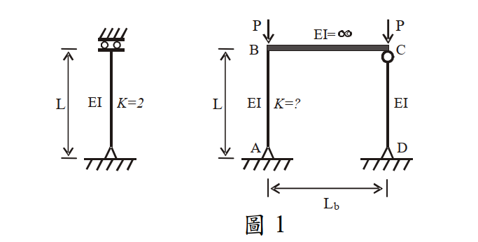

# SS-2008-2 題目正本

> 本檔只記錄**考卷上寫了什麼、圖上畫了什麼**，不含任何解法。解析見同資料夾 `SS-2008-2.md`。
> 判讀清單經使用者確認前，狀態為「待確認」；確認後本檔原則上不再修改（改動須回考卷原圖並記 log）。

| 項目 | 內容 |
|------|------|
| 考卷 | `raw/exams/SS-2008_鋼結構設計.pdf` 第 1（全四頁之第一頁） 頁，第二題 |
| 考年 | 民國 97 年（2008） |
| 配分 | 25 分（㈠ 10、㈡ 15） |
| 附圖 | 1 張（圖 1：單根柱與頂層未束制鋼架），`SS-2008-2-fig-1.png` |
| 判讀狀態 | **已確認**（2026-11-02 使用者確認，含「不確定」項之解讀；轉錄同日，PyMuPDF 110 dpi 全頁＋關鍵處 400–500 dpi 局部目視，盲讀後才比對既有解析） |

## 1. 考卷原文（逐字）

> 二、依據 LRFD 所述，受壓鋼架結構頂層具有未束制邊界條件時，因受結構內部靠桿（leaning column）影響，需要參考萊梅厥公式（LeMessurier formula）作有效長度係數 $K$ 值的修正，此修正公式如下所示。
>
> $$K' = \sqrt{\frac{P_e}{P_I} \times \frac{\Sigma P}{\Sigma P_{eK}}}$$
>
> $P_e$：尤拉載重（Euler buckling load）
> $P_I$：欲求 $K$ 值之支撐所受的垂直載重
> $\Sigma P$：整個結構所受之總外載重
> $\Sigma P_{eK}$：整個結構中所有非靠桿在考慮有效長度係數後之挫屈載重（buckling load）
>
> ㈠圖 1 中有一單根柱及一頂層邊界未束制之鋼架結構，已知單根柱之 $K = 2.0$，鋼架結構中 CD 柱為靠桿，試以萊梅厥公式求解鋼架結構中 AB 柱之有效長度係數 $K_{AB}$。（10 分）
> ㈡請簡要說明圖 1 鋼架結構中，靠桿效應（leaning column effect）造成 AB 柱之 $K_{AB}$ 增大的原因。（15 分）

## 2. 考卷給的公式、附表與參數

- 萊梅厥公式及符號說明（見 §1，照錄）。
- 卷首注意事項㈢：「下列計算各題所需之物理常數、參數或條件等有不足時，請依規範自行作合理假設。」
- 考卷**沒給** $P_e$ 是否含 $K$（只寫「尤拉載重」）。

## 3. 附圖

*圖面文字照錄：L；EI；K=2；P；P；EI=∞；B；C；L；EI；K=?；EI；A；D；$L_b$；圖 1。*

## 4. 判讀清單

「把握」標**不確定**者請優先確認；解讀類項目（題目用字的意思）另標「解讀」。

| # | 項目 | 判讀 | 圖上／題文依據 | 把握 |
|---|------|------|---------------|------|
| 1 | 單根柱底部 | **鉸支**（三角形＋地面斜線），不是固定端 | 圖 1 左柱底（500 dpi） | 確定 |
| 2 | 單根柱頂部 | 導槽滾支：可水平移動、不可轉動（兩個圓輪夾在兩條水平線間，上方斜線） | 圖 1 左柱頂（500 dpi） | 確定 |
| 3 | 單根柱 $K = 2.0$ 的來由 | 底鉸＋頂可平移不可轉 → 2.0（與題給一致；不是懸臂柱） | 支承符號（解讀） | 不確定 → 使用者確認 |
| 4 | A 點 | **鉸支**（三角形），不是固定端 | 圖 1 右架 A（500 dpi） | 確定 |
| 5 | B 點 | AB 柱頂與 BC 梁**剛接**（無鉸圓） | B 處無圓圈（500 dpi） | 確定 |
| 6 | C 點 | CD 柱頂有鉸圓 → 與梁鉸接 | C 處圓圈（500 dpi） | 確定 |
| 7 | D 點 | 鉸支（三角形） | 圖 1 右架 D（500 dpi） | 確定 |
| 8 | CD 柱 | 靠桿（兩端鉸接，無側向勁度） | 題文「CD 柱為靠桿」＋C、D 符號 | 確定 |
| 9 | 梁 BC | $EI = \infty$ | 圖面文字 | 確定 |
| 10 | 載重 | B、C 各受垂直 $P$ | 圖面箭頭 | 確定 |
| 11 | AB 柱與單根柱的關係 | AB 柱（底鉸、頂剛接於無限剛梁、可側移）與單根柱邊界相同，故單柱 $K = 2.0$ 即 AB 自身的 K | 支承符號比對（解讀） | 不確定 → 使用者確認 |
| 12 | $P_e$ | $\pi^2EI/L^2$（K = 1 的尤拉載重） | 題文「尤拉載重」（解讀） | 不確定 → 使用者確認 |

---

*轉錄：2026-11-02（SS-U1-1 題目正本推廣・批 1）｜確認：2026-11-02 使用者確認*
