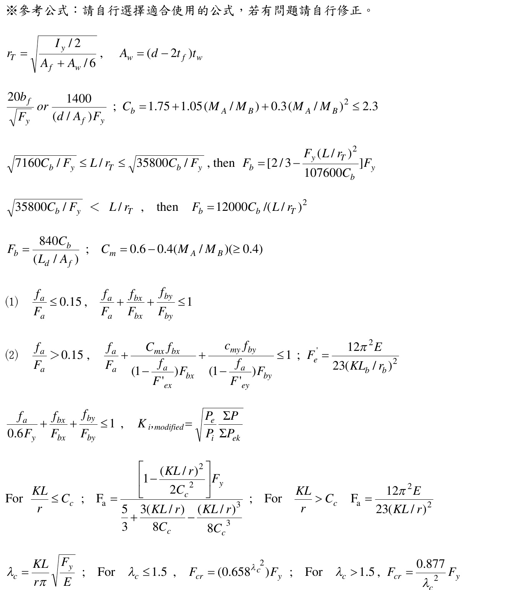
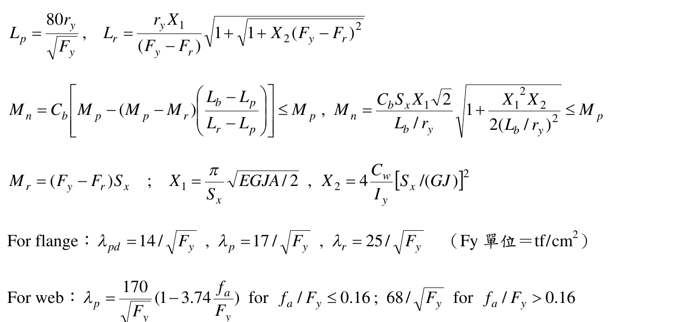
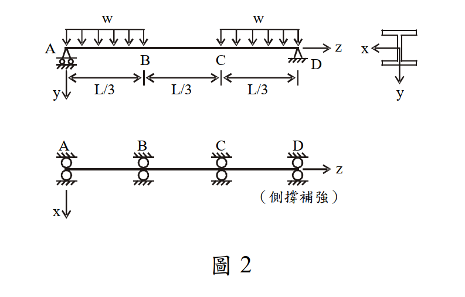

# SS-2008-3 題目正本

> 本檔只記錄**考卷上寫了什麼、圖上畫了什麼**，不含任何解法。解析見同資料夾 `SS-2008-3.md`。
> 判讀清單經使用者確認前，狀態為「待確認」；確認後本檔原則上不再修改（改動須回考卷原圖並記 log）。

| 項目 | 內容 |
|------|------|
| 考卷 | `raw/exams/SS-2008_鋼結構設計.pdf` 第 2 頁（全四頁之第二頁），第三題；參考公式在第 3–4 頁 |
| 考年 | 民國 97 年（2008） |
| 配分 | 25 分 |
| 附圖 | 1 張（圖 2：梁立面、載重、側撐），`SS-2008-3-fig-1.png`；參考公式截圖 `SS-2008-3-eqn-1.png`（第 3 頁）、`SS-2008-3-eqn-2.png`（第 4 頁） |
| 判讀狀態 | **待確認**（轉錄 2026-11-02，PyMuPDF 110 dpi 全頁＋圖 2 400 dpi 局部目視，盲讀後才比對既有解析） |

## 1. 考卷原文（逐字）

> 三、圖 2 為一鋼梁，假設鋼梁在 A、B、C、D 四點側向均有側撐補強，且此梁兩側承受均佈載重 w，如圖所示。採用 H 型鋼，鋼梁長度 L 為 18 m，鋼材特性如下所示，試以極限設計法（LRFD），求解此鋼梁所能承受之容許標稱外載重 $w_{n,cr}$。（25 分）
> W 型鋼斷面參數及材料特性如下：
> d＝54.43 cm，$b_f$＝21.22 cm，$t_f$＝2.12 cm，$t_w$＝1.31 cm，A＝156.77 cm²
> $I_x$＝76170 cm⁴，$r_x$＝22.02 cm，$S_x$＝2802 cm³，$Z_x$＝3212 cm³
> $I_y$＝3388 cm⁴，$r_y$＝4.65 cm
> $r_T$＝5.46 cm，$C_w$＝2317464 cm⁶，J＝181 cm⁴
> E＝2100 t/cm²，G＝840 t/cm²，$F_y$＝3.5 t/cm²

## 2. 考卷給的公式、附表與參數

- 題文：$L = 18$ m；斷面與材料參數（照錄於 §1）。
- 第 3–4 頁「※參考公式：請自行選擇適合使用的公式，若有問題請自行修正。」與本題相關者照錄：

$$C_b = 1.75 + 1.05(M_A/M_B) + 0.3(M_A/M_B)^2 \le 2.3$$
$$L_p = \frac{80r_y}{\sqrt{F_y}},\qquad L_r = \frac{r_yX_1}{(F_y - F_r)}\sqrt{1 + \sqrt{1 + X_2(F_y - F_r)^2}}$$
$$M_n = C_b\left[M_p - (M_p - M_r)\left(\frac{L_b - L_p}{L_r - L_p}\right)\right] \le M_p,\qquad M_n = \frac{C_bS_xX_1\sqrt2}{L_b/r_y}\sqrt{1 + \frac{X_1^2X_2}{2(L_b/r_y)^2}} \le M_p$$
$$M_r = (F_y - F_r)S_x,\qquad X_1 = \frac{\pi}{S_x}\sqrt{EGJA/2},\qquad X_2 = 4\frac{C_w}{I_y}[S_x/(GJ)]^2$$
$$\text{For flange: } \lambda_{pd} = 14/\sqrt{F_y},\ \lambda_p = 17/\sqrt{F_y},\ \lambda_r = 25/\sqrt{F_y};\quad \text{For web: } \lambda_p = \frac{170}{\sqrt{F_y}}\left(1 - 3.74\frac{f_a}{F_y}\right)\ (f_a/F_y \le 0.16),\ 68/\sqrt{F_y}\ (f_a/F_y > 0.16)$$

  

  
- **沒有給殘留應力 $F_r$**，也沒有給 $\phi_b$。
- 卷首注意事項：㈠不必抄題；㈡可以使用電子計算器，但需詳列解答過程；㈢物理常數、參數或條件等有不足時，請依規範自行作合理假設。

## 3. 附圖

*圖面文字照錄：w；w；A；B；C；D；z；L/3；L/3；L/3；x；y；A；B；C；D；z；x；（側撐補強）；圖 2。*

## 4. 判讀清單

「把握」標**不確定**者請優先確認；解讀類項目（題目用字的意思）另標「解讀」。

| # | 項目 | 判讀 | 圖上／題文依據 | 把握 |
|---|------|------|---------------|------|
| 1 | 支承 | A 滾支、D 鉸支，簡支梁 | 圖 2 立面（400 dpi） | 確定 |
| 2 | 載重範圍 | $w$ 只作用於 AB、CD 兩段（「兩側」＝兩端各 $L/3$），BC 段無載重 | 圖 2 立面 | 確定 |
| 3 | 側撐 | A、B、C、D 四點，各段 $L_b = L/3 = 6$ m | 圖 2 平面＋題文 | 確定 |
| 4 | 彎曲軸 | 繞強軸 $x$（$y$ 向下為載重方向） | 圖 2 斷面座標 | 確定 |
| 5 | 「容許標稱外載重 $w_{n,cr}$」 | 由各段設計強度 $\phi_bM_n$ 反求可承受的 $w$（是否乘 $\phi_b$ 有歧義：「標稱」指不乘、「LRFD 容許」指乘） | 題文 | 不確定（解讀） |
| 6 | $F_r$ | 題未給，依規範自取（熱軋斷面常用 0.69 tf/cm²） | 題文未給＋卷首注意㈢ | 不確定（解讀） |
| 7 | 各段 $C_b$ | 依各段彎矩分布自行決定；考卷 $C_b$ 式只適用線性彎矩段 | 參考公式 | 確定（解讀） |
| 8 | 自重 | 不計（題未給單位重） | 題文 | 確定（解讀） |

---

*轉錄：2026-11-02（SS-U1-2 題目正本推廣・批 1）*
