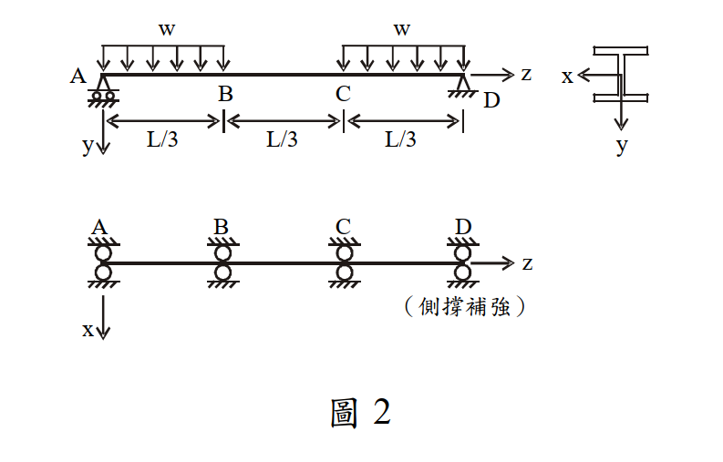
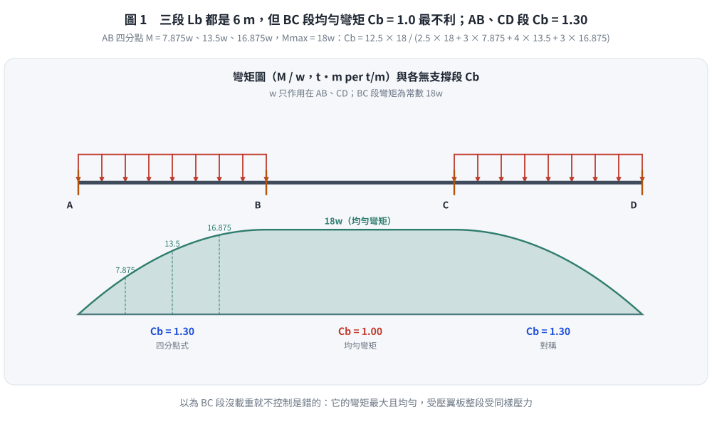
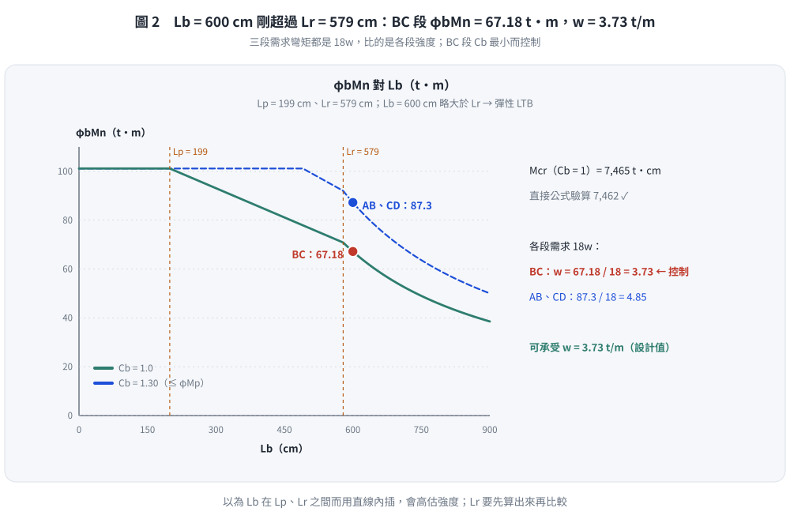

# 考題編號：SS-2008-3

**主分類：** `SS-U1-2` 梁桿件
**副分類：** 無
**設計法：** LRFD
**標籤：** `梁桿件` `LRFD` `LTB側扭挫屈` `Cb彎矩梯度` `塑性彎矩` `結實斷面` `X1X2參數` `均佈載重` `部分跨載重`

---

## 1. 原始題目重述 (Problem Restatement)

圖 2 為一鋼梁，假設鋼梁在 A、B、C、D 四點側向均有側撐補強，且此梁**兩側**承受均佈載重 $w$，如圖所示。採用 H 型鋼，鋼梁長度 $L$ 為 18 m，試以極限設計法（LRFD）求解此鋼梁所能承受之容許標稱外載重 $w_{n,cr}$。（25 分）

**斷面參數：**

| 參數 | 數值 | 參數 | 數值 |
|------|------|------|------|
| $d$ | 54.43 cm | $r_x$ | 22.02 cm |
| $b_f$ | 21.22 cm | $S_x$ | 2802 cm³ |
| $t_f$ | 2.12 cm | $Z_x$ | 3212 cm³ |
| $t_w$ | 1.31 cm | $r_y$ | 4.65 cm |
| $A$ | 156.77 cm² | $r_T$ | 5.46 cm |
| $I_x$ | 76170 cm⁴ | $C_w$ | 2,317,464 cm⁶ |
| $I_y$ | 3388 cm⁴ | $J$ | 181 cm⁴ |

**材料特性：** $F_y = 3.5$ t/cm²，$E = 2100$ t/cm²，$G = 840$ t/cm²



*圖說（依考卷原圖 450 dpi 目視判讀）：簡支梁 A（滾支）至 D（鉸支），全長 18 m，分三等分 $L/3 = 6$ m。**均佈載重 $w$ 只畫在 A–B 與 C–D 兩段**（題文「此梁兩側承受均佈載重」），**B–C 段沒有載重**。下方平面圖 A、B、C、D 四點皆有側撐 → 各段 $L_b = 6$ m。*

---

## 2. 考題核心精神與出題者意圖 (Core Concepts & Examiner's Intent)

**核心考點：** LRFD 梁桿件設計三段式 LTB 流程：
1. 確認結實斷面（排除局部挫屈）
2. 計算 $L_p$、$L_r$，判斷控制極限狀態
3. 對各無束制段計算 $C_b$，求 $\phi_b M_n$
4. 以最大彎矩對應設計強度求解 $w_{n,cr}$

**出題者意圖：** 載重只放在兩側，讓中間 BC 段成為**均勻彎矩段**（$C_b = 1.0$，最不利），且 $L_b = 6$ m 恰好略大於 $L_r$ → 彈性 LTB 控制。測的是讀圖、彎矩圖與 $C_b$ 的判斷。

---

## 3. 解題戰略地圖與陷阱分析 (Strategic Roadmap & Trap Analysis)

**解題順序：**
```
① 局部挫屈（翼板、腹板）→ 確認結實斷面
② 計算 Mp、X1、X2、Lp、Lr
③ 比較 Lb = 600 cm 與 Lp、Lr
④ 各段計算 Cb → 求 φbMn（注意 Mn ≤ Mp 上限）
⑤ 各段對應彎矩需求 → 求解 wn,cr
```

**關鍵陷阱：**

| 陷阱 | 錯誤 | 正確 |
|------|------|------|
| ① Cb 的段落定義 | 用全梁計算一個 Cb | 每個無束制段（AB、BC、CD）各算各的 Cb |
| ② Mn 的上限 | 忘記 $M_n \leq M_p$ | 即使 $C_b \times M_{cr} > M_p$，仍要以 $M_p$ 為上限 |
| ③ 載重範圍 | 把 $w$ 當成全跨 | 圖上 $w$ 只在 AB、CD 兩段；BC 段無載重 → BC 段彎矩為常數 $18w$ |
| ④ 均勻彎矩的 $C_b$ | 把 $M_1/M_2 = +1$ 代入 1.75 式得 3.10 | 均勻彎矩是**單曲率**，$M_1/M_2 = -1$ → $C_b = 1.75 - 1.05 + 0.3 = 1.0$（四分點式同為 1.0） |
| ⑤ Lr 的計算 | 跳過 X1、X2 直接查表 | 題目給了斷面參數，需完整計算 X1、X2 後求 Lr；題目未給 $F_r$，熱軋取 0.69 t/cm²（10 ksi） |

---

## 3.5 變數層次分析（Variable Hierarchy Analysis）

> 複習提示：解題後，在每個卡住的知識點「卡關?」欄標記 `⚠`；第二次複習時只看有 `⚠` 的項目。

**最終目標：** 驗結實斷面 → 算 $L_p, X_1, X_2, L_r$ → 判斷各段 LTB 區段 → 各段 $C_b$ → $\phi_b M_n$ → BC 段（均勻彎矩 $18w$、$C_b = 1$、彈性 LTB）控制 → 求 $w_{n,cr} = 3.73$ t/m

### 主要公式（$\boxed{\phantom{x}}$ = 未知，待推導）

$$\boxed{M_p} = F_y Z_x, \quad \phi_b M_p = 0.9 M_p$$

$$\boxed{L_p} = \frac{80 r_y}{\sqrt{F_y}}, \quad \boxed{X_1} = \frac{\pi}{S_x}\sqrt{\frac{EGJA}{2}}, \quad \boxed{X_2} = \frac{4C_w}{I_y}\left(\frac{S_x}{GJ}\right)^2$$

$$\boxed{L_r} = \frac{r_y X_1}{F_y - F_r}\sqrt{1 + \sqrt{1 + X_2(F_y-F_r)^2}}$$

$$\boxed{M_n} = C_b \cdot M_{cr}(C_b=1) \leq M_p \quad \Rightarrow \quad w_{n,cr} = \frac{\phi_b M_n}{18}\quad(M_{max} = M_B = M_C = 18w)$$

### L1：題目直接給定

| 符號 | 數值 | 說明 |
|------|------|------|
| $L$ | 18 m | 梁總跨距 |
| $L_b$ | 6 m = 600 cm | 無束制段長度（A-B-C-D 四點均等分） |
| $F_y$ | 3.5 t/cm² | 鋼材降伏應力 |
| $E$ | 2100 t/cm² | 彈性模數 |
| $G$ | 840 t/cm² | 剪力模數 |
| $Z_x$ | 3212 cm³ | 塑性斷面模數 |
| $S_x$ | 2802 cm³ | 彈性斷面模數 |
| $r_y$ | 4.65 cm | 弱軸迴轉半徑 |
| $J$ | 181 cm⁴ | St. Venant 扭轉常數 |
| $C_w$ | 2,317,464 cm⁶ | 翹曲常數 |
| $I_y$ | 3388 cm⁴ | 弱軸慣性矩 |
| $A$ | 156.77 cm² | 全斷面積 |

### L2：需知識點推導

**Step 1：結實斷面確認**

| 符號 | 公式 / 來源 | 卡關? |
|------|------------|:-----:|
| $\lambda_f = b_f/(2t_f)$ | $21.22/(2\times2.12) = 5.00$ | |
| $\lambda_{p,f} = 17/\sqrt{F_y}$ | $9.09$ → $\lambda_f < \lambda_{p,f}$ ✓ | |
| $\lambda_w = h/t_w$ | $38.31 < \lambda_{p,w} = 90.87$ ✓ 結實腹板 | |

**Step 2：基本強度參數**

| 符號 | 公式 / 來源 | 卡關? |
|------|------------|:-----:|
| $M_p$ | $F_y Z_x = 3.5 \times 3212 = 11242$ t·cm | |
| $F_r$ | 熱軋斷面 $0.69$ t/cm²；$F_y - F_r = 2.81$ t/cm² | |

**Step 3：$L_p, X_1, X_2, L_r$ 計算**

| 符號 | 公式 / 來源 | 卡關? |
|------|------------|:-----:|
| $L_p$ | $80r_y/\sqrt{F_y} = 199$ cm | |
| $X_1$ | $(\pi/S_x)\sqrt{EGJA/2} = 177.4$ t/cm² | |
| $X_2$ | $(4C_w/I_y)(S_x/GJ)^2 = 0.9291$ cm⁴/t² | |
| $L_r$ | 代入公式 $= 579$ cm；$L_b = 600 > L_r$ → 彈性 LTB | |

**Step 4：彎矩圖、各段 $C_b$ 與 $M_n$**

| 符號 | 公式 / 來源 | 卡關? |
|------|------------|:-----:|
| 反力 | 總載重 $12w$，對稱 → $R_A = R_D = 6w$ | |
| $M_B = M_C$ | $6w \times 6 - w \times 6^2/2 = 18w$；BC 段無載重 → **常數 $18w$** | ⚠ |
| $M_{cr}(C_b=1)$ | 彈性 LTB 公式，$L_b/r_y = 129.03$ → $7{,}465$ t·cm | |
| $C_b$（BC 段） | 均勻彎矩、單曲率 → **1.0** → $M_n = 74.65$ t·m | ⚠ |
| $C_b$（AB／CD 段） | 四分點 $7.875w, 13.5w, 16.875w$，$M_{max} = 18w$ → 1.30；$M_n = 96.9$ t·m | |

**Step 5：控制段與 $w_{n,cr}$**

| 符號 | 公式 / 來源 | 卡關? |
|------|------------|:-----:|
| 控制段 | BC 段（需求 $18w$ 與 AB、CD 相同，但強度最低） | |
| $w_{n,cr}$ | $\phi_bM_n/18 = 0.9 \times 74.65/18 = 3.73$ t/m | |

### L3：深層知識（不懂就卡住）

| 知識點 | 說明 | 卡關? |
|--------|------|:-----:|
| LTB 三段判斷 | $L_b \leq L_p$：塑性；$L_p < L_b \leq L_r$：非彈性；$L_b > L_r$：彈性 | |
| $X_1, X_2$ 的物理意義 | $X_1$：扭轉-慣性矩綜合；$X_2$：翹曲/扭轉比值；兩者共同決定 $L_r$ | |
| $C_b$ 的 $M_1/M_2$ 正負號 | 雙曲率（反向彎）為正、單曲率為負；均勻彎矩 $M_1/M_2 = -1$ → $C_b = 1.0$ | |
| 讀載重範圍 | 均佈載重箭頭畫到哪裡，彎矩圖就長什麼樣；部分跨載重常製造均勻彎矩段 | |
| 各段獨立計算 $C_b$ | 每個無束制段各自計算 $C_b$，不可用全梁統一值 | |
| 殘留應力 $F_r = 0.69$ t/cm² | 熱軋斷面殘留應力，影響 $L_r$ 計算中的 $F_y - F_r$ | |

---

## 4. 步驟化詳細計算過程 (Step-by-Step Detailed Calculation)

### Step 1：局部挫屈檢核（結實斷面確認）

**翼板寬厚比：**

$$\lambda_f = \frac{b_f}{2t_f} = \frac{21.22}{2 \times 2.12} = 5.00$$

$$\lambda_{p,f} = \frac{17}{\sqrt{F_y}} = \frac{17}{\sqrt{3.5}} = \frac{17}{1.871} = 9.09$$

$\lambda_f = 5.00 < \lambda_{p,f} = 9.09$ ✅ 結實翼板

**腹板寬厚比（純彎曲，$f_a = 0$）：**

$$h = d - 2t_f = 54.43 - 2(2.12) = 50.19 \text{ cm}$$

$$\lambda_w = \frac{h}{t_w} = \frac{50.19}{1.31} = 38.31$$

$$\lambda_{p,w} = \frac{170}{\sqrt{F_y}} = \frac{170}{\sqrt{3.5}} = \frac{170}{1.871} = 90.87$$

$\lambda_w = 38.31 < \lambda_{p,w} = 90.87$ ✅ 結實腹板

> **結論：結實斷面（Compact Section）**，塑性彎矩 $M_p$ 為斷面最大撓曲強度。

---

### Step 2：計算基本強度參數

**塑性彎矩：**

$$M_p = F_y Z_x = 3.5 \times 3212 = 11{,}242 \text{ t}\cdot\text{cm} = 112.42 \text{ t}\cdot\text{m}$$

**設計強度上限：**

$$\phi_b M_p = 0.9 \times 11{,}242 = 10{,}118 \text{ t}\cdot\text{cm} = 101.18 \text{ t}\cdot\text{m}$$

**殘留應力（熱軋斷面）：**

$$F_r = 0.69 \text{ t/cm}^2 \quad \Rightarrow \quad F_y - F_r = 3.5 - 0.69 = 2.81 \text{ t/cm}^2$$

**彈性極限彎矩：**

$$M_r = (F_y - F_r) S_x = 2.81 \times 2802 = 7{,}874 \text{ t}\cdot\text{cm}$$

---

### Step 3：計算 $L_p$

$$L_p = \frac{80 r_y}{\sqrt{F_y}} = \frac{80 \times 4.65}{\sqrt{3.5}} = \frac{372}{1.871} = \mathbf{198.8 \text{ cm} \approx 199 \text{ cm}}$$

---

### Step 4：計算 $X_1$、$X_2$ → 求 $L_r$

**$X_1$（扭轉常數一）：**

$$X_1 = \frac{\pi}{S_x}\sqrt{\frac{EGJA}{2}}$$

$$EGJA = 2100 \times 840 \times 181 \times 156.77 = 5.007 \times 10^{10} \text{ t}^2\cdot\text{cm}^2$$

$$\sqrt{EGJA/2} = \sqrt{2.504 \times 10^{10}} = 158{,}227 \text{ t}\cdot\text{cm}$$

$$X_1 = \frac{\pi}{2802} \times 158{,}227 = \frac{3.14159}{2802} \times 158{,}227 = \mathbf{177.4 \text{ t/cm}^2}$$

**$X_2$（扭轉常數二）：**

$$X_2 = \frac{4C_w}{I_y}\left[\frac{S_x}{GJ}\right]^2$$

$$\frac{4C_w}{I_y} = \frac{4 \times 2{,}317{,}464}{3388} = 2{,}735.9 \text{ cm}^2$$

$$\frac{S_x}{GJ} = \frac{2802}{840 \times 181} = \frac{2802}{152{,}040} = 0.018429 \text{ cm/t}$$

$$\left[\frac{S_x}{GJ}\right]^2 = (0.018429)^2 = 3.396 \times 10^{-4} \text{ cm}^2/\text{t}^2$$

$$X_2 = 2{,}735.9 \times 3.396 \times 10^{-4} = \mathbf{0.9291 \text{ cm}^4/\text{t}^2}$$

**$L_r$：**

$$L_r = \frac{r_y X_1}{F_y - F_r}\sqrt{1 + \sqrt{1 + X_2(F_y-F_r)^2}}$$

$$X_2(F_y-F_r)^2 = 0.9291 \times (2.81)^2 = 0.9291 \times 7.896 = 7.335$$

$$\sqrt{1 + X_2(F_y-F_r)^2} = \sqrt{1 + 7.335} = \sqrt{8.335} = 2.887$$

$$\sqrt{1 + 2.887} = \sqrt{3.887} = 1.972$$

$$L_r = \frac{4.65 \times 177.4}{2.81} \times 1.972 = \frac{824.9}{2.81} \times 1.972 = 293.6 \times 1.972 = \mathbf{578.9 \text{ cm} \approx 579 \text{ cm}}$$

---

### Step 5：判斷 LTB 區段

各無束制段之 $L_b$（A-B、B-C、C-D）均為：

$$L_b = L/3 = 18/3 = 6 \text{ m} = 600 \text{ cm}$$

**比較：**

$$L_p = 199 \text{ cm} < L_r = 579 \text{ cm} < L_b = 600 \text{ cm}$$

> **$L_b > L_r$ → 彈性 LTB 控制！**

使用彈性 LTB 公式（LRFD）：

$$M_n = \frac{C_b S_x X_1 \sqrt{2}}{L_b/r_y}\sqrt{1 + \frac{X_1^2 X_2}{2(L_b/r_y)^2}} \leq M_p$$

**計算 $M_{cr}$（$C_b = 1$ 時之基準彈性挫屈彎矩）：**

$$\frac{L_b}{r_y} = \frac{600}{4.65} = 129.03$$

$$\frac{X_1^2 X_2}{2(L_b/r_y)^2} = \frac{(177.4)^2 \times 0.9291}{2 \times (129.03)^2} = \frac{31{,}471 \times 0.9291}{2 \times 16{,}649} = \frac{29{,}241}{33{,}298} = 0.8782$$

$$\sqrt{1 + 0.8782} = \sqrt{1.8782} = 1.3704$$

$$S_x X_1 \sqrt{2} = 2802 \times 177.4 \times 1.4142 = 703{,}022 \text{ t}\cdot\text{cm}$$

$$M_{cr}(C_b=1) = \frac{703{,}022}{129.03} \times 1.3704 = 5{,}449 \times 1.3704 = \mathbf{7{,}469 \text{ t}\cdot\text{cm}}$$

---

### Step 6：彎矩圖與各段 $C_b$、$M_n$

**載重與反力（依原圖：$w$ 只作用於 AB、CD）：**

$$R_A = R_D = \frac{w \times 6 + w \times 6}{2} = 6w$$

$$M(x) = 6w\,x - \frac{w x^2}{2}\quad(0 \le x \le 6),\qquad M = 18w\quad(6 \le x \le 12)$$

| 位置 | $x$ (m) | $M$ (t·m) |
|------|:---:|:---:|
| A | 0 | 0 |
| AB 四分點 | 1.5 / 3.0 / 4.5 | $7.875w$ / $13.5w$ / $16.875w$ |
| B | 6 | $18w$（AB 段在 B 點斜率 $6w - 6w = 0$） |
| B–C | 6～12 | **$18w$（常數）** |
| C | 12 | $18w$ |
| D | 18 | 0 |

---

**段 B-C（均勻彎矩，控制段）：**

均勻彎矩使受壓翼板全段受同樣大的壓力，是 LTB 最不利的情形。以 1.75 式計算時，兩端彎矩同向使梁**單曲率**彎曲，$M_1/M_2 = -1$：

$$C_b = 1.75 + 1.05(-1) + 0.3(-1)^2 = 1.0$$

（四分點式：$12.5 \times 18w/(2.5 \times 18w + 3 \times 18w + 4 \times 18w + 3 \times 18w) = 1.0$，相同。）

$$M_n = 1.0 \times 7{,}465 = 7{,}465\ \text{t}\cdot\text{cm} < M_p = 11{,}242\ \text{t}\cdot\text{cm}$$

$$\phi_bM_n = 0.9 \times 74.65 = 67.18\ \text{t}\cdot\text{m}$$

---

**段 A-B（C-D 對稱）：**

四分點式 $C_b = \dfrac{12.5 \times 18}{2.5 \times 18 + 3 \times 7.875 + 4 \times 13.5 + 3 \times 16.875} = 1.30$（若用 1.75 式，$M_A = 0$ → 1.75）

$$M_n = \min(1.30 \times 74.65,\ M_p) = 96.9\ \text{t}\cdot\text{m}\ \ (\text{1.75 式則達 } M_p = 112.4)$$



*圖 1　三段 $L_b$ 都是 6 m，但 BC 段是均勻彎矩 $C_b = 1.0$，最不利；AB、CD 段 $C_b = 1.30$。這張圖攔的是以為 BC 段沒載重就不控制、BC 段 $C_b$ 誤取 1.75，或四分點彎矩算錯。*

---

### Step 7：求解 $w_{n,cr}$

| 無束制段 | 最大彎矩需求 | $\phi_b M_n$ (t·m) | 對應 $w$ (t/m) |
|---------|:---:|:---:|:---:|
| A-B | $18w$ | 87.3 | 4.85 |
| **B-C** | **$18w$** | **67.18** | **3.73 ← 控制** |
| C-D | $18w$ | 87.3 | 4.85 |

$$18\,w_{n,cr} = 67.18\ \Rightarrow\ \boxed{w_{n,cr} = 3.73\ \text{t/m}}$$

（不乘 $\phi_b$ 的標稱值：$w = 74.65/18 = 4.15$ t/m。）

**雙路徑驗算：** 直接以 AISC 彈性 LTB 式 $M_{cr} = \dfrac{\pi}{L_b}\sqrt{EI_yGJ + \left(\dfrac{\pi E}{L_b}\right)^2I_yC_w}$ 計算：$\dfrac{\pi}{600}\sqrt{2100 \times 3388 \times 840 \times 181 + (\pi \times 2100/600)^2 \times 3388 \times 2{,}317{,}464} = 7{,}462$ t·cm ✔，與 $X_1$、$X_2$ 式（7,465）相同。



*圖 2　$L_b = 600$ cm 剛超過 $L_r = 579$ cm，屬彈性 LTB；BC 段 $\phi_bM_n = 67.18$ t·m 控制，$w = 3.73$ t/m。這張圖攔的是把 $L_b$ 判成非彈性區而用直線內插，或控制段選錯。（$M_{cr}$ 精確為 7,465 t·cm；解析 Step 5 寫 7,469、Step 6 寫 7,465，以後者為準。）*

---

### Step 8：剪力驗核（確認不控制）

$$V_u = 6w = 6 \times 3.73 = 22.4\ \text{t},\qquad \phi_vV_n = 0.9 \times 0.6 \times 3.5 \times (54.43 \times 1.31) = 134.7\ \text{t}\quad\checkmark$$

---

## 5. 關鍵爭議點與進階探討 (Critical Issues & Advanced Discussion)

### 舊版解析的兩處錯誤

| 項目 | 舊解 | 正確 |
|---|---|---|
| 載重範圍 | 全跨均佈，跨中 $40.5w$ | 只在 AB、CD；BC 段常數 $18w$ |
| BC 段 $C_b$ | $M_1/M_2 = +1$ → 3.10 → 取 2.3 → $M_n = M_p$ | 單曲率 $M_1/M_2 = -1$ → **1.0** → 彈性 $M_{cr}$ |
| $w_{n,cr}$ | 2.50 t/m | **3.73 t/m** |

第二個錯誤即使載重判讀正確也會出現：「兩端彎矩相等」在 1.75 式中代 $+1$ 會得到最大 $C_b$，但兩端彎矩相等且同號正是**均勻彎矩、單曲率**，應代 $-1$。記法：單曲率（中段沒有反曲點）$M_1/M_2 < 0$，$C_b$ 偏小；雙曲率（中段有反曲點）$M_1/M_2 > 0$，$C_b$ 偏大。

### 題目未給 $F_r$

本解取熱軋型鋼 $F_r = 0.69$ t/cm²（10 ksi），$L_r = 579$ cm，$L_b = 600$ cm 剛好落在彈性段。若取 1.16 t/cm²（銲接組合），$L_r = 656$ cm，BC 段改為非彈性 $M_n = 71.4$ t·m，$w_{n,cr} = 3.57$ t/m，差約 4%。

### $X_1$、$X_2$ 的物理意義

- $X_1$：代表截面抵抗 **St. Venant 扭轉**與彎矩慣性矩的綜合指標，$X_1$ 越大，翹曲行為越顯著
- $X_2$：代表截面**翹曲剛度**（$C_w$）相對於扭轉剛度（$GJ$）的比值，$X_2$ 越大，翹曲扭轉在 LTB 中的貢獻越大

$L_r$ 正是利用 $X_1$、$X_2$ 求得的彈性 LTB 開始點（$C_b = 1$，$F_b = F_y - F_r$）。

---

## 6. 依最新規範（AISC 360-16／-22）對照

| 項目 | 考卷（LRFD 1993 系） | AISC 360-16／-22 |
|:---|:---|:---|
| $L_p$ | $80r_y/\sqrt{F_y}$ = 199 cm | $1.76r_y\sqrt{E/F_y}$ = 200 cm |
| $L_r$ | $X_1$、$X_2$ 式，$F_L = F_y - F_r$ | $1.95r_{ts}\dfrac{E}{0.7F_y}\sqrt{\dfrac{Jc}{S_xh_o} + \sqrt{\left(\dfrac{Jc}{S_xh_o}\right)^2 + 6.76\left(\dfrac{0.7F_y}{E}\right)^2}}$，以 $0.7F_y$ 取代 $F_y - F_r$ |
| 均勻彎矩 $C_b$ | 1.0 | 1.0（四分點式） |
| $\phi_b$ | 0.9 | 0.9 |

**本題以 360-16 估算：** $r_{ts} = \sqrt{\sqrt{I_yC_w}/S_x} = 5.62$ cm、$h_o = 52.31$ cm → $L_r = 631$ cm，$L_b = 600$ cm 改落在**非彈性**段：$M_n = 112.42 - (112.42 - 68.65) \times \dfrac{600 - 200.5}{631 - 200.5} = 71.8$ t·m，$w_{n,cr} = 3.59$ t/m，與考卷版（3.73）相差約 4%。差異來自新版以 $0.7F_y$ 取代 $F_y - F_r$。

---

*修正日期：2026-11-01（依考卷原圖：均佈載重 $w$ 只作用於 AB、CD 兩段，原解誤作全跨，致跨中彎矩 $40.5w$；更正 BC 段為常數 $18w$。另更正均勻彎矩段 $C_b$ 之正負號（原解代 $M_1/M_2 = +1$ 得 3.10，應為單曲率 $-1$ → 1.0）。BC 段 $L_b = 6$ m $> L_r = 5.79$ m 彈性 LTB 控制，$w_{n,cr}$ 由 2.50 更正為 **3.73 t/m**（標稱 4.15）；新增雙路徑驗算、$F_r$ 敏感度與 §6 對照）*
*圖解補繪：2026-11-03（向量圖 2 張，腳本 `gen_SS-2008-3.py`，改輸入可原地重跑；SVG 供 wiki／PDF，2× PNG 供 pptx／影片）*
*驗證狀態：unverified*
