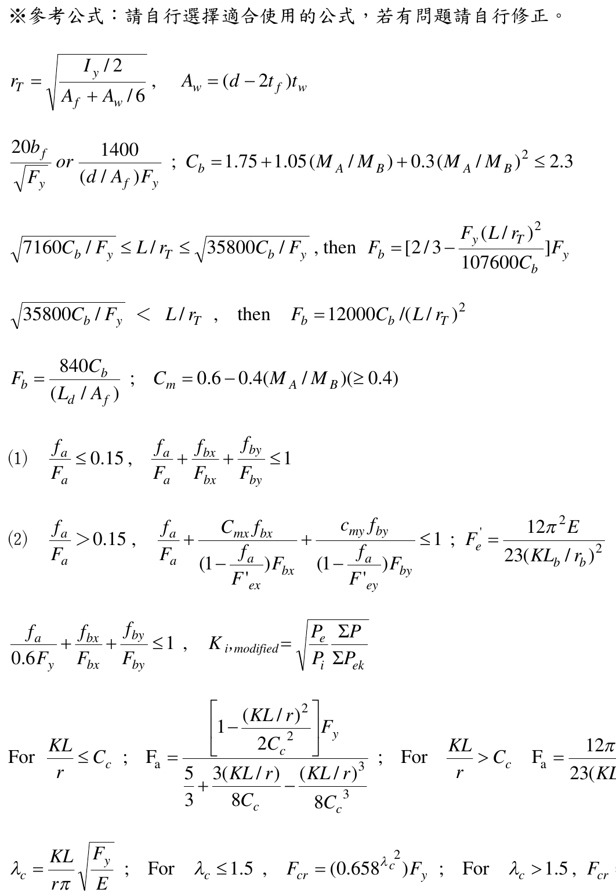
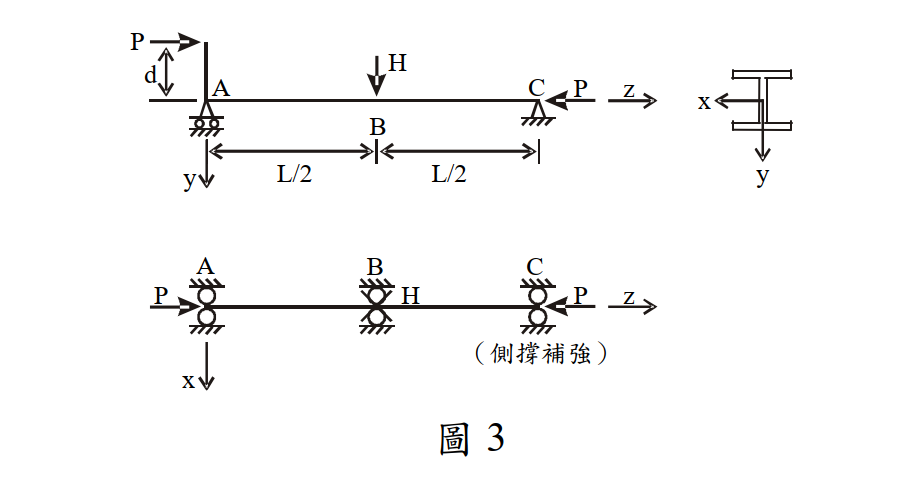

# SS-2008-4 題目正本

> 本檔只記錄**考卷上寫了什麼、圖上畫了什麼**，不含任何解法。解析見同資料夾 `SS-2008-4.md`。
> 判讀清單經使用者確認前，狀態為「待確認」；確認後本檔原則上不再修改（改動須回考卷原圖並記 log）。

| 項目 | 內容 |
|------|------|
| 考卷 | `raw/exams/SS-2008_鋼結構設計.pdf` 第 2 頁（全四頁・第二頁），第四題；參考公式在第 3–4 頁 |
| 考年 | 民國 97 年（2008） |
| 配分 | 35 分 |
| 附圖 | 1 張（圖 3：y-z 面與 x-z 面受力及支承、斷面軸向），`SS-2008-4-fig-1.png`；第 3 頁參考公式截圖 `SS-2008-4-eqn-1.png` |
| 判讀狀態 | **待確認**（轉錄 2026-11-02，PyMuPDF 110 dpi 全頁＋附圖 450 dpi 局部目視（向量圖）＋PDF 文字座標核對，盲讀後才比對既有解析） |

## 1. 考卷原文（逐字）

> 四、圖 3 為一型鋼梁柱構件，假設構件在 A、B、C 三點側向均有側撐補強，已知其承受偏心 $d$ 之軸壓力 $P$ 及 $y$ 方向力 $H$，構件尺寸及相關配置如圖 3 所示。若此構件採用 A36 之鋼材，$H$ 為 2.5 t，$L$ 為 12 m，偏心 $d$ 為 25 cm。試以容許應力設計法（ASD），求此型鋼梁柱構件所能承受之最大容許軸壓力 $P$。（35 分）
>
> W 型鋼斷面參數及材料特性如下：
> $A$＝76 cm²，$d$＝30.3 cm，$b_f$＝20.3 cm，$t_f$＝1.31 cm，$t_w$＝0.749 cm
> $r_x$＝13 cm，$S_x$＝851 cm³，$r_y$＝4.91 cm，$I_y$＝1830 cm⁴
> $E$＝2040 t/cm²，$F_y$＝2.5 t/cm²
> （已知：$K_x$＝$K_y$＝1.0；$C_m$＝1.0）

## 2. 考卷給的公式、附表與參數

- 題文：$H$ = 2.5 t；$L$ = 12 m；偏心 $d$ = 25 cm；斷面與材料參數（照錄於 §1）；$K_x = K_y = 1.0$；$C_m = 1.0$。
- 第 3 頁「※參考公式：請自行選擇適合使用的公式，若有問題請自行修正。」照錄（第 4 頁為 LRFD 撓曲與寬厚比式，與本題無關，見 SS-2008-3 題目正本）：

$$r_T = \sqrt{\frac{I_y/2}{A_f + A_w/6}},\qquad A_w = (d - 2t_f)t_w$$
$$\frac{20b_f}{\sqrt{F_y}}\ or\ \frac{1400}{(d/A_f)F_y}\;;\qquad C_b = 1.75 + 1.05(M_A/M_B) + 0.3(M_A/M_B)^2 \le 2.3$$
$$\sqrt{7160C_b/F_y} \le L/r_T \le \sqrt{35800C_b/F_y},\ \text{then}\ F_b = \left[\frac23 - \frac{F_y(L/r_T)^2}{107600C_b}\right]F_y\;;\qquad \sqrt{35800C_b/F_y} < L/r_T,\ \text{then}\ F_b = 12000C_b/(L/r_T)^2$$
$$F_b = \frac{840C_b}{(L_d/A_f)}\;;\qquad C_m = 0.6 - 0.4(M_A/M_B)\ (\ge 0.4)$$
$$(1)\ \frac{f_a}{F_a} \le 0.15,\ \frac{f_a}{F_a} + \frac{f_{bx}}{F_{bx}} + \frac{f_{by}}{F_{by}} \le 1\qquad (2)\ \frac{f_a}{F_a} > 0.15,\ \frac{f_a}{F_a} + \frac{C_{mx}f_{bx}}{\left(1 - \dfrac{f_a}{F'_{ex}}\right)F_{bx}} + \frac{c_{my}f_{by}}{\left(1 - \dfrac{f_a}{F'_{ey}}\right)F_{by}} \le 1\;;\ F'_e = \frac{12\pi^2E}{23(KL_b/r_b)^2}$$
$$\frac{f_a}{0.6F_y} + \frac{f_{bx}}{F_{bx}} + \frac{f_{by}}{F_{by}} \le 1,\qquad K_{i,modified} = \sqrt{\frac{P_e}{P_i}\frac{\Sigma P}{\Sigma P_{ek}}}$$
$$\text{For}\ \frac{KL}{r} \le C_c:\ F_a = \frac{\left[1 - \dfrac{(KL/r)^2}{2C_c^2}\right]F_y}{\dfrac53 + \dfrac{3(KL/r)}{8C_c} - \dfrac{(KL/r)^3}{8C_c^3}}\;;\quad \text{For}\ \frac{KL}{r} > C_c:\ F_a = \frac{12\pi^2E}{23(KL/r)^2}$$
$$\lambda_c = \frac{KL}{r\pi}\sqrt{\frac{F_y}{E}}\;;\ \text{For}\ \lambda_c \le 1.5,\ F_{cr} = (0.658^{\lambda_c^2})F_y\;;\ \text{For}\ \lambda_c > 1.5,\ F_{cr} = \frac{0.877}{\lambda_c^2}F_y$$

  

- **沒有給 $C_c$ 式、$S_y$、$I_x$、$r_T$ 數值**（$r_T$ 有公式可算）。
- 卷首注意事項：㈠不必抄題；㈡可以使用電子計算器，但需詳列解答過程；㈢下列計算各題所需之物理常數、參數或條件等有不足時，請依規範自行作合理假設。

## 3. 附圖

*圖面文字照錄：P；d；A；H；C；P；z；x；y；y；B；L/2；L/2；A；B；C；P；H；P；z；x；（側撐補強）；圖 3。*

## 4. 判讀清單

「把握」標**不確定**者請優先確認；解讀類項目（題目用字的意思）另標「解讀」。

| # | 項目 | 判讀 | 圖上／題文依據 | 把握 |
|---|------|------|---------------|------|
| 1 | 偏心位置 | **只有 A 端**偏心：P 經剛臂作用於軸線 −y 側 $d$ = 25 cm；C 端 P 作用於軸線上（無偏心） | 450 dpi：C 端箭頭與構件軸線同高；PDF 文字座標 C 端 P（y≈805 pt）與 A、C 字樣同列 | 確定 |
| 2 | $d$ 的量法 | 自剛臂上 P 作用點量到構件形心軸 | 尺寸線下端延伸線與構件軸線同高 | 確定 |
| 3 | 支承 | y-z 面：A 滾支、C 鉸支；x-z 面：A、B、C 皆側撐 | 支承符號 | 確定 |
| 4 | $H$ | 作用於跨中 B、沿 +y（向下）；y 沿腹板 → 強軸彎曲 | 圖＋斷面小圖 | 確定 |
| 5 | 彎矩疊加 | A 端 $Pd$ 與 $H$ 造成的彎矩**同向**（皆使 −y 側翼板受壓） | P 作用在軸線 −y 側且朝 +z（壓）、H 朝 +y | 確定（解讀） |
| 6 | 有效長度 | 強軸 $K_xL$ = 12 m；弱軸受 B 點側撐 → $K_yL$ = 6 m；側向無支撐長度 $L_b$ = 6 m | 題文「A、B、C 三點側向均有側撐補強」＋x-z 面圖 | 確定（解讀） |
| 7 | 符號 $d$ | 偏心 $d$ = 25 cm 與斷面深 $d$ = 30.3 cm 同符號，照錄 | 題文 | 確定 |
| 8 | $C_m$ | 題給 $C_m$ = 1.0，不必由公式集計算 | 題文 | 確定 |
| 9 | 所求 | 最大容許軸壓力 $P$（$P$ 同時出現在軸力與 $Pd$ 彎矩） | 題文 | 確定 |

---

*轉錄：2026-11-02（SS-U1-3 題目正本推廣・批 1）*
