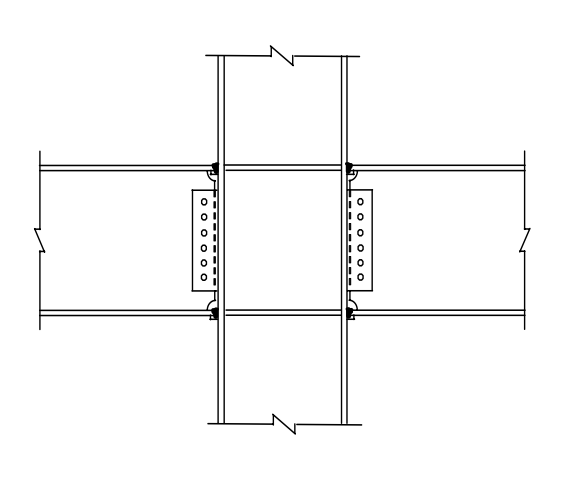

# SS-2009-1 題目正本

> 本檔只記錄**考卷上寫了什麼、圖上畫了什麼**，不含任何解法。解析見同資料夾 `SS-2009-1.md`。
> 判讀清單經使用者確認前，狀態為「待確認」；確認後本檔原則上不再修改（改動須回考卷原圖並記 log）。

| 項目 | 內容 |
|------|------|
| 考卷 | `raw/exams/SS-2009_鋼結構設計.pdf` 第 1 頁（全一張・正面），第一題 |
| 考年 | 民國 98 年（2009） |
| 配分 | 25 分（㈠ 10、㈡ 15） |
| 附圖 | 1 張（梁柱構材示意圖），`SS-2009-1-fig-1.png` |
| 判讀狀態 | **待確認**（轉錄 2026-11-02，PyMuPDF 110 dpi 全頁＋附圖 400 dpi 局部目視（向量圖）＋抽出文字核對，盲讀後才比對既有解析） |

## 1. 考卷原文（逐字）

> 一、如右圖所示鋼結構建築之梁柱構材示意圖，試回答以下問題：
>
> ㈠進行鋼骨建築耐震設計時，依據我國鋼結構極限設計法規範，說明如何滿足強柱弱梁（Strong Column Weak Beam）之梁柱彎矩強度比（Moment Strength Ratio）之要求？（10 分）
>
> ㈡對於鋼結構建築之鋼柱，依據我國鋼結構極限設計法規範，繪出鋼柱受軸壓力（P）與單軸向彎矩（M）共同作用下之交互作用曲線圖（P-M Interaction Curve）。（15 分）

## 2. 考卷給的公式、附表與參數

- 本題**沒有給任何數值、公式或材料參數**。
- 卷首注意事項：㈠可以使用電子計算器，但需詳列解答過程；㈡不必抄題；㈢下列問題之相關公式、物理常數、符號意義及設計參數未提及時，請依規範自行做合理推斷或假設。

## 3. 附圖

*圖面文字照錄：無文字。*

## 4. 判讀清單

「把握」標**不確定**者請優先確認；解讀類項目（題目用字的意思）另標「解讀」。

| # | 項目 | 判讀 | 圖上／題文依據 | 把握 |
|---|------|------|---------------|------|
| 1 | 附圖性質 | 示意圖（剛接梁柱接頭：翼板銲接、腹板剪力板螺栓、柱內連續板），不帶數值 | 400 dpi 目視 | 確定（解讀） |
| 2 | ㈠ | 說明題：我國極限設計法規範之強柱弱梁彎矩強度比要求 | 題文 | 確定 |
| 3 | ㈡ | 繪圖題：鋼柱 P 與**單軸** M 交互作用曲線，依我國極限設計法規範 | 題文 | 確定 |
| 4 | 規範版本 | 題目只寫「我國鋼結構極限設計法規範」，未指定版次 | 題文 | 確定（解讀） |

---

*轉錄：2026-11-02（SS-U1-3 題目正本推廣・批 1）*
