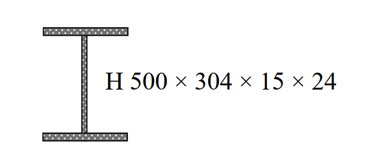

# SS-2009-3 題目正本

> 本檔只記錄**考卷上寫了什麼、圖上畫了什麼**，不含任何解法。解析見同資料夾 `SS-2009-3.md`。
> 判讀清單經使用者確認前，狀態為「待確認」；確認後本檔原則上不再修改（改動須回考卷原圖並記 log）。

| 項目 | 內容 |
|------|------|
| 考卷 | `raw/exams/SS-2009_鋼結構設計.pdf` 第 1（正面） 頁，第三題 |
| 考年 | 民國 98 年（2009） |
| 配分 | 25 分（8＋8＋9） |
| 附圖 | 1 張（H 型斷面示意），`SS-2009-3-fig-1.png` |
| 判讀狀態 | **已確認**（2026-11-02 使用者確認，含「不確定」項之解讀；轉錄同日，PyMuPDF 110 dpi 全頁＋關鍵尺寸 220–400 dpi 局部目視，盲讀後才比對既有解析） |

## 1. 考卷原文（逐字）

> 三、如右圖所示之鋼骨構材斷面，標示為 H 500 × 304 × 15 × 24（mm），鋼材之降伏應力 $F_y = 3.5\ \text{tf/cm}^2$，鋼材之彈性模數 $E_s = 2040\ \text{tf/cm}^2$，試回答以下問題：
>
> ㈠若該鋼骨斷面作為建築物之鋼梁，試求該斷面強軸之塑性彎矩強度（Plastic Moment Strength，$M_p$）與降伏彎矩強度（Yield Moment Strength，$M_y$）之比值，即 $M_p/M_y$ = ?（8 分）
>
> ㈡假設該鋼骨斷面之腹板不會發生剪力挫屈，依據我國鋼結構極限設計法規範，試求該鋼梁之標稱剪力強度（Nominal Shear Strength，$V_n$），即 $V_n$ = ?（8 分）
>
> ㈢若該鋼骨斷面作為建築物之鋼柱，且該柱之長細比參數 $\lambda_c \le 1.5$，依據我國鋼結構極限設計法規範，鋼柱之標稱軸壓強度（Nominal Compressive Strength，$P_n$）可依下式計算：
>
> $$P_n = \left[\exp\left(-0.419\lambda_c^2\right)\right] F_y A_s$$
>
> 假設該柱弱軸方向之有效長度 $K_yL_y = 4$ m，試求該柱於弱軸方向之 $\lambda_c$ = ?（9 分）

## 2. 考卷給的公式、附表與參數

- 題內公式：$P_n = \left[\exp(-0.419\lambda_c^2)\right]F_yA_s$（適用 $\lambda_c \le 1.5$）。
- 卷首注意事項㈢：「下列問題之相關公式、物理常數、符號意義及設計參數未提及時，請依規範自行做合理推斷或假設。」
- 本卷無參考公式區。

## 3. 附圖

*圖面文字照錄：H 500 × 304 × 15 × 24。圖僅示意斷面形狀，無尺寸線。*

## 4. 判讀清單

「把握」標**不確定**者請優先確認；解讀類項目（題目用字的意思）另標「解讀」。

| # | 項目 | 判讀 | 圖上／題文依據 | 把握 |
|---|------|------|---------------|------|
| 1 | 斷面標示順序 | $d \times b_f \times t_w \times t_f$ = 500 × 304 × 15 × 24 mm | 國內標示慣例；圖上翼板厚明顯大於腹板厚的比例不可量測（示意圖） | 確定 |
| 2 | 圖的性質 | 示意圖，無尺寸線，不可量測 | 圖面只有一行標示文字 | 確定 |
| 3 | 圓角 | 未給，以三塊矩形計 | 題文（解讀） | 確定 |
| 4 | ㈡ 依據 | 「我國鋼結構極限設計法規範」 | 題文 | 確定 |
| 5 | ㈢ 給定條件 | 題目已設定 $\lambda_c \le 1.5$ 並給 $P_n$ 式；只問 $\lambda_c$，不問 $P_n$ | 題文 | 確定 |

---

*轉錄：2026-11-02（U2-1 題目／解答拆分試做）｜確認：2026-11-02 使用者確認*
