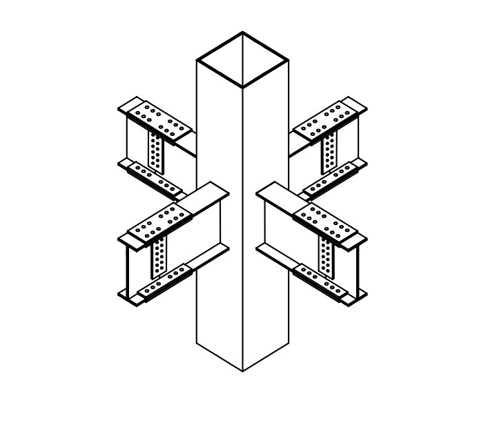

# SS-2009-4 題目正本

> 本檔只記錄**考卷上寫了什麼、圖上畫了什麼**，不含任何解法。解析見同資料夾 `SS-2009-4.md`。
> 判讀清單經使用者確認前，狀態為「待確認」；確認後本檔原則上不再修改（改動須回考卷原圖並記 log）。

| 項目 | 內容 |
|------|------|
| 考卷 | `raw/exams/SS-2009_鋼結構設計.pdf` 第 2 頁（全一張之背面），第四題 |
| 考年 | 民國 98 年（2009） |
| 配分 | 25 分（每小題 5 分） |
| 附圖 | 1 張（箱型柱與四向 H 型梁接頭立體圖），`SS-2009-4-fig-1.png` |
| 判讀狀態 | **待確認**（轉錄 2026-11-02，PyMuPDF 110 dpi 全頁目視＋抽出文字核對，盲讀後才比對既有解析） |

## 1. 考卷原文（逐字）

> 四、如下圖所示鋼結構建築的梁柱接頭示意圖，依據我國鋼結構設計與施工相關規範，試回答有關「銲接（Welding）」與「高強度螺栓（High Strength Bolt）」之問題：（每小題 5 分，共 25 分）
> ㈠關於銲道之開槽銲接（Groove Weld）型式中，試繪圖說明「Single V」與「Single Bevel」開槽方式之差異。
> ㈡鋼結構之銲接程序中，常用「SAW」之方法，試寫出其英文全名及中文譯名。
> ㈢銲道之非破壞檢測法中，常用「UT」之方法，請寫出其英文全名及中文譯名。
> ㈣高強度螺栓之相鄰螺栓孔中心至中心的距離，不得小於多少倍之螺栓標稱直徑？
> ㈤高強度螺栓鎖緊時，會對螺栓產生預拉力（Pretension），依據規範之要求，鎖緊螺栓之最小預拉力應達到多少倍的螺栓最小抗拉強度 $F_u$？

## 2. 考卷給的公式、附表與參數

- 本題**沒有給任何數值或公式**；附圖只作情境示意。
- 卷首注意事項：同 SS-2009 卷（㈢相關參數未提及時請依規範自行合理推斷或假設）。

## 3. 附圖

*圖面無文字。*

## 4. 判讀清單

「把握」標**不確定**者請優先確認；解讀類項目（題目用字的意思）另標「解讀」。

| # | 項目 | 判讀 | 圖上／題文依據 | 把握 |
|---|------|------|---------------|------|
| 1 | 附圖角色 | 情境示意，五小題不需從圖讀數值 | 題文 | 確定 |
| 2 | ㈠ | 須繪圖比較兩種開槽形狀 | 題文「試繪圖說明」 | 確定 |
| 3 | ㈣ | 規範最小螺栓間距（以標稱直徑倍數表示） | 題文 | 確定 |
| 4 | ㈤ | 規範最小預拉力占螺栓最小抗拉強度的倍數；「$F_u$」指強度，是否乘抗拉面積由規範定義 | 題文 | 確定（解讀） |

---

*轉錄：2026-11-02（SS-U1-4 題目正本推廣・批 2）*
