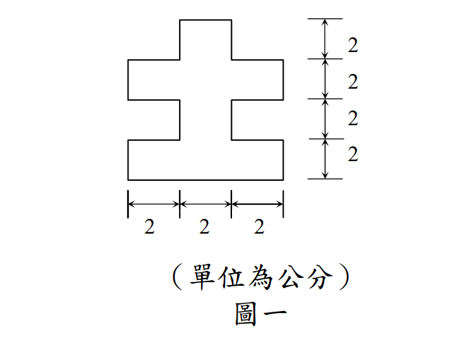

# SS-2010-1 題目正本

> 本檔只記錄**考卷上寫了什麼、圖上畫了什麼**，不含任何解法。解析見同資料夾 `SS-2010-1.md`。
> 判讀清單經使用者確認前，狀態為「待確認」；確認後本檔原則上不再修改（改動須回考卷原圖並記 log）。

| 項目 | 內容 |
|------|------|
| 考卷 | `raw/exams/SS-2010_鋼結構設計.pdf` 第 1（正面） 頁，第一題 |
| 考年 | 民國 99 年（2010） |
| 配分 | 20 分（10＋10） |
| 附圖 | 1 張（圖一，斷面），`SS-2010-1-fig-1.png` |
| 判讀狀態 | **已確認**（2026-11-02 使用者確認，含「不確定」項之解讀；轉錄同日，PyMuPDF 110 dpi 全頁＋關鍵尺寸 220–400 dpi 局部目視，盲讀後才比對既有解析） |

## 1. 考卷原文（逐字）

> 一、有一斷面如圖一所示，使用 SS540 鋼料（降伏強度 $F_y = 4.0\ \textit{tf/cm}^2$），求此斷面強軸之：
>
> ㈠降伏力矩 $M_y$（*tf-cm*）。（10 分）
>
> ㈡塑性力矩 $M_p$（*tf-cm*）。（10 分）

## 2. 考卷給的公式、附表與參數

本卷卷首有「◎參考公式集（請自行使用適合之公式，並檢查其正確性，若有問題應自行修正）」，內容（照錄，與本題無直接關係）：

$$C_c = \sqrt{\frac{2\pi^2E}{F_y}},\quad F_a = \frac{12}{23}\times\frac{\pi^2E}{(k\ell/r)^2},\quad F_a = \frac{\left[1 - \dfrac{(k\ell/r)^2}{2C_c^2}\right]F_y}{\dfrac53 + \dfrac{3(k\ell/r)}{8C_c} - \dfrac{(k\ell/r)^3}{8C_c^3}}$$

$$\lambda_c = \left(\frac{k\ell}{r\pi}\right)\sqrt{\frac{F_y}{E}},\quad F_{cr} = \left[\exp(-0.419\lambda_c^2)\right]F_y,\quad F_{cr} = \left(\frac{0.877}{\lambda_c^2}\right)F_y$$

$$L_p = \frac{80 r_y}{\sqrt{F_{yf}}},\quad L_r = \frac{r_yX_1}{F_L}\sqrt{1+\sqrt{1+X_2F_L^2}},\quad C_b = 1.75 + 1.05\frac{M_1}{M_2} + 0.3\left(\frac{M_1}{M_2}\right)^2 \le 2.3$$

$$M_n = C_b\left[M_p - (M_p - M_r)\left(\frac{L_b - L_p}{L_r - L_p}\right)\right] \le M_p,\quad M_{cr} = \frac{C_bS_xX_1\sqrt2}{L_b/r_y}\sqrt{1 + \frac{X_1^2X_2}{2(L_b/r_y)^2}} \le M_p$$

注意：公式集出現 $M_p$，但**沒有定義** $M_p$ 或 $M_y$ 的算法。

## 3. 附圖

*圖面文字照錄：右側垂直尺寸 2、2、2、2；下方水平尺寸 2、2、2；（單位為公分）；圖一。*

## 4. 判讀清單

「把握」標**不確定**者請優先確認；解讀類項目（題目用字的意思）另標「解讀」。

| # | 項目 | 判讀 | 圖上／題文依據 | 把握 |
|---|------|------|---------------|------|
| 1 | 水平分段 | 2-2-2，總寬 6 cm | 下方三段尺寸線 | 確定 |
| 2 | 垂直分段 | 2-2-2-2，總高 8 cm | 右側四段尺寸線 | 確定 |
| 3 | 由下而上第 1 層（0–2） | 全寬 6 × 2 | 圖形底部為最寬的矩形 | 確定 |
| 4 | 第 2 層（2–4） | 中央 2 × 2 | 窄頸，對齊水平尺寸中段 | 確定 |
| 5 | 第 3 層（4–6） | 全寬 6 × 2 | 第二個寬矩形 | 確定 |
| 6 | 第 4 層（6–8） | 頂部中央凸塊 2 × 2 | 最上方的小凸塊，對齊中段 | 確定 |
| 7 | 對稱性 | 左右對稱、**上下不對稱**（底部是全寬段，頂部是凸塊） | 圖形外框 | 確定 |
| 8 | 強軸 | 水平軸（$I_x$ 對水平軸較大） | 斷面高 8 > 寬 6（解讀，算得 $I_x > I_y$ 可驗證） | 確定 |

---

*轉錄：2026-11-02（U2-1 題目／解答拆分試做）｜確認：2026-11-02 使用者確認*
