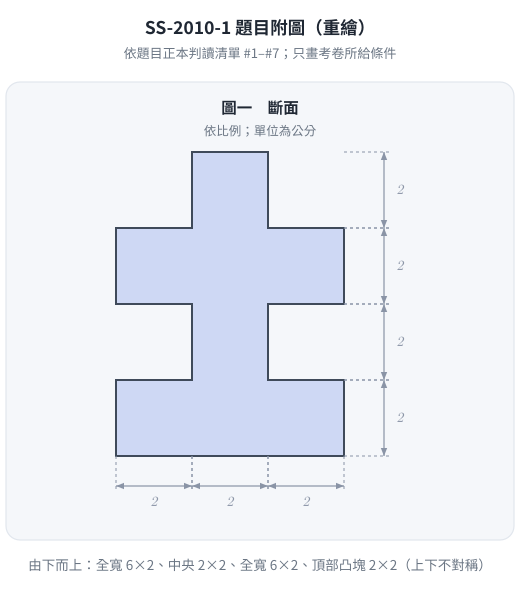

# 考題編號：SS-2010-1

**主分類：** `SS-U2-1` 塑性分析與設計
**副分類：** 無
**設計法：** 概念題（材料力學）
**標籤：** `斷面性質` `降伏力矩` `塑性力矩` `十字形斷面` `平行軸定理` `塑性中性軸`

---

## 1. 題目（考卷原文見題目正本）

> 考卷原文、公式／附表、附圖與判讀清單（已確認）見同資料夾 `SS-2010-1-problem.md`（題目瀏覽頁最上方「📄 題目正本」區塊）。本節只列**解題時最容易讀錯的地方**與本解使用的記號；題意以題目正本為準。



*圖 1　題目附圖重繪（依題目正本判讀清單 #1–#7）。依比例畫出四層，底部是全寬段、頂部是凸塊，攔下「上下對稱十字形」的誤讀（ENA 與 PNA 因此不在同一處）。*

### 常見誤讀

| 項目 | 正確判讀 | 常見誤讀 |
|------|---------|---------|
| 斷面形狀 | 由下而上：全寬 6×2、中央 2×2、全寬 6×2、頂部凸塊 2×2——**上下不對稱** | 讀成上下對稱十字形（舊版解析得 $M_y = 106.7$、$M_p = 192$） |
| 強軸 | 水平軸（$I_x = 162.67 > I_y = 74.67$ cm⁴） | 以為寬 6 的方向是強軸 |
| ENA 與 PNA | ENA 距底 3.5 cm、PNA 距底 4.0 cm，兩者不同 | 用同一條軸算 $S$ 與 $Z$ |

**本解記號：** $y$ 自底面量起（cm）；$F_y = 4.0$ tf/cm²；參考公式集與本題無關。

---

## 2. 考題核心精神與出題者意圖 (Core Concepts & Examiner's Intent)

**核心觀念：非對稱斷面的 $M_y$ 與 $M_p$——彈性中性軸 ≠ 塑性中性軸**

本題刻意把斷面做成上下不對稱（下方兩塊寬段、上方一塊寬段＋凸塊），測驗：

- **形心（彈性中性軸 ENA）要先算**：$\bar{y} = 3.5$ cm，不在幾何中心
- **$S_x$ 取最外纖維較遠的一側**：$c = \max(3.5,\ 4.5) = 4.5$ cm（頂部凸塊先降伏）
- **塑性中性軸（PNA）在面積等分處**：$y = 4.0$ cm，與 ENA 不同
- **$Z_x$ = 上下兩半對 PNA 的一次面積矩之和**，上下兩半力臂不同，不能用「2 倍上半」

**強軸判斷**：$I_x = 162.7$ cm⁴ > $I_y = 74.7$ cm⁴，故強軸為水平軸（繞水平軸彎曲）。

---

## 3. 解題戰略地圖與陷阱分析 (Strategic Roadmap & Trap Analysis)

**作戰計畫：**
```
前置：依原圖分解四個矩形（由下而上 6×2、2×2、6×2、2×2），記錄 b、h、A、ȳi

Step 1  形心 ȳ = ΣAiȳi / ΣAi = 3.5 cm；c_top = 4.5、c_bot = 3.5 cm
Step 2  Ix = Σ(bh³/12 + Ai di²)
Step 3  Sx = Ix / c_max，My = Fy·Sx（頂部先降伏）
Step 4  PNA：由底部累積面積至 A/2 = 16 cm² → y = 4.0 cm
Step 5  Zx = Σ Ai |ȳi − y_PNA|（上下兩半分別計算）
Step 6  Mp = Fy·Zx；以力偶法驗算
```

**陷阱分析：**

| 陷阱 | 說明 | 對策 |
|------|------|------|
| ❶ 看錯斷面上下順序 | 底部是 6 cm 全寬段，頂部才有 2×2 凸塊；看成上下對稱十字形會得 $M_y = 106.7$、$M_p = 192$（舊解錯誤） | 依原圖由下而上逐格確認 |
| ❷ 以為形心在 4 cm | 上下不對稱 → $\bar{y} = 3.5$ cm | 一定先算形心 |
| ❸ $c$ 取錯側 | $S_x$ 要用離 ENA 較遠的頂部 $c = 4.5$ cm（$S_{\min}$） | $M_y$ 由先降伏的一側控制 |
| ❹ PNA 當成形心 | PNA 在面積等分處 $y = 4.0$ cm | ENA 與 PNA 分開算 |
| ❺ $Z_x$ 用「2 × 上半」 | 上下兩半一次面積矩不同（24 與 40） | 分別計算後相加 |

---

## 3.5 變數層次分析（Variable Hierarchy Analysis）

> 複習提示：解題後，在每個卡住的知識點「卡關?」欄標記 `⚠`；第二次複習時只看有 `⚠` 的項目。

**最終目標：** 不對稱斷面強軸降伏力矩 $M_y = 144.6$ tf-cm、塑性力矩 $M_p = 256$ tf-cm

### 主要公式（$\boxed{\phantom{x}}$ = 未知，待推導）

$$\boxed{\bar{y}} = \frac{\sum A_i \bar{y}_i}{\sum A_i}, \quad \boxed{I_x} = \sum\left(\frac{b_i h_i^3}{12} + A_i d_i^2\right)$$
$$\boxed{S_x} = \frac{\boxed{I_x}}{c_{\max}}, \quad \boxed{M_y} = F_y \cdot \boxed{S_x}$$
$$\boxed{Z_x} = \sum A_i\,|\bar{y}_i - y_{PNA}|, \quad \boxed{M_p} = F_y \cdot \boxed{Z_x}$$

### L1：題目直接給定

| 符號 | 數值 | 說明 |
|------|------|------|
| 斷面形狀 | 由下而上 6×2、2×2、6×2、2×2 | 總高 8 cm，總寬 6 cm |
| $F_y$ | 4.0 tf/cm² | SS540 鋼料 |

### L2：需知識點推導

| 符號 | 公式 / 來源 | 卡關? |
|------|------------|:-----:|
| $A$ | $12 + 4 + 12 + 4 = 32$ cm² | |
| $\bar{y}$ | $(12\times1 + 4\times3 + 12\times5 + 4\times7)/32 = 112/32 = 3.5$ cm | |
| $c_{\max}$ | $8 - 3.5 = 4.5$ cm（頂部） | |
| $I_x$ | $32/3 + 152 = 488/3 \approx 162.67$ cm⁴ | |
| $S_x$ | $162.67/4.5 = 36.15$ cm³ | |
| $M_y$ | $4.0 \times 36.15 = 144.6$ tf-cm | |
| $y_{PNA}$ | 底部累積 $12 + 4 = 16 = A/2$ → $y = 4.0$ cm | |
| $Z_x$ | 下半 40 ＋ 上半 24 ＝ 64 cm³ | |
| $M_p$ | $4.0 \times 64 = 256$ tf-cm | |

### L3：深層知識（不懂就卡住）

| 知識點 | 說明 | 卡關? |
|--------|------|:-----:|
| ENA 與 PNA 不同 | 非對稱斷面彈性中性軸過形心、塑性中性軸平分面積 | |
| $S_x$ 取 $S_{\min}$ | 降伏由離中性軸最遠的纖維開始 | |
| 平行軸定理 | $I = \sum(bh^3/12 + Ad^2)$，自身慣性矩不可漏 | |
| 形狀因子 | $f = Z_x/S_x = 1.77$，介於矩形 1.5 與菱形 2.0 之間 | |

---

## 4. 步驟化詳細計算過程 (Step-by-Step Calculation)

### 斷面幾何分解

以斷面底部為原點，$y$ 軸向上：

| 構件 | $y$ 範圍（cm） | $b_i$ | $h_i$ | $A_i$（cm²） | $\bar{y}_i$（cm） |
|------|--------------|------|------|-----------|----------------|
| ① 下全寬段 | 0～2 | 6 | 2 | 12 | 1 |
| ② 中央段 | 2～4 | 2 | 2 | 4 | 3 |
| ③ 上全寬段 | 4～6 | 6 | 2 | 12 | 5 |
| ④ 頂部凸塊 | 6～8 | 2 | 2 | 4 | 7 |

$$A = 32\ \text{cm}^2,\qquad \bar{y} = \frac{12(1) + 4(3) + 12(5) + 4(7)}{32} = \frac{112}{32} = 3.5\ \text{cm}$$

---

### 一、降伏力矩 $M_y$

#### Step 1：$I_x$（平行軸定理，$d_i = \bar{y}_i - 3.5$）

| 構件 | $b_i h_i^3/12$（cm⁴） | $d_i$（cm） | $A_i d_i^2$（cm⁴） | $I_{x,i}$（cm⁴） |
|------|---------------------|-----------|------------------|----------------|
| ① | $6\times8/12 = 4$ | $-2.5$ | $12 \times 6.25 = 75$ | 79.00 |
| ② | $2\times8/12 = 1.333$ | $-0.5$ | $4 \times 0.25 = 1$ | 2.33 |
| ③ | 4 | $+1.5$ | $12 \times 2.25 = 27$ | 31.00 |
| ④ | 1.333 | $+3.5$ | $4 \times 12.25 = 49$ | 50.33 |

$$I_x = \frac{32}{3} + 152 = \frac{488}{3} \approx 162.67\ \text{cm}^4$$

（$I_y = 2\times\dfrac{2\times6^3}{12} + 2\times\dfrac{2\times2^3}{12} = 72 + 2.67 = 74.67$ cm⁴ < $I_x$，確認水平軸為強軸）

#### Step 2：$S_x$ 與 $M_y$

$$c_{top} = 8 - 3.5 = 4.5\ \text{cm} > c_{bot} = 3.5\ \text{cm} \Rightarrow S_x = \frac{162.67}{4.5} = 36.15\ \text{cm}^3$$

$$\boxed{M_y = F_y S_x = 4.0 \times 36.15 = 144.6\ \text{tf-cm}}$$

（頂部凸塊外緣先達 $F_y$；此時底緣應力 $= 4.0 \times 3.5/4.5 = 3.11$ tf/cm²）

---

### 二、塑性力矩 $M_p$

#### Step 3：PNA

$A/2 = 16$ cm²；由底部累積：① 12 → ①＋② 16 → **$y_{PNA} = 4.0$ cm**（恰在②、③交界）

#### Step 4：$Z_x$

| 構件 | $A_i$ | $|\bar{y}_i - 4|$ | $A_i e_i$（cm³） |
|------|------|-----------------|----------------|
| ① | 12 | 3 | 36 |
| ② | 4 | 1 | 4 |
| ③ | 12 | 1 | 12 |
| ④ | 4 | 3 | 12 |

$$Z_x = (36 + 4) + (12 + 12) = 40 + 24 = 64\ \text{cm}^3$$

$$\boxed{M_p = F_y Z_x = 4.0 \times 64 = 256\ \text{tf-cm}}$$

#### Step 5：雙路徑驗算

- **力偶法**：$C = T = F_y \cdot A/2 = 4.0 \times 16 = 64$ tf；上半形心距 PNA $24/16 = 1.5$ cm、下半 $40/16 = 2.5$ cm → 力臂 4.0 cm → $M_p = 64 \times 4.0 = 256$ tf-cm ✓
- **$I_x$ 對底邊再移軸**：$I_{base} = 16 + 37.33 + 304 + 197.33 = 554.67$；$I_x = 554.67 - 32 \times 3.5^2 = 162.67$ cm⁴ ✓

形狀因子 $f = Z_x/S_x = 64/36.15 = 1.77$。

---

## 5. 結果彙整與驗算 (Summary & Verification)

| 項目 | 結果 |
|------|------|
| 全斷面積 $A$ | 32 cm² |
| 形心（ENA）距底 | 3.5 cm |
| 強軸慣性矩 $I_x$ | 162.67 cm⁴ |
| 斷面模數 $S_x$（頂部） | 36.15 cm³ |
| **降伏力矩 $M_y$** | **144.6 tf-cm** |
| PNA 距底 | 4.0 cm |
| 塑性斷面模數 $Z_x$ | 64 cm³ |
| **塑性力矩 $M_p$** | **256 tf-cm** |
| 形狀因子 | 1.77 |

**觀念精析：** 舊版解答把斷面讀成上下對稱十字形（底部也是 2×2 凸塊），得 $M_y = 106.7$、$M_p = 192$ tf-cm、$f = 1.80$。原圖底部是 6 cm 全寬段，斷面上下不對稱，ENA（3.5 cm）與 PNA（4.0 cm）分開，這正是本題的考點。

---

## 6. 依最新規範（AISC 360-16／-22）對照

本題為斷面性質計算，$M_y = F_y S_x$、$M_p = F_y Z_x$ 之定義新舊規範相同；AISC 360 F 章對結實斷面 $M_n = M_p$，並無改變本題答案。

---

*修正日期：2026-11-01（依考卷原圖 400 dpi：斷面由下而上為 6×2 全寬、2×2、6×2 全寬、2×2 頂部凸塊，上下不對稱；原解誤讀為上下對稱十字形。形心 3.5 cm、PNA 4.0 cm，$M_y$ 由 106.7 更正為 **144.6 tf-cm**、$M_p$ 由 192 更正為 **256 tf-cm**（形狀因子 1.80 → 1.77）；新增力偶法與移軸雙路徑驗算）*
*驗證狀態：unverified*

*修正日期：2026-11-02（§1 全文重述改為指向題目正本 `SS-2010-1-problem.md`（已確認）＋常見誤讀＋本解記號，避免題意兩份不同步；解題內容與答案不變）*

*修正日期：2026-11-03（§1 補入題目附圖重繪 `figs/SS-2010-1-fig-1-problem.svg`（依已確認的題目正本判讀清單，腳本 `gen_SS-2010-1.py`，可重跑）；解題內容與答案不變）*
