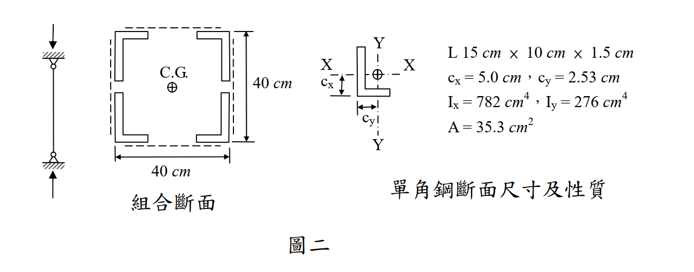

# SS-2010-3 題目正本

> 本檔只記錄**考卷上寫了什麼、圖上畫了什麼**，不含任何解法。解析見同資料夾 `SS-2010-3.md`。
> 判讀清單經使用者確認前，狀態為「待確認」；確認後本檔原則上不再修改（改動須回考卷原圖並記 log）。

| 項目 | 內容 |
|------|------|
| 考卷 | `raw/exams/SS-2010_鋼結構設計.pdf` 第 2 頁（全一張之背面），第三題 |
| 考年 | 民國 99 年（2010） |
| 配分 | 30 分（㈠ 15、㈡ 15） |
| 附圖 | 1 張（圖二：柱側視、組合斷面、單角鋼斷面尺寸及性質），`SS-2010-3-fig-1.png` |
| 判讀狀態 | **已確認**（2026-11-02 使用者確認，含「不確定」項之解讀；轉錄同日，PyMuPDF 110 dpi 全頁＋圖二 400 dpi 局部目視，盲讀後才比對既有解析） |

## 1. 考卷原文（逐字）

> 三、有一受壓桿件，斷面由四個不等肢角鋼（L150×100×15）以繫板和繫條穩固組合而成（如圖二），柱的有效長度為 25 $m$，若繫板和繫條之斷面積不計，鋼料降伏強度 $F_y = 2.52\ tf/cm^2$，$E = 2{,}040\ tf/cm^2$。
> ㈠以容許應力設計法（ASD），求組合斷面之挫屈載重（$tf$）。（15 分）
> ㈡以極限設計法（LSD），求組合斷面之設計強度（$tf$）。（15 分）

## 2. 考卷給的公式、附表與參數

- 卷首「◎參考公式集（請自行使用適合之公式，並檢查其正確性，若有問題應自行修正）」，與本題相關者照錄：

$$C_c = \sqrt{\frac{2\pi^2E}{F_y}},\qquad F_a = \frac{12}{23}\times\frac{\pi^2E}{(k\ell/r)^2},\qquad F_a = \frac{\left[1 - \dfrac{(k\ell/r)^2}{2C_c^2}\right]\cdot F_y}{\dfrac53 + \dfrac{3(k\ell/r)}{8C_c} - \dfrac{(k\ell/r)^3}{8C_c^3}}$$

$$\lambda_c = \left(\frac{k\ell}{r\pi}\right)\sqrt{\frac{F_y}{E}},\qquad F_{cr} = \left[\exp(-0.419\cdot\lambda_c^2)\right]\cdot F_y,\qquad F_{cr} = \left(\frac{0.877}{\lambda_c^2}\right)\cdot F_y$$

  （公式集另有 $L_p$、$L_r$、$C_b$、$M_n$、$M_{cr}$，屬梁題。）公式未標適用範圍（$k\ell/r$ 與 $C_c$、$\lambda_c$ 與 1.5 的分界考卷沒寫）。
- 卷首注意事項㈢：「下列計算各題所需設計參數或公式不足時，請自行合理假設或推知。」
- 單角鋼性質（圖二）：L 15 cm × 10 cm × 1.5 cm；$c_x = 5.0$ cm，$c_y = 2.53$ cm；$I_x = 782$ cm⁴，$I_y = 276$ cm⁴；$A = 35.3$ cm²。
- 考卷**沒給**：$\phi_c$、繫板間距、角鋼 $r_z$。

## 3. 附圖

*圖面文字照錄：C.G.；40 cm；40 cm；組合斷面；X；X；Y；Y；c_x；c_y；L 15 cm × 10 cm × 1.5 cm；c_x = 5.0 cm，c_y = 2.53 cm；I_x = 782 cm⁴，I_y = 276 cm⁴；A = 35.3 cm²；單角鋼斷面尺寸及性質；圖二。*

## 4. 判讀清單

「把握」標**不確定**者請優先確認；解讀類項目（題目用字的意思）另標「解讀」。

| # | 項目 | 判讀 | 圖上／題文依據 | 把握 |
|---|------|------|---------------|------|
| 1 | ㈠「挫屈載重」 | ASD 的容許載重 $P_a = F_aA$（不是尤拉挫屈載重） | 題文用字＋「以容許應力設計法」（解讀） | 不確定 → 使用者確認 |
| 2 | 組合效應 | 繫板繫條視為使四支角鋼整體作用；題未給繫板間距，不檢核單肢挫屈與修正長細比 | 題文「穩固組合」、未給間距（解讀） | 不確定 → 使用者確認 |
| 3 | 單角鋼方向 | **長肢 15 cm 垂直、短肢 10 cm 水平** | 單角鋼圖（400 dpi） | 確定 |
| 4 | $c_x$ | **垂直**尺寸：水平肢外緣（底）至形心；對應繞水平 $X$ 軸之 $I_x = 782$ | 尺寸線為垂直向（400 dpi） | 確定 |
| 5 | $c_y$ | **水平**尺寸：垂直肢外緣（背）至形心；對應繞垂直 $Y$ 軸之 $I_y = 276$ | 尺寸線為水平向（400 dpi） | 確定 |
| 6 | 組合斷面配置 | 四支角鋼方向同單角鋼圖（長肢沿左右兩側垂直、短肢沿上下兩邊水平），對稱置於四角 | 組合斷面圖（400 dpi） | 確定 |
| 7 | 40 cm 尺寸 | 量到角鋼外緣（外廓 40 × 40 cm） | 尺寸線端點對齊角鋼外緣（400 dpi） | 確定 |
| 8 | 有效長度 | 題給 25 m，兩軸相同（側視圖兩端鉸接） | 題文＋側視圖 | 確定 |
| 9 | ㈡「LSD」 | 極限設計法，求設計強度 $\phi_cP_n$；$\phi_c$ 考卷未給，依規範取 0.85 | 題文（解讀） | 確定 |

---

*轉錄：2026-11-02（SS-U1-1 題目正本推廣・批 2）｜確認：2026-11-02 使用者確認*
