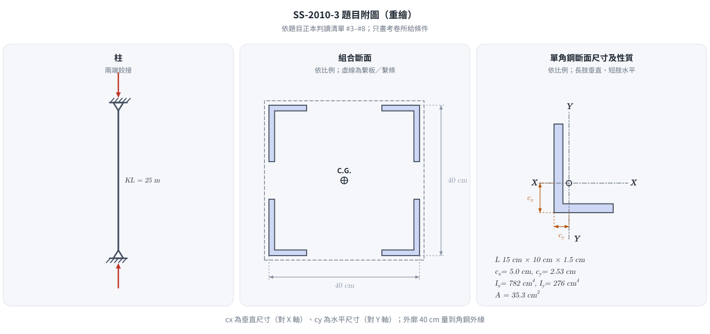
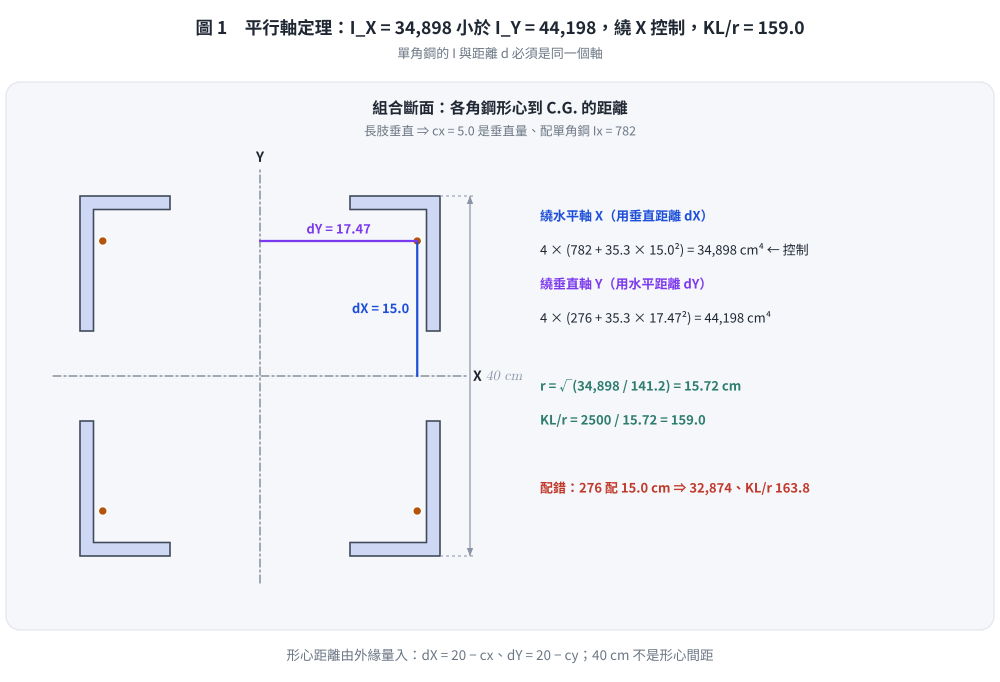
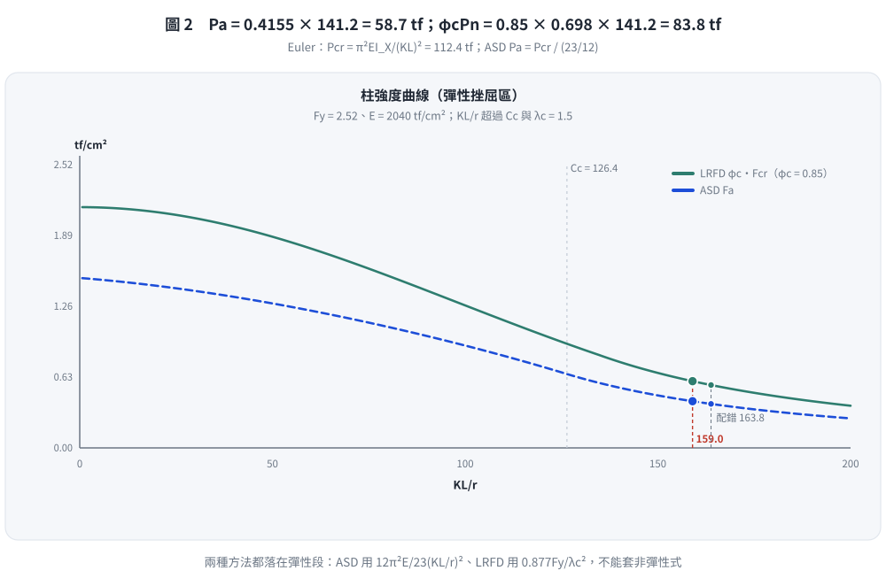

# 考題編號：SS-2010-3

**主分類：** `SS-U1-1` 拉力及壓力桿件
**副分類：** 無
**設計法：** 混合（ASD + LRFD）
**標籤：** `組合柱` `壓力桿件` `不等肢角鋼` `ASD` `LRFD` `Euler公式` `長柱` `有效長度` `迴轉半徑` `Cc判斷` `平行軸定理`

---

## 1. 題目（考卷原文見題目正本）

> 考卷原文、公式／附表、附圖與判讀清單（已確認）見 [`SS-2010-3-problem.md`](SS-2010-3-problem.md)。本節只列**解題時最容易讀錯的地方**與本解使用的記號；題意以題目正本為準。



*圖 1　題目附圖重繪（依題目正本判讀清單 #3–#8）。單角鋼的 $c_x$ 畫成垂直尺寸、$c_y$ 畫成水平尺寸，組合斷面的 40 cm 量到角鋼外緣，攔下 $c_x$／$c_y$ 對應軸對調、或把 40 cm 當成角鋼形心間距的誤讀。*

### 常見誤讀

| 項目 | 正確判讀 | 常見誤讀 |
|------|---------|---------|
| 角鋼方向 | 長肢 15 cm 垂直、短肢 10 cm 水平，四支相同 | 把長肢當成水平 |
| $c_x$、$c_y$ | $c_x = 5.0$ cm 為垂直距離、配 $I_x = 782$；$c_y = 2.53$ cm 為水平距離、配 $I_y = 276$ cm⁴ | 把 $I_y = 276$ 配上 15 cm 力臂（舊版解析即如此，$P_a$ 55.3 t） |
| 40 cm | 量到角鋼外緣 | 量到角鋼形心 |
| ㈠「挫屈載重」 | ASD 容許載重 $P_a = F_aA$ | 答尤拉挫屈載重 |

**本解記號：** 單角鋼 $A = 35.3$ cm²、$I_x = 782$、$I_y = 276$ cm⁴、$c_x = 5.0$、$c_y = 2.53$ cm；$KL = 2500$ cm；$F_y = 2.52$、$E = 2040$ tf/cm²。

---

## 2. 考題核心精神與出題者意圖 (Core Concepts & Examiner's Intent)

**核心觀念：組合柱斷面性質（平行軸定理）＋ ASD 與 LRFD 兩法柱強度**

**出題者測驗重點：**
- **平行軸距離要配對正確的軸**：角鋼繞水平軸的 $I_x$ 要配「形心到組合斷面水平軸的垂直距離」$20 - c_x$；繞垂直軸的 $I_y$ 要配水平距離 $20 - c_y$。
- 兩個方向都算，取較小的 $I$ 控制。
- ASD：$KL/r > C_c$ 用彈性 $F_a = 12\pi^2E/[23(KL/r)^2]$；LRFD：$\lambda_c > 1.5$ 用 $F_{cr} = 0.877F_y/\lambda_c^2$。

---

## 3. 解題戰略地圖與陷阱分析 (Strategic Roadmap & Trap Analysis)

**作戰計畫：**
```
Step 1  讀單角鋼圖：c_x 是垂直距離（對應水平軸 X），c_y 是水平距離（對應垂直軸 Y）
Step 2  組合慣性矩（平行軸定理）：
        I_X = 4[I_x + A(20 − c_x)²] = 4[782 + 35.3×15.0²]  = 34,898 cm⁴（控制）
        I_Y = 4[I_y + A(20 − c_y)²] = 4[276 + 35.3×17.47²] = 44,198 cm⁴
Step 3  r = √(34,898/141.2) = 15.72 cm，KL/r = 2500/15.72 = 159.0
(一) ASD：C_c = 126.4 < 159.0 → 彈性 → F_a = 0.415 → P_a = 58.7 t
(二) LRFD：λ_c = 1.779 > 1.5 → F_cr = 0.698 → φcPn = 83.8 t
```

**陷阱分析：**

| 陷阱 | 說明 | 對策 |
|------|------|------|
| ❶ 平行軸距離配錯軸 | $I_x$（繞水平軸）必須配**垂直**距離 $20 - c_x$；把 $I_y = 276$ 配上 15 cm 就是把兩個方向混在一起 | 每一項都問「繞哪一軸？距離是不是垂直於這軸量的？」 |
| ❷ 看錯 $c_x$、$c_y$ 方向 | 圖上 $c_x$ 箭頭是上下向、$c_y$ 是左右向；下標指的是「對應哪一軸」，不是「沿哪個方向量」 | 回圖看箭頭 |
| ❸ 平行軸距離用 20 cm | 要扣掉形心偏距 | $20 - c$ |
| ❹ ASD 公式選錯 | $KL/r > C_c$ 用彈性式 | 先求 $C_c$ |
| ❺ LRFD 公式選錯 | $\lambda_c > 1.5$ 用 $0.877/\lambda_c^2$ | |

---

## 3.5 變數層次分析（Variable Hierarchy Analysis）

> 複習提示：解題後，在每個卡住的知識點「卡關?」欄標記 `⚠`；第二次複習時只看有 `⚠` 的項目。

**最終目標：** 四角鋼組合柱 → ASD 挫屈（容許）載重 $P_a$ 與 LRFD 設計強度 $\phi_c P_n$

### 主要公式（$\boxed{\phantom{x}}$ = 未知，待推導）

$$\boxed{I_X} = 4\left[I_x + A(20 - c_x)^2\right],\quad \boxed{I_Y} = 4\left[I_y + A(20 - c_y)^2\right],\quad \boxed{r} = \sqrt{\frac{\min(I_X, I_Y)}{4A}}$$

**ASD（彈性段）：**
$$\boxed{F_a} = \frac{12\pi^2 E}{23(KL/r)^2},\quad \boxed{P_a} = F_a \times 4A$$

**LRFD（彈性段）：**
$$\boxed{\lambda_c} = \frac{KL}{r\pi}\sqrt{\frac{F_y}{E}},\quad \boxed{F_{cr}} = \frac{0.877}{\lambda_c^2}F_y,\quad \boxed{\phi_cP_n} = 0.85F_{cr}(4A)$$

### L1：題目直接給定

| 符號 | 數值 | 說明 |
|------|------|------|
| 單角鋼 | L150×100×15 | 長肢垂直、短肢水平 |
| $A$ | 35.3 cm² | 單角鋼面積 |
| $I_x$ | 782 cm⁴ | 繞水平軸 |
| $I_y$ | 276 cm⁴ | 繞垂直軸 |
| $c_x$ | 5.0 cm | 形心到水平肢外緣（垂直距離） |
| $c_y$ | 2.53 cm | 形心到垂直肢外緣（水平距離） |
| 外廓 | 40 × 40 cm | |
| $KL$ | 2500 cm | |
| $F_y$、$E$ | 2.52、2040 tf/cm² | |

### L2：需知識點推導

| 符號 | 公式 / 來源 | 卡關? |
|------|------------|:-----:|
| $A_{total}$ | $4 \times 35.3 = 141.2$ cm² | |
| $d_X$ | $20 - 5.0 = 15.0$ cm（到水平軸的垂直距離） | ⚠ |
| $d_Y$ | $20 - 2.53 = 17.47$ cm（到垂直軸的水平距離） | ⚠ |
| $I_X$ | $4(782 + 35.3 \times 15.0^2) = 34{,}898$ cm⁴（控制） | |
| $I_Y$ | $4(276 + 35.3 \times 17.47^2) = 44{,}198$ cm⁴ | |
| $r$ | $\sqrt{34{,}898/141.2} = 15.72$ cm | |
| $KL/r$ | $2500/15.72 = 159.0$ | |
| $C_c$ | $\sqrt{2\pi^2 \times 2040/2.52} = 126.4$ | |
| $F_a$ | $12\pi^2 \times 2040/(23 \times 159.0^2) = 0.415$ tf/cm² | |
| $P_a$ | $0.415 \times 141.2 = 58.7$ tf | |
| $\lambda_c$ | $(159.0/\pi)\sqrt{2.52/2040} = 1.779$ | |
| $F_{cr}$ | $0.877 \times 2.52/1.779^2 = 0.698$ tf/cm² | |
| $\phi_cP_n$ | $0.85 \times 0.698 \times 141.2 = 83.8$ tf | |

### L3：深層知識（不懂就卡住）

| 知識點 | 說明 | 卡關? |
|--------|------|:-----:|
| 平行軸定理配對 | $I_{組} = \sum(I_{自身} + Ad^2)$，$d$ 必須垂直於同一根軸量 | |
| 角鋼形心符號 | $c_x$ 定位 $X$ 軸（所以是垂直距離），$c_y$ 定位 $Y$ 軸（水平距離） | |
| ASD 長柱公式 | $KL/r > C_c$：$F_a = 12\pi^2E/[23(KL/r)^2]$，安全係數 23/12 | |
| LRFD 彈性段 | $\lambda_c > 1.5$：$F_{cr} = 0.877F_y/\lambda_c^2$ | |
| 組合構材修正細長比 | 題目未給繫板間距、且言明「穩固組合」，不作 $(KL/r)_m$ 修正 | |

---

## 4. 步驟化詳細計算過程 (Step-by-Step Calculation)

### 一、組合斷面性質

$$A_{total} = 4 \times 35.3 = 141.2\ \text{cm}^2$$

各角鋼形心到組合形心的距離：

| 方向 | 計算 | 用於 |
|------|------|------|
| 垂直距離 | $d_X = 20 - c_x = 20 - 5.0 = 15.0$ cm | 繞水平軸 $X$ |
| 水平距離 | $d_Y = 20 - c_y = 20 - 2.53 = 17.47$ cm | 繞垂直軸 $Y$ |

**繞水平軸 $X$：**

$$I_X = 4\left(782 + 35.3 \times 15.0^2\right) = 4(782 + 7{,}942.5) = 34{,}898\ \text{cm}^4$$

**繞垂直軸 $Y$：**

$$I_Y = 4\left(276 + 35.3 \times 17.47^2\right) = 4(276 + 10{,}773.6) = 44{,}198\ \text{cm}^4$$

$I_X < I_Y$，繞水平軸控制：

$$r = \sqrt{\frac{34{,}898}{141.2}} = 15.72\ \text{cm},\qquad \frac{KL}{r} = \frac{2500}{15.72} = 159.0$$



*圖 1　平行軸定理要同軸配對：$I_x = 782$ 配垂直距離 $d_X = 15.0$、$I_y = 276$ 配水平距離 $d_Y = 17.47$，$I_X = 34{,}898$ 控制。這張圖攔的是 276 配上 15 cm（得 32,874、$KL/r$ 163.8）、把 40 cm 當形心間距，或選錯控制軸。*

---

### 二、ASD

$$C_c = \sqrt{\frac{2\pi^2 \times 2040}{2.52}} = 126.4 < 159.0\ \Rightarrow\ \text{彈性挫屈}$$

$$F_a = \frac{12\pi^2E}{23(KL/r)^2} = \frac{12\pi^2 \times 2040}{23 \times 159.0^2} = 0.415\ \text{tf/cm}^2$$

$$\boxed{P_a = 0.415 \times 141.2 = 58.7\ \text{tf}}$$

若題目「挫屈載重」指的是理論（尤拉）挫屈載重：$P_{cr} = \pi^2EI_X/(KL)^2 = 112.4$ tf；$P_a = P_{cr}/(23/12)$ ✔（112.4 ÷ 1.917 = 58.7）。

---

### 三、LRFD

$$\lambda_c = \frac{KL}{r\pi}\sqrt{\frac{F_y}{E}} = \frac{159.0}{\pi}\sqrt{\frac{2.52}{2040}} = 1.779 > 1.5\ \Rightarrow\ \text{彈性挫屈}$$

$$F_{cr} = \frac{0.877}{\lambda_c^2}F_y = \frac{0.877}{1.779^2} \times 2.52 = 0.698\ \text{tf/cm}^2$$

$$P_n = 0.698 \times 141.2 = 98.6\ \text{tf}$$

$$\boxed{\phi_cP_n = 0.85 \times 98.6 = 83.8\ \text{tf}}$$



*圖 2　$KL/r = 159.0 > C_c = 126.4$，兩種方法都在彈性段：$P_a = 58.7$ tf、$\phi_cP_n = 83.8$ tf（Euler $P_{cr} = 112.4$ tf）。這張圖攔的是超過 $C_c$ 仍套非彈性式，或把 Euler 載重當容許載重。*

---

## 5. 結果彙整與驗算 (Summary & Verification)

| 項目 | 數值 |
|------|------|
| $A_{total}$ | 141.2 cm² |
| $I_X$（控制）／$I_Y$ | 34,898／44,198 cm⁴ |
| $r$ | 15.72 cm |
| $KL/r$ | 159.0 |
| ASD $P_a$ | **58.7 tf** |
| LRFD $\phi_cP_n$ | **83.8 tf** |

**雙路徑驗算：** 彈性段兩式都等於尤拉載重乘係數：ASD $P_a = P_{cr} \times 12/23 = 112.4 \times 0.522 = 58.7$ ✔；LRFD $\phi_cP_n = 0.85 \times 0.877 \times P_{cr} = 0.745 \times 112.4 = 83.8$ ✔。

**與舊版解析的差異：** 舊解把角鋼繞垂直軸的 $I_y = 276$ 配上垂直距離 15 cm，得 $I = 32{,}876$、$r = 15.26$、$KL/r = 163.8$，$P_a = 55.3$、$\phi_cP_n = 79.0$ tf，約低估 6%。正確配對後兩個方向都比它大，控制方向是繞水平軸。

---

## 6. 依最新規範（AISC 360-16／-22）對照

| 項目 | 考卷 | AISC 360-16／-22 |
|:---|:---|:---|
| 柱強度 | ASD $F_a$、LRFD $\lambda_c$ 兩段式，$\phi_c = 0.85$ | $F_e = \pi^2E/(KL/r)^2$；$F_y/F_e > 2.25$ 時 $F_{cr} = 0.877F_e$；$\phi_c = 0.90$、$\Omega_c = 1.67$ |
| 本題 | $P_a = 58.7$、$\phi_cP_n = 83.8$ tf | $\phi_cP_n = 0.90 \times 98.6 = 88.7$ tf；$P_n/\Omega_c = 59.0$ tf |
| 組合構材 | 本題不計 | §E6：以繫板連接時須用修正細長比 $(KL/r)_m$，並限制繫材間單肢細長比 ≤ 0.75 倍整體控制細長比 |
| 單角鋼局部挫屈 | — | 表 B4.1a：$b/t = 15/1.5 = 10 < 0.45\sqrt{E/F_y} = 12.8$，非細長肢 |

**觀察：** 新版只把 $\phi_c$ 提高，彈性段 $0.877F_e$ 與舊式相同。實務上 25 m 長的組合柱必須檢討繫板間距與 §E6 修正細長比，否則整體強度會被高估。

---

*修正日期：2026-11-01（依考卷原圖：單角鋼 $c_x = 5.0$ cm 為垂直距離、對應繞水平軸之 $I_x = 782$ cm⁴，原解把 $I_y = 276$ 配上 15 cm 致平行軸配對錯誤；更正 $I_X = 34{,}898$（控制）、$I_Y = 44{,}198$ cm⁴，$r$ 15.26 → **15.72** cm、$KL/r$ 163.8 → **159.0**，$P_a$ 55.3 → **58.7 tf**、$\phi_cP_n$ 79.0 → **83.8 tf**；新增雙路徑驗算與 §6 對照）*
*圖解補繪：2026-11-03（向量圖 2 張，腳本 `gen_SS-2010-3.py`，改輸入可原地重跑；SVG 供 wiki／PDF，2× PNG 供 pptx／影片）*
*驗證狀態：unverified*

*修正日期：2026-11-02（§1 全文重述改為指向題目正本 `SS-2010-3-problem.md`（已確認）＋常見誤讀＋本解記號；解題內容與答案不變）*

*修正日期：2026-11-03（§1 補入題目附圖重繪 `figs/SS-2010-3-fig-1-problem.svg`（依已確認的題目正本判讀清單，腳本 `gen_SS-2010-3.py`，可重跑）；解題內容與答案不變）*
