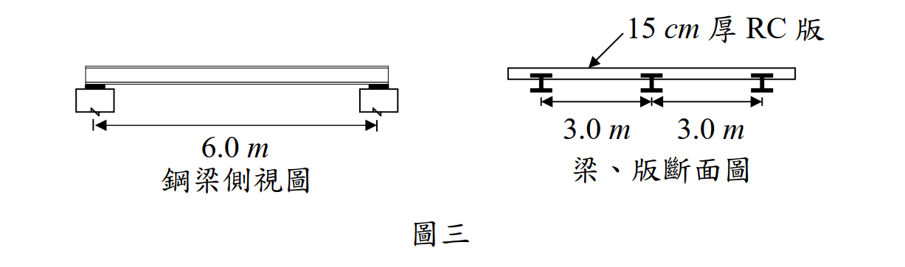

# SS-2010-4 題目正本

> 本檔只記錄**考卷上寫了什麼、圖上畫了什麼**，不含任何解法。解析見同資料夾 `SS-2010-4.md`。
> 判讀清單經使用者確認前，狀態為「待確認」；確認後本檔原則上不再修改（改動須回考卷原圖並記 log）。

| 項目 | 內容 |
|------|------|
| 考卷 | `raw/exams/SS-2010_鋼結構設計.pdf` 第 2 頁（全一張之背面），第四題；參考公式集在第 1 頁 |
| 考年 | 民國 99 年（2010） |
| 配分 | 30 分（㈠ 15、㈡ 15） |
| 附圖 | 1 張（圖三：鋼梁側視圖、梁版斷面圖），`SS-2010-4-fig-1.png`；RH 斷面表照錄於 §2 |
| 判讀狀態 | **待確認**（轉錄 2026-11-02，PyMuPDF 110 dpi 全頁＋圖三 400 dpi 局部目視，盲讀後才比對既有解析） |

## 1. 考卷原文（逐字）

> 四、有一 15 cm 厚鋼筋混凝土版由鋼梁支撐，鋼梁為跨距 6.0 m 之簡支承，梁與梁之間距為 3.0 m，上翼版埋入混凝土版內（如圖三），混凝土單位重 2.4 tf/m³，版面上貼大理石面磚，重 30 kg/m²，樓版承受活載重 400 kg/m²，荷重僅考慮靜載重與活載重之組合，試使用 A992 鋼料（降伏強度 $F_y$＝3.52 tf/cm²，E＝2,040 tf/cm²），以極限設計法（LSD）參考下表設計。
> ㈠僅就力矩考量，設計一最經濟之 RH 梁斷面。（15 分）
> ㈡檢核此斷面之撓度是否合乎 L/360 之規定。（15 分）

## 2. 考卷給的公式、附表與參數

- 題文：版厚 15 cm；跨距 6.0 m；梁距 3.0 m；混凝土 2.4 tf/m³；面磚 30 kg/m²；活載重 400 kg/m²；A992，$F_y = 3.52$、$E = 2040$ tf/cm²。
- 題內 RH 斷面表（照錄）：

| RH 斷面 (H×B) | 斷面模數 $S_x$ (cm³) | 塑性模數 $Z_x$ (cm³) | 慣性矩 $I_x$ (cm⁴) | 迴轉半徑 $r_y$ (cm) | $X_1$ (tf/cm²) | $X_2$ (cm²/tf)² | 單位重 (kg/m) |
|---|---|---|---|---|---|---|---|
| 175×175 | 331 | 370 | 2,900 | 4.37 | 288 | 0.102 | 40.4 |
| 298×149 | 424 | 475 | 6,320 | 3.29 | 128 | 3.07 | 32.0 |
| 200×200 | 472 | 525 | 4,720 | 5.02 | 267 | 0.135 | 49.9 |
| 244×175 | 495 | 550 | 6,040 | 4.21 | 201 | 0.451 | 43.6 |
| 200×204 | 498 | 565 | 4,980 | 4.88 | 309 | 0.0853 | 56.2 |

- 第 1 頁「◎參考公式集（請自行使用適合之公式，並檢查其正確性，若有問題應自行修正）」有 $L_p$、$L_r$、$C_b$、$M_n$、$M_{cr}$ 等式（見 SS-2010 卷第 1 頁），**沒有載重組合係數、$\phi_b$ 與撓度公式**。
- 卷首注意事項：㈠可用計算器、㈡不必抄題、㈢下列計算各題若有所需設計參數或公式不足時，請自行合理假設或推知。

## 3. 附圖

*圖面文字照錄：6.0 m；鋼梁側視圖；15 cm 厚 RC 版；3.0 m；3.0 m；梁、版斷面圖；圖三。*

## 4. 判讀清單

「把握」標**不確定**者請優先確認；解讀類項目（題目用字的意思）另標「解讀」。

| # | 項目 | 判讀 | 圖上／題文依據 | 把握 |
|---|------|------|---------------|------|
| 1 | 支承與跨距 | 簡支，跨距 6.0 m | 題文＋側視圖 | 確定 |
| 2 | 受載寬度 | 中間梁，左右各半跨，受載寬 3.0 m | 斷面圖梁距 3.0 m | 確定（解讀） |
| 3 | 靜載重 | RC 版 $0.15 \times 2.4$ tf/m²＋面磚 30 kg/m²＋鋼梁自重（依表單位重） | 題文＋表 | 確定（解讀） |
| 4 | 側撐 | 上翼板埋入 RC 版 → 受壓翼板連續側撐，不受 LTB 控制（表中 $X_1$、$X_2$ 用不到） | 題文「上翼版埋入混凝土版內」 | 確定（解讀） |
| 5 | 合成作用 | 不計合成梁作用，以鋼梁單獨設計（題未提剪力釘） | 題文「設計一 RH 梁斷面」 | 不確定（解讀） |
| 6 | 載重組合 | 1.2D＋1.6L 與 1.4D 取大（係數題未給） | 題文「僅考慮靜載重與活載重之組合」 | 不確定（解讀） |
| 7 | 「最經濟」 | 滿足強度的斷面中單位重最輕者 | 題文＋表「單位重」欄 | 確定（解讀） |
| 8 | ㈡ 撓度 | 以未因數化活載重計算，限值 $L/360$ | 題文 | 不確定（解讀） |
| 9 | 「LSD」 | 即極限設計法（LRFD），$\phi_b$ 依規範取 0.9 | 題文 | 確定（解讀） |

---

*轉錄：2026-11-02（SS-U1-2 題目正本推廣・批 1）*
