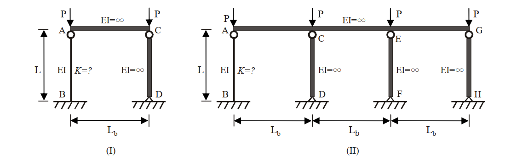

# SS-2011-2 題目正本

> 本檔只記錄**考卷上寫了什麼、圖上畫了什麼**，不含任何解法。解析見同資料夾 `SS-2011-2.md`。
> 判讀清單經使用者確認前，狀態為「待確認」；確認後本檔原則上不再修改（改動須回考卷原圖並記 log）。

| 項目 | 內容 |
|------|------|
| 考卷 | `raw/exams/SS-2011_鋼結構設計.pdf` 第 1 頁（全三頁之第一頁），第二題 |
| 考年 | 民國 100 年（2011） |
| 配分 | 25 分 |
| 附圖 | 1 張（鋼架 (I)、(II)），`SS-2011-2-fig-1.png` |
| 判讀狀態 | **已確認**（2026-11-02 使用者確認，含「不確定」項之解讀；轉錄同日，PyMuPDF 110 dpi 全頁＋附圖 450 dpi 局部目視，盲讀後才比對既有解析） |

## 1. 考卷原文（逐字）

> 二、AISC 規範針對承壓之鋼架結構系統，在其內部受靠桿效應（Leaning column effect）影響時，建議宜參考萊梅厥公式（LeMessurier formula）作有效長度係數 $K$ 值的修正，修正公式如右所示：$K' = \sqrt{\dfrac{P_e}{P_i} \times \dfrac{\sum P}{\sum P_{eK}}}$
>
> $P_i$　：欲求 $K$ 值之柱所受的垂直載重
> $P_e$　：柱之尤拉挫屈載重（Euler buckling load）
> $\Sigma P$　：整體結構承受的總垂直外載重
> $\Sigma P_{eK}$：整體結構所有非靠桿且考慮相應有效長度係數後之挫屈載重（Buckling load）
>
> 下圖中有兩個鋼架結構，已知鋼架（I）中柱 CD，鋼架（II）中柱 CD、柱 EF 及柱 GH 為靠桿。試以萊梅厥公式，分別求解鋼架（I）及鋼架（II）中柱 AB 之有效長度係數 $K_{(I)AB}$ 及 $K_{(II)AB}$，並試求二鋼架結構系統總挫屈載重 $\Sigma P_{(I)cr}$ 及 $\Sigma P_{(II)cr}$ 之比值，即 $\Sigma P_{(I)cr} / \Sigma P_{(II)cr}$ ＝？（25 分）

## 2. 考卷給的公式、附表與參數

- 萊梅厥公式及符號說明（見 §1，照錄）。
- 卷首注意事項㈢：「本試題之相關符號、公式、物理常數及設計參數未提及時，請依規範自行合理推斷或假設。」
- 第 3 頁「參考公式」（ASD／LSD 柱、梁、梁柱公式，另有 $G_{inelastic}$、$\tau_a$）與本題無直接關係。
- 考卷**沒給**：$P_e$ 是否含 $K$（只寫「柱之尤拉挫屈載重」）、柱 AB 自身之 $K$。

## 3. 附圖

*圖面文字照錄：(I)：P；P；EI=∞；A；C；L；EI；K=?；EI=∞；B；D；L_b。(II)：P；P；P；P；EI=∞；A；C；E；G；L；EI；K=?；EI=∞；EI=∞；EI=∞；B；D；F；H；L_b；L_b；L_b。*

## 4. 判讀清單

「把握」標**不確定**者請優先確認；解讀類項目（題目用字的意思）另標「解讀」。

| # | 項目 | 判讀 | 圖上／題文依據 | 把握 |
|---|------|------|---------------|------|
| 1 | 柱 AB 自身之 $K$ | 底固、頂鉸、可側移 → 2.0（題未給，由支承判定） | 支承符號（解讀） | 不確定 → 使用者確認 |
| 2 | $P_e$ | $\pi^2EI/L^2$（$K = 1$ 之尤拉載重） | 題文「柱之尤拉挫屈載重」（解讀） | 不確定 → 使用者確認 |
| 3 | $\Sigma P_{cr}$ | 挫屈時各柱頂 $P$ 的總和（(I) 為 $2P_{cr}$、(II) 為 $4P_{cr}$） | 題文「系統總挫屈載重」（解讀） | 不確定 → 使用者確認 |
| 4 | B 點 | **固接**（斜線地面、無三角形） | 附圖（450 dpi） | 確定 |
| 5 | A 點 | 有鉸圓 → 柱 AB 頂與頂梁**鉸接** | 附圖（450 dpi） | 確定 |
| 6 | C、E、G 點 | 有鉸圓 → 靠桿頂與頂梁鉸接 | 附圖（450 dpi） | 確定 |
| 7 | D、F、H 點 | 三角形 → 鉸支 | 附圖（450 dpi） | 確定 |
| 8 | 靠桿勁度 | 圖標 $EI = \infty$，但兩端鉸接，無側向勁度（與題文「為靠桿」一致） | 附圖＋題文 | 確定 |
| 9 | 頂梁 | $EI = \infty$，連成同一側移 | 圖面文字 | 確定 |
| 10 | 載重 | 每根柱頂各一個垂直 $P$；柱高皆 $L$ | 附圖 | 確定 |

---

*轉錄：2026-11-02（SS-U1-1 題目正本推廣・批 2）｜確認：2026-11-02 使用者確認*
