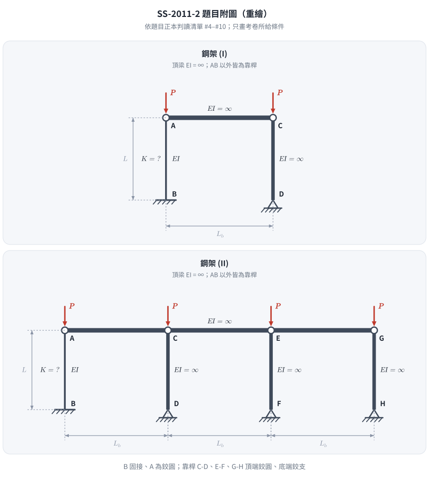
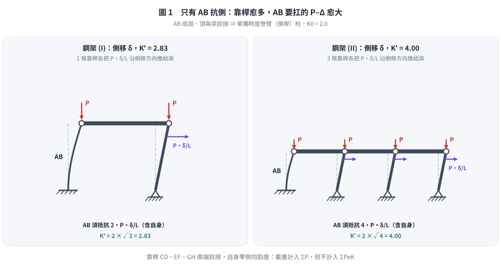
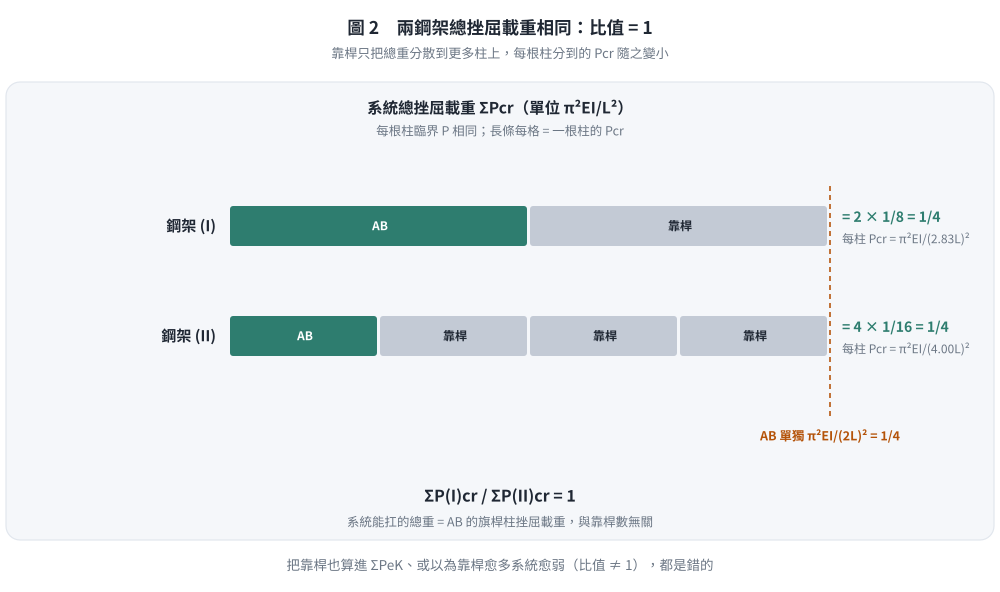

# 考題編號：SS-2011-2

**主分類：** `SS-U1-1` 拉力及壓力桿件
**副分類：** 無
**設計法：** LRFD
**標籤：** `壓力桿件` `有效長度` `LeMessurier公式` `靠柱效應` `側移構架` `整體挫屈` `K值修正` `系統挫屈載重` `柱頂鉸接`

---

## 1. 題目（考卷原文見題目正本）

> 考卷原文、公式／附表、附圖與判讀清單（已確認）見 [`SS-2011-2-problem.md`](SS-2011-2-problem.md)。本節只列**解題時最容易讀錯的地方**與本解使用的記號；題意以題目正本為準。



*圖 1　題目附圖重繪（依題目正本判讀清單 #4–#10）。B 畫成固接、A 畫成鉸圓，靠桿以粗線標 $EI = \infty$ 但兩端皆鉸，攔下把 AB 自身邊界讀錯（影響 $K_{AB}$），或把 $EI = \infty$ 的靠桿當成有側向勁度的誤讀。*

### 常見誤讀

| 項目 | 正確判讀 | 常見誤讀 |
|------|---------|---------|
| A 點 | 鉸圓 → 柱 AB 頂與頂梁鉸接 | 當成剛接（舊版解析取 $K_0 = 1.0$） |
| B 點 | 固接 | 當成鉸支 |
| 靠桿 $EI = \infty$ | 兩端鉸接，仍無側向勁度 | 以為 $EI = \infty$ 會提供勁度 |
| $P_e$ 與 $\Sigma P_{eK}$ | $P_e$ 用 $L$（$K = 1$），$\Sigma P_{eK}$ 用 $K_0L$ | 兩者都用 $K_0L$ |

**本解記號：** 柱 AB 勁度 $EI$、高 $L$；每根柱頂受 $P$，鋼架 (I) 2 根、(II) 4 根柱；$K_0$ 為 AB 不計靠桿之 $K$。

---

## 2. 考題核心精神與出題者意圖 (Core Concepts & Examiner's Intent)

**核心觀念：** 靠柱效應（Leaning Column Effect）。靠柱只承受垂直載重、不提供側向勁度，系統的側移穩定全部由「非靠柱」AB 負擔，因此 AB 的有效長度係數會被放大。

**出題者意圖：**
- 測試考生能否先正確判讀 AB 的邊界條件，求出未修正的 $K_0$，再代入 LeMessurier 公式。
- 分清 $P_e$（尤拉挫屈載重，用實際柱長 $L$）與 $\sum P_{eK}$（用 $K_0L$，只含非靠柱）。
- 揭示重要觀念：增加靠柱不會改變系統總挫屈載重，比值恆為 1。

**關鍵陷阱：**
1. **A 點的小圓圈**：柱 AB 頂端與梁是**鉸接**，梁再剛也傳不了彎矩給柱頂。AB 是「底固、頂鉸、可側移」的懸臂柱，$K_0 = 2.0$，**不是** $G_A = 0$、$K_0 = 1.0$。
2. $P_e$ 與 $\sum P_{eK}$ 混淆：$P_e = \pi^2EI/L^2$（以 $L$ 計），$\sum P_{eK} = \pi^2EI/(K_0L)^2$（以 $K_0L$ 計）。若兩者都以 $K_0L$ 計，$K_0$ 會被消掉，只在 $K_0 = 1$ 時才湊巧不出錯。
3. $\sum P_{eK}$ 誤將靠柱也加入（靠柱的載重只出現在 $\sum P$）。

---

## 3. 解題戰略地圖與陷阱分析 (Strategic Roadmap & Trap Analysis)

```
Step 1：判讀柱 AB 邊界條件
         B 固接、A 柱頂鉸接（小圓圈）、頂梁 EI=∞ 只約束側移同步
         → 底固頂鉸、可側移 → K₀ = 2.0（理論值）
         → P_e = π²EI/L²；P_eK,AB = π²EI/(2L)² = π²EI/(4L²)

Step 2：鋼架（I）：ΣP = 2P，ΣP_eK = π²EI/(4L²)
         → K'² = (π²EI/L²)/P × 2P/(π²EI/4L²) = 8 → K' = 2√2 ≈ 2.83

Step 3：鋼架（II）：ΣP = 4P → K'² = 16 → K' = 4.0

Step 4：系統總挫屈載重
         ΣP_cr = n × P_cr,AB = n × π²EI/(K'L)²
         (I) 2 × π²EI/(8L²) = π²EI/(4L²)；(II) 4 × π²EI/(16L²) = π²EI/(4L²)
         → 比值 = 1
```

---

## 3.5 變數層次分析（Variable Hierarchy Analysis）

> 複習提示：解題後，在每個卡住的知識點「卡關?」欄標記 `⚠`；第二次複習時只看有 `⚠` 的項目。

**最終目標：** 套用 LeMessurier 公式求側移構架中柱 AB 的修正有效長度係數 K，並證明系統總挫屈載重比值 $\sum P_{(I)cr}/\sum P_{(II)cr} = 1$

### 主要公式（$\boxed{\phantom{x}}$ = 未知，待推導）

$$\boxed{K_0} = 2.0 \quad (\text{底固接、頂鉸接、可側移})$$
$$P_e = \frac{\pi^2 EI}{L^2},\qquad P_{eK,AB} = \frac{\pi^2 EI}{(K_0 L)^2}$$
$$\boxed{K'_{AB}} = \sqrt{\frac{P_e}{P_i} \times \frac{\sum P}{\sum P_{eK}}}$$
$$\boxed{\sum P_{cr}} = n_{col} \times \frac{\pi^2 EI}{(K'_{AB} \cdot L)^2}$$

### L1：題目直接給定

| 符號 | 數值 | 說明 |
|------|------|------|
| $EI$ | 有限值（柱 AB） | 柱 AB 的抗彎剛度 |
| $EI_{靠柱}$ | $\infty$ | 靠柱 CD、EF、GH |
| $EI_{beam}$ | $\infty$（頂梁） | 頂部梁剛度無限大 |
| $L$ | 柱高 | 柱 AB 之高度 |
| 柱 AB 邊界 | B 固接、A **鉸接**於頂梁 | 圖中 A 點小圓圈 |
| 鋼架(I) 柱數 | 2（AB、CD），各承受 $P$ | |
| 鋼架(II) 柱數 | 4（AB、CD、EF、GH），各承受 $P$ | |

### L2：需知識點推導

**Step 1：邊界條件分析，求 $K_0$**

| 符號 | 公式 / 來源 | 卡關? |
|------|------------|:-----:|
| 柱頂 A | 小圓圈＝鉸接，柱頂不受轉動約束（$G_A = \infty$） | |
| 柱底 B | 固接（$G_B = 0$） | |
| $K_0$ | 底固頂鉸、可側移（旗桿柱）→ $K_0 = 2.0$ | |
| $P_e$ | $\pi^2 EI / L^2$（尤拉挫屈載重，以實際柱長計） | |
| $P_{eK,AB}$ | $\pi^2 EI / (2L)^2 = \pi^2EI/(4L^2)$ | |

**Step 2：LeMessurier 公式 — 鋼架(I)**

| 符號 | 公式 / 來源 | 卡關? |
|------|------------|:-----:|
| $P_i$ | $P$ | |
| $\sum P_{(I)}$ | $2P$ | |
| $\sum P_{eK,(I)}$ | $\pi^2 EI/(4L^2)$（只含非靠柱 AB） | |
| $K'_{(I)AB}$ | $\sqrt{(\pi^2EI/L^2)/P \times 2P/(\pi^2EI/4L^2)} = \sqrt{8} = 2\sqrt2$ | |

**Step 3：LeMessurier 公式 — 鋼架(II)**

| 符號 | 公式 / 來源 | 卡關? |
|------|------------|:-----:|
| $\sum P_{(II)}$ | $4P$ | |
| $\sum P_{eK,(II)}$ | $\pi^2 EI/(4L^2)$（仍只含 AB） | |
| $K'_{(II)AB}$ | $\sqrt{4 \times 4} = 4.0$ | |

**Step 4：系統總挫屈載重比值**

| 符號 | 公式 / 來源 | 卡關? |
|------|------------|:-----:|
| $\sum P_{(I)cr}$ | $2 \times \pi^2 EI/(8L^2) = \pi^2EI/(4L^2)$ | |
| $\sum P_{(II)cr}$ | $4 \times \pi^2 EI/(16L^2) = \pi^2EI/(4L^2)$ | |
| 比值 | $1$ | |

### L3：深層知識（不懂就卡住）

| 知識點 | 說明 | 卡關? |
|--------|------|:-----:|
| 支承與接頭符號 | 構架圖上節點的小圓圈＝鉸接；三角形＝鉸支；斜線無三角形＝固接 | |
| 旗桿柱 $K_0 = 2$ | 底固、頂自由轉動、可側移 → 變形如懸臂，有效長度 $2L$ | |
| LeMessurier 公式物理意義 | $\sum P_{eK}$ 只含非靠柱，且用 $K_0L$；$P_e$ 用實際長 $L$ | |
| 系統總挫屈載重與靠柱數無關 | $K' = K_0\sqrt{n_{col}}$，代回得 $\sum P_{cr} = P_{eK,AB}$，與 $n_{col}$ 無關 | |

---

## 4. 步驟化詳細計算過程 (Step-by-Step Detailed Calculation)

### Step 1：確認柱 AB 之邊界條件，求未修正 $K_0$

**柱 AB 的連結條件（依考卷原圖）：**
- 下端 B：固接 → 不轉動、不移動。
- 上端 A：圖中有**小圓圈**，表示柱頂與頂梁**鉸接**。頂梁 $EI = \infty$ 只使所有柱頂側移相同，無法對柱 AB 頂端提供轉動約束。

所以柱 AB 是「底固接、頂鉸接、可側移」的旗桿柱（flagpole），單獨挫屈時變形為懸臂形：

$$\boxed{K_0 = 2.0}$$

以對位圖表示：$G_A = \infty$（實務取 10）、$G_B = 0$（實務取 1），無側撐對位圖讀得 $K \approx 2$；理論值為 2.0。

**兩個挫屈載重（不可混用）：**

$$P_e = \frac{\pi^2 EI}{L^2}\quad(\text{尤拉挫屈載重，公式中 } P_e)$$

$$P_{eK,AB} = \frac{\pi^2 EI}{(K_0L)^2} = \frac{\pi^2 EI}{4L^2}\quad(\text{代入 } \textstyle\sum P_{eK})$$

---

### Step 2：鋼架（I）— $K_{(I)AB}$

| 參數 | 說明 | 值 |
|------|------|-----|
| $P_i$ | 柱 AB 所受垂直載重 | $P$ |
| $P_e$ | 柱 AB 尤拉挫屈載重 | $\pi^2 EI / L^2$ |
| $\sum P$ | P（AB）＋ P（CD） | $2P$ |
| $\sum P_{eK}$ | 非靠柱挫屈載重（只含 AB，$K_0 = 2$） | $\pi^2 EI / (4L^2)$ |

靠柱 CD 兩端鉸接、零側向勁度，**不列入 $\sum P_{eK}$**，但其載重 $P$ 要列入 $\sum P$。

$$K'_{(I)AB} = \sqrt{\frac{\pi^2EI/L^2}{P} \times \frac{2P}{\pi^2EI/(4L^2)}} = \sqrt{2 \times 4} = \sqrt8$$

$$\boxed{K_{(I)AB} = 2\sqrt2 \approx 2.83}$$

---

### Step 3：鋼架（II）— $K_{(II)AB}$

| 參數 | 說明 | 值 |
|------|------|-----|
| $P_i$ | 柱 AB 所受垂直載重 | $P$ |
| $P_e$ | 柱 AB 尤拉挫屈載重 | $\pi^2 EI / L^2$ |
| $\sum P$ | P × 4（AB、CD、EF、GH） | $4P$ |
| $\sum P_{eK}$ | 非靠柱挫屈載重（只含 AB） | $\pi^2 EI / (4L^2)$ |

$$K'_{(II)AB} = \sqrt{\frac{\pi^2EI/L^2}{P} \times \frac{4P}{\pi^2EI/(4L^2)}} = \sqrt{4 \times 4} = 4$$

$$\boxed{K_{(II)AB} = 4.0}$$



*圖 1　只有 AB 抗側：靠桿把自己的 $P\delta/L$ 推給頂梁，靠桿愈多，AB 的 $K'$ 愈大（$2\sqrt2 \to 4$）。這張圖攔的是把 AB 頂端當固接（$K_0$ 取 1）、把靠桿計入 $\sum P_{eK}$，或漏算靠桿的載重。*

---

### Step 4：系統總挫屈載重比值

**鋼架（I）：** 柱 AB 挫屈時所受載重

$$P_{cr,AB}^{(I)} = \frac{\pi^2 EI}{(2\sqrt2\,L)^2} = \frac{\pi^2 EI}{8L^2}$$

挫屈時每根柱都承受同一個 $P$，故

$$\sum P_{(I)cr} = 2 \times \frac{\pi^2 EI}{8L^2} = \frac{\pi^2 EI}{4L^2}$$

**鋼架（II）：**

$$P_{cr,AB}^{(II)} = \frac{\pi^2 EI}{(4L)^2} = \frac{\pi^2 EI}{16L^2},\qquad \sum P_{(II)cr} = 4 \times \frac{\pi^2 EI}{16L^2} = \frac{\pi^2 EI}{4L^2}$$

**比值：**

$$\boxed{\frac{\sum P_{(I)cr}}{\sum P_{(II)cr}} = \frac{\pi^2 EI/(4L^2)}{\pi^2 EI/(4L^2)} = 1}$$

**雙路徑驗算（直接平衡法）：** 讓整個構架側移 $\Delta$。靠柱兩端鉸接，每根把 $P\Delta/L$ 的水平力推給頂梁；柱 AB 為懸臂柱，其側向勁度在挫屈時需平衡全部 $P\Delta$ 效應。系統臨界條件為 $\sum P = P_{eK,AB} = \pi^2EI/(4L^2)$，與靠柱數無關，兩個鋼架的 $\sum P_{cr}$ 皆為 $\pi^2EI/(4L^2)$ ✔。



*圖 2　兩鋼架的 $\sum P_{cr}$ 都等於 AB 單獨的 $\pi^2EI/(4L^2)$，比值 = 1；靠桿只是把總重分到更多柱上。這張圖攔的是以為靠桿愈多系統愈弱，或把每柱 $P_{cr}$ 當成系統總值。*

---

## 5. 關鍵爭議點與進階探討 (Critical Issues & Advanced Discussion)

### 核心洞察：靠柱效應不改變系統總挫屈載重

$$K' = K_0\sqrt{\frac{\sum P}{P_i}} = K_0\sqrt{n_{col}}\quad(\text{每柱載重相同、只有一根非靠柱時})$$

$$\sum P_{cr} = n_{col} \times \frac{\pi^2 EI}{(K_0\sqrt{n_{col}}\,L)^2} = \frac{\pi^2 EI}{(K_0L)^2} = P_{eK,AB}$$

系統的側向穩定**完全由非靠柱提供**。增加靠柱只是把 AB 單根的 K 值放大，系統總承載能力始終等於非靠柱自己的挫屈載重。

### 為何要分清 $P_e$ 與 $\sum P_{eK}$

| 寫法 | 鋼架（I）$K'$ | 說明 |
|---|:---:|---|
| $P_e$ 用 $L$、$\sum P_{eK}$ 用 $K_0L$（正確） | $2\sqrt2 = 2.83$ | AISC 解說之 LeMessurier 形式 |
| 兩者都用 $K_0L$ | $\sqrt2 = 1.41$ | $K_0$ 被消掉，等於假設柱頂剛接 |

本題舊版解析即因把 A 點看成剛接（$K_0 = 1$），得到 $K_{(I)} = 1.414$、$K_{(II)} = 2.0$；比值 1 的結論不受影響，但兩個 K 值都只有正確值的一半。同型的 SS-2008-2 柱頂沒有小圓圈（剛接），$K_0 = 1$ 才是對的，可對照練習。

### 考場應用建議

- 先看柱頂、柱底的符號，再決定 $K_0$；鉸接小圓圈最容易漏看。
- 鋼架（I）：$K = 2\sqrt2 \approx 2.83$；鋼架（II）：$K = 4.0$；比值 1。
- 答題需說明「靠柱不列入 $\sum P_{eK}$，但其載重列入 $\sum P$」。

---

## 6. 依最新規範（AISC 360-16／-22）對照

| 項目 | 考卷（AISC 2005 附錄 LeMessurier 式） | AISC 360-16／-22 |
|:---|:---|:---|
| 規範地位 | 第 C 章有效長度法（ELM），K 以對位圖＋LeMessurier 修正 | 第 C 章改為**直接分析法（DM）**，有效長度法移至附錄 7 |
| 靠柱處理 | 以 LeMessurier 式放大非靠柱的 K | DM：靠柱直接放進二階分析模型，所有柱取 $K = 1$；附錄 7 解說仍保留以整層挫屈（story buckling）修正 K 的作法 |
| 本題結果 | $K_{(I)} = 2.83$、$K_{(II)} = 4.0$ | 附錄 7 story-buckling 法結果相同；DM 不需求 K |

**觀察：** 新規範把「靠柱拖垮整層穩定」的效應放到二階分析裡處理，考生仍須懂 LeMessurier 式背後的「整層挫屈＝$\sum P_{eK}$」觀念，因為它就是直接分析法要模擬的物理。

---

*修正日期：2026-11-01（考卷原圖 A 點有小圓圈＝柱頂鉸接，原解誤作剛接取 $K_0 = 1.0$；更正為底固頂鉸 $K_0 = 2.0$，$K_{(I)AB}$ 由 1.414 更正為 **2.83**、$K_{(II)AB}$ 由 2.0 更正為 **4.0**，比值 1 不變；釐清 $P_e$ 與 $\sum P_{eK}$ 的長度取法；新增直接平衡法驗算與 §6 對照）*
*圖解補繪：2026-11-03（向量圖 2 張，腳本 `gen_SS-2011-2.py`，改輸入可原地重跑；SVG 供 wiki／PDF，2× PNG 供 pptx／影片）*
*驗證狀態：unverified*

*修正日期：2026-11-02（§1 全文重述改為指向題目正本 `SS-2011-2-problem.md`（已確認）＋常見誤讀＋本解記號；解題內容與答案不變）*

*修正日期：2026-11-03（§1 補入題目附圖重繪 `figs/SS-2011-2-fig-1-problem.svg`（依已確認的題目正本判讀清單，腳本 `gen_SS-2011-2.py`，可重跑）；解題內容與答案不變）*
