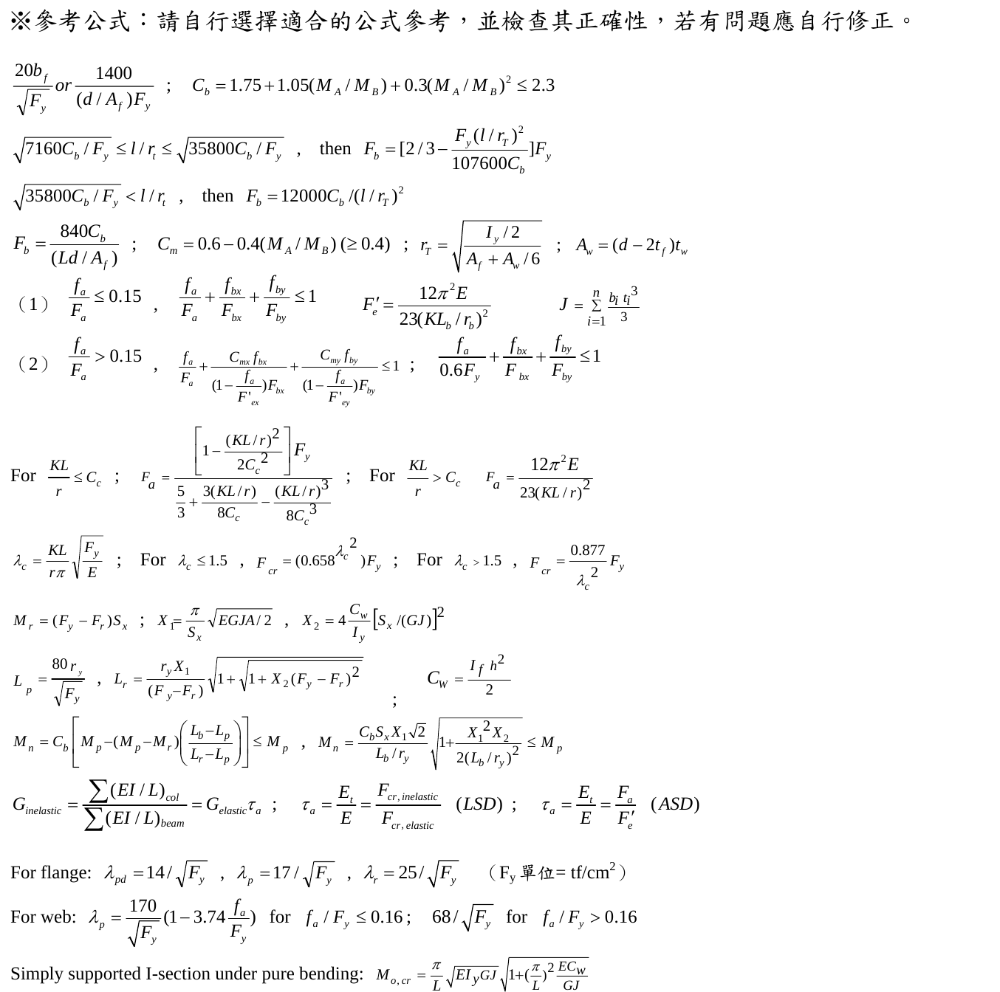
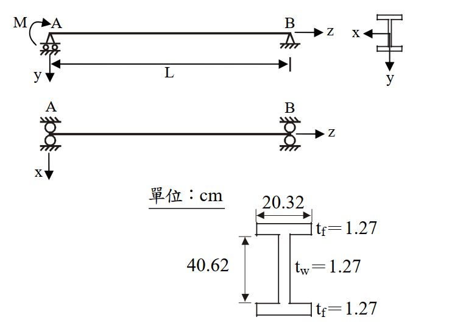

# SS-2011-3 題目正本

> 本檔只記錄**考卷上寫了什麼、圖上畫了什麼**，不含任何解法。解析見同資料夾 `SS-2011-3.md`。
> 判讀清單經使用者確認前，狀態為「待確認」；確認後本檔原則上不再修改（改動須回考卷原圖並記 log）。

| 項目 | 內容 |
|------|------|
| 考卷 | `raw/exams/SS-2011_鋼結構設計.pdf` 第 2 頁（全三頁之第二頁），第三題；參考公式在第 3 頁 |
| 考年 | 民國 100 年（2011） |
| 配分 | 25 分 |
| 附圖 | 1 張（梁立面、平面、斷面尺寸），`SS-2011-3-fig-1.png`；第 3 頁參考公式截圖 `SS-2011-3-eqn-1.png` |
| 判讀狀態 | **待確認**（轉錄 2026-11-02，PyMuPDF 110 dpi 全頁＋附圖 400 dpi、斷面 800 dpi 局部目視＋PDF 向量座標核對，盲讀後才比對既有解析） |

## 1. 考卷原文（逐字）

> 三、圖示為一鋼梁，已知鋼梁在 A 端有一彎矩 M 作用，鋼梁長度 L 為 812.8 cm，梁鋼材特性及斷面尺寸如下所示。試用 LRFD 規範求解此鋼梁所能承受之標稱彎矩 $M_n$，並確認此梁挫屈時是否在彈性範圍內。（25 分）
> 型鋼材料特性及斷面尺寸：
> E＝2100 tf/cm²，G＝840 tf/cm²
> $F_y$＝2.52 tf/cm²，$F_r$＝1.05 tf/cm²

## 2. 考卷給的公式、附表與參數

- 題文：$L = 812.8$ cm；$E = 2100$、$G = 840$、$F_y = 2.52$、$F_r = 1.05$ tf/cm²。
- 圖面斷面尺寸（單位 cm）：翼寬 20.32；$t_f = 1.27$（上下）；$t_w = 1.27$；高度方向尺寸 40.62（量法見 §4 #4）。
- **沒有給 $A$、$I$、$S_x$、$Z_x$、$J$、$C_w$**，須由尺寸自算。
- 第 3 頁「※參考公式：請自行選擇適合的公式參考，並檢查其正確性，若有問題應自行修正。」與本題相關者照錄：

$$C_b = 1.75 + 1.05(M_A/M_B) + 0.3(M_A/M_B)^2 \le 2.3$$
$$M_r = (F_y - F_r)S_x\;;\quad X_1 = \frac{\pi}{S_x}\sqrt{EGJA/2},\quad X_2 = 4\frac{C_w}{I_y}\left[S_x/(GJ)\right]^2$$
$$L_p = \frac{80r_y}{\sqrt{F_y}},\quad L_r = \frac{r_yX_1}{(F_y - F_r)}\sqrt{1 + \sqrt{1 + X_2(F_y - F_r)^2}}\;;\quad C_W = \frac{I_fh^2}{2}\;;\quad J = \sum_{i=1}^{n}\frac{b_it_i^3}{3}$$
$$M_n = C_b\left[M_p - (M_p - M_r)\left(\frac{L_b - L_p}{L_r - L_p}\right)\right] \le M_p,\qquad M_n = \frac{C_bS_xX_1\sqrt2}{L_b/r_y}\sqrt{1 + \frac{X_1^2X_2}{2(L_b/r_y)^2}} \le M_p$$
$$\text{For flange: } \lambda_{pd} = 14/\sqrt{F_y},\ \lambda_p = 17/\sqrt{F_y},\ \lambda_r = 25/\sqrt{F_y}\quad(F_y\ \text{單位}= \text{tf/cm}^2)$$
$$\text{Simply supported I-section under pure bending: } M_{o,cr} = \frac{\pi}{L}\sqrt{EI_yGJ}\sqrt{1 + \left(\frac{\pi}{L}\right)^2\frac{EC_w}{GJ}}$$

  
- 卷首注意事項：㈠可用計算器、㈡不必抄題、㈢本試題之相關符號、公式、物理常數及設計參數未提及時，請依規範自行合理推斷或假設。

## 3. 附圖

*圖面文字照錄：M；A；B；z；x；y；L；A；B；z；x；單位：cm；20.32；$t_f$＝1.27；40.62；$t_w$＝1.27；$t_f$＝1.27。*

## 4. 判讀清單

「把握」標**不確定**者請優先確認；解讀類項目（題目用字的意思）另標「解讀」。

| # | 項目 | 判讀 | 圖上／題文依據 | 把握 |
|---|------|------|---------------|------|
| 1 | 支承 | A 滾支、B 鉸支（簡支）；平面圖 A、B 兩端皆側撐，無中間側撐 → $L_b = L = 812.8$ cm | 立面與平面圖（400 dpi） | 確定 |
| 2 | 載重 | 只有 A 端彎矩 $M$，彎矩自 A 的 $M$ 線性降到 B 的 0 | 題文＋立面 | 確定 |
| 3 | 彎曲軸 | 繞強軸 $x$ | 斷面座標 | 確定 |
| 4 | **40.62 的量法** | **腹板淨高**（上下翼板內側面之間），全深 $d = 40.62 + 2(1.27) = 43.16$ cm | 尺寸線端點對齊翼板內側面（800 dpi）；PDF 向量座標：尺寸線 405.2–445.8 pt，與翼板內側面一致，斷面外框 395.8–454.4 pt | 不確定（影響答案，請確認） |
| 5 | $C_b$ | $M_A/M_B$ 取兩端彎矩較小／較大之比 $= 0/M = 0$ → $C_b = 1.75$ | 參考公式 | 確定（解讀） |
| 6 | 所求 | 標稱 $M_n$（不乘 $\phi_b$），並以 $L_b$ 與 $L_r$ 比較判斷是否為彈性 LTB | 題文 | 確定 |
| 7 | 斷面性質 | 由板尺寸自算（不計圓角）；$C_w = I_fh^2/2$ 中 $h$ 為上下翼板形心距 | 題文＋參考公式 | 確定（解讀） |
| 8 | 局部挫屈 | 是否須檢核翼板寬厚比（公式集給了 $\lambda$） | 參考公式 | 確定（解讀） |

---

*轉錄：2026-11-02（SS-U1-2 題目正本推廣・批 1）*
