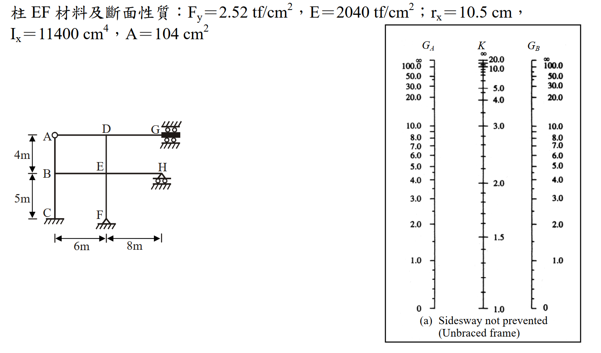

# SS-2011-4 題目正本

> 本檔只記錄**考卷上寫了什麼、圖上畫了什麼**，不含任何解法。解析見同資料夾 `SS-2011-4.md`。
> 判讀清單經使用者確認前，狀態為「待確認」；確認後本檔原則上不再修改（改動須回考卷原圖並記 log）。

| 項目 | 內容 |
|------|------|
| 考卷 | `raw/exams/SS-2011_鋼結構設計.pdf` 第 2 頁（全三頁之第二頁），第四題；公式在第 3 頁 |
| 考年 | 民國 100 年（2011） |
| 配分 | 25 分 |
| 附圖 | 1 張（鋼架＋Sidesway not prevented 對位圖），`SS-2011-4-fig-1.png` |
| 判讀狀態 | **已確認**（2026-11-02 使用者確認，含「不確定」項之解讀；轉錄同日，PyMuPDF 110 dpi 全頁＋鋼架 450 dpi、第 3 頁 τ 式 300 dpi 局部目視，盲讀後才比對既有解析） |

## 1. 考卷原文（逐字）

> 四、圖示為一無側撐鋼架，且 G 點不可轉動、H 點可轉動。各梁與柱之 I 值如下表所示。試依據 Alignment Chart，並進行必要的修正，求取彈性範圍之柱 DE 及柱 EF 的有效長度係數 $K$，並使用 ASD 規範求取非彈性範圍之柱 EF 的有效長度係數 $K$。（柱邊界為鉸接（hinged end）時 G 可使用 10，為固接（Fixed end）時 G 可使用 1。）（25 分）
>
> | | 柱 AB、柱 BC | 柱 DE、柱 EF | 梁 AD | 梁 DG | 梁 BE | 梁 EH |
> |---|---|---|---|---|---|---|
> | I 值（cm⁴） | 10700 | 11400 | 24000 | 28000 | 30000 | 36000 |
>
> 柱 EF 材料及斷面性質：$F_y = 2.52$ tf/cm²，$E = 2040$ tf/cm²；$r_x = 10.5$ cm，$I_x = 11400$ cm⁴，$A = 104$ cm²

## 2. 考卷給的公式、附表與參數

- 附 Sidesway not prevented（Unbraced frame）對位圖（$G_A$、$K$、$G_B$ 三軸）。
- 第 3 頁「※參考公式：請自行選擇適合的公式參考，並檢查其正確性，若有問題應自行修正。」與本題相關者照錄：

$$\text{For } \frac{KL}{r} \le C_c:\ F_a = \frac{\left[1 - \dfrac{(KL/r)^2}{2C_c^2}\right]F_y}{\dfrac53 + \dfrac{3(KL/r)}{8C_c} - \dfrac{(KL/r)^3}{8C_c^3}};\qquad \text{For } \frac{KL}{r} > C_c:\ F_a = \frac{12\pi^2E}{23(KL/r)^2}$$

$$F'_e = \frac{12\pi^2E}{23(Kl_b/r_b)^2}$$

$$G_{inelastic} = \frac{\sum(EI/L)_{col}}{\sum(EI/L)_{beam}} = G_{elastic}\,\tau_a;\qquad \tau_a = \frac{E_t}{E} = \frac{F_{cr,inelastic}}{F_{cr,elastic}}\ (LSD);\qquad \tau_a = \frac{E_t}{E} = \frac{F_a}{F'_e}\ (ASD)$$

- 卷首注意事項㈢：「本試題之相關符號、公式、物理常數及設計參數未提及時，請依規範自行合理推斷或假設。」
- 考卷**沒給**：$C_c$ 式（第 3 頁未見，依規範 $\sqrt{2\pi^2E/F_y}$）、梁遠端修正係數。

## 3. 附圖

*圖面文字照錄：A；D；G；B；E；H；C；F；4m；5m；6m；8m；G_A；K；G_B；(a) Sidesway not prevented (Unbraced frame)。*

## 4. 判讀清單

「把握」標**不確定**者請優先確認；解讀類項目（題目用字的意思）另標「解讀」。

| # | 項目 | 判讀 | 圖上／題文依據 | 把握 |
|---|------|------|---------------|------|
| 1 | 「必要的修正」 | 梁遠端條件與對位圖假設不同者修正：AD（遠端 A 鉸接）、DG（遠端 G 不轉）、EH（遠端 H 可轉）；BE 遠端 B 為剛接節點不修正 | 題文＋支承符號（解讀） | 不確定 → 使用者確認 |
| 2 | 非彈性 $G_F$ | F 為鉸支、題目規定 $G = 10$；是否也乘 $\tau_a$ 折減，題未明說 | 題文括號（解讀） | 不確定 → 使用者確認 |
| 3 | 非彈性 $K$ 用的 $f_a$ | 題未給軸力；以「$K$ 自洽（$F_a$ 與 $F'_e$ 皆由同一 $K$ 求得）」疊代 | 題文只問非彈性 $K$（解讀） | 不確定 → 使用者確認 |
| 4 | A 點 | 有鉸圓 → 梁 AD 與柱 AB 頂**鉸接** | 附圖（450 dpi） | 確定 |
| 5 | B 點 | 無鉸圓 → 剛接（柱 AB、BC 連續，與梁 BE 剛接） | 附圖（450 dpi） | 確定 |
| 6 | C 點 | 固接（斜線、無三角形） | 附圖（450 dpi） | 確定 |
| 7 | F 點 | **鉸支**（三角形） | 附圖（450 dpi） | 確定 |
| 8 | G 點 | 方塊上下各一排滾輪夾住 → 可水平移動、**不可轉動**、不可垂直移動 | 附圖＋題文「G 點不可轉動」 | 確定 |
| 9 | H 點 | 三角形＋滾輪 → 滾支，**可轉動** | 附圖＋題文 | 確定 |
| 10 | D 點 | 上方無柱，只有柱 DE 向下；梁 AD、DG 交會 | 附圖 | 確定 |
| 11 | 尺寸 | 上層 4 m（AB、DE）、下層 5 m（BC、EF）；左跨 6 m（AD、BE）、右跨 8 m（DG、EH） | 尺寸線 | 確定 |
| 12 | 側移條件 | 無側撐 → 用所附 Sidesway not prevented 圖 | 題文＋對位圖標題 | 確定 |
| 13 | 柱 EF 面內 | 只給 $r_x$、$I_x$ → 構架平面內為繞 $x$ 軸 | 題文 | 確定 |

---

*轉錄：2026-11-02（SS-U1-1 題目正本推廣・批 2）｜確認：2026-11-02 使用者確認*
