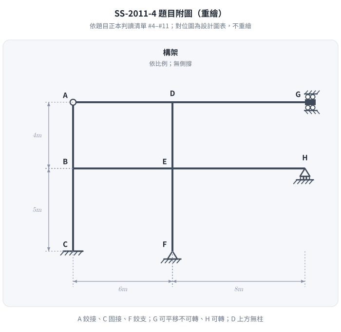
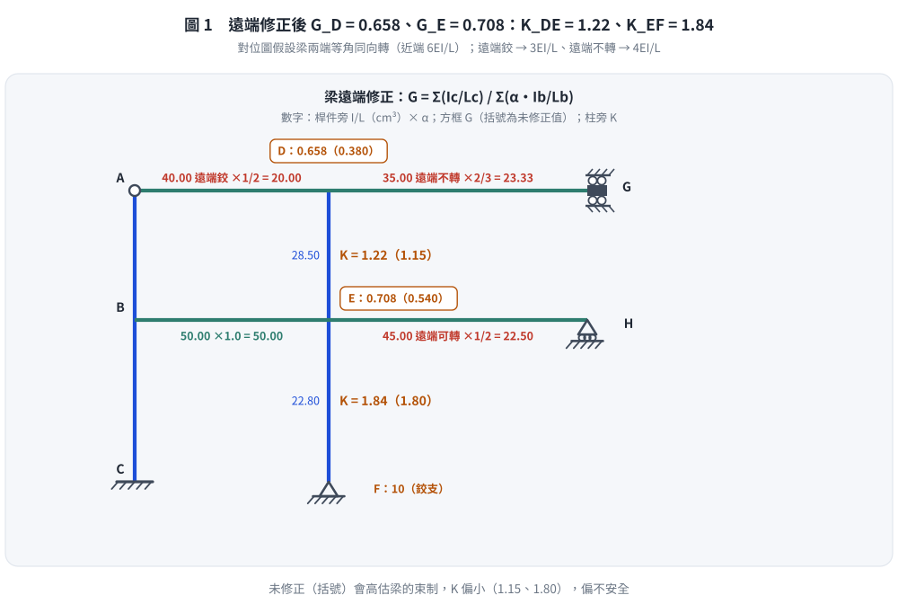
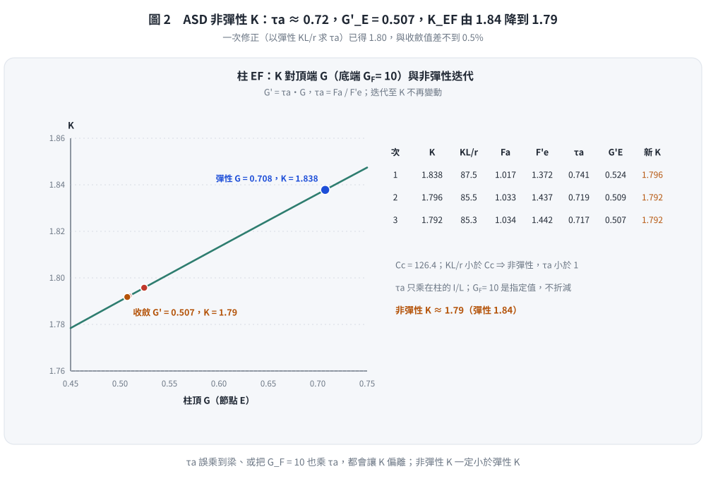

# 考題編號：SS-2011-4

**主分類：** `SS-U1-1` 拉力及壓力桿件
**副分類：** 無
**設計法：** ASD
**標籤：** `壓力桿件` `有效長度` `對位圖` `nomograph` `無側撐構架` `非彈性修正` `τ_a折減` `ASD` `G值邊界條件` `遠端修正因子` `鉸支端`

---

## 1. 題目（考卷原文見題目正本）

> 考卷原文、公式／附表、附圖與判讀清單（已確認）見 [`SS-2011-4-problem.md`](SS-2011-4-problem.md)。本節只列**解題時最容易讀錯的地方**與本解使用的記號；題意以題目正本為準。



*圖 1　題目附圖重繪（依題目正本判讀清單 #4–#11；對位圖為設計圖表，不重繪）。G 的導槽與 H 的滾支分開畫出，A 標鉸圓、F 標鉸支，攔下梁遠端條件（G 不轉、H 可轉、A 鉸接）讀錯而用錯修正係數。*

### 常見誤讀

| 項目 | 正確判讀 | 常見誤讀 |
|------|---------|---------|
| A 點 | 鉸圓 → 梁 AD 與柱頂鉸接，梁遠端修正 | 當成剛接 |
| F 點 | 三角形鉸支，題定 $G_F = 10$ | 當成固接（舊版解析 $G_F = 1.0$） |
| G 點 | 可平移、不可轉 → 梁 DG 遠端不轉 | 當成鉸接或完全固定 |
| H 點 | 滾支可轉 → 梁 EH 遠端鉸 | 當成固接 |
| 非彈性 $\tau_a$ | 考卷第 3 頁 $\tau_a = F_a/F'_e$（ASD），以 $K$ 自洽疊代 | 改用 LRFD 的 $\tau$ |

**本解記號：** 柱 DE、EF：$I = 11{,}400$ cm⁴，$L$ = 400、500 cm；梁 AD 24,000／600、DG 28,000／800、BE 30,000／600、EH 36,000／800（cm⁴／cm）；柱 EF $r_x = 10.5$ cm、$A = 104$ cm²；$F_y = 2.52$、$E = 2040$ tf/cm²。

---

## 2. 考題核心精神與出題者意圖 (Core Concepts & Examiner's Intent)

**核心觀念：**
1. 對位圖（無側撐）假設每根梁兩端轉角相同、雙曲率變形，近端勁度 $6EI/L$。梁遠端條件不同時要乘修正係數。
2. ASD 非彈性修正：柱勁度乘 $\tau_a = F_a/F'_e$，使節點 G 值變小、K 值下降。

**出題者意圖：**
- 「必要的修正」指梁遠端修正：A 點鉸接（梁 AD ×1/2）、G 點不可轉動（梁 DG ×2/3）、H 點可轉動（梁 EH ×1/2）。
- 題目明示鉸支 $G = 10$：F 點為鉸支。
- 非彈性 K 需以 $\tau_a$ 折減後重查圖，且 $\tau_a$ 與 K 互相依賴，需疊代。

**關鍵陷阱：**
1. 漏看 **A 點小圓圈**：梁 AD 遠端鉸接，也要 ×1/2。
2. 把 **F 點三角形**看成固接：F 為鉸支，$G_F = 10$，不是 1。
3. 遠端「不可轉動」在側移構架中的修正係數是 **2/3**（不是有側撐構架的 2）。

---

## 3. 解題戰略地圖與陷阱分析 (Strategic Roadmap & Trap Analysis)

```
【彈性 K】
Step 1a：梁遠端修正（無側撐構架）
  - 梁 AD：遠端 A 鉸接 → ×1/2
  - 梁 DG：遠端 G 不可轉動 → ×2/3
  - 梁 EH：遠端 H 可轉動（滾支）→ ×1/2
  - 梁 BE：遠端 B 剛接於連續柱 ABC → 不修正

Step 1b：G 值
  G_D = 28.50 / (20.00 + 23.33) = 0.658
  G_E = (28.50 + 22.80) / (50.00 + 22.50) = 0.708
  G_F = 10（鉸支，題目規定）

Step 1c：查對位圖（Sidesway not prevented）
  柱 DE：0.658 / 0.708 → K_DE ≈ 1.22
  柱 EF：0.708 / 10    → K_EF ≈ 1.84

【ASD 非彈性 K（柱 EF）】
Step 2：KL/r → F_a、F'_e → τ_a → G_E' = τ_a·G_E（G_F 維持 10）→ 重查 K → 疊代
  收斂：τ_a ≈ 0.717，K_EF ≈ 1.79
```

---

## 3.5 變數層次分析（Variable Hierarchy Analysis）

> 複習提示：解題後，在每個卡住的知識點「卡關?」欄標記 `⚠`；第二次複習時只看有 `⚠` 的項目。

**最終目標：** 用對位圖求柱 DE 與柱 EF 的彈性有效長度係數 K，再以 ASD 非彈性修正（$\tau_a$ 疊代）求柱 EF 的非彈性 K

### 主要公式（$\boxed{\phantom{x}}$ = 未知，待推導）

$$\boxed{G} = \frac{\sum(I_c/L_c)}{\sum \alpha\,(I_b/L_b)} \quad (\alpha\text{：梁遠端修正係數})$$
$$\boxed{K_{elastic}} \quad \text{（查對位圖 Sidesway not prevented）}$$
$$\tau_a = \frac{F_a}{F'_e}, \quad G_{inelastic} = \tau_a \cdot G_{elastic}$$
$$\boxed{K_{inelastic}} \quad \text{（疊代至收斂）}$$

### L1：題目直接給定

| 符號 | 數值 | 說明 |
|------|------|------|
| $I_{柱AB,BC}$ | 10700 cm⁴ | 左柱（本題不需） |
| $I_{柱DE,EF}$ | 11400 cm⁴ | 中柱 |
| $I_{梁AD}$ | 24000 cm⁴ | 遠端 A 鉸接 |
| $I_{梁DG}$ | 28000 cm⁴ | 遠端 G 不可轉動 |
| $I_{梁BE}$ | 30000 cm⁴ | 遠端 B 剛接 |
| $I_{梁EH}$ | 36000 cm⁴ | 遠端 H 可轉動 |
| 柱高 | 上 400 cm、下 500 cm | |
| 跨度 | 左 600 cm、右 800 cm | |
| $G_F$ | 10 | F 鉸支（題目規定） |
| $F_y$、$E$、$r_x$ | 2.52、2040 tf/cm²、10.5 cm | 柱 EF |

### L2：需知識點推導

**Step 1：梁遠端修正係數（無側撐構架）**

| 符號 | 公式 / 來源 | 卡關? |
|------|------------|:-----:|
| 梁 AD | 遠端 A 鉸接 → 近端勁度 $3EI/L$ ÷ $6EI/L$ = 1/2 | |
| 梁 DG | 遠端 G 不轉動 → $4EI/L$ ÷ $6EI/L$ = 2/3 | |
| 梁 EH | 遠端 H 可轉動 → 1/2 | |
| 梁 BE | 遠端 B 剛接於連續柱 → 1.0 | |

**Step 2：彈性 G 值與 K**

| 符號 | 公式 / 來源 | 卡關? |
|------|------------|:-----:|
| $G_D$ | $28.50/(40.00\times\tfrac12 + 35.00\times\tfrac23) = 28.50/43.33 = 0.658$ | |
| $G_E$ | $(28.50 + 22.80)/(50.00 + 45.00\times\tfrac12) = 51.30/72.50 = 0.708$ | |
| $G_F$ | $10$ | |
| $K_{DE}$ | 查圖（0.658, 0.708）→ $1.22$ | |
| $K_{EF}$ | 查圖（0.708, 10）→ $1.84$ | |

**Step 3：ASD 非彈性修正（柱 EF）**

| 符號 | 公式 / 來源 | 卡關? |
|------|------------|:-----:|
| $C_c$ | $\sqrt{2\pi^2E/F_y} = 126.4$ | |
| $F_a$ | ASD 非彈性公式（$KL/r < C_c$） | |
| $F'_e$ | $12\pi^2E/[23(KL/r)^2]$ | |
| $\tau_a$ | $F_a/F'_e$，收斂值 0.717 | |
| $G'_E$ | $0.717 \times 0.708 = 0.507$；$G_F$ 維持 10 | |
| $K_{EF,inel}$ | $1.79$ | |

### L3：深層知識（不懂就卡住）

| 知識點 | 說明 | 卡關? |
|--------|------|:-----:|
| 對位圖的梁假設 | 無側撐：梁兩端同向轉、雙曲率 $6EI/L$；有側撐：反向轉、單曲率 $2EI/L$ | |
| 遠端修正係數 | 無側撐：遠端鉸 ×1/2、遠端固 ×2/3；有側撐：遠端鉸 ×1.5、遠端固 ×2 | |
| 支承符號 | 小圓圈＝鉸接點；三角形＝鉸支；滾輪＝可沿一方向滑動 | |
| ASD 勁度折減 $\tau_a$ | 非彈性時 $E_t < E$，柱的 $I/L$ 乘 $\tau_a$，G 變小、K 下降 | |

---

## 4. 步驟化詳細計算過程 (Step-by-Step Detailed Calculation)

### Part 1：彈性有效長度係數

#### Step 1a：梁遠端修正係數

無側撐對位圖推導時，假設梁兩端轉角相等、同向（雙曲率），近端勁度為 $6EI/L$。遠端條件不同時：

| 梁 | 遠端條件（依原圖） | 近端勁度 | 修正係數 $\alpha$ |
|----|---------|------------|---------|
| AD | A：梁柱鉸接（小圓圈） | $3EI/L$ | **1/2** |
| DG | G：不可轉動、可水平滑動 | $4EI/L$ | **2/3** |
| BE | B：剛接於連續柱 ABC | $6EI/L$ | 1.0 |
| EH | H：滾支，可轉動 | $3EI/L$ | **1/2** |

G 點雖不可轉動，但整個構架側移時 G 隨之水平滑動，梁 DG 兩端無相對垂直位移，所以只看轉動約束：遠端固定 → $4EI/L$。

#### Step 1b：各節點 G 值

**各構材 $I/L$（cm³）：**

| 構材 | I (cm⁴) | L (cm) | $I/L$ | × $\alpha$ |
|------|---------|--------|------|------|
| 柱 DE | 11400 | 400 | 28.50 | — |
| 柱 EF | 11400 | 500 | 22.80 | — |
| 梁 AD | 24000 | 600 | 40.00 | **20.00** |
| 梁 DG | 28000 | 800 | 35.00 | **23.33** |
| 梁 BE | 30000 | 600 | 50.00 | 50.00 |
| 梁 EH | 36000 | 800 | 45.00 | **22.50** |

$$G_D = \frac{28.50}{20.00 + 23.33} = \frac{28.50}{43.33} = \boxed{0.658}$$

$$G_E = \frac{28.50 + 22.80}{50.00 + 22.50} = \frac{51.30}{72.50} = \boxed{0.708}$$

$$G_F = \boxed{10} \quad\text{（F 為鉸支，依題目規定）}$$

#### Step 1c：查對位圖（Sidesway not prevented）

以對位圖方程式 $\dfrac{G_AG_B(\pi/K)^2 - 36}{6(G_A + G_B)} = \dfrac{\pi/K}{\tan(\pi/K)}$ 精確求解（考場查圖讀值應在 ±0.03 內）：

$$\text{柱 DE}（G_{top} = 0.658,\ G_{bot} = 0.708）：\boxed{K_{DE} = 1.22}$$

$$\text{柱 EF}（G_{top} = 0.708,\ G_{bot} = 10）：\boxed{K_{EF} = 1.84}$$

**對照（未做梁修正）：** $G_D = 0.380$、$G_E = 0.540$ → $K_{DE} = 1.15$、$K_{EF} = 1.80$。未修正會低估 K，偏不安全。



*圖 1　梁遠端修正後 $G_D = 0.658$、$G_E = 0.708$，$K_{DE} = 1.22$、$K_{EF} = 1.84$；括號是未修正值，會低估 K。這張圖攔的是梁遠端條件一律取 $\alpha = 1$、G 點不可轉卻取 1/2，或在 D 補上不存在的上柱。*

---

### Part 2：ASD 非彈性有效長度係數（柱 EF）

$$G_{inelastic} = \tau_a\, G_{elastic},\qquad \tau_a = \frac{F_a}{F'_e},\qquad F'_e = \frac{12\pi^2E}{23(KL/r)^2}$$

$\tau_a$ 只乘在柱的 $I/L$ 上。節點 E 上下兩柱同斷面，近似取同一 $\tau_a$，故 $G'_E = \tau_aG_E$。F 點的 $G = 10$ 是題目指定的支承代表值（代表基礎幾乎不提供轉動約束），維持 10 不折減。

$$C_c = \sqrt{\frac{2\pi^2E}{F_y}} = \sqrt{\frac{2\pi^2 \times 2040}{2.52}} = 126.4$$

#### 第 1 次（$K = 1.838$）

$$KL/r = \frac{1.838 \times 500}{10.5} = 87.5 < C_c$$

$$F_a = \frac{\left[1 - \dfrac{87.5^2}{2 \times 126.4^2}\right] \times 2.52}{\dfrac53 + \dfrac{3 \times 87.5}{8 \times 126.4} - \dfrac{87.5^3}{8 \times 126.4^3}} = \frac{0.7604 \times 2.52}{1.6667 + 0.2596 - 0.0415} = \frac{1.916}{1.8848} = 1.017\ \text{tf/cm}^2$$

$$F'_e = \frac{12\pi^2 \times 2040}{23 \times 87.5^2} = 1.372\ \text{tf/cm}^2,\qquad \tau_a = \frac{1.017}{1.372} = 0.741$$

$$G'_E = 0.741 \times 0.708 = 0.525,\ G_F = 10 \ \Rightarrow\ K = 1.796$$

#### 第 2、3 次

| 次 | $K$ | $KL/r$ | $F_a$ | $F'_e$ | $\tau_a$ | $G'_E$ | 新 $K$ |
|:--:|:--:|:--:|:--:|:--:|:--:|:--:|:--:|
| 1 | 1.838 | 87.5 | 1.017 | 1.372 | 0.741 | 0.525 | 1.796 |
| 2 | 1.796 | 85.5 | 1.033 | 1.437 | 0.719 | 0.509 | 1.792 |
| 3 | 1.792 | 85.3 | 1.034 | 1.442 | 0.717 | 0.507 | 1.792 |

$$\boxed{K_{EF,inelastic} \approx 1.79}$$

只做一次修正（以彈性 KL/r 求 $\tau_a$）即得 1.80，與收斂值差不到 0.5%。



*圖 2　ASD 非彈性 K：$\tau_a \approx 0.72$，$G'_E = 0.507$，$K_{EF}$ 由 1.84 降到 1.79，一次修正已很接近。這張圖攔的是 $\tau_a$ 乘到梁或乘到 $G_F = 10$、$KL/r$ 超過 $C_c$ 仍用非彈性式，以及忘了迭代。（第 1 次 $G'_E$ 精確值 0.524，解析表以四捨五入後的 τa 相乘寫 0.525。）*

---

### 計算結果彙整

| 柱 | $G_{top}$ | $G_{bot}$ | K |
|----|---------|---------|-------|
| DE（彈性） | 0.658 | 0.708 | **1.22** |
| EF（彈性） | 0.708 | 10 | **1.84** |
| EF（非彈性，ASD） | 0.507 | 10 | **1.79** |

---

## 5. 關鍵爭議點與進階探討 (Critical Issues & Advanced Discussion)

### 為何非彈性 K 只降一點點

柱 EF 底端是鉸支（$G_F = 10$），K 主要由底端控制；$\tau_a$ 只把頂端 $G_E$ 由 0.708 降到 0.507，對 K 的影響有限（1.84 → 1.79，降 2.5%）。若底端是固接，非彈性修正的效果會明顯得多。

### 若連 $G_F$ 一起乘 $\tau_a$

有些教材把 $\tau_a$ 也乘在支承端的 G 上。本題若 $G_F$ 亦折減，疊代收斂於 $\tau_a = 0.649$、$K = 1.67$。因題目已明定鉸接端 $G$ 取 10，本解以 10 為給定值；考場可在答案中註明所採假設。

### 舊版解析的兩處判讀錯誤

| 項目 | 舊解 | 原圖 | 影響 |
|---|---|---|---|
| F 點 | 當成固接，$G_F = 1.0$ | 三角形＝鉸支，$G_F = 10$ | $K_{EF}$ 1.27 → **1.84** |
| A 點 | 梁 AD 不修正 | 小圓圈＝鉸接，×1/2 | $G_D$ 0.450 → **0.658** |
| 非彈性 K | 1.11 | — | → **1.79** |

### 考場建議

- 先把每個節點的符號（圓圈、三角、滾輪、斜線）標在圖上，再決定修正係數。
- 修正係數表要寫出來（佔分重點）；非彈性疊代 2 次即足夠。

---

## 6. 依最新規範（AISC 360-16／-22）對照

| 項目 | 考卷（ASD，AISC 1989 系） | AISC 360-16／-22 |
|:---|:---|:---|
| 穩定設計方法 | 有效長度法：對位圖求 K | 本文第 C 章為**直接分析法**（不需 K）；有效長度法移至附錄 7 |
| 非彈性勁度折減 | $\tau_a = F_a/F'_e$（ASD） | $\tau_b$：$\alpha P_r/P_{ns} \le 0.5$ 時 1.0，否則 $4(\alpha P_r/P_{ns})[1 - \alpha P_r/P_{ns}]$（附錄 7 解說亦以此折減 G） |
| 梁遠端修正 | 無側撐：鉸 ×1/2、固 ×2/3 | 解說內容相同 |

**觀察：** $\tau_b$ 需要實際軸力 $P_r$；本題未給軸力，只能用舊 ASD 的「$F_a/F'_e$ 在同一 $KL/r$ 下自洽疊代」，這正是舊考題的出題前提。現行設計以直接分析法為主，構材取 $K = 1$，非彈性效應改以整體勁度折減 $0.8\tau_b$ 納入分析。

---

*修正日期：2026-11-01（依考卷原圖：F 點為三角形鉸支，原解誤作固接取 $G_F = 1.0$；A 點小圓圈為梁柱鉸接，原解漏乘梁 AD 遠端修正 1/2。$G_D$ 由 0.450 更正為 **0.658**，$K_{DE}$ 1.21 → **1.22**、$K_{EF}$ 1.27 → **1.84**、非彈性 $K_{EF}$ 1.11 → **1.79**；K 值改以對位圖方程式精確解；新增 $G_F$ 折減與否之比較及 §6 對照）*
*圖解補繪：2026-11-03（向量圖 2 張，腳本 `gen_SS-2011-4.py`，改輸入可原地重跑；SVG 供 wiki／PDF，2× PNG 供 pptx／影片）*
*驗證狀態：unverified*

*修正日期：2026-11-02（§1 全文重述改為指向題目正本 `SS-2011-4-problem.md`（已確認）＋常見誤讀＋本解記號；解題內容與答案不變）*

*修正日期：2026-11-03（§1 補入題目附圖重繪 `figs/SS-2011-4-fig-1-problem.svg`（依已確認的題目正本判讀清單，腳本 `gen_SS-2011-4.py`，可重跑）；解題內容與答案不變）*
