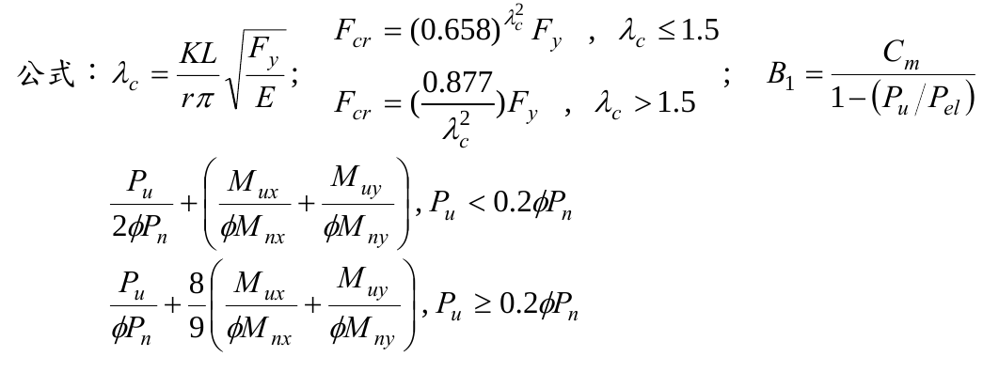

# SS-2012-3 題目正本

> 本檔只記錄**考卷上寫了什麼、圖上畫了什麼**，不含任何解法。解析見同資料夾 `SS-2012-3.md`。
> 判讀清單經使用者確認前，狀態為「待確認」；確認後本檔原則上不再修改（改動須回考卷原圖並記 log）。

| 項目 | 內容 |
|------|------|
| 考卷 | `raw/exams/SS-2012_鋼結構設計.pdf` 第 1 頁（全一張・正面），第三題 |
| 考年 | 民國 101 年（2012） |
| 配分 | 25 分 |
| 附圖 | 無；題內公式截圖 `SS-2012-3-eqn-1.png` |
| 判讀狀態 | **待確認**（轉錄 2026-11-02，PyMuPDF 110 dpi 全頁目視＋抽出文字核對，盲讀後才比對既有解析） |

## 1. 考卷原文（逐字）

> 三、有一鋼造斜撐構架系統，經過載重組合分析後得柱軸力 800 kN，柱底端強軸彎矩為 100 kN-m，弱軸彎矩為 50 kN-m，柱底端為固接端，另一端為鉸接端，此柱在強軸及弱軸的有效長度（$KL$）均為 4.5 m，請利用極限設計法（LRFD）檢核此柱所承受之軸力彎矩需求強度比是否符合設計需求。（25 分）
>
> 柱為 ASTM A572 Gr.50 之 W14×68，鋼材及斷面性質如下：
> $F_y$ = 350 MPa
> W14×68 型鋼性質：$Z_x$ = 1884512 mm³, $Z_y$ = 604683 mm³, $A$ = 12903 mm²
> $r_x$ = 153 mm, $r_y$ = 62 mm
>
> 公式：（見 §2）

## 2. 考卷給的公式、附表與參數

- 題文：$P_u$ = 800 kN；柱底 $M_{ux}$ = 100 kN-m、$M_{uy}$ = 50 kN-m；$KL$ = 4.5 m（兩軸）；$F_y$ = 350 MPa；$Z_x$、$Z_y$、$A$、$r_x$、$r_y$。
- 題內「公式」照錄：

$$\lambda_c = \frac{KL}{r\pi}\sqrt{\frac{F_y}{E}}\;;\qquad F_{cr} = (0.658)^{\lambda_c^2}F_y,\ \lambda_c \le 1.5\;;\quad F_{cr} = \left(\frac{0.877}{\lambda_c^2}\right)F_y,\ \lambda_c > 1.5\;;\qquad B_1 = \frac{C_m}{1 - (P_u/P_{el})}$$
$$\frac{P_u}{2\phi P_n} + \left(\frac{M_{ux}}{\phi M_{nx}} + \frac{M_{uy}}{\phi M_{ny}}\right),\ P_u < 0.2\phi P_n$$
$$\frac{P_u}{\phi P_n} + \frac89\left(\frac{M_{ux}}{\phi M_{nx}} + \frac{M_{uy}}{\phi M_{ny}}\right),\ P_u \ge 0.2\phi P_n$$

  

- 兩條交互式**沒有寫「≤ 1.0」**（照考卷原樣）。
- **沒有給 $E$、$\phi$、$C_m$ 式、$P_{el}$ 式、柱實際長度與側向無支撐長度**，也沒有給 $S_x$、$b_f$、$t_f$ 等寬厚比資料。
- 卷首注意事項：㈠可以使用電子計算器；㈡不必抄題；㈢本試題之相關公式、物理常數、符號意義及設計參數未提及時，請自行合理推斷與假設。

## 3. 附圖

本題無附圖。

## 4. 判讀清單

「把握」標**不確定**者請優先確認；解讀類項目（題目用字的意思）另標「解讀」。

| # | 項目 | 判讀 | 圖上／題文依據 | 把握 |
|---|------|------|---------------|------|
| 1 | 彎矩分布 | 只給柱底彎矩；上端鉸接 → 上端彎矩 0，$M_1/M_2 = 0$（兩軸） | 題文「柱底端為固接端，另一端為鉸接端」 | 確定（解讀） |
| 2 | 構架型式 | 斜撐構架 → 不側移，只有 $B_1$（題只給 $B_1$） | 題文 | 確定（解讀） |
| 3 | 跨間載重 | 題未提跨間橫向載重 → 視為無 | 題文 | 確定（解讀） |
| 4 | 有效長度 | $K_xL = K_yL$ = 4.5 m（題給 $KL$，未給 $K$ 與 $L$） | 題文 | 確定 |
| 5 | 撓曲強度 | 只給 $Z_x$、$Z_y$；未給 LTB 所需資料 → 考生須自行假設（例如 $M_n = M_p$） | 題文 | 確定（解讀） |
| 6 | 所求 | 交互作用比（需求強度比）是否 ≤ 1.0 | 題文 | 確定 |

---

*轉錄：2026-11-02（SS-U1-3 題目正本推廣・批 2）*
