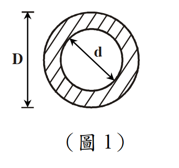

# SS-2013-1 題目正本

> 本檔只記錄**考卷上寫了什麼、圖上畫了什麼**，不含任何解法。解析見同資料夾 `SS-2013-1.md`。
> 判讀清單經使用者確認前，狀態為「待確認」；確認後本檔原則上不再修改（改動須回考卷原圖並記 log）。

| 項目 | 內容 |
|------|------|
| 考卷 | `raw/exams/SS-2013_鋼結構設計.pdf` 第 1（正面） 頁，第一題 |
| 考年 | 民國 102 年（2013） |
| 配分 | 25 分 |
| 附圖 | 1 張（圖 1，空心圓斷面），`SS-2013-1-fig-1.png` |
| 判讀狀態 | **已確認**（2026-11-02 使用者確認，含「不確定」項之解讀；轉錄同日，PyMuPDF 110 dpi 全頁＋關鍵尺寸 220–400 dpi 局部目視，盲讀後才比對既有解析） |

## 1. 考卷原文（逐字）

> 一、如圖 1 所示空心圓斷面，已知 $d = 0.6\,D$，試求該斷面之斷面模數（Section modulus）$S_x$、塑性斷面模數（Plastic section modulus）$Z_x$ 及形狀因數（Shape factor）$f$ = ？（求解之 $S_x$ 及 $Z_x$ 請以 $D$ 表示）（25 分）

## 2. 考卷給的公式、附表與參數

無（同頁的對位圖與萊梅厥公式屬第二題）。

## 3. 附圖

*圖面文字照錄：D；d；（圖 1）。*

## 4. 判讀清單

「把握」標**不確定**者請優先確認；解讀類項目（題目用字的意思）另標「解讀」。

| # | 項目 | 判讀 | 圖上／題文依據 | 把握 |
|---|------|------|---------------|------|
| 1 | $D$ | 外徑 | 左側尺寸線上下界線切外圓頂、底 | 確定 |
| 2 | $d$ | 內徑 | 斜向雙箭頭兩端碰內圓 | 確定 |
| 3 | 斷面實體 | 外圓與內圓之間的圓環（斜線剖面） | 斜線填充只在環上 | 確定 |
| 4 | 答案形式 | $S_x$、$Z_x$ 以 $D$ 表示；$f$ 為數值 | 題文 | 確定 |

---

*轉錄：2026-11-02（U2-1 題目／解答拆分試做）｜確認：2026-11-02 使用者確認*
