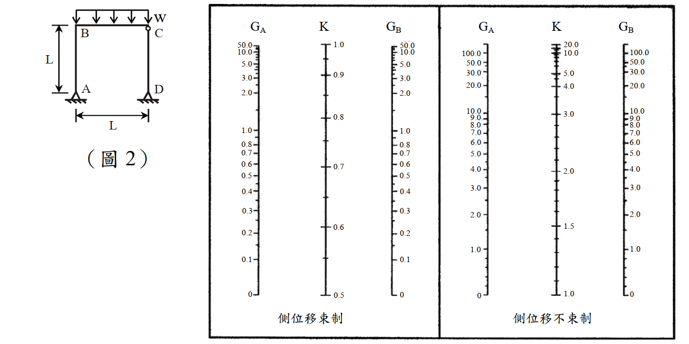

# SS-2013-2 題目正本

> 本檔只記錄**考卷上寫了什麼、圖上畫了什麼**，不含任何解法。解析見同資料夾 `SS-2013-2.md`。
> 判讀清單經使用者確認前，狀態為「待確認」；確認後本檔原則上不再修改（改動須回考卷原圖並記 log）。

| 項目 | 內容 |
|------|------|
| 考卷 | `raw/exams/SS-2013_鋼結構設計.pdf` 第 1 頁（全一張之正面），第二題 |
| 考年 | 民國 102 年（2013） |
| 配分 | 25 分 |
| 附圖 | 1 張（圖 2 剛架＋對位圖兩張），`SS-2013-2-fig-1.png` |
| 判讀狀態 | **已確認**（2026-11-02 使用者確認，含「不確定」項之解讀；轉錄同日，PyMuPDF 110 dpi 全頁＋圖 2 500 dpi 局部目視，盲讀後才比對既有解析） |

## 1. 考卷原文（逐字）

> 二、如圖 2 所示之剛架承受均佈載重 w，柱 CD 為靠桿。已知梁及柱之 $E = 2{,}040$ tf/cm²，梁及柱之長度 $L = 6$ m，柱之 $I_c = 30{,}094$ cm⁴，梁之 $I_b = 136{,}108$ cm⁴。試使用 AISC Alignment Chart 及萊梅厥公式（LeMessurier formula），求解剛架中柱 AB 之有效長度係數 $K'_{AB}$ 及挫屈載重 $w_{cr}$(tf/m)＝？今若僅於梁 BC 上配置單位重 $\rho = 240$ tf/m² 之均佈載重，試求該載重容許配置的厚度 $d$(m)＝？（25 分）
> （柱邊界為固接（Fixed end）時 G 使用 1、為鉸接（hinged end）時 G 使用 10。）
>
> 萊梅厥公式（LeMessurier formula）：$K' = \sqrt{\dfrac{P_e}{P_I} \times \dfrac{\Sigma P}{\Sigma P_{eK}}}$
>
> $P_I$：欲求 K 值之柱所受的垂直載重
> $P_e$：柱之尤拉載重（Euler buckling load）
> $\Sigma P$：整體結構承受的總垂直外載重
> $\Sigma P_{eK}$：整體結構所有非靠桿且考慮相應有效長度係數後之柱挫屈載重（Buckling load）

## 2. 考卷給的公式、附表與參數

- 萊梅厥公式及符號說明（見 §1，照錄）。
- 對位圖兩張：左「側位移束制」（$G_A$、$G_B$ 0～50，$K$ 0.5～1.0）、右「側位移不束制」（$G_A$、$G_B$ 0～100，$K$ 1.0～20.0）。
- 本卷注意事項只有㈠㈡（無「自行合理假設」一條）。
- 考卷**沒給**：兩柱如何分擔 $w$、$\rho$ 與 $d$ 換算成 $w$ 的方式、梁遠端修正係數。

## 3. 附圖

*圖面文字照錄：W；B；C；L；A；D；L；（圖 2）；G_A；K；G_B；側位移束制；側位移不束制。*

## 4. 判讀清單

「把握」標**不確定**者請優先確認；解讀類項目（題目用字的意思）另標「解讀」。

| # | 項目 | 判讀 | 圖上／題文依據 | 把握 |
|---|------|------|---------------|------|
| 1 | $\rho$ 與 $d$ | $w = \rho\,d$（$\rho$ 為每公尺梁長、每公尺厚度的重量，單位 tf/m² 照錄） | 題文用字與單位（解讀） | 不確定 → 使用者確認 |
| 2 | 兩柱分擔 | 題未給，須由靜力決定（CD 為二力桿） | 題文（解讀） | 不確定 → 使用者確認 |
| 3 | $P_e$ | $\pi^2EI_c/L^2$（$K = 1$） | 題文「柱之尤拉載重」（解讀） | 不確定 → 使用者確認 |
| 4 | $G_B$ 是否作梁遠端修正 | C 端梁柱鉸接、有側移 → 梁 $I/L$ ×0.5（2026-11-01 使用者已決定主答採修正值，見 log FIX-SS-已勘誤抽樣） | 題文「Alignment Chart」（解讀） | 確定 |
| 5 | A 點 | 三角形 → **鉸支**，題目規定 $G_A = 10$ | 圖 2（500 dpi） | 確定 |
| 6 | D 點 | 三角形 → 鉸支 | 圖 2（500 dpi） | 確定 |
| 7 | B 點 | 無鉸圓 → 梁柱剛接 | 圖 2（500 dpi） | 確定 |
| 8 | C 點 | 有鉸圓 → 梁 BC 與柱 CD 頂鉸接；CD 兩端鉸（與題文「靠桿」一致） | 圖 2（500 dpi） | 確定 |
| 9 | 載重範圍 | $w$ 布滿梁 BC 全跨 | 圖 2 箭頭自 B 至 C | 確定 |
| 10 | 尺寸 | 柱高 $L$、跨度 $L$，皆 6 m | 圖 2＋題文 | 確定 |
| 11 | 用哪張圖 | 側位移不束制（右圖） | 構架可側移（解讀） | 確定 |

---

*轉錄：2026-11-02（SS-U1-1 題目正本推廣・批 2）｜確認：2026-11-02 使用者確認*
